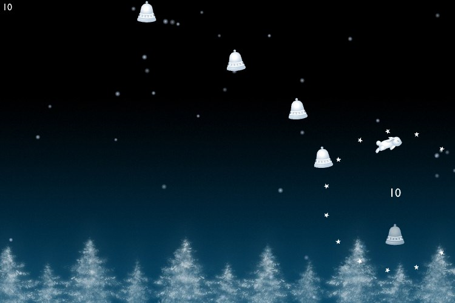

<figure>
    
    <figcaption>Winterbells: the hare jumps from bell to bell.</figcaption>
</figure>

<b>Go to the Game</b>: <a href="http://www.ferryhalim.com/orisinal/g3/bells.htm" rel="nofollow">www.ferryhalim.com</a>
<b>Task</b>: Jump at as many bells / pigeons with your arctic hare as possible
<b>How to play</b>: The arctic hare jumps automatically. You choose the direction in which he jumps / flies with your mouse.
<b>My Record</b>: 44,960

If you thought that was good, just watch this video:
<iframe title="YouTube video player" width="512" height="414" src="//www.youtube.com/embed/mcrMDeeERks?rel=0&amp;hd=1" frameborder="0" allowfullscreen></iframe>
