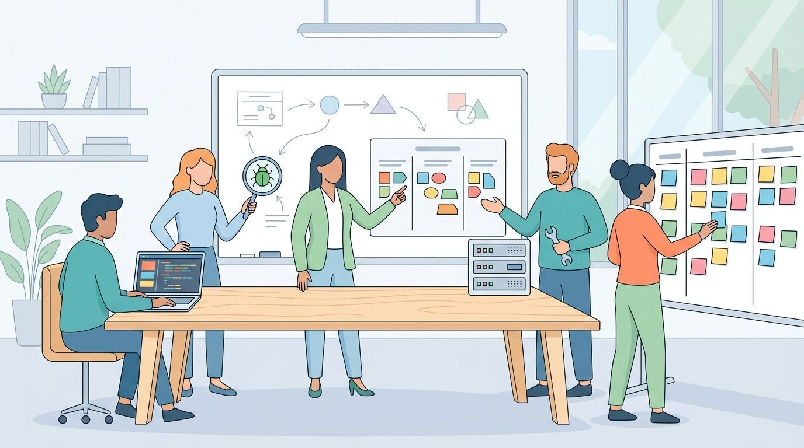

Software development is a huge industry. Naturally, there are many
specializations which makes it difficult for outsiders and freshmen to
understand this topic.

A work process called <a href="https://en.wikipedia.org/wiki/Scrum_(software_development)">Scrum</a>
distinguishes three roles (the [Scrum Guide](https://scrumguides.org/scrum-guide.html)
calls them accountabilities):

* Developers (until 2020: Development Team): Writing Code
* Product Owner: Voice of the customer; prioritizes features
* Scrum Master: Helps to remove impediments; supports

In practice, companies rarely hire just "a developer". At the very least they
focus on some of the core languages important for the company (often Java,
JavaScript, PHP, C++, or Python). And most of the time they distinguish between
some technical roles.

<figure class="ai-generated">
    
    <figcaption>Different roles in a software team.</figcaption>
</figure>

## Technical Roles

All technical roles are software engineers with some form of specialization.
I looked at the first 30 results of <a href="https://de.indeed.com/Devops-Engineer-Jobs">indeed.com</a>
to see what the current expectations are for those roles (2019-07-14).

What almost every technical role has:

* Fluent in English, German is a plus (sometimes required)
* Team Player
* Agile Development (most of the time Scrum)

### DevOps Engineer

Typical Skillset:

* 16x Docker
    * 1x Docker host
* 9x CI /CD: e.g. Azure DevOps
* 10x Ansible
* 10x Python
* 10x Linux
* 10x Git-Service: GitLab (GitLab CI) / Bitbucket / GitHub
* 7x container orchestration: Kubernetes (OpenShift)
* 7x Jenkins: e.g. build environment, setting up a continuous delivery pipeline
* 7x Bash (or other shell)
* 7x Git
* 6x Cloud: AWS / Azure / Profitbricks
* 6x Java
* 4x Puppet
* 4x Jira
* 4x Terraform
* 4x ELK
* 3x Chef
* Monitoring:
    * 4x Grafana
* 4x Kafka
* 3x npm
* 3x yarn
* 3x IAC (infrastructure as code)
* 3x Prometheus
* 3x Windows
* 2x Pipeline as code, pipeline management
* 2x Confluence
* 2x Ruby
* 2x Unit Testing
* Perl
* Kinesis
* Go
* Maven
* Virtual Machines
* CloudFormation
* Kibana
* Networking: DNS, DHCP, firewall, load balancing
* Orchestration Tools: Mesos, Chronos, Marathon
* Databases:
    * 4x Elasticsearch
    * 4x SQL (relational databases)
    * 4x MySQL
    * 2x PostgreSQL
    * MS SQL
    * neo4j
* logstash, graphite, influxDB
* 3x Node.js
* Luigi: Workflow orchestration
* RabbitMQ
* AMQP
* Logging, monitoring, analysis, notification and incident management
* DevOps mindset (you build it, you run it)

Shared role with:

* System Administrator (Sysadmin)
* Machine Learning
* SRE

### Frontend, Backend and Full-Stack Developers

The most common split is by the part of the system:

* **Frontend:** everything that runs in the browser or app: HTML, CSS,
  JavaScript/TypeScript, a framework like React, Angular or Vue, accessibility,
  performance in the browser.
* **Backend:** APIs, business logic, databases, authentication, integration of
  other services. Typical languages are Java, C#, Python, Go, PHP and Node.js.
* **Full-stack:** both. In small companies the norm, in big ones often a
  generalist who can fill gaps.

Mobile developers (iOS with Swift, Android with Kotlin, or cross-platform with
Flutter or React Native) are a specialization of their own.

### Quality Assurance (QA)

QA engineers make sure the software does what it should, before customers
notice that it doesn't. The role ranges from manual testing to writing test
automation:

* Writing test plans and test cases from the requirements
* Exploratory testing: trying to break the software like a curious user would
* Test automation: end-to-end tests with Selenium, Playwright or Cypress, API
  tests, load tests
* Maintaining test environments and test data
* Reporting bugs so that developers can reproduce them

In many agile teams, developers write the unit and integration tests themselves,
and QA focuses on end-to-end tests, exploratory testing and the test strategy.
The title then often is "Software Development Engineer in Test" (SDET) or "Test
Automation Engineer".

### Site Reliability Engineer (SRE)

The role comes from Google: "SRE is what happens when you ask a software
engineer to design an operations team"
([Site Reliability Engineering](https://sre.google/sre-book/introduction/), the
book by Google). SREs are responsible for availability, latency, performance
and capacity of production systems, and they solve operational problems with
code instead of manual work.

Typical tasks and concepts:

* Service level objectives (SLOs): for example "99.9 % of requests succeed
  within 300 ms"
* Error budgets: if the SLO is met with room to spare, the team may ship faster
  and take more risks; if not, reliability work comes first
  ([Embracing Risk](https://sre.google/sre-book/embracing-risk/))
* Monitoring and alerting, on-call duty, incident response and blameless
  postmortems
* Reducing "toil": repetitive manual work that can be automated

The skillset overlaps strongly with the DevOps engineer above. DevOps is more
of a culture and a set of practices; SRE is one concrete way to implement it.

### Other Technical Roles

* **Data Engineer:** builds the pipelines that collect, clean and store data
  (SQL, Spark, Airflow, Kafka).
* **Data Scientist / Machine Learning Engineer:** analyzes data and builds
  models; the ML engineer brings them into production.
* **Security Engineer:** threat modeling, code reviews and penetration tests
  for security, incident response.
* **Software Architect:** decisions about the structure of bigger systems that
  are expensive to change later.

## Soft Roles

### Product Owner (PO)

This is a role defined in Scrum. The tasks of a product owner (PO) are:

* Management of product backlog:
    * Items in the backlog have to have a priority-order
    * Every team member has to understand the items of the backlog.
* Responsible for the product
* Talks with Stakeholders / Management
* Accepts finished work: in many teams, the PO decides whether an item may move
  from "In Review" to "Done" (Scrum itself only requires a shared Definition of
  Done).

### Scrum Master (SM)

What the scrum master is:

* **Supporter**: Supports the team by removing obstacles. This can be as simple
  as making sure the team has a place to work, the equipment and permissions to
  work.
* **Talker**: Moderates scrum meetings, makes sure information between PO and
  the team flows.
* **Protector**: Protects the team from interference during the sprint

What the scrum master isn't:

* Team lead: The scrum master does not tell which work to do or in which way it
  should be done
* Team member: The scrum master is not actively developing
* PO

Tools:

* Product Backlog
* Sprint Backlog
* Burndown Chart

### Project Manager

A project manager is responsible for delivering a project on time, within
budget and in the agreed scope. The classic tasks:

* Planning: scope, milestones, schedule, budget
* Coordinating people and teams, also outside of development (legal,
  marketing, customers)
* Tracking progress and risks, reporting to stakeholders
* Managing changes of scope

In Scrum, there is no project manager: the PO owns the "what", the developers
plan the "how", and the Scrum Master takes care of the process. In practice,
project managers still exist in many companies, especially for projects with a
fixed deadline, a fixed price or several teams. Other roles nearby:

* **Engineering Manager / Team Lead:** responsible for the people: hiring,
  feedback, career development. Often still technical.
* **Tech Lead:** responsible for technical decisions of a team, usually without
  personnel responsibility.
* **Product Manager:** like a PO, but with a broader view: market, strategy,
  pricing. In many companies, the PO is the product manager's role within Scrum.
