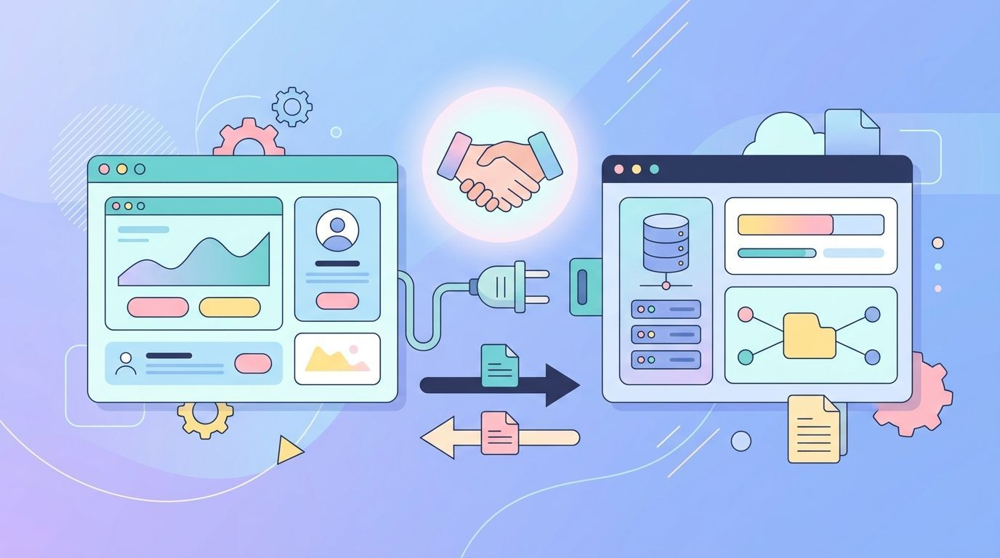

When different programs or services have to interact, there has to be an
interface to let them do so. A common language, so to say. Commonly, those
interfaces are called APIs — application programming interfaces.


<figure class="ai-generated">
    <a href="../images/2020/01/apis.jpg"></a>
    <figcaption>An API lets programs talk to each other.</figcaption>
</figure>

An API is a contract: which operations exist, what they expect and what they
return. Everything behind the interface may change, as long as the contract
holds. That is what makes APIs so valuable: the two sides can be developed,
deployed and replaced independently.


## Library APIs

The most common APIs don't involve a network at all. When you call
`json.loads(text)` in Python, you use the API of the `json` module: a function
name, parameters, a return value and the exceptions it may raise. The
documentation, the type hints and the promise not to break it in a minor
release are part of the API, too. Semantic versioning exists mainly to
communicate changes of library APIs.

Operating systems have APIs as well: system calls, the Windows API, POSIX.


## Web APIs

In this article, a web API is any API that is used over the network, usually
over HTTP.

### REST

REST APIs are probably the most widespread type of API. I don't want to
write more in this article about them, because I already wrote <a href="../rest/">an article about REST</a>.
In short: resources have URLs, and the HTTP methods `GET`, `POST`, `PUT`,
`PATCH` and `DELETE` act on them. An [OpenAPI](https://spec.openapis.org/oas/latest.html)
document describes such an API in a machine-readable way, so documentation and
client code can be generated from it.

### GraphQL

In many ways similar to REST, but more flexible. There is a single endpoint,
and the client sends a query that says exactly which fields it wants
([graphql.org](https://graphql.org/learn/)):

```text
query {
  user(id: "42") {
    name
    posts(last: 3) {
      title
    }
  }
}
```

The answer has the same shape as the query. One request replaces several REST
calls, and the client doesn't get fields it doesn't need. The price is more
complexity on the server: caching is harder, and a careless query can be very
expensive to answer.

### RPC

RPC is short for "remote procedure call": the client calls a function on the
server as if it were local. There is XML-RPC and JSON-RPC. A
[JSON-RPC](https://www.jsonrpc.org/specification) request looks like this:

```json
{"jsonrpc": "2.0", "method": "subtract", "params": [42, 23], "id": 1}
```

XML-RPC is simpler than SOAP: it has a handful of data types and no schema
language.

[gRPC](https://grpc.io/docs/what-is-grpc/introduction/) is the modern variant
from Google. The interface is defined in Protocol Buffers, and code for client
and server is generated from it:

```text
service Greeter {
  rpc SayHello (HelloRequest) returns (HelloReply) {}
}
```

gRPC uses HTTP/2 and a compact binary format. It is popular for communication
between services inside a company, less so for public APIs, because browsers
can't use it directly.

### SOAP

[SOAP](https://www.w3.org/TR/soap12/) sends XML messages, usually over HTTP, and
describes the interface in a WSDL file. I'm not sure how widespread this still
is for new projects. I have the impression that it is mainly used in older
enterprise software, for example in the Java and .NET worlds, by banks and in
public administration, where the strict contracts and the existing tooling are
valued.

### WebSockets and Webhooks

REST, GraphQL and RPC follow the request–response pattern: the client asks, the
server answers. Two other patterns are common:

* **[WebSockets](https://developer.mozilla.org/en-US/docs/Web/API/WebSockets_API)**
  keep a connection open in both directions. The server can push messages, which
  is what chats, live dashboards and multiplayer games need.
* **Webhooks** turn the direction around: you give a service a URL, and it sends
  an HTTP request to it when something happens, for example when a payment
  arrived or a commit was pushed.


## What makes a good API

* **Consistency.** Names, error formats, pagination and date formats are the same
  everywhere.
* **Good error messages.** Machine-readable error codes plus a text a developer
  understands.
* **Documentation with examples.** Most developers copy the first example and
  modify it.
* **Versioning.** Breaking changes are announced and old versions keep working
  for a while.
* **Security.** Authentication, authorization per object and rate limiting.


## User Interfaces

There are two interesting special cases: Command-line interfaces (CLIs) and
graphical user interfaces (GUIs). They are designed for humans, not for
applications. But, of course, you can also use them. Bash scripting is
basically using CLIs all the time. GUIs can be automated, too (for example with
Selenium for browsers), but that breaks with every redesign: a user interface
doesn't promise to stay stable, an API does.
