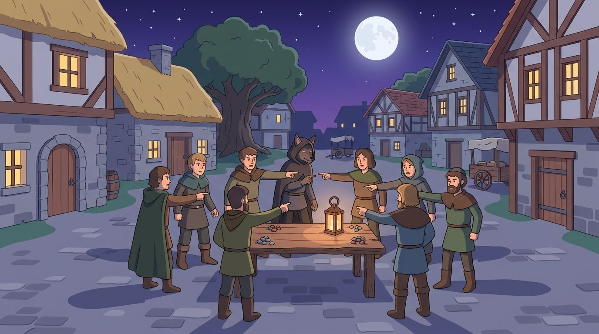

Werewolf is a game for a group of at least 4 people. You have at least one
werewolf and several villagers. The werewolves try to kill the villagers and
the villagers try to kill the werewolves. It is round-based and the villagers
don't know who the werewolves are.

In the villagers round (the day), everybody tries to figure out who one
werewolf is. The villagers and the werewolves then vote whom to kill. Imagine a
lynching mob. They might accidentally hit a villager, too.

At night, the werewolves kill one villager. As they know each other, they are
guaranteed to hit a villager.

Besides mistakes from the werewolves, this is a game of chance. In the
following, $p_v$ is the probability of villagers to win and $p_w = 1 - p_v$ is
the probability of werewolves to win. The werewolves win as soon as there are at
least as many werewolves as villagers, because then they control the vote.

The model is deliberately simple: the villagers have no information, so the
lynch hits a random player. Every real game is better than that for the
villagers, so the numbers below are a lower bound for them.


<figure class="ai-generated">
    <a href="../images/2020/03/werewolf.jpg"></a>
    <figcaption>Werewolf: villagers against hidden wolves.</figcaption>
</figure>

## One Werewolf, no special roles

If there is only one werewolf and one villager left, the werewolf is guaranteed
to win: 1 werewolf, 1 villager $\Rightarrow p_w = 1$ and $p_v = 0$.

If there are two villagers, they basically choose at random. Hence they have
1/3 chance to directly win. If they kill a villager, we are in the situation
from above. This means: 1 werewolf, 2 villagers $\Rightarrow p_w = 2/3$ and $p_v = 1/3$.

In general, let $p_w^{(n)}$ be the probability that the werewolf wins if a day
starts with $n$ villagers. The lynch hits the werewolf with probability
$\frac{1}{n+1}$. Otherwise a villager dies at day and another one at night, and
the next day starts with $n - 2$ villagers:

$$p_w^{(n)} = \left(1 - \frac{1}{n + 1}\right) \cdot p_w^{(n-2)} = \frac{n}{n+1} \cdot p_w^{(n-2)}$$

with $p_w^{(1)} = 1$ and $p_w^{(0)} = 1$. This gives

* 3 villagers: $p_v = \frac{1}{4}$
* 4 villagers: $p_v = \frac{7}{15} \approx 0.47$
* 5 villagers: $p_v = \frac{3}{8}$
* 6 villagers: $p_v = \frac{19}{35} \approx 0.54$

Two things are interesting. First, an even number of villagers is better for
them than the next odd number. Every round removes two villagers. With an even
number, the last day starts with 2 villagers and the werewolf: a vote among
three, a 1/3 chance. With an odd number, the last day starts with 3 villagers
(a vote among four, a 1/4 chance), and if it fails, the night leaves one
villager and one werewolf. Second, the werewolf's chance shrinks only slowly: it
falls roughly with $1/\sqrt{n}$, so even with 20 villagers, a werewolf without
any skill wins about every fourth game.


## More werewolves

With $w$ werewolves and $v$ villagers, the lynch hits a werewolf with
probability $\frac{w}{w+v}$. The recursion is easiest to compute with a few
lines of Python:

```python
from fractions import Fraction
from functools import lru_cache


@lru_cache(maxsize=None)
def p_villagers(wolves: int, villagers: int) -> Fraction:
    """Probability that the villagers win; a day starts."""
    if wolves == 0:
        return Fraction(1)
    if wolves >= villagers:
        return Fraction(0)
    players = wolves + villagers
    return Fraction(wolves, players) * night(wolves - 1, villagers) + Fraction(
        villagers, players
    ) * night(wolves, villagers - 1)


def night(wolves: int, villagers: int) -> Fraction:
    if wolves == 0:
        return Fraction(1)
    if wolves >= villagers:
        return Fraction(0)
    return p_villagers(wolves, villagers - 1)
```

Probability that the villagers win:

| Villagers | 1 werewolf | 2 werewolves | 3 werewolves |
| --------: | ---------: | -----------: | -----------: |
| 2 | 33 % | 0 % | 0 % |
| 3 | 25 % | 13 % | 0 % |
| 4 | 47 % | 8 % | 6 % |
| 5 | 38 % | 23 % | 3 % |
| 6 | 54 % | 16 % | 11 % |
| 7 | 45 % | 30 % | 7 % |
| 8 | 59 % | 22 % | 16 % |
| 9 | 51 % | 35 % | 11 % |
| 10 | 63 % | 26 % | 21 % |
| 12 | 66 % | 30 % | 25 % |
| 15 | 61 % | 46 % | 20 % |
| 20 | 73 % | 42 % | 35 % |

Without information, the villagers need many more players than the werewolves
to have a fair chance. That is why real games add special roles like the seer,
who learns the identity of one player per night: they turn the random lynch
into an informed one.


## Note

If you like social deduction games, then Blood on the Clocktower might also interest you.
