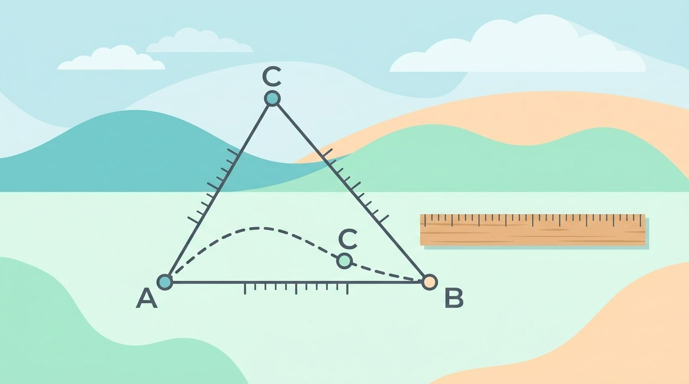

I was recently thinking a lot about metrics and properties metrics have. Let's
summarize them. "Metric" here means the mathematical concept of a distance
function, not a key performance indicator.

<figure class="ai-generated">
    
    <figcaption>Metrics measure distance and obey the triangle inequality.</figcaption>
</figure>

<dl>
    <dt>Metric</dt>
    <dd>Let $X$ be an arbitrary set. A function $d: X \times X \rightarrow \mathbb{R}$ is called a metric on $X$, iff
        the following properties hold true:
        <ul>
            <li>identity of indiscernibles: $\forall x, y \in X: d(x, y) = 0 \Leftrightarrow x = y$</li>
            <li>symmetry: $\forall x, y \in X: d(x, y) = d(y, x)$</li>
            <li>triangle inequality: $\forall x, y,z \in X: d(x, z) \leq d(x,y) + d(y, z)$</li>
        </ul>
    </dd>
</dl>

## Properties of Metrics

<dl>
    <dt>Non-Negativity ($d(x, y) \ge 0 \forall x, y \in X$)</dt>
    <dd>
        \begin{align}
            d(x, y) + d(y, x) \ge d(x, x) & \text{ by triangle inequality}\\
            \Leftrightarrow d(x,y) + d(x,y)   \ge d(x, x) & \text{ by symmetry}\\
            \Leftrightarrow 2d(x,y)           \ge 0       & \text{ by identity of indiscernibles}\\
            \Leftrightarrow  d(x,y)           \ge 0
        \end{align}
    </dd>
    <dt>Additivity</dt>
    <dd>If $d_1 : X \times X \rightarrow \mathbb{R}$ and $d_2 : X \times X \rightarrow \mathbb{R}$ are
        metrics, then $d_3 : X \times X \rightarrow \mathbb{R}$ with $d_3(x, y) := d_1(x,y) + d_2(x, y)$
        is a metric as well.</dd>
</dl>

## Common metrics

Every norm $\| \cdot \|$ induces a metric:

$$d(x, y) := \|x - y\|$$

This includes all p-norms:

* $p=1$: [Taxicab metric](https://en.wikipedia.org/wiki/Taxicab_geometry)
* $p=2$: [Euclidean metric](https://en.wikipedia.org/wiki/Euclidean_distance)
* $p=\infty$: [Maximum metric](https://en.wikipedia.org/wiki/Chebyshev_distance)
