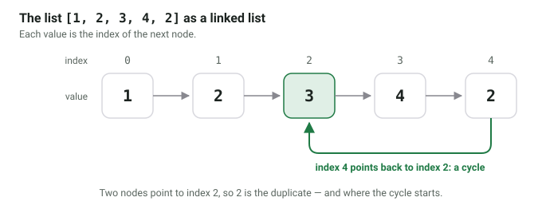

[Floyd's cycle-detection algorithm](https://en.wikipedia.org/wiki/Cycle_detection#Floyd's_Tortoise_and_Hare)
uses two pointers. Those two pointers are sometimes called *tortoise* and
*hare*. The tortoise is slow and just moves one step at a time. The hare is
fast and moves two steps at a time. If there is a loop, the hare enters it
first and runs in circles until the tortoise arrives. From then on, the hare
gets one step closer to the tortoise with every move, so they have to meet.

```python
from typing import Optional


class Node:
    def __init__(self, val):
        self.val = val
        self.next: Optional["Node"] = None


def find_meeting_point(head: Node) -> Optional[Node]:
    """Return a node inside the loop, or None if there is no loop."""
    slow = head
    fast = head
    while fast and fast.next:
        slow = slow.next
        fast = fast.next.next
        if slow is fast:
            return slow
    return None
```

The meeting point is somewhere in the loop, but not necessarily where the loop
starts. A second phase finds the start: put one pointer back to the head, leave
the other one at the meeting point and move both one step at a time. They meet
at the first node of the loop.

```python
def find_loop_start(head: Node) -> Optional[Node]:
    meeting = find_meeting_point(head)
    if meeting is None:
        return None
    pointer = head
    while pointer is not meeting:
        pointer = pointer.next
        meeting = meeting.next
    return pointer
```

Why does this work? Let $\mu$ be the number of steps from the head to the start
of the loop and $\lambda$ the length of the loop. When they meet, the tortoise
went $t$ steps and the hare $2t$ steps. The hare went around the loop some
whole number of times more, so $t$ is a multiple of $\lambda$. The tortoise is
$t - \mu$ steps into the loop. Going $\mu$ more steps brings it to position $t$,
which is a multiple of $\lambda$: exactly the start of the loop. The pointer
from the head needs the same $\mu$ steps to get there.

This is pretty nice as it needs $\mathcal{O}(1)$ additional space and has a
time complexity of $\mathcal{O}(n)$. The obvious alternative, storing all
visited nodes in a set, needs $\mathcal{O}(n)$ additional space.

You can also use this for various competitive coding tasks if you are given an
unsorted array of $n$ numbers where the values are guaranteed to be in 1 to
$n$.

## Duplicate Number finding

> Given is an array with n+1 numbers, each being in the range 1 to n.
> There is one number appearing multiple times (could be more than twice).
> Find that number.

See [Leetcode 287](https://leetcode.com/problems/find-the-duplicate-number/solution/)

You can interpret the list of numbers as a linked list: index $i$ is a node, and
the value `nums[i]` is the index of the next node. We start at index 0. As no
value is 0, nothing points back to index 0, and as there are more indices than
distinct values, two nodes point to the same next node: the duplicate is where
the loop starts.

For example, the list `[1, 2, 3, 4, 2]` represents the graph below:

<figure>
    <a href="../images/2020/05/singly-linked-list.svg"></a>
    <figcaption>Graph represented by the list [1,2,3,4,2]</figcaption>
</figure>

The number `2` is the duplicate here. With the same two phases, we can find it
in $\mathcal{O}(n)$ with $\mathcal{O}(1)$ additional space, without modifying
the list:

```python
from typing import List


def find_duplicate(nums: List[int]) -> int:
    # Phase 1: find a meeting point inside the loop
    slow = 0
    fast = 0
    while True:
        slow = nums[slow]
        fast = nums[nums[fast]]
        if slow == fast:
            break

    # Phase 2: find the start of the loop
    slow = 0
    while slow != fast:
        slow = nums[slow]
        fast = nums[fast]
    return slow


assert find_duplicate([1, 2, 3, 4, 2]) == 2
assert find_duplicate([3, 1, 3, 4, 2]) == 3
assert find_duplicate([2, 2, 2, 2, 2]) == 2
```

Both pointers have to start at the same node in both phases. If the second
phase starts at `nums[0]` instead of `0`, the pointers are one step out of sync
and can circle forever.
