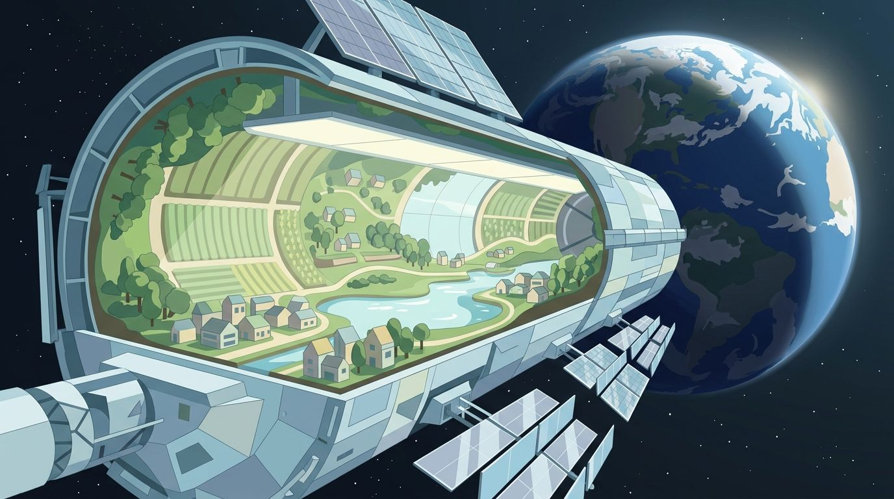

Having a permanent colony in space where people can live their whole life is
an interesting thought. There are multiple potential ways to get there and I
would like to outline some of the ideas and their drawbacks.

A colony is self-sustaining if it can survive without contact with Earth. One big
factor is to have a **minimum viable population**. The size of this is
estimated to be somewhere between 80[^1] and 44,000[^2]. Other big factors
are the ability to protect against harmful environmental factors, to reproduce
biologically and the equipment. This means not only being able to repair
equipment, but also to produce all equipment by resources one can reach.

<figure class="ai-generated">
    
    <figcaption>A self-sustaining space colony (O'Neill cylinder).</figcaption>
</figure>

## Needs

A self-sustaining colony needs to have air and water. It needs to be able to grow food.
It needs to have energy.

### Energy

Solar power is certainly a sustainable solution. Nuclear energy would be
another potential solution.

### Air

Humans need oxygen and breathe out carbon dioxide (CO₂), which has to be
removed. The ISS does both with machines (Air Revitalization System and Oxygen Generation System)[^3]:

* **Electrolysis**: Electricity from the solar panels splits water into
  oxygen and hydrogen. The oxygen goes into the cabin.
* **CO₂ reduction**: A [Sabatier reactor](https://en.wikipedia.org/wiki/Sabatier_reaction)
  combines the hydrogen with the exhaled CO₂ to water and methane. The water
  goes back into the electrolysis, the methane is vented into space. Some
  hydrogen is lost this way, so the loop is not fully closed.

Plants do the same with sunlight: they take up CO₂ and release oxygen. A
colony could use plants or algae instead of (or in addition to) machines. That
is harder than it sounds: in [Biosphere 2](https://en.wikipedia.org/wiki/Biosphere_2),
a sealed ecosystem in Arizona, the oxygen fell from 20.9% to 14.5%. Soil
microbes consumed oxygen, and the fresh concrete absorbed the CO₂ they
produced, so nobody noticed it at first[^4].

On the Moon and on Mars, oxygen can also come from local resources (see below).

### Water

Recycling works well, but it took a long time: since 2023, the ISS recovers
98% of the water from urine, sweat and air humidity[^5]. The remaining
2%, and all water for growing plants, must come from somewhere. Without
supplies from Earth, that means local ice:

* **Moon**: In 2009, NASA crashed the upper stage of the LCROSS mission into
  the permanently shadowed crater Cabeus at the lunar south pole. The ejected
  material contained water[^6].
* **Mars**: There is water on Mars, mostly as ice (see below).

### Food

Three concepts are being tested:

* **Plants**: The ISS has a small plant growth system called Veggie. In August
  2015, astronauts ate lettuce grown on the station for the first time[^7].
* **Closed ecosystems with animals**: In the Chinese experiment
  [Yuegong-1](https://en.wikipedia.org/wiki/Yuegong-1) (Lunar Palace 1), two
  teams of four volunteers lived 370 days (2017-2018) in a sealed habitat in
  Beijing. They ate plants they grew and mealworms, which were fed with the
  inedible parts of the plants[^8].
* **Synthetic food**: The Finnish company Solar Foods lets microbes produce a
  protein powder (Solein) from CO₂, hydrogen and electricity. It needs neither
  soil nor sunlight. The ESA funds a project to test it in weightlessness[^9].

### Habitation

Habitation needs to provide some basics to make it possible for humans to
survive:

* Radiation protection
* Gravitation
* Temperature between 10°C to 30°C

Cosmic radiation causes cancer and kills life. On Earth, the magnetic field
protects us.

If you build thick enough walls, probably any material can protect from
radiation. But the material matters: aluminum, the typical material for
spacecraft, is a poor shield against cosmic rays. Materials with a lot of
hydrogen, like polyethylene, need much less mass for the same protection[^10].
The 1975 NASA/Stanford design study needed 4.4&thinsp;t of lunar soil per m²
(441&thinsp;g/cm²) to keep the dose below 2.5&thinsp;mSv per year[^11].
On Mars, more than 3&thinsp;m of regolith are needed to stay below the safety
limits[^12]. For comparison: the air above us has a mass of about
10&thinsp;t per m² (that's what 1&thinsp;bar air pressure means).

Water can protect from radiation. Due to its hydrogen, it is a better shield
than aluminum: 10&thinsp;cm of water (10&thinsp;g/cm²) reduce the dose from
galactic cosmic rays on Mars by about a third, from 297 to 199&thinsp;µGy per
day[^12]. To have the same mass as the shield of the NASA study, you
would need a 4.4&thinsp;m thick layer of water, as 1&thinsp;m³ of water
weighs 1&thinsp;t. Because water is the better shield, probably a bit less
would do. A nice side effect: the colony needs large water reserves anyway, so
they could be stored in the walls.

## Space Stations

Building a big station in space is the option where you might be able to see
most progress with the [International Space
Station](https://en.wikipedia.org/wiki/International_Space_Station) (ISS).
However, the ISS has a mass of about 450&thinsp;t, a length of 109&thinsp;m and
a width of 73&thinsp;m. Usually, seven people live on it. Even the
smallest population size for a permanent settlement assumes 80 people. This means
we have to go way bigger.

Launches have become much cheaper. Bringing one kilogram to low Earth orbit cost
about 65,400&thinsp;USD with the Space Shuttle, about 2,600&thinsp;USD with a
Falcon 9 and about 1,500&thinsp;USD with a Falcon Heavy (in 2021 dollars)[^13].
Even at the Falcon 9 price, only launching the material of the ISS would cost
about 1.2 billion USD. The Stanford torus (see below) would need 10 million
tonnes: about 26 trillion USD for the launches alone. Building any of the
proposals for permanent settlement by bringing material from Earth to space is
completely unrealistic. This means we either have to mine materials from the
moon or from asteroids.

Other problems all of the space station designs have to deal with:

* [microgravity](https://en.wikipedia.org/wiki/Micro-g_environment): The human
  body did not evolve to be in micro-g environments. Using centrifugal forces
  to mimic gravitation could be possible.
* Radiation: One could put the space stations close enough to Earth to benefit
  from its magnetic field.

Such a big space station is similar to a [generation ship](https://en.wikipedia.org/wiki/Generation_ship).

### Bernal sphere

The [Bernal sphere](https://en.wikipedia.org/wiki/Bernal_sphere) is a design
proposed by [John Desmond Bernal](https://en.wikipedia.org/wiki/J._D._Bernal)
in 1929 for a space habitat capable of housing 20,000 to 30,000 permanent residents.

### Stanford torus

The [Stanford torus](https://en.wikipedia.org/wiki/Stanford_torus) is a
proposed NASA design from 1975 for a space habitat capable of housing 10,000 to
140,000 permanent residents.

The total mass would be 10 million tons.

The movie [Elysium](https://en.wikipedia.org/wiki/Elysium_(film)) contains a
Stanford torus.

### O'Neill cylinder / Island Three

The [O'Neill cylinder](https://en.wikipedia.org/wiki/O%27Neill_cylinder) (Island Three) is
a design proposed by [Gerard K. O'Neill](https://en.wikipedia.org/wiki/Gerard_K._O%27Neill)
in 1976 for a space habitat capable of housing several million people[^14].

## Asteroids

Asteroids are interesting as a quarry rather than as a home. Material from a
near-Earth asteroid can need less energy (delta-v) to bring to a space station
than material lifted from the surface of the Moon, but the trips take much
longer ([asteroid mining](https://en.wikipedia.org/wiki/Asteroid_mining)). The
three main types offer different resources:

* **C-type** asteroids are rich in carbon and contain water bound in minerals:
  water to drink, oxygen to breathe and hydrogen for rocket fuel.
* **S-type** asteroids are stony, with silicates and some iron and nickel.
* **M-type** asteroids are mostly metal, iron and nickel.

So far, we have brought back grams, not tonnes:
[Hayabusa2](https://en.wikipedia.org/wiki/Hayabusa2) returned 5.4&thinsp;g from
the asteroid Ryugu in 2020, [OSIRIS-REx](https://en.wikipedia.org/wiki/OSIRIS-REx)
about 122&thinsp;g from Bennu in 2023. The
[Psyche](https://en.wikipedia.org/wiki/Psyche_(spacecraft)) probe, launched in
2023, will reach the metallic asteroid 16 Psyche in 2029.

Living *on* an asteroid has the problems of a space station: there is almost no
gravity. On Ryugu, it is about 0.1&thinsp;mm/s², so a jump would end in space.
One idea is to hollow out an asteroid and use the rock as a radiation shield.
Spinning it for artificial gravity is hard, though: Ryugu and Bennu are
[rubble piles](https://en.wikipedia.org/wiki/Rubble_pile), loose heaps of rock
held together only by their weak gravity, and they would fly apart.

## The Moon

The moon cannot have an atmosphere[^15].

The communication with Earth would be delayed between 1.2 and 1.4 seconds.

The temperature ranges from −247 °C to 123 °C.

### Energy

A [lunar night](https://en.wikipedia.org/wiki/Lunar_day) takes about two weeks.
This means one needs batteries which can save energy that long or an alternative
energy source to solar energy.

### Air

It might be possible to create oxygen from moon dust[^16].

### Water

There seems to be water on the surface of the moon, but it's by no means
clear to me how much there is and how easy it is to access.[^17]

### Food

[Lunar soil](https://en.wikipedia.org/wiki/Lunar_soil) contains no organic
matter. In 2022, researchers grew thale cress (*Arabidopsis thaliana*) in soil
samples from Apollo 11, 12 and 17. The plants germinated and grew, but slowly,
and many showed signs of stress, similar to plants in salty soil or soil with
too much metal[^18]. So lunar soil can be used to grow plants, but it needs
treatment, or the plants grow without soil (hydroponics).

### Habitats

As the moon does not have an atmosphere, the habitats need to be air-tight.

Lunar dust is super fine, which has [adverse health effects](https://en.wikipedia.org/wiki/Adverse_health_effects_from_lunar_dust_exposure). This means the habitats need
an [airlock](https://en.wikipedia.org/wiki/Airlock) where the dust can be
cleaned away.

### Moon Village

The Moon Village is a concept presented in 2015 by the European Space Agency
(ESA). Despite the name, it is not a plan for houses and shops on the Moon. ESA
describes it as "neither a project nor a programme", but as an open invitation
to space agencies, companies and other parties to work together on the Moon:
with robots and astronauts, for science, for using local resources or even for
tourism[^19].

More concrete plans come from NASA's [Artemis program](https://en.wikipedia.org/wiki/Artemis_program)
and from the [International Lunar Research Station](https://en.wikipedia.org/wiki/International_Lunar_Research_Station)
(ILRS) of China and Russia, whose construction is planned to begin in 2031. In
April 2026, Artemis II flew four astronauts around the Moon, the first crewed
flight beyond low Earth orbit since Apollo 17 in 1972.

## Mars

The [colonization of Mars](https://en.wikipedia.org/wiki/Colonization_of_Mars)
is a fascinating thought which is shown in many different novels and movies.

It takes about nine months to bring humans to Mars[^20].

The [Mars atmosphere](https://en.wikipedia.org/wiki/Atmosphere_of_Mars) is
thin and consists mostly of carbon dioxide (CO₂)[^21]:

<table>
    <tr>
        <th></th>
        <th></th>
        <th>Earth</th>
        <th>Mars</th>
    </tr>
    <tr>
        <td>Atmosphere</td>
        <td>Surface pressure</td>
        <td>1014&thinsp;hPa</td>
        <td>6.4&thinsp;hPa (4.0 to 8.7&thinsp;hPa, depending on the season)</td>
    </tr>
    <tr>
        <td></td>
        <td>Nitrogen</td>
        <td>78.08%</td>
        <td>2.59%</td>
    </tr>
    <tr>
        <td></td>
        <td>Oxygen</td>
        <td>20.95%</td>
        <td>0.16%</td>
    </tr>
    <tr>
        <td></td>
        <td>CO₂</td>
        <td>0.04%</td>
        <td>95.1%</td>
    </tr>
    <tr>
        <td></td>
        <td>Argon</td>
        <td>0.93%</td>
        <td>1.94%</td>
    </tr>
    <tr>
        <td></td>
        <td></td>
        <td>Neon, Helium, Methane, Krypton, Hydrogen</td>
        <td>Carbon monoxide, water vapor, NO, Neon, Krypton, Xenon</td>
    </tr>
    <tr>
        <td>Surface gravity</td>
        <td></td>
        <td>1g</td>
        <td>0.38g</td>
    </tr>
    <tr>
        <td><a href="https://en.wikipedia.org/wiki/Sol_(day_on_Mars)">Night-duration</a></td>
        <td></td>
        <td>~12h</td>
        <td>~12h</td>
    </tr>
    <tr>
        <td>Communication Delay</td>
        <td></td>
        <td>min. 100ms</td>
        <td>3 min - 22.3 min; sometimes blocked by the sun</td>
    </tr>
    <tr>
        <td>Temperature</td>
        <td></td>
        <td>−9.2 °C to 39.5 °C in Tokyo (Extremes: -89.2 °C to 56.7 °C)</td>
        <td>−107 °C to 35 °C (see <a href="https://en.wikipedia.org/wiki/Climate_of_Mars">climate of Mars</a>)</td>
    </tr>
</table>

### Energy

Besides night, you can have dust storms on Mars which could take weeks[^22].
This means it is necessary to have an alternative.

### Air

Oxygen can be produced from the carbon dioxide of the atmosphere:

$$2 \text{CO}_2 \rightarrow  2 \text{CO} + \text{O}_2$$

[MOXIE](https://en.wikipedia.org/wiki/Mars_Oxygen_ISRU_Experiment), an
instrument on the Perseverance rover, showed that this works on Mars. From 2021
to 2023, it produced oxygen 16 times, 122&thinsp;g in total. At its best, it
made 12&thinsp;g per hour with a purity of at least 98%, twice as much as NASA's
goal[^23]. That is still tiny: 122&thinsp;g is about what a small dog breathes in
10 hours. The next step would be a full-scale plant that also liquefies and
stores the oxygen, mainly as rocket propellant for the flight home.

### Water

There is [water on Mars](https://en.wikipedia.org/wiki/Water_on_Mars)!

### Food

[Martian soil](https://en.wikipedia.org/wiki/Martian_soil#Toxicity) is toxic
due to relatively high concentrations of perchlorate compounds containing
chlorine.

## See also

* Daniel Suarez: [Delta-V](https://www.goodreads.com/en/book/show/40859000-delta-v)

## Footnotes

[^1]: Damian Carrington: ["Magic number" for space pioneers calculated](https://www.newscientist.com/article/dn1936-magic-number-for-space-pioneers-calculated/?ignored=irrelevant#.VBiC_XtDLwo) in [New Scientist](https://en.wikipedia.org/wiki/New_Scientist), 2002.
[^2]: [Cameron M. Smith](http://cameronmsmith.com/index.html): [Estimation of a genetically viable population for multigenerational interstellar voyaging: Review and data for project Hyperion](https://ui.adsabs.harvard.edu/abs/2014AcAau..97...16S/abstract) in [Acta Astronautica](https://en.wikipedia.org/wiki/Acta_Astronautica), 2014.
[^3]: [Environmental Control and Life Support System](https://www.nasa.gov/wp-content/uploads/2025/08/g-657270-59-hp-environmental-control-and-life-support-system-eclss.pdf) via NASA Marshall Space Flight Center, accessed 27.09.2026.
[^4]: J. P. Severinghaus, W. S. Broecker, W. F. Dempster, T. MacCallum, M. Wahlen: [Oxygen loss in Biosphere 2](https://ui.adsabs.harvard.edu/abs/1994EOSTr..75...33S/abstract) in Eos, 1994.
[^5]: [Status of ISS Water Management and Recovery](https://ntrs.nasa.gov/api/citations/20230006217/downloads/ICES%202023-097%20Status%20of%20ISS%20Water%20Management%20and%20Recovery.pdf) via NASA Technical Reports Server, 2023.
[^6]: [LCROSS](https://science.nasa.gov/mission/lcross/) via NASA Science, accessed 27.09.2026.
[^7]: [Lettuce in Space: Astronauts Enjoy Their Harvest](https://time.com/3991352/lettuce-space-station/) via Time, 10.08.2015.
[^8]: [Yuegong-1](https://en.wikipedia.org/wiki/Yuegong-1) via Wikipedia, accessed 27.09.2026.
[^9]: [Solar Foods to develop Solein® production technology for testing onboard the International Space Station](https://solarfoods.com/solar-foods-to-develop-solein-production-technology-for-testing-onboard-the-international-space-station/) via Solar Foods, accessed 27.09.2026.
[^10]: John W. Wilson, Francis A. Cucinotta, H. Tai, Lisa C. Simonsen, Judy L. Shinn, Shelia A. Thibeault, M. Y. Kim: [Galactic and Solar Cosmic Ray Shielding in Deep Space](https://ntrs.nasa.gov/api/citations/19980006777/downloads/19980006777.pdf), NASA Technical Paper 3682, 1997.
[^11]: Richard D. Johnson, Charles Holbrow (eds.): [Space Settlements: A Design Study, Appendix E: Mass Shielding](https://nss.org/settlement/nasa/75SummerStudy/5appendE.html), NASA SP-413, 1977.
[^12]: Dionysios Gakis, Dimitra Atri: [Modeling the effectiveness of radiation shielding materials for astronaut protection on Mars](https://arxiv.org/abs/2205.13786) via arXiv, 2024.
[^13]: Thomas G. Roberts: [Space Launch to Low Earth Orbit: How Much Does It Cost?](https://aerospace.csis.org/data/space-launch-to-low-earth-orbit-how-much-does-it-cost/) via CSIS Aerospace Security Project, 01.09.2022.
[^14]: [O’Neill Cylinder Space Settlement](https://space.nss.org/o-neill-cylinder-space-settlement/) on National Space Society.
[^15]: Martin Thoma: [Warum kann der Mond keine Atmosphäre haben?](../warum-kann-der-mond-keine-atmosphare-haben/), 2012.
[^16]: Erika K. Carlson: [Making air from Moon dust: Scientists create a prototype oxygen plant](https://astronomy.com/news/2020/01/how-to-make-air-from-moondust), 2020.
[^17]: Mike Wall: [Water Ice Confirmed on the Surface of the Moon for the 1st Time!](https://www.space.com/41554-water-ice-moon-surface-confirmed.html), 2018.
[^18]: Anna-Lisa Paul, Stephen M. Elardo, Robert Ferl: [Plants grown in Apollo lunar regolith present stress-associated transcriptomes that inform prospects for lunar exploration](https://www.nature.com/articles/s42003-022-03334-8) via Communications Biology, 12.05.2022.
[^19]: [Moon Village](https://www.esa.int/About_Us/Ministerial_Council_2016/Moon_Village) via ESA, accessed 11.10.2026.
[^20]: Craig C. Patten: [How long would a trip to Mars take?](https://web.archive.org/web/20041025234722/http://image.gsfc.nasa.gov/poetry/venus/q2811.html) via NASA IMAGE (archived), 2004.
[^21]: David R. Williams: [Mars Fact Sheet](https://nssdc.gsfc.nasa.gov/planetary/factsheet/marsfact.html) and [Earth Fact Sheet](https://nssdc.gsfc.nasa.gov/planetary/factsheet/earthfact.html) via NASA Space Science Data Coordinated Archive, accessed 11.10.2026.
[^22]: [How bad are the dust storms on Mars?](http://coolcosmos.ipac.caltech.edu/ask/77-How-bad-are-the-dust-storms-on-Mars-)
[^23]: [NASA's Oxygen-Generating Experiment MOXIE Completes Mars Mission](https://www.nasa.gov/missions/mars-2020-perseverance/perseverance-rover/nasas-oxygen-generating-experiment-moxie-completes-mars-mission/) via NASA, 06.09.2023.
