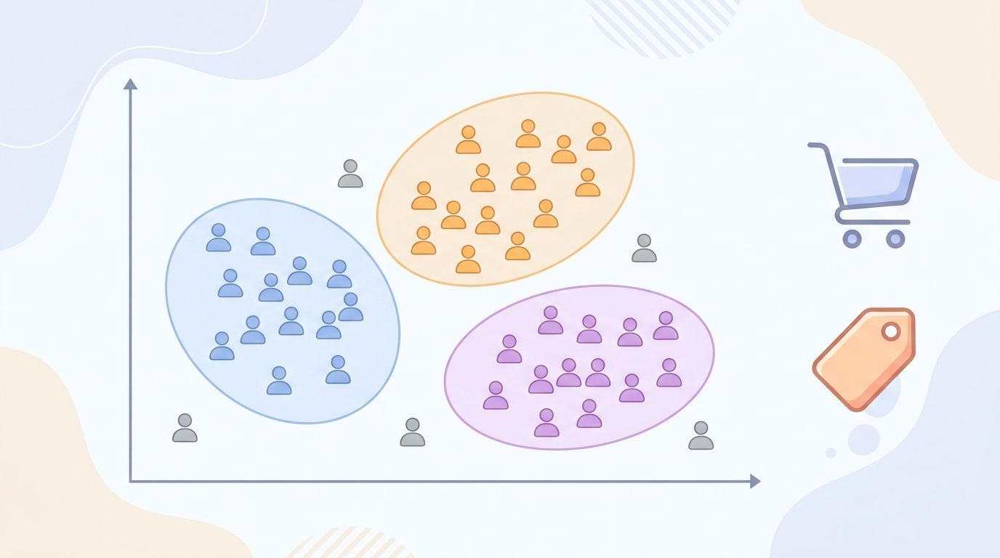

Customer segmentation is one form of clustering. It's a set of techniques that
group customers in segments that have something in common.

It's important to note that not every customer has to belong to one segment.
There might be outliers who don't belong to any group and you might model the
problem such that people can partially belong to multiple segments.

It is helpful to give the segments names. For example, if you cluster by age
and income, then the low-income+low-age group might be called "students".


<figure class="ai-generated">
    <a href="../images/2020/07/customer-segmentation.jpg"></a>
    <figcaption>Customer segmentation groups customers with something in common.</figcaption>
</figure>

## How it helps

* Tailor advertisements and products more specifically to the customer
* Optimizing sales-channel mix
* Find out which customers are about to leave and which ones are worth a
  special offer
* Plan the product: a segment that is big but badly served is an opportunity

An example where it was likely applied is Obama's election campaign (see "Brand Obama: How Barack Obama Revolutionized Political Campaign Marketing in the 2008 Presidential Election")[^1]: the campaign addressed groups of voters with
different messages, channels and requests for donations.


## Typical Features

Demographic information

* Age
* Income
* Gender
* Marital Status

Transactional information

* Products purchased
* \$ volume purchased
* \# items purchased
* Time of purchase

Geographic information

* Country
* Region
* City size
* Climate

Behavioral information (for online shops and apps)

* Visits per week
* Features used
* Support requests


## RFM: a simple start

A classic for shops is RFM analysis
([Wikipedia](https://en.wikipedia.org/wiki/RFM_%28market_research%29)). Every
customer gets three numbers:

* **Recency:** how many days since the last purchase?
* **Frequency:** how many purchases?
* **Monetary:** how much money in total?

Even without any machine learning, these three numbers give useful groups: "new
customers" (low recency, low frequency), "loyal customers" (high frequency),
"customers we are losing" (high frequency in the past, but high recency).

With pandas, you get them from a table of orders with the columns
`customer_id`, `date` and `amount`:

```python
import pandas as pd

orders = pd.read_csv("orders.csv", parse_dates=["date"])
now = orders["date"].max() + pd.Timedelta(days=1)
rfm = orders.groupby("customer_id").agg(
    recency=("date", lambda d: (now - d.max()).days),
    frequency=("date", "count"),
    monetary=("amount", "sum"),
)
```


## Clustering

To let an algorithm find the groups, k-means is the usual first try
([scikit-learn overview of clustering algorithms](https://scikit-learn.org/stable/modules/clustering.html)).
Two preparation steps matter more than the choice of algorithm:

* **Transform skewed features.** A few customers spend a hundred times more than
  the median. The logarithm keeps them from dominating.
* **Scale the features.** k-means uses the Euclidean distance; without scaling,
  the feature with the largest numbers decides everything.

```python
import numpy as np
from sklearn.cluster import KMeans
from sklearn.metrics import silhouette_score
from sklearn.preprocessing import StandardScaler

X = StandardScaler().fit_transform(np.log1p(rfm))

for k in range(2, 9):
    labels = KMeans(n_clusters=k, n_init=10, random_state=0).fit_predict(X)
    print(k, silhouette_score(X, labels))

rfm["segment"] = KMeans(n_clusters=4, n_init=10, random_state=0).fit_predict(X)
print(rfm.groupby("segment").mean())
```

The silhouette score (higher is better) helps to choose the number of segments,
but in practice the deciding question is whether the marketing or product team
can do something different for each segment. Four segments that lead to four
different actions are better than nine statistically perfect ones.

The mean values per segment are what you give names to: for example "recent,
frequent, high value" (champions) or "long ago, once, low value" (lost).

Alternatives to k-means:

* **Gaussian mixture models** give each customer a probability for each
  segment, so customers can partially belong to several segments.
* **DBSCAN** and **HDBSCAN** find the number of clusters themselves and mark
  outliers as noise.
* **Hierarchical clustering** shows how segments split into sub-segments.


## Pitfalls

* Segments change: re-run the analysis regularly and watch how customers move
  between segments.
* Clustering always finds clusters, even in random data. Check that the
  segments differ in something that matters, for example in how they react to
  a campaign.
* Be careful with sensitive attributes (gender, origin, health) and with what
  the GDPR allows you to do with the data.


## Technologies

* Pandas: Exploratory data analysis
* scikit-learn: [scaling, clustering and metrics](https://scikit-learn.org/stable/modules/clustering.html)
* A BI tool (for example Metabase or Power BI) to show the segments to the
  people who use them


## Footnotes

[^1]: Abigail Michaelsen: [Brand Obama: How Barack Obama Revolutionized Political Campaign Marketing in the 2008 Presidential Election](https://scholarship.claremont.edu/cmc_theses/990) via Claremont Colleges Scholarship, 2015.
