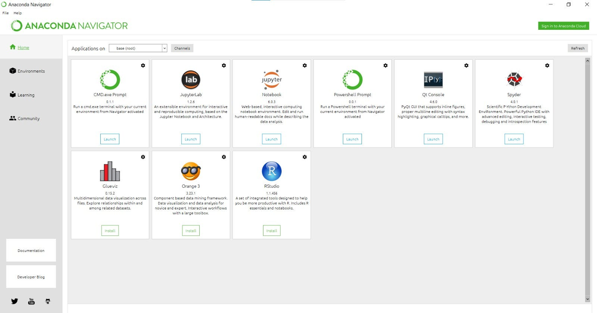
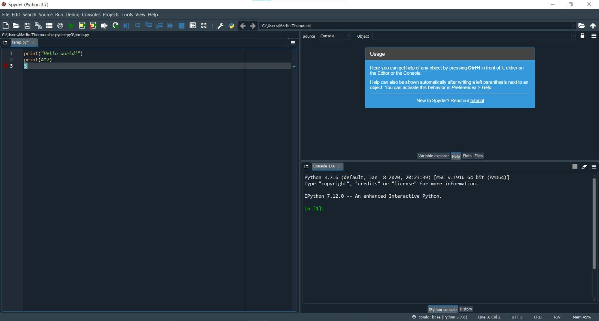
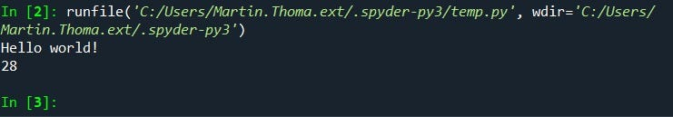
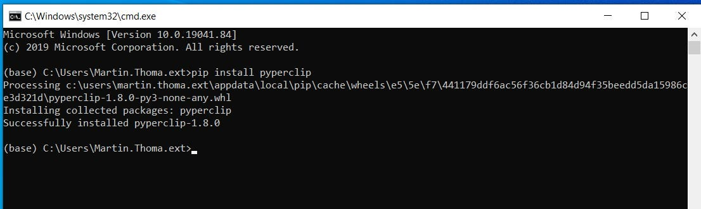
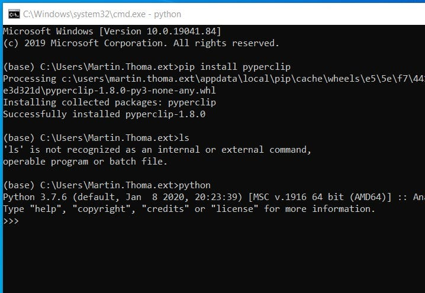
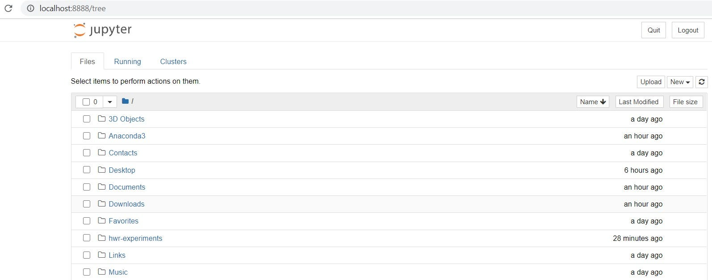
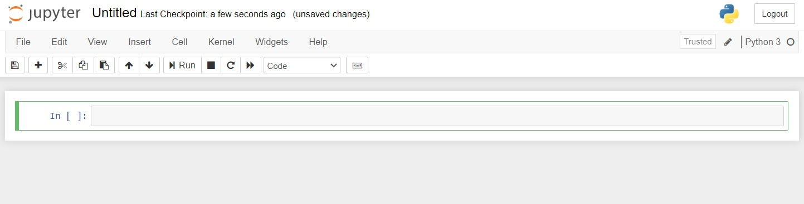
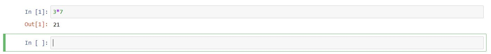

The Python programming language is used for [web development](https://blog.miguelgrinberg.com/post/the-flask-mega-tutorial-part-i-hello-world), [data analysis](https://www.udacity.com/course/intro-to-data-analysis--ud170), [machine learning](https://www.udacity.com/course/intro-to-machine-learning--ud120), [statistics](https://towardsdatascience.com/hypothesis-testing-in-machine-learning-using-python-a0dc89e169ce), [web scraping](../scraping-with-selenium/), and so much more. There are tons of tutorials which, ironically, makes it pretty hard to recommend one. However, there is also a lack of support for Windows.

Let’s get the very first step done: Install it on Windows. After reading this article you will be able to execute Python in 3 different ways on a Windows 10 machine via Anaconda. This prepares you to go with one of the many tutorials to start your Python career.

## Anaconda Installation

Anaconda is a Python and R distribution. It does not only bring the Python interpreter, but also an editor called Spyder and Jupyter Notebooks. I’ll explain that later.

[Download](https://www.anaconda.com/products/individual#windows) Python 3 for Windows — at the time of writing, Python 3.7 and most likely the 64-bit Edition. Use the default values and install it. After that, you should see the *Anaconda Navigator* in your programs.

<figure>
    <a href="../images/2020/07/how-to-start-python-development-on-windows-10-anaconda-edition-2.jpg"></a>
    <figcaption>The Anaconda Navigator is your entry point to start the editor Spyder or Jupyter Notebooks; Screenshot taken by Martin Thoma</figcaption>
</figure>

## Run Python through Spyder

Now Launch Spyder. You will be prompted with a lot of different things. You can just click them away.

<figure>
    <a href="../images/2020/07/how-to-start-python-development-on-windows-10-anaconda-edition-3.jpg"></a>
    <figcaption>In the left window, you enter your code. In the bottom right window, you can see output when your code executes. In the top right you can choose between many options. I think the “variable explorer” is most helpful. Screenshot taken by Martin Thoma</figcaption>
</figure>

Then enter some hello world code:

```
print("Hello World")
print(4*7)
```

And click on the green “play” button. You will be prompted with options how to run this file. Just leave all at default and click on “Run”:

<figure>
    <a href="../images/2020/07/how-to-start-python-development-on-windows-10-anaconda-edition-4.jpg"></a>
    <figcaption>This is what the output should look like.</figcaption>
</figure>

Congratulations, you executed Python code!

## How to install packages for Anaconda?

Installing packages gives you super powers: You can execute other people’s code — code written by hundreds and thousands of people!

Go back to the Anaconda Navigator and click on CMD.exe Prompt. A window with black background and white text will appear. This is a terminal. It’s sometimes also called console or shell (see the [exact terminology](https://unix.stackexchange.com/a/68427/4784); it doesn’t matter for now). Enter the following:

```
pip install pyperclip
```

`pip` is a command-line tool to install packages for Python.

After entering the command, it should look like this:

<figure>
    <a href="../images/2020/07/how-to-start-python-development-on-windows-10-anaconda-edition-5.jpg"></a>
    <figcaption>Install the package pyperclip</figcaption>
</figure>

Congratulations, you’ve just installed one of 200,000 Python packages!

To test it, go back to Spyder and enter the following code:

```python
import pyperclip

print("This is currently in your clipboard: " + pyperclip.paste())
pyperclip.copy("Pyperclip can copy something to your clipboard")
```

## Run Python via Terminal

Start a terminal via the Anaconda Navigator / CMD.exe and enter `python`. This will start the interactive Python shell:

<figure>
    <a href="../images/2020/07/how-to-start-python-development-on-windows-10-anaconda-edition-6.jpg"></a>
    <figcaption>The interactive shell waits for your input after the &gt;&gt;&gt;</figcaption>
</figure>

The string `>>>` is called a *prompt* and it indicates that you should enter something. You can enter any Python code you want. For example:

```
>>> 4+7
11
>>> 2**3
8
>>> print("Hello World")
Hello World
```

You’ve just mastered the next milestone in your Python career — using the interactive shell! It’s also called a *REPL* for **R**ead-**E**valuate-**P**rint-**L**oop. It is extremely useful for quickly trying things out.

## Run Python in Jupyter notebooks

Jupyter notebooks are the data scientist’s tool of choice. They can be hosted in the web and include images and text directly next to the code. There are pretty impressive examples out there. The charm of it is that you don’t need to restart the execution over and over again. Still, for real development it’s not a good fit.

Click on “Launch Jupyter Notebook” in the Anaconda Navigator.

<figure>
    <a href="../images/2020/07/how-to-start-python-development-on-windows-10-anaconda-edition-7.jpg"></a>
    <figcaption>Jupyter opens in your default browser. The folders / files shown will differ, of course.</figcaption>
</figure>

Click on “New” in the upper right corner below Quit / Logout. In the dropdown menu, you can see “Python 3”. Click on that:

<figure>
    <a href="../images/2020/07/how-to-start-python-development-on-windows-10-anaconda-edition-8.jpg"></a>
    <figcaption>An empty Jupyter notebook. You should enter a reasonable name in the very top (“Untitled”). This will be the file name.</figcaption>
</figure>

Enter some code (e.g. `print(3*7)`) and hit Shift+Enter. It should now print 21 and give you a new box to enter code:

<figure>
    <a href="../images/2020/07/how-to-start-python-development-on-windows-10-anaconda-edition-9.jpg"></a>
    <figcaption>Enter Python code</figcaption>
</figure>

Amazing, you’ve just used Jupyter notebooks the first time! There are [way](https://nbviewer.jupyter.org/github/vincentarelbundock/Reinhart-Rogoff/blob/master/reinhart-rogoff.ipynb) [more](https://nbviewer.jupyter.org/github/changhiskhan/talks/blob/master/pydata2012/pandas_timeseries.ipynb) [things](https://nbviewer.jupyter.org/gist/twiecki/3962843) [you](https://nbviewer.jupyter.org/github/ggventurini/python-deltasigma/blob/master/examples/dsdemo1.ipynb) [can](http://holoviews.org/Tutorials/Showcase.html) [do](https://anaconda.org/jbednar/nyc_taxi/notebook) [with](https://anaconda.org/jbednar/census/notebook) [Jupyter](https://towardsdatascience.com/bringing-the-best-out-of-jupyter-notebooks-for-data-science-f0871519ca29).

## How can I continue?

If you want an introduction into Python from the beginning, try [the official Python tutorial](https://docs.python.org/3/tutorial/). Although I already had programming experience when I started with Python, I went through this to make sure I know the basics.

If you have some programming background, there is also the [Python Jumpstart by building 10 apps](https://training.talkpython.fm/courses/explore_python_jumpstart/python-language-jumpstart-building-10-apps). I haven’t tried it, but I love [the talk Python podcast](https://talkpython.fm/).


<!-- series: python-for-beginners -->
