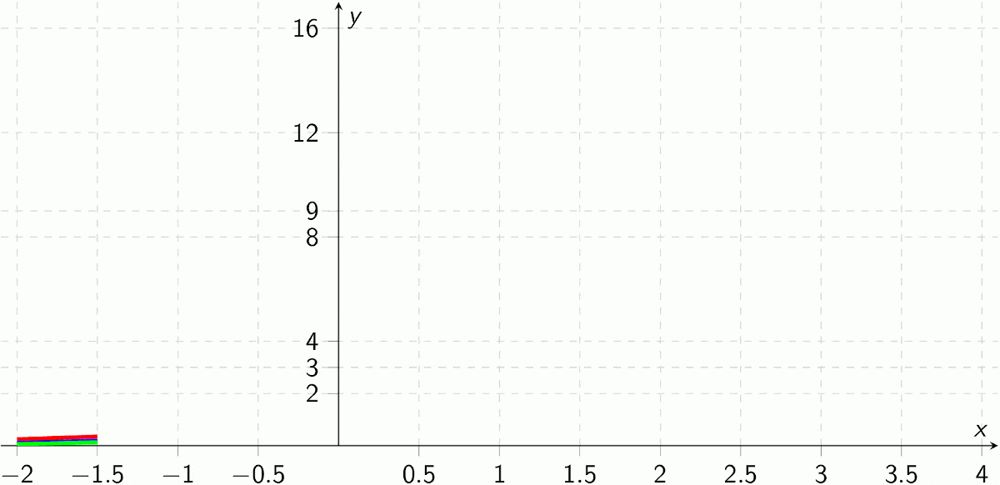
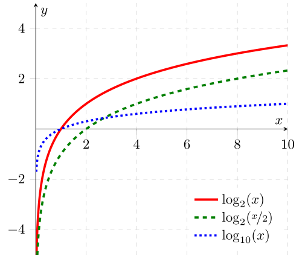
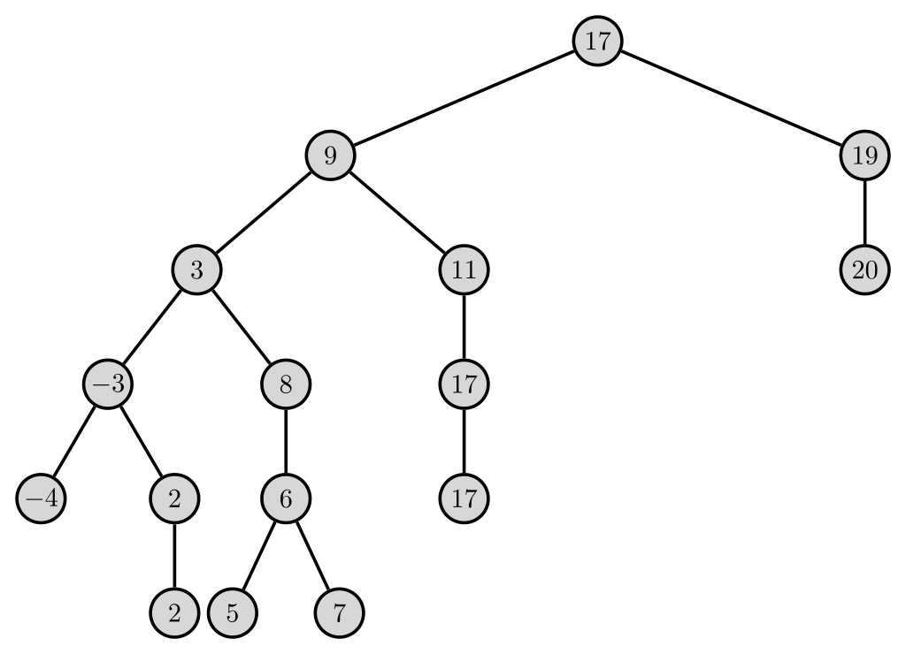
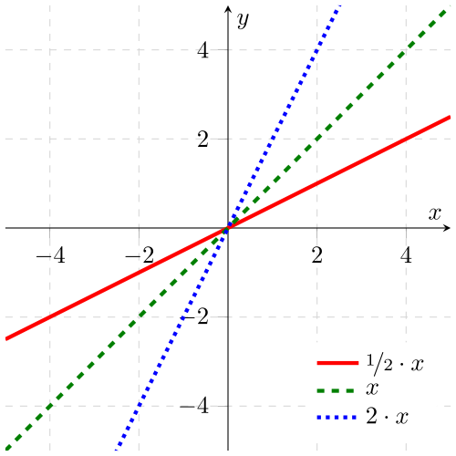
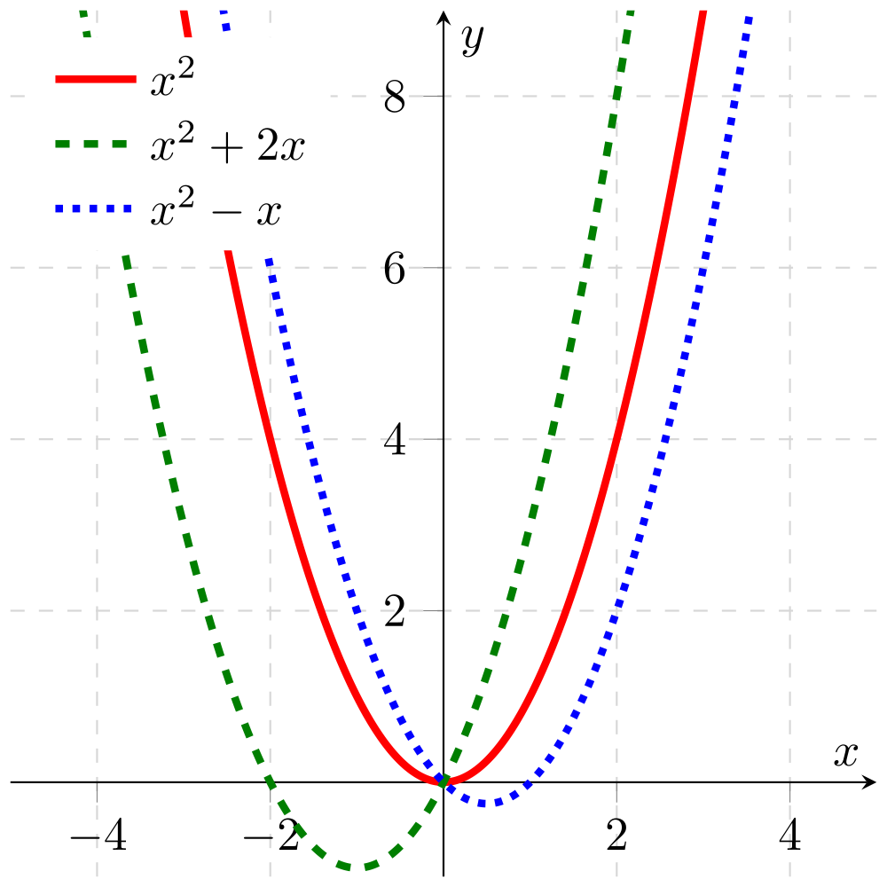
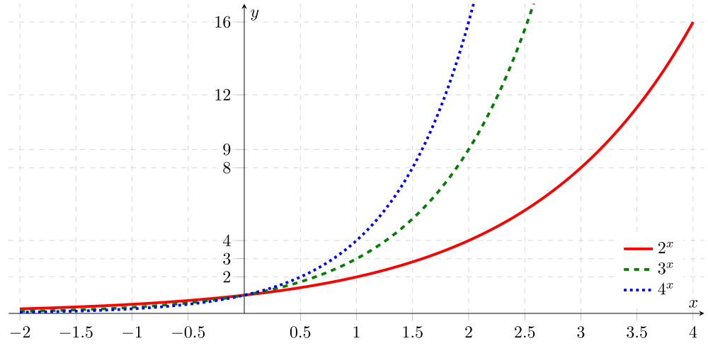
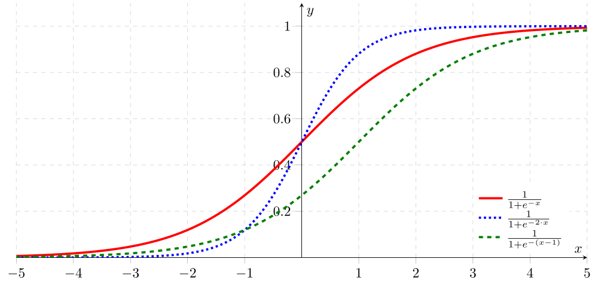

<figure>
    
    <figcaption>Three exponential functions — green has base 4, blue has base 3, red has base 2. Image by Martin Thoma</figcaption>
</figure>

Knowing the following set of functions helps you to describe the change in income, the growth of your company, the number of COVID-19 cases, …

## Logarithmic Functions

[Logarithmic functions](https://en.wikipedia.org/wiki/Logarithm) are also [monotonically increasing](https://en.wikipedia.org/wiki/Monotonic_function), but after a quick initial phase they are only increasing very slowly:

<figure>
    
    <figcaption>Image by Martin Thoma.</figcaption>
</figure>

Logarithms have a base. In the example above you can see two examples with base 2 and one example with base 10. The higher the base, the slower the function grows. Logarithmic functions have two phases:

* 0 &lt; x &lt; 1: Negative phase. The closer you get to zero, the more negative the logarithm’s value becomes.
* x = 1: The logarithm of 1 is zero for all bases.
* x &gt; 1: The logarithm keeps growing.

One invariant to know is

$$\log_b(b^x) = x$$

This means the logarithm to base b reverses the exponential function to base b.

In computer science, this kind of growth behavior is associated with trees:

<figure>
    
    <figcaption>A binary search tree. Image by Martin Thoma</figcaption>
</figure>

At every node in this tree, the left subtree is smaller or equal to the node and the right subtree is bigger than the node. If you want to check if a value is there, you can make a series of checks. If that tree was a [balanced tree](https://en.wikipedia.org/wiki/Self-balancing_binary_search_tree) — meaning you have the same amount of nodes at the left as you have on the right, then the number of checks you have to perform grows logarithmically with the number of elements:

* 1 element → 1 check
* 2–3 elements → 2 checks
* 4–7 elements → 3 checks
* 8–15 elements → 4 checks
* 16–31 elements → 5 checks

This is extremely relevant to design fast algorithms. If you see O(log(n)), very likely a binary search or a binary tree is involved. If you see O(n log(n)), very likely sorting is done.

## Linear Functions

[Linear functions](https://en.wikipedia.org/wiki/Linear_function) are described by $f(x) = m \cdot x$ where $m$ is called the slope.

<figure>
    
    <figcaption>Three linear functions with different slopes. A slope of 2 means the value increases by 2 with every increase of x. A slope of 0.5 means the value increases by 0.5 with every step. Image by Martin Thoma</figcaption>
</figure>

A typical worker’s wage is a linear function over the time. This means the x-axis represents the time and the y-axis represents the money the worker earned. If they work double the time, they get double the income. If they work half the time, the income halves.

As a developer, one might think that a lot of the resources also show linear growth: If your website has double the amount of users, you need double the amount of machines to show a similar performance. In reality, due to caching or inefficient algorithms it might be more complicated.

A slightly more complex version of a linear function is called an *affine function*: $f(x) = m \cdot x + t$ — but pretty often, one does not make this distinction and calls affine functions also linear functions. The parameter *t* is called the intercept. The intercept just pushes the whole function up or down.

Fuel consumption for driving x kilometers is another real world example of a linear function: If you drive double the distance, you will approximately need double the fuel.

## Quadratic Functions

<figure>
    
    <figcaption>3 quadratic functions. In computer science, you’re usually only interested in the part x&gt;0 of the red line. Image by Martin Thoma</figcaption>
</figure>

Quadratic functions have the form

$$f(x) = ax^2 + bx + c$$

The x² leads to the characteristic behaviour, that a doubling of x means the value increases by a factor of 4:

* x ⋅ 2 → f(x) ⋅ 4
* x ⋅ 3 → f(x) ⋅ 9
* x ⋅ 4 → f(x) ⋅ 16

In software development, it typically happens when you need to look at all combinations of a set. For example, if you had a dating platform and you wanted to check for every pair of users if they are a good fit. This quickly grows out of hand, although today's computers can deal with astonishingly big numbers.

Linear and quadratic functions belong to the bigger family of polynomial functions. Polynomials are described like this:

$$\sum_{i=0}^n a_i x^i$$

*n* is the degree of the polynomial. A linear function is a polynomial of degree 1, a quadratic function has degree 2. The constant $a_n$ has to be different from zero, but can be negative. All other constants $a_i$ can have any value.

Polynomials are important in a variety of different applications in computer science and mathematics, but for describing growth it’s usually fine to just know cubic, quadratic, linear, and constant functions.

## Exponential functions

<figure>
    
    <figcaption>Image by Martin Thoma</figcaption>
</figure>

Exponential functions multiply their value by the base with every unit step. Exponential functions are typically used to calculate **unlimited growth** of bacteria and viruses under ideal conditions.

For base 2 — the red line in the image above — some of the values are:

* x=-1→y=0.5
* x=0→y = 1
* x=1→ y=2
* x=2→ y=4
* x=3→y=8
* x=4→y=16

You can see how this becomes extremely huge after a while. This is also visualized by the [wheat and chessboard problem](https://en.wikipedia.org/wiki/Wheat_and_chessboard_problem).

## Sigmoid functions

<figure>
    
    <figcaption>Image by Martin Thoma</figcaption>
</figure>

Exponential growth only describes the growth of bacteria under ideal conditions. This is true for the starting phase, but the world’s resources are limited. At some point there will not be enough food to continue growth. The curve flattens out.

Sigmoid functions capture this behaviour of **limited growth**. They have an initial phase where they grow very slowly. Closely around their symmetry point — at x=0 for the red and the blue line and at x=1 for the green line in the image above— they look linear.

Logistic functions are a very typical subclass of the sigmoid functions. Logistic functions are described by the following equation:

$$f(x) = \frac{L}{1 + e^{-k(x - x_0)}}$$

* L defines the upper boundary. In all shown examples, the functions approach y=1
* The function has a symmetry point at $(x_0, L/2)$
* The bigger k, the more steep the function is

Other important sigmoid functions are the [hyperbolic tangent](https://en.wikipedia.org/wiki/Hyperbolic_functions) and cumulative distribution functions (CDFs) such as the CDF of the normal distribution.

Both, logistic functions and the hyperbolic tangent are used as a core ingredient in artificial neural networks.

## Summary and Outlook

You’ve just seen 5 classes of functions which are relevant when talking about growth. Logarithmic functions are always increasing, but very slowly. Faster are linear and quadratic functions. Exponential growth is crazy and does usually only happen for a limited amount of time until a threshold is reached. Then the curve flattens and you see a sigmoid shape.

There are, of course, way more functions and more general properties.
