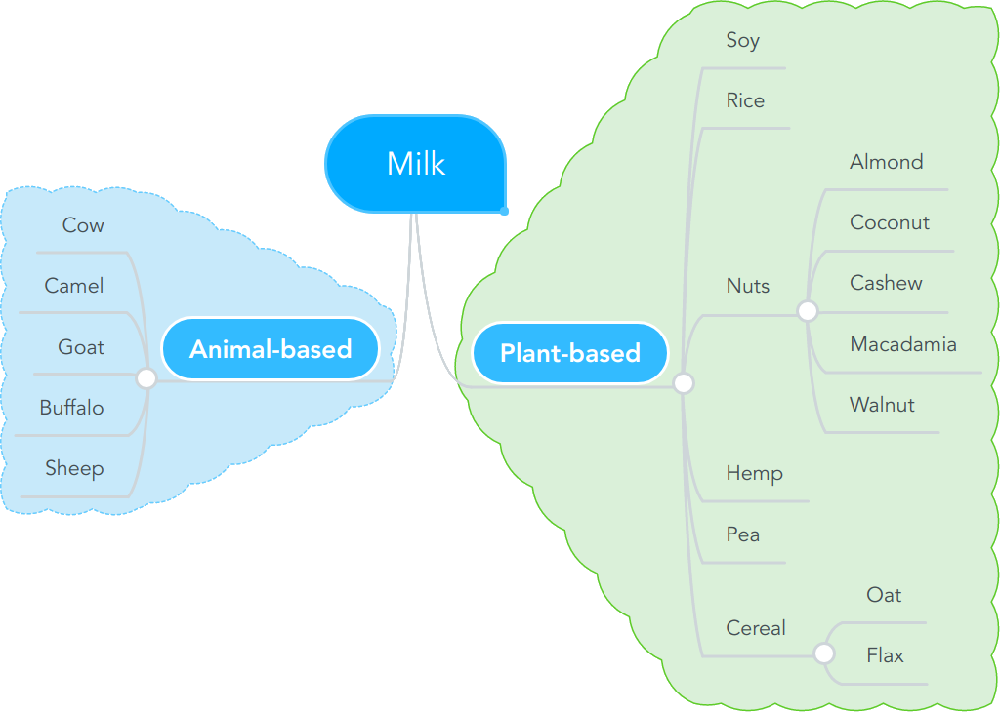
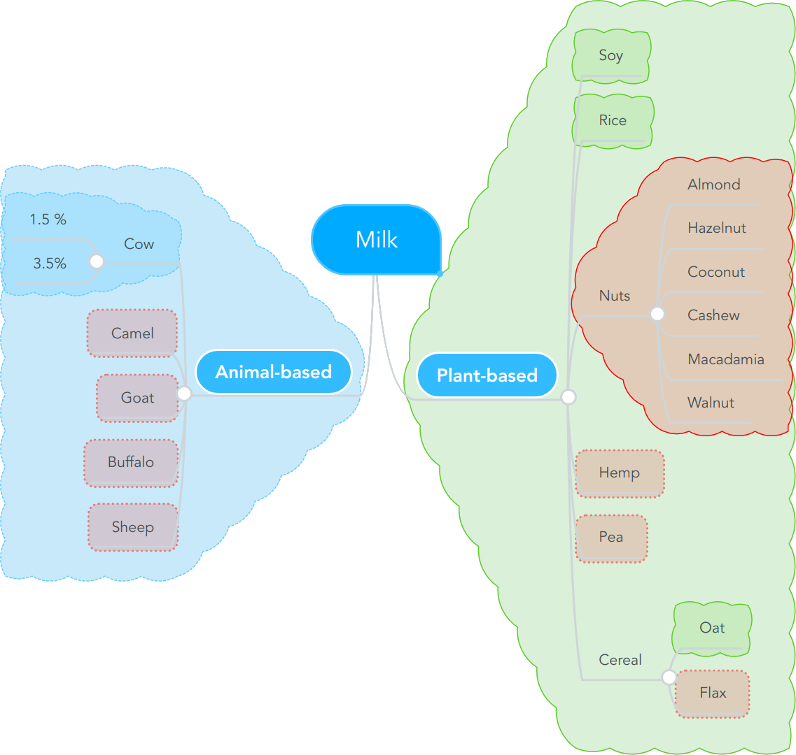
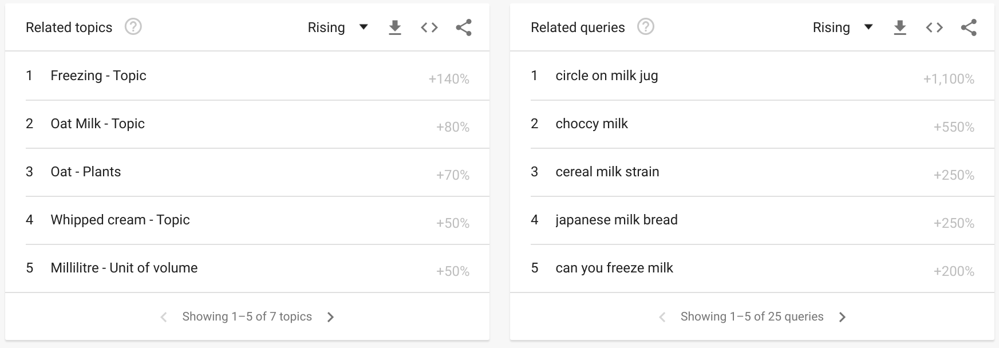
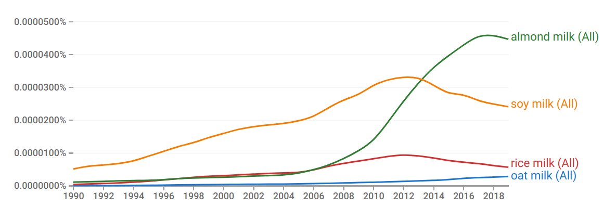
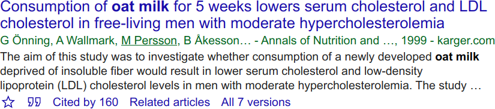
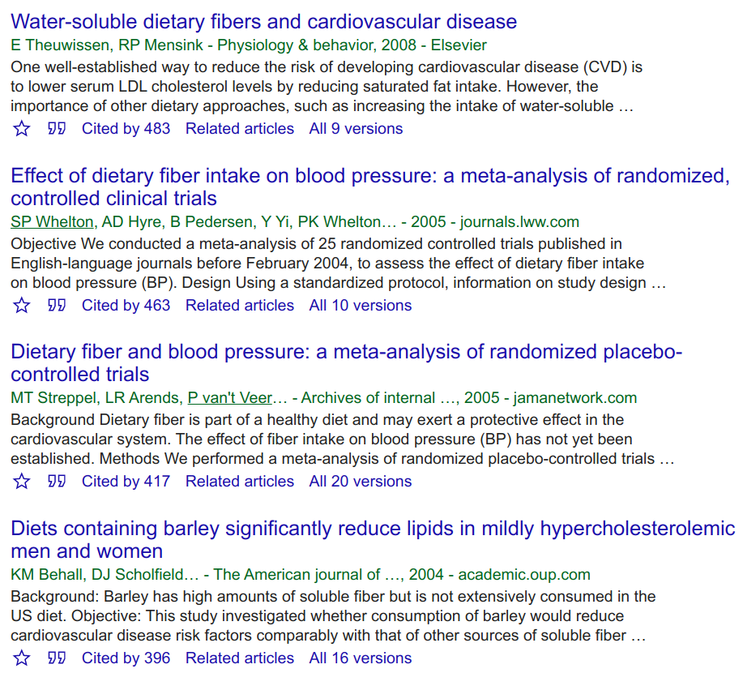

The world is developing fast. New topics arise which were not at all a thing when I was at school. Topics that I was not prepared for by my parents either. My job as a Data Scientist / Machine Learning Engineer did not exist when I was at school. Today, I think one of the most valuable life skills I have is to quickly get into new topics. It’s a skill every adult needs.

After reading this article, you will know the tools and techniques to dive deep into any topic. Let’s go!

## Which kind of milk should you drink?

I love examples 😍 — they are just the best to learn a new skill. The example itself does not matter too much, but I hope you can relate at least a little bit to it:

I’m interested in having a healthy diet and reducing my carbon footprint. I’ve heard that alternatives to normal milk from cows are good. But what are the alternatives and why are they better?

## General Research

<figure>
    
    <figcaption>Screenshot by Martin Thoma</figcaption>
</figure>

Using search engines is probably not news to anybody. [Google](https://www.google.com/) is my choice and [DuckDuckGo](https://duckduckgo.com/) is an alternative. Today, you can simply phrase the topic you want to get into as a question. Now you have to make your mind clear about the problem you’re trying to solve. I want a healthy diet and a low carbon footprint, so I might want to search for:

1. Why is cow’s milk bad?
1. Why is cow’s milk good?
1. What effect does cow’s milk have on me?
1. What effect does cow’s milk have on the environment?

The difference between questions (1) + (2) and (3) is that (3) is neutral. Question (1) and (2) would support an opinion I already have and thus likely lead to the [echo chamber problem](https://en.wikipedia.org/wiki/Echo_chamber_%28media%29).

Notice that questions (3) and (4) are more nuanced than just asking “is cow’s milk bad”.

Besides using a search engine, I might also want to search on platforms. Videos are easier to consume, so searching on YouTube is a common choice. When I search for (3), the first results are videos that cover exactly what I’m interested in.

## Alternative to…

Using a search engine with the term “alternative to [some product / company / technique]” quickly shows new elements and broadens your overview.

By applying this technique, I quickly found alternatives to cow’s milk: Soy milk, oat milk, almond milk, rice milk, coconut milk, hemp milk, cashew milk, macadamia milk, pea milk, walnut milk, flax milk, goat milk, camel milk, buffalo milk, and sheep milk.

## Structure Your Knowledge

Try to spot patterns in what you see. I found 15 alternatives to cow’s milk. Researching all of them in detail might be a lot of work. How can I group them?

A mind map may help:

<figure>
    
    <figcaption>Image by Martin Thoma</figcaption>
</figure>

## Filter Out Quickly

You probably don’t want to write an extensive scientific essay going through all details of the topic. You want to make a decision. In my case, I want to know if I should switch to another type of milk. A filter here is availability and price. If I can’t get the milk or if it’s too expensive, I mark it as red and don’t continue looking at it:

<figure>
    
    <figcaption>Image by Martin Thoma</figcaption>
</figure>

You can see that most of the candidates could be filtered out. While doing that, I found that cow’s milk might be more diverse.

## Ask Experts!

Now that you have a basis to formulate questions and know a bit about the area, you can try to pinpoint what you want to know. Asking humans can help you to find gaps you didn’t know you had.

If you don’t happen to have **a friend or colleague** who knows about this topic, you can try those networks:

* **Authors:** Try to find related articles and ping the authors. Make sure you read their articles so that you can show that you’re genuinely interested. In my experience, people who write about a topic publicly are also very open to answer questions or give pointers privately.
* [**LinkedIn**](http://linkedin.com/): A career/business social network. You can search for #topic, e.g. [#milk](https://www.linkedin.com/feed/hashtag/milk/). Look at who writes something. Read it. Contact the people who seem to post relevant content.
* **Reddit**: A bulletin-board for anything. It is organized in subreddits, e.g. [reddit.com/r/milk](https://www.reddit.com/r/Milk/). As it is open to everybody and anonymous, be prepared to get nonsense answers.
* **Wikipedia**: The global Encyclopedia attracts people from all kinds of backgrounds. Every article has a [discussion page](https://en.wikipedia.org/wiki/Talk:Milk) on which you can post anything. Try to use it only when your question is relevant to the article.
* [**Quora**](https://www.quora.com/): A once nice question and answer platform. However, recently I didn’t get any good answers for questions that were non-trivial.
* **Twitter**: Simply by the fact that there are lots of users, you can try to find the ones that could help you. First, you can look at #hashtags, such as [#milk](https://twitter.com/hashtag/milk). Be prepared to get unexpected and unwanted results.

It’s important to have a healthy amount of skepticism towards self-proclaimed experts. Try to find sources that have proven to be trustworthy.

## Tech and Software

Searching for specific technologies or software has specialized websites. The most valuable platform is the [StackExchange network](https://stackexchange.com/sites#technology-traffic). They offer all kinds of sites, but by far the biggest is [stackoverflow.com](https://stackoverflow.com/).

## Google Trends

Google gives you some insights into search behavior via [trends.google.com](https://trends.google.com/). If you are exploring a topic, it might help you to find related topics.

For example, if you look for “milk” you can directly find “oat milk”:

<figure>
    
    <figcaption>Google trends for “milk”. Screenshot by Martin Thoma</figcaption>
</figure>

You can also do a lot of other stuff with it like [predicting flu outbreaks](https://www.nature.com/articles/nature07634).

## Google n-Grams

Terminology matters. You want to use the right words to speak with people. Quite often there are synonyms or terms which are no longer used. Also, topics get and lose interest. You can find the right terminology via [Google n-gram](https://books.google.com/ngrams).

> Side note: Google scanned a lot of books in [Project Ocean](https://www.theatlantic.com/technology/archive/2017/04/the-tragedy-of-google-books/523320/). Via [Google n-gram](https://books.google.com/ngrams), you can access a part of this data. An “n-gram” is n words in a row. If you take the sentence “n-grams help to understand texts” as an example, then all 2-grams are:
> - n-grams help
> - help to
> - to understand
> - understand texts

> All 3-grams are:
> - n-grams help to
> - help to understand
> - to understand texts

> You can do more fancy stuff like adding a pseudo “starting word” and “end word” or remove stuff like “to”, “a”, “an”, etc. But essentially those are n-grams.

Let’s search for some of the different milk types:

<figure>
    
    <figcaption>Google n-grams. Screenshot taken by Martin Thoma</figcaption>
</figure>

You can see that soy milk is found in books for quite a while, but the rest was rare. Something changed around 2006 and in 2010 almond milk started to take off. The interest in soy milk declined but is still at a very high level.

## Backward References

If you read good books or articles, they will give references or even cite single statements. I call them “backward” because I see this as a stream of knowledge over time. The book references older / more “raw” sources. The book you have might miss a couple of interesting points.

## Forward References

Finding literature that references the stuff you are currently reading is harder. I do this often via [Google Scholar](https://scholar.google.com/):

<figure>
    
    <figcaption>Notice the “Cited by” link in the bottom. Screenshot taken by Martin Thoma</figcaption>
</figure>

There I click on “Cited by”:

<figure>
    
    <figcaption>Screenshot taken by Martin Thoma</figcaption>
</figure>

Those resources got more citations than the one I started with. They might make a broader point that is relevant to the topic I’m looking at.

## Authors

Stalk them. Find what they published, look at co-authors, and what they published. This is a good way to find forward and backward references.

If you look at many forward and backward references, a picture will form. You will identify key authors for the topic you’re interested in. Contact them.

## Summary

I’ve shown you a couple of ways to broaden your knowledge, e.g. by looking at alternatives. You’ve also seen how to dive deeper by finding forward- and backward references. It’s an iterative process. It takes time, but it works. For you, this means the next time you are super interested in a topic you know how to do it. Maybe you want to get a new position in your job? Maybe you want to switch jobs? Become the expert — you can do it!
