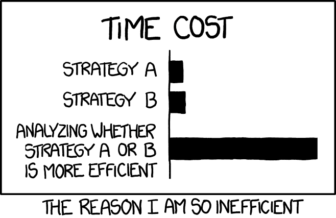
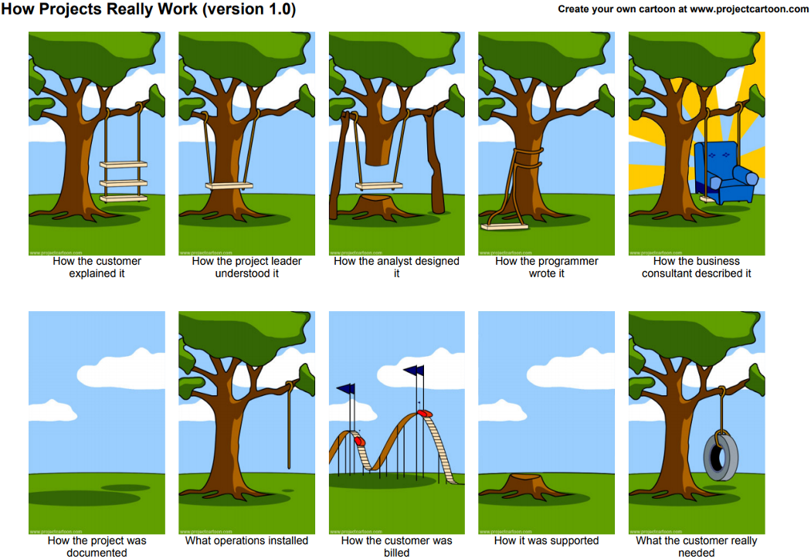

<figure>
    
    <figcaption>Image source: <a href="https://xkcd.com/1445/">XKCD</a> (Randall Munroe)</figcaption>
</figure>

When I hear the word “efficiency” I’m thinking of engines and light. How much energy does the car use for actually bringing me from A to B and how much is wasted on heat or simply transporting the car itself? For light bulbs, how much energy is used for producing light, and how much for unwanted heat?

> Efficiency is the ratio of resources spent for a task and total resources spent in the process, including non-task related stuff. The resources can be either energy, time, or other.

Effectiveness on the other hand is about goal-alignment. You want to make sure that you satisfy the actual client needs. The client might ask you to implement a neural network for figuring out a good layout for the website because they have heard that neural networks can solve any task. Being effective might be to ask if they might want a [responsive design](https://en.wikipedia.org/wiki/Responsive_web_design).

<figure>
    
    <figcaption>Copyright © <a href="http://www.projectcartoon.com/">projectcartoon.com</a> under the <a href="http://www.projectcartoon.com/about/">Creative Commons Attribution 3.0 Unported License</a></figcaption>
</figure>

[Peter F. Drucker](https://en.wikipedia.org/wiki/Peter_Drucker) summarized the difference between effectiveness and efficiency pretty well:

> Efficiency is doing the thing right. Effectiveness is doing the right thing.

As an example, let’s say you go into a coffee shop and you order a cappuccino:

|             | Ineffective                           | Effective                                     |
|-------------|---------------------------------------|-----------------------------------------------|
| Inefficient | You receive a coke after 20 minutes   | You receive your cappuccino after 20 minutes  |
| Efficient   | You receive a coke within 10 seconds  | You receive your cappuccino within 10 seconds |

Efficient vs Effective: All 4 combinations are possible.
