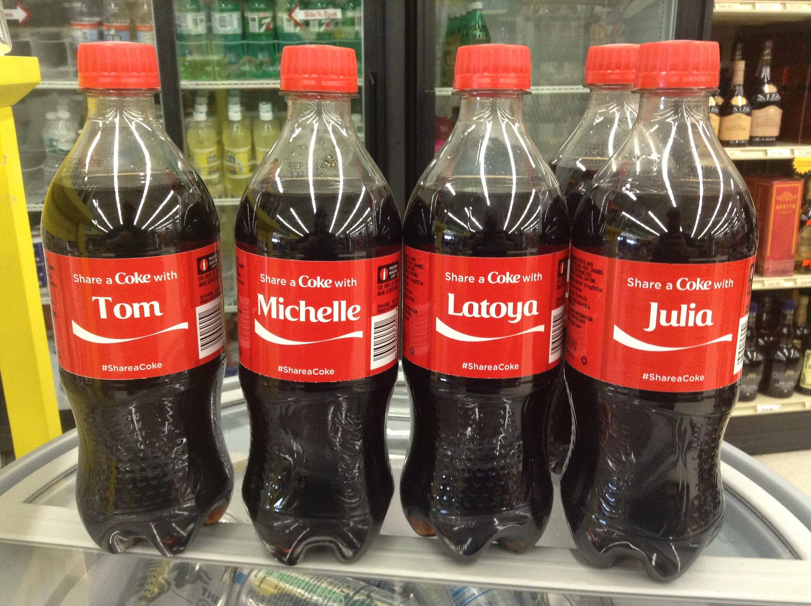
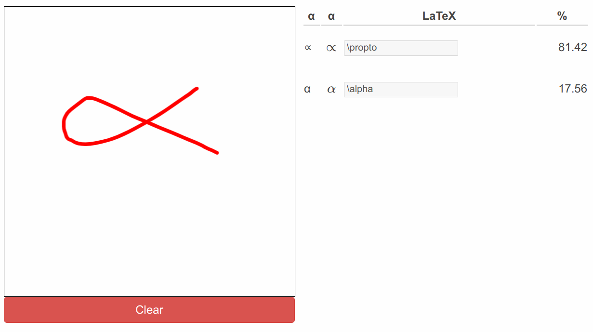

Today, people expect websites and services to be adjusted to their specific situation. Services that are tailored to our needs in the specific moment are more useful to us — let it be the web search of Google, planning the next vacation with Maps, looking up products on Amazon, or searching for the next series to binge-watch on Netflix. We love the customized goods we can buy on [Zazzle](https://www.zazzle.com/) and the Coke with our name on it.

As a data scientist, I thought about the different kinds of customization of web services and realized that there are important types to distinguish. Most important: Is the service **dynamic** or **personalized** — or potentially both?

> A dynamic service changes by time of the day, day of the week, or the season. A personalized service changes by the person who uses it.

Think about vacation planning on Google Maps. When you don’t enter anything, what part is shown to you? Of course, something that is as close as possible to your current location. This depends just on you. Google Maps is **personalized**. If you search for “restaurant”, the results might differ if you search in the afternoon or the late evening. The search in the afternoon might rather show cafés, while the search at night might rather show bars. I would expect this behavior for every user. So it is **dynamic**.

There are also signals which are not that clear: The device type (smartphone vs tablet vs desktop), the internet connection speed, and if you are on a metered network with volume limitations, e.g. mobile internet, come to my mind. Although those might cause changes in the web app, they are more technical in nature. Some are more about [responsive web design](https://en.wikipedia.org/wiki/Responsive_web_design).

> If it’s only about how something is presented and not about what is presented, it’s a responsive web design topic.

Typical examples are layout changes to fit a small screen and changes in image size/crop for slow or metered networks.

## Customization vs Personalization

Customization and personalization are both adaptions of the product to the user. The difference is who is driving the adaption:

> Customization is adjusting a product to the users' needs by the user. Personalization is adjusting the product to the users by the seller.

I deliberately didn’t write that personalization is an adjustment to the users' needs, because sometimes it might actually harm the user. Think about a shop abroad which increases the prices after they see that you are a tourist.

<figure>
    
    <figcaption>Coke bottles with names on them. Image by Mike Mozart (<a href="https://commons.wikimedia.org/wiki/File:Share_a_Coke_Name_Promotional_Coca_Cola_Bottles_%2814483573386%29.jpg">source</a>)</figcaption>
</figure>

## Show me examples!

* **Clothing stores** have dynamic prices: When a new season begins, the old stuff needs to go. The prices are lowered at the end of the season.
* **Coke** printed names on bottles. This is an example of customization. The users choose the bottle they want and thus they are the ones who drive the “change” to the product. Nutella made something similar.
* **Car configurators** like [the one from BMW](https://www.bmw.com.sg/en/ssl/configurator.html#/) are an example of customization by configuration. Nissan plans to extend the capabilities and calls this “hyper-personalization” ([source](https://phys.org/news/2016-11-nissan-banks-after-sales-hyper-personalization-revenue.html)) — as the customer drives it, it is still customization.
* **Marketing letters** in which you are sent a message with your full address, your name, maybe also some light adjustments to the text are **personalized**. Yes, it’s trivial. Yes, it’s simply using templates and rules. Nobody said personalization always needs to be hard, right?
* [**Zazzle**](https://www.zazzle.com/) offers many products that can be customized, e.g. T-Shirts with your name on it.

Of course, there are the obvious candidates for software where you also see those topics:

* **Dynamic pricing** is famously used by Amazon ([source](https://www.fastcompany.com/3060803/algorithmic-pricing-is-creating-an-arms-race-on-amazons-marketplace)), Hotels ([source](https://www.sciencedirect.com/science/article/abs/pii/S144767701930083X)), train and bus tickets (the closer the date gets, the more expensive the ticket becomes). The idea here is to algorithmically adjust the price to the demand. When the supply cannot be changed, this leads to better resource usage in theory.
* **Personalized pricing** is something most people really don’t like, but it might happen for plane tickets ([source](https://www.washingtonpost.com/lifestyle/travel/could-dynamic-pricing-be-influencing-how-much-you-pay-for-your-plane-ticket/2020/08/19/7e77e182-e17d-11ea-8181-606e603bb1c4_story.html)). There are rumors that some companies make prices for iPhone users higher because there is the idea that they have more money and are more willing to pay, but I haven’t found evidence for that.
* **Netflix** personalizes a lot and even makes this a core part of their business ([source](https://research.netflix.com/business-area/personalization-and-search)). **Spotify** also comes to my mind in a very similar way.
* **The Search Bubble** is another example of personalization. No matter if it is Google Search or Facebook’s News Feed: Influencing which items you get to see has an enormous impact ([TED Talk](https://www.ted.com/talks/eli_pariser_beware_online_filter_bubbles)). As this is mostly out of your control, it is personalization.

## What are the implications of personalization?

Personalized services are harder or even impossible to **cache on the server-side**. You need to think about **privacy**. You might need to communicate the kind of personalization to the user. There might be **regulations** that force you to disclose parts of the algorithm being used ([example](https://techcrunch.com/2019/01/15/how-do-you-fight-an-algorithm-you-cannot-see/)) to make sure that there is no bias against minorities.

Especially if you apply machine learning, **communicating the decision process** is hard. This is a problem for internal alignment as well as external transparency. People tend to say that machine learning algorithms are not interpretable or even that we don’t understand how the model makes decisions. I strongly disagree with that statement, but this is a different story. If you’re interested, I recommend reading “[The Mythos of Model Interpretability](https://arxiv.org/pdf/1606.03490.pdf)” by [Zachary C. Lipton](https://arxiv.org/abs/1606.03490).

The need to explain decisions might force you to store personal information. In case there is a data breach, [GDPR](https://en.wikipedia.org/wiki/General_Data_Protection_Regulation) forces you to inform the affected people of it. This is not only a PR nightmare, but preparing for this case makes this even more work. To conclude:

> Only personalize a product if the effort is justified by the benefit.

## Do dynamic services have the same issues?

Dynamic services don’t have privacy-related issues like personalized services have. It’s also likely that a dynamic service will have fewer signals than a personalized one. That makes it easier to communicate the decision process. Having fewer factors of influence means caching might be easier. It might also mean that one can **pre-compute** the results of the service! Pre-computing is awesome because it makes it way simpler to assure the availability of the service. It can also make the service lightning fast!

## Is it exclusively dynamic or personalized?

No! For sure not! As an example, take my tiny service [write-math.com](http://write-math.com/) which allows you to draw a symbol (Greek or Latin letter, digit, arrows, some others) and tells you what you drew. It is neither dynamic nor customizable or personalized.

<figure>
    
    <figcaption>Screenshot of write-math.com. The Greek letter α was drawn and two very similar symbols were recognized. Image by Author.</figcaption>
</figure>

I could make it **customizable** by letting you choose which groups of symbols you want to recognize. Are letters and digits boring? Just turn them off.

I could also make it **dynamic**, by looking at which symbols are typically looked up at which time of the day. I can tell you that a lot of people draw penises and I have a guess that there might be a correlation with the local time.

I could also **personalize** it by creating profiles. If there are enough symbol entries by a single user, I show the symbols already entered by that user more often than “unknown” symbols.

## Randomness for the Win!

Think clearly about your goal. Preferably from a user's perspective. If you have a news aggregation website, the user does not benefit from a more dynamic page. But the user might benefit from the possibility to explore more content. Having a more dynamic page is one way to achieve this. You can do all kinds of interesting stuff here, but there is a simple hack to get started: Just randomize. Not necessarily for every call, but as often as you want to get the dynamics you think are good. This gives you a chance to see the users' reactions, understand technical difficulties, and collect ideas for smarter approaches.
