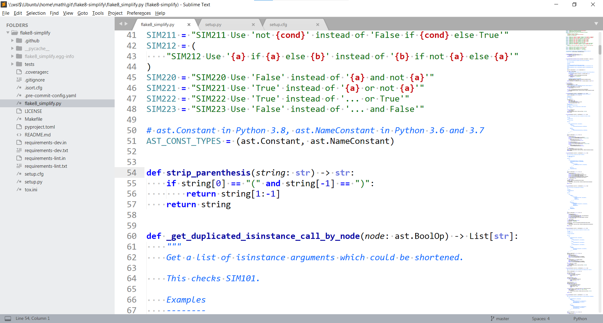
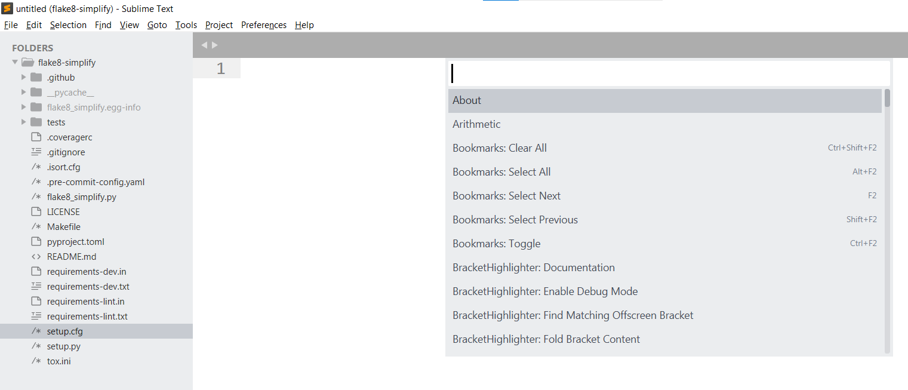
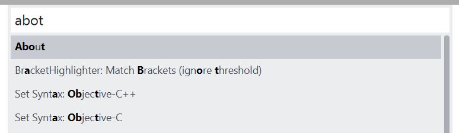
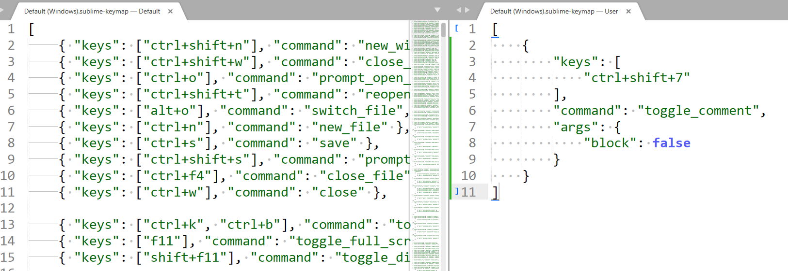
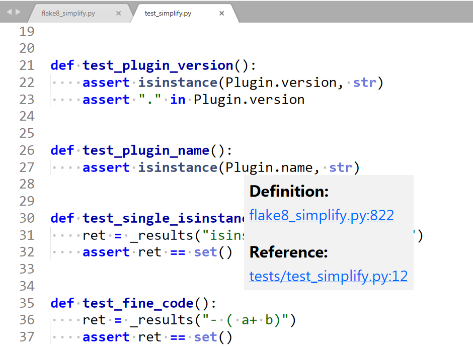

<figure>
    
    <figcaption>Screenshot of Sublime Text 3.2 taken by the author.</figcaption>
</figure>

Sublime Text is an editor developed by [Jon Skinner](https://www.linkedin.com/in/jon-skinner-b150192/). It is available for free, but it will ask you every 15th time you save something if you would like to buy it. I bought Sublime Text because I use it on a daily basis. I love this editor ❤️

The core reasons why I use Sublime Text are performance and minimalism. Sublime opens when I click on it. Instantly. No delay. I can jump to files quickly. I can close the editor without saving and when I open the editor again, I see the same (“unsaved”) state.

There are also nice features like [multiple cursors](https://www.youtube.com/watch?v=czQipWJA8EU) and plugins.

## Speed

Sublime Text is **lightning-fast**. It opens in less than a second on my ThinkPad T490s. It stores everything, even if you don’t hit `Ctrl+S`. This means you can at all times just close the editor. The next time you open it, it will tell you that there are unsaved changes 😍

## The User Interface

In the screenshot above you can see what I have typically open:

* The main window shows the code.
* At the top over the code, there are tabs for opened files.
* Left of the code, there is a **file explorer**.
* Right of the code, there is a **minimap** of the code. This can be helpful to jump to weird sections.
* At the bottom, you see the line and the column of your cursor. You can see the current git branch and the current highlighting (“Python”) option.

## Killer Feature: Command Palette

The [command palette](https://sublime-text-unofficial-documentation.readthedocs.io/en/latest/extensibility/command_palette.html#command-palette) is a way to reach any functionality of Sublime Text. No more searching in deeply nested menus.

You can open the command palette with the key combination `Ctrl` + `Shift` + `P`. It looks like this:

<figure>
    
    <figcaption>The command palette. The screenshot was taken by the author.</figcaption>
</figure>

It does a fuzzy search which means it’s ok to make some typos:

<figure>
    
</figure>

## Killer Feature: Customizable Shortcuts

You can set your shortcuts via `Preferences → Key Bindings` or searching for it via the command palette.

It will open a split window. On the left side, you can see the defaults. On the right side, you can see your personal settings:

<figure>
    
    <figcaption>The screenshot was taken by the author.</figcaption>
</figure>

### Tab interactions

You can close a tab with `Ctrl+W`, just like in Chrome. You can switch to the first tab with `Alt+1`, to the second with `Alt+2`, …

You can open a new file with `Ctrl+N` — just like you would open a new window in Chrome.

### Jump to Line

`Ctrl+G` to jump to a line. This is super handy when you’re debugging.

### Goto File

`Ctrl+P` to go to any file in the current workspace. With fuzzy search again 🎉

### Find / Replace all

`Ctrl+F` to find something, `Ctrl+H` to replace. You can also use regex! Definitely a feature I don’t want to miss. This is pretty cool in combination with multiple cursors!

### Distraction-Free Mode

`Shift+F11` switches in distraction-free mode. You just see the code. No mini-map, no file explorer, no footer. This is helpful if you want to show another developer something.

## Autocompletion

The [autocompletion of Sublime Text](https://www.sublimetext.com/docs/3/auto_complete.html) is mostly text-based. This means if you have never used a function you just imported, the autocompletion will not properly work.

Also, what I miss are hints for parameters of functions you’re using.

## Jump to Definition

“Jump to definition” works like this: You hover over … well, just about anything. Let’s call it a *symbol*. The editor then will figure out where the symbol was defined.

Some developers love this feature, but I rarely use it. Sublime provides this:

<figure>
    
</figure>

## Debugging

Sublime Text does not have any debugging features. You have to use an IDE or [pdb](https://docs.python.org/3/library/pdb.html) for that.

## Plugins

Sublime Text has a vivid plugin community on [packagecontrol.io](https://packagecontrol.io/). You need to [install package control](https://packagecontrol.io/installation) first.

### BracketHighlighter

Highlighting the matching bracket helps me to understand an expression better. I use [BracketHighlighter](https://packagecontrol.io/packages/BracketHighlighter) to support me.

### Colorsublime

People prefer different color themes for their editors. Not only dark and light themes but more specific ones. For example, I love the TextMate theme. You can install those via [Colorsublime](https://packagecontrol.io/packages/Colorsublime).

### requirementstxt

[requirementstxt](https://packagecontrol.io/packages/requirementstxt) is a syntax highlighting package for requirements.txt files.

## Customization

We have already seen that the theme and the keybindings are customizable. With plugins, you can even go further and expand syntax highlighting capabilities. Another important part of customization is workspaces. You can open them, switch them, and have settings such as ignored files stored per workspace. In a Python project, you might want to ignore `__pycache__` directories in the file browser and when you jump to files.

## Summary

Sublime Text is a **lightning-fast**, **distraction-free** editor with **all features** I need 95% of the time. This is especially sensible key bindings, syntax highlighting, and search/replace. What I miss sometimes are debugging features and hints for function parameters.

<!-- series: python-for-beginners -->
