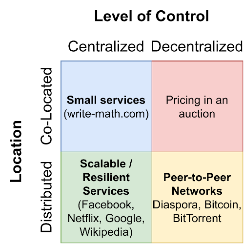

The terms “decentralized” and “distributed” sound extremely similar and people sometimes use them interchangeably. It might depend on the context, but I see “decentralized” mostly about decision making, control, and who is in charge. I associate “distributed” with the location: Where is something stored/computed/done, how do we make latency low, create services which can deal with natural disasters.

A decentralized system has no single element that takes a decision. The decision is taken across more than one person or organization.

A distributed system is computing/storing things across more than one machine or data center.

## Internet Services

<figure>
    
    <figcaption>Image Source: Martin Thoma</figcaption>
</figure>

The **small websites** example is easiest to explain: Typically, small websites have one web application and one database running. Both processes are pretty tightly coupled and run most of the time on the same machine or at least in the same data center. Every decision-making process is done by that single application.

**Monolithic architectures** are for sure also in the **centrally-controlled**, **single location** category. The reason why I called the distribution aspect “co-located” is microservices. Many companies nowadays choose to create microservices instead of a monolith. Those are all controlled by the company, but different developers can work on them. Especially if they are done by one team or if the company is rather small, it is also likely that the different services run on the same machine. Having a microservice architecture allows you to have different services running on different machines more easily. That is one way to scale.

**Big organizations** like Google, Netflix, and Wikipedia **centrally control** which software they are running. The control is centralized. They see users from all over the world and want to have low latency. So they want the servers which give the content to the users to be physically close to the users. They also want to be resilient against natural disasters or construction work cutting power lines. For this reason, the applications are **distributed**.

**Pricing in auctions** is different: Think of a very specialized stock market, e.g. for advertisement space on websites. The trade has to be done extremely fast: A user visits a website, some big companies get key data of that user and need to decide in fractions of a second how much it’s worth to them to show an ad to that user in that location. The final price could be the second-highest value but given to the highest bidder. This is called a [Vickrey auction](https://en.wikipedia.org/wiki/Vickrey_auction). As it has to be done so quickly, the bidding servers are physically close to the auctioneer.

To be in the centrally controlled, physically distributed category you actually don’t have to go to different regions of the world. The [Apache Spark](https://en.wikipedia.org/wiki/Apache_Spark) **cluster-computing** framework distributes work across different machines in the same data center.

Most of the commonly used big services which are centrally controlled and distributed have an alternative that is also **distributed**, but also **decentralized**. The social network Facebook has the decentralized alternative [Diaspora](https://en.wikipedia.org/wiki/Diaspora_%28social_network%29), [Filecoin](https://en.wikipedia.org/wiki/Filecoin) and Storj are alternatives for Dropbox. Tom Terado wrote an article about [decentralized storage](https://medium.com/bitfwd/what-is-decentralised-storage-ipfs-filecoin-sia-storj-swarm-5509e476995f). [Drife](https://www.drife.one/) is an alternative to Uber.

## Examples

* In the **Energy market**, we speak about a centralized and decentralized energy supply. A centralized energy supply has comparatively few power plants. Each plant is huge. If there is a black-out, it typically is huge. There is more than one supplier in a centralized energy market, but not too many. Decentralized energy supply means there are a lot more producers, e.g. via solar cells. As you might see here already, there are many shades of gray: A completely **centralized** energy supply would mean you have one power plant for all consumers. A completely **decentralized** supply would mean you have one plant per consumer.
* If we are talking about the **location of back-ups**, we might consider storing all backups in the same location. An alternative might be to use different locations. For example, AWS has S3 in different regions of the world. We could have a central supplier (AWS), but **distribute** our backups to different regions.
* Is your **team working** on-site or remotely? According to Wikipedia, “&#91;Co-location&#93; is the act of placing multiple (sometimes related) entities within a single location.” Martin Fowler made some nice images about the [distribution patterns of teams](https://martinfowler.com/articles/remote-or-co-located.html).
* Do we make decisions centrally or decentralized in a **democracy**? This is another issue with the term. It depends on which level of decision making you look at and what you compare it to. You could argue that the parliament is a central place where the decision is made for all citizens. You could also argue that the decision about the best option is found individually by members of parliament and only the voting process brings them together. In comparison with a monarchy/dictatorship, the decision-making process of a parliament is decentralized. It depends on the context.

## TL;DR

* Having a service in **one location**, controlled by one **central** organization is common; especially for **small services.**
* A **central** organization in control and servers **distributed** across several regions is super common for **big services**.
* **Peer-to-peer services** are **distributed** and **decentralized**.
* **Decentralized** decision making by multiple organizations, but in **one location** for one task is rare. I only know this from speed trading of advertisements.
