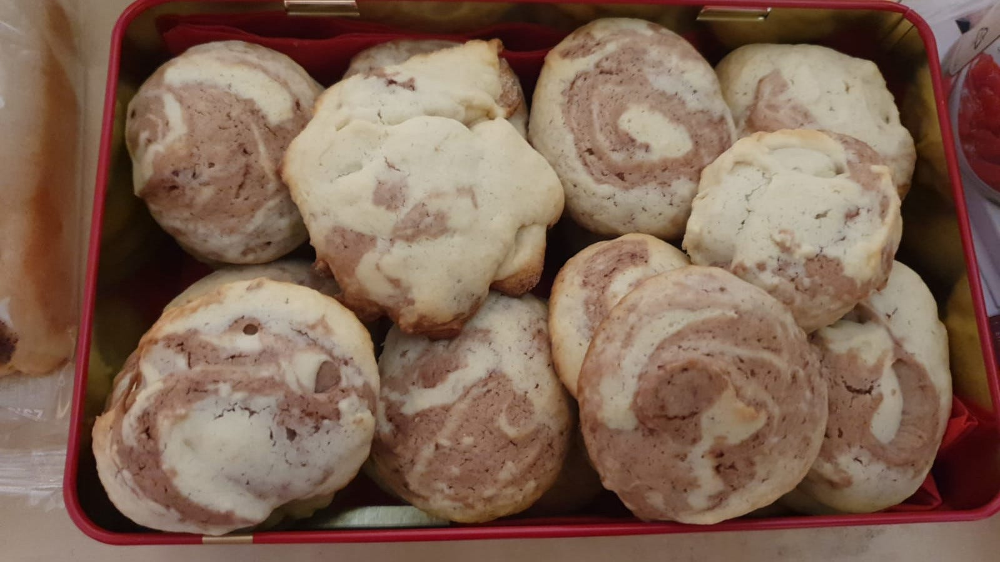

<figure>
    
    <figcaption>Image by the Author</figcaption>
</figure>

I love those simple cookies. They are not super dry like many others, they are easy to bake. Let's get started!

## Ingredients for 25 cookies

* 150g butter
* 100g sugar
* 1 package (ca. 8g) of vanilla sugar
* 1 egg
* 250g flour
* 2 tablespoons of cocoa powder

## Tools

* Oven
* Fridge
* Baking tray and baking paper
* Mixing bowl and [Hand mixer](https://en.wikipedia.org/wiki/Mixer_%28appliance%29)
* [Kitchen scale](https://en.wikipedia.org/wiki/Weighing_scale)
* 2 bowls/plates which fit into the fridge and can have at least half of the dough

## Preparation

1. Mix butter, sugar, vanilla sugar, egg.
1. Add the flour and mix it until the dough is smooth
1. Remove half of the dough. Put it in the fridge.
1. Put the cocoa powder in the remaining dough. Mix it in.
1. Put the remaining dough also in the fridge.
1. Wait for 1 hour. At least. The dough should get a bit more firm in there.
1. Heat the oven to 180 °C
1. Mix both colors together as you like. The simplest way is to roll it out, put one color into the other. Then roll them together and cut pieces out of the rolled dough.
1. Put the baking paper on the baking tray. Put the cookies on the tray.
1. Put the tray in the oven once it has 180°C. Bake it for about 10 — 15 minutes; depending on how dry you want them. The drier they are, the longer they last.
