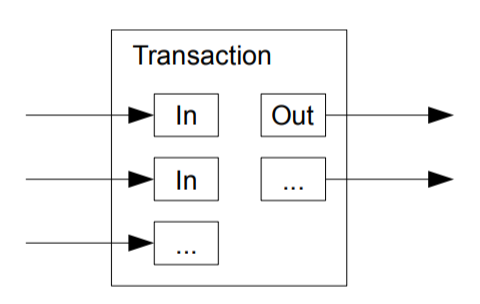
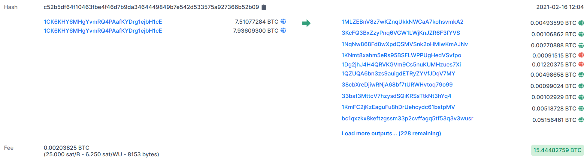
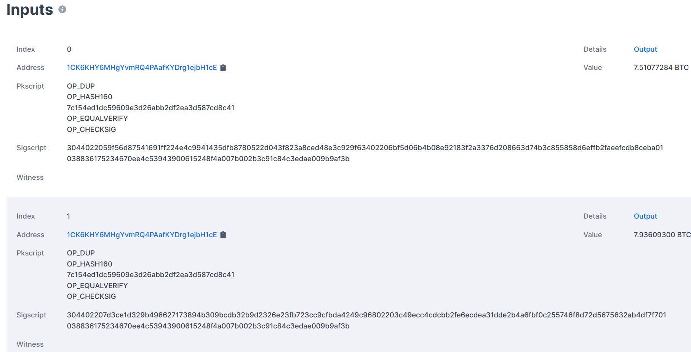
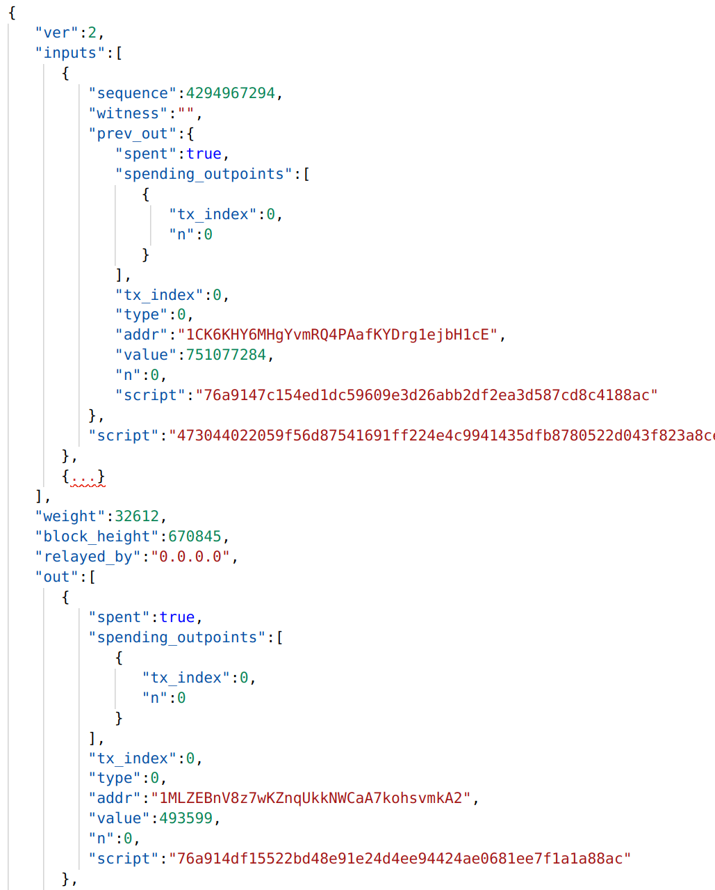

<figure>
    <a href="../images/2021/02/utxo-model-1.png"></a>
    <figcaption>Visualization of a transaction. Image by Satoshi Nakamoto (<a href="https://bitcoin.org/bitcoin.pdf">Bitcoin: A Peer-to-Peer Electronic Cash System</a>)</figcaption>
</figure>

Bitcoin is based on the UTXO (unspent transaction output) model to ensure that
nobody is able to spend money they don’t have and prevent money from being
spent twice — so-called double-spending. In this article, you will learn how
that works. Let’s go!


## The Context

Bitcoin transactions are stored in blocks. Verifying the transactions is a
crucial part of the security of Bitcoin. Another element of security is to
make it computationally hard to add new blocks by adding a mathematical
puzzle. In this article, you will learn how the transactions are actually
validated.

If you want a longer introduction to Bitcoin / Blockchain, I’ve got you:
[**The Blockchain**
*An Introduction to Blockchain, Bitcoin ₿, and related concepts*](../blockchain/)


## How Bitcoins are created

The first block of the blockchain is just defined in the code. All other
blocks in Bitcoin need to have a “proof of work”. This is a solution to an
automatically generated mathematical puzzle that makes [clever use of hash
functions](../3-applications-of-hash-functions/).
Solving this hash puzzle is computationally intensive. This means you need to
have good hardware and invest a lot of time and electricity to solve it.
People wouldn’t do that just for fun on the current scale. They do it because
of the **mining reward**. This reward is given to every solved hash puzzle.


## Halving

When Bitcoin started in 2009, the mining reward was 50 Bitcoin (BTC). In 2012,
the reward was halved to 25 Bitcoin. In 2016 the mining reward was halved to
12.5 BTC. In 2020, it was halved to 6.25 BTC and in April 2024 to 3.125 BTC ([source](https://en.bitcoin.it/wiki/Controlled_supply)).

Halving happens every 210,000 blocks. It is a mechanism to keep the
total supply of bitcoins in check. The maximum possible amount of Bitcoins is
21 million. Then, miners will not receive a reward anymore. They will need to
use transaction fees then — which they already do.


## Keys and Addresses

Bitcoin makes use of ECDSA. Blair Marshall has written a nice article about it:
[**How does ECDSA work in Bitcoin**
*ECDSA (‘Elliptical Curve Digital Signature Algorithm’) is the cryptography behind private and public keys used in…*medium.com](https://medium.com/@blairlmarshall/how-does-ecdsa-work-in-bitcoin-7819d201a3ec)

The gist of it is that people have a private and a public key. The public key
can be known to everybody, but the private key must be kept private. The owner
of the private key can approve a transaction by a digital signature. This
signature is an algorithm that makes use of the private key in a similar way
to a signature: It is easy to tell that the owner has created it and (in
contrast to real signatures) it is practically impossible to forge the
signature.

The Bitcoin address is generated from the public key by applying the SHA256
and RIPEMD-160 hash functions
([source](https://en.bitcoin.it/wiki/Technical_background_of_version_1_Bitcoin_addresses)).

The reason for not using the public key directly is to have a second layer of
defense (security in-depth). Even if the ECDSA algorithm would get broken (or,
more likely, an implementation flaw would be found) the attacker would still
need to figure out how to undo the hashing. It is highly unlikely that both
happen around the same time.


## The Anatomy of a Transaction

You can go to [the block
explorer](https://www.blockchain.com/btc/tx/c52b5df64f10463fbe4f46d7b9da3464449849b7e542d533575a927366b52b09)
and actually have a look at any block. Taking the linked example, you might
see many lines like this:

<figure>
    <a href="../images/2021/02/utxo-model-2.png"></a>
    <figcaption>Screenshot taken <a href="https://www.blockchain.com/btc/tx/c52b5df64f10463fbe4f46d7b9da3464449849b7e542d533575a927366b52b09">from blockchain.com</a></figcaption>
</figure>

In this example, you see two input addresses and over 228 output addresses.
When you scroll down a bit, you can see the inputs:

<figure>
    <a href="../images/2021/02/utxo-model-3.png"></a>
    <figcaption>Screenshot taken <a href="https://www.blockchain.com/btc/tx/c52b5df64f10463fbe4f46d7b9da3464449849b7e542d533575a927366b52b09">from blockchain.com</a></figcaption>
</figure>

Here you can see the ECDSA signature of input 1:

```text
3044022059f56d87541691ff224e4c9941435dfb8780522d043f823a8ced...a01
```

And the public key of input 1:

```text
038836175234670ee4c53943900615248f4a007b002b3c91c84c3edae009b9af3b
```

The same goes for input 2.

However, this is quite different from [the raw JSON transaction](https://blockchain.info/tx/c52b5df64f10463fbe4f46d7b9da3464449849b7e542d533575a927366b52b09?format=json):

<figure>
    <a href="../images/2021/02/utxo-model-4.png"></a>
    <figcaption>Screenshot of the raw JSON transaction</figcaption>
</figure>

I will come to the inputs and outputs, but let’s first discuss the remaining attributes:

* **Ver** is the version of the transaction format. I couldn’t find a good source for that, but in general, it’s a good idea and common practice to version protocols and exchange formats.
* **Block height** was added with [BIP 34](https://en.bitcoin.it/wiki/BIP_0034) and is essentially the block number in the current blockchain.
* **Relayed by**, according to sheinix’s article [Understanding some Bitcoin Metrics](https://medium.com/coinmonks/understanding-some-bitcoin-metrics-ac51f28a4145) “indicates the mining pool that has solved the Proof of Work”. I don’t understand what this is good for.
* **Weight** is a concept I’ve first seen with Segwit. Please have a look at [this video](https://youtu.be/f3CFUbeehc8?t=442) by 99Bitcoin for details. The weight is similar to the size of the transaction.

## Inputs and Outputs

It sounds crazy but imagine real coins. In a transaction with real coins, the
receiver(s) get as many coins as the sender(s) put into the transaction. No
coin is lost. Coins are created during **mining** in a controlled way and in a
limited amount. After that, they are assigned to a Bitcoin address.

This is the core of the UTXO model. You have a bunch of input Bitcoin
addresses and a bunch of output Bitcoin addresses.

<figure>
    <a href="../images/2021/02/utxo-model-1.png"></a>
    <figcaption>Visualization of a transaction. Image by Satoshi Nakamoto (<a href="https://bitcoin.org/bitcoin.pdf">Bitcoin: A Peer-to-Peer Electronic Cash System</a>)</figcaption>
</figure>

Everybody can verify which address has how many Bitcoins in it by getting the
whole blockchain. It is possible to track every bitcoin since the beginning.
