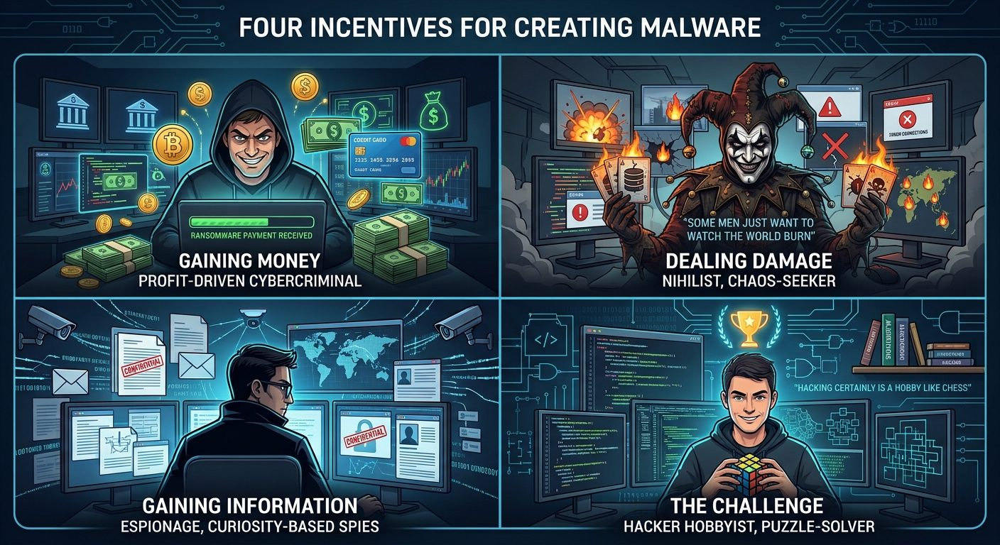

<figure class="ai-generated">
    
    <figcaption>The four incentives for creating malware.</figcaption>
</figure>

Why do people write malware? Who are those stereotypical black-hat hackers? After reading this article, you should have a better understanding of the breadth of this group of people.

The incentives for creating malware are:

* **Gaining Money**: People want to get rich or at least earn a living.
* **Dealing Damage**: “Some Men Just Want to Watch the World Burn” to quote Batman’s butler Alfred.
* **Gaining Information**: Getting private information can be tempting for many people just out of curiosity.
* **The Challenge**: Hacking certainly is a hobby like chess. Just like with chess, there are many people who don’t understand the joy of it. There are many legal ways to hack as shown in a lot of [CCC talks](https://www.youtube.com/user/mediacccde) and at [Black Hat conferences](https://www.youtube.com/user/BlackHatOfficialYT).

## Gaining Money: Malware Business Models

Money likely is the biggest incentive and there are various business models criminals follow.

### Adware: Attention is all you need

Advertisement is the way to legally make money on the web. Companies want to sell their stuff. They need the consumers to know that there is a new iPhone, that the new Tesla is really cool, or how beautiful you could look if you just spent a fortune on a Gucci handbag.

Getting attention is valuable. If you can install software that presents advertisements to the user, then the advertising company can pay you. There are multiple ways:

* Pay-per-show: This is the poster model. You have a space in which you can show advertisements. The company pays to be a certain time in that space.
* Pay-per-click: It doesn’t help advertisers if nobody is reacting to the advertisement. On the web, one of the simplest types of reactions is to click on the link.
* Pay-per-buy: You get a commission if a user came from your site and bought something.

As you can see, the “pay-per-buy” does incentivize effective advertisement. It’s not helping to only annoy people, but being smart about which ads to show.

### Spyware: Breach of Confidentiality

Spyware does exactly what the name implies: It gathers information. A typical example of spyware is a keylogger. A keylogger is software (sometimes even hardware!) that records every single keystroke you make. Bank account credentials, all your emails, conversations you have on any social network. Anything you type.

The gathered information can be used for **direct attacks** like logging into your bank account or taking your crypto-wallet keys, but it can also be used to **blackmail** you or to add your computer into a **botnet**.

I don’t have any examples, but I expect that governments try to give companies in their country a competitive advantage by **industrial espionage**. Some companies might even do that on their own. And, of course, there could be companies or individuals focusing on industrial espionage.

### Cryptolocker: Breach of Availability

“Information is the new oil” is a quote that likely sounds familiar. Intellectual property is one of the core assets of many companies. Knowing the recipe of Coca-Cola, the supply chains, the signed contracts and conditions, having contacts — there are a lot of small pieces of information that are worth a lot of money. Selling this information is what criminals can do with the spyware approach. Technically simpler is the cryptolocker approach. In that case, the criminal only prevents the victim from getting access. All organizations and individuals have information that is valuable to them.

The process is as follows:

1. The Cryptolocker encrypts the victim's data. The victim cannot access the data anymore.
1. The victim gets a ransom: Either you send me money or your data will be destroyed.
1. If the victim pays, the data is decrypted.

### Cryptojacking: Unauthorized usage of Resources

Cryptojacking is hijacking your computer to do crypto mining.

Bitcoin is a cryptocurrency that makes use of proof-of-work as a consensus mechanism. The effect of this is that you can convert computational power into money. The cost of that is the cost of the hardware and the power bill. The professional “miners” who earn money with this process have dedicated machines that are specialized in this type of computation. They are way more efficient. But when your AWS credentials are public, the attacker can use your credit card to get computational power. It would be more efficient to directly get your money, but that might not be possible.

The more typical way to do cryptojacking is by running JavaScript in the background of a website. The user can still use the website, but in the background, the browser uses more of the CPU than it would otherwise do. It’s super inefficient, but luckily the harm is also very limited.

### DoS: Sabotaging Availability

If the services of a web company are down, they have to pay fines to their clients. This can be used to blackmail companies:

1. Write to a company that they will be the target of a DoS attack in 28 days if they don’t pay a certain amount of money. Tell them that there will be a demonstration in 7 days.
1. Run a small demonstration at a non-critical target, at a smaller scale, or at a time where it does less harm and the fallout is easier to handle.

One simple way to run a DoS against a free web service is by creating a botnet and creating so many requests that something breaks.

## Dealing Damage: See the World Burn

In this category, it becomes important to distinguish the target. People typically think of deleted files. But it can be worse. [USB Killer](https://en.wikipedia.org/wiki/USB_Killer) can damage your hardware.

On a personal level, you might get targeted by children/students who just try things out. Nothing to worry about for professional systems or people who take reasonable precautions and have a basic understanding of security. Keep your software updated, don’t install random crap.

On an organizational level, I could imagine a company sabotaging competitors or political activists harming organizations they oppose. Another big part can be former employees who were treated badly.

On a state level, it can also happen if two states disagree and want to avoid a hot war. The [Stuxnet worm](https://en.wikipedia.org/wiki/Stuxnet) pops into my mind. With that software, the USA and Israel sabotaged the uranium enrichment of Iran’s nuclear program.

## Gaining Information: Do you have something to hide?

We already had spyware in the monetary incentive section, but there is way more.

### Policeware and govware

The police should **keep people safe from terrorists** and **prosecute crimes**. The simplest way to do this job is to keep people in prison. Obviously, that is not acceptable to most people, but giving the police or other governmental agencies the possibility to spy on individuals or large amounts of people is. In Germany, there were a lot of discussions about a trojan written by the government (“Bundestrojaner”).

Sometimes, like in [the Snowden-Leaks](https://en.wikipedia.org/wiki/Global_surveillance_disclosures_%282013%E2%80%93present%29), there is no malware involved as the agencies and commercial partners directly give access to the data or look at the communication.

Although I don’t know of any particular examples for information gathering from states, I would not be surprised if the NSA and similar agencies created malware to spy on high-ranking politicians.

## Now … what do I do with this information?

You can increase the security so that it becomes uninteresting. You can also make it easy to report potential issues and participate in a bug bounty program. You can treat your employees with respect to keep people from rage-quitting their jobs. You can increase awareness against phishing campaigns and [email spoofing](../email-spoofing/), make regular backups and apply security best practices. Think about who has hardware access to your machines and what they could do with that.

### Bug Bounty / Vulnerability Research Programs

The damage done by malware for single companies can go above a hundred million USD ([source](https://www.wired.com/2010/03/heartland-sentencing/)) and always causes the brand to take damage. For this reason, companies started bug bounty programs. The idea is simple: If you can show that you have found a vulnerability and if you tell the company in private so that they can fix it, you will get money.

Some bug bounty programs are:

* **Google** ([docs](https://www.google.com/about/appsecurity/reward-program/)): Up to \$31,337
* **Android** ([docs](https://www.google.com/about/appsecurity/android-rewards/)) and **iOS** ([docs](https://developer.apple.com/security-bounty/)): Up to \$1,000,000
* **Chrome** ([docs](https://www.google.com/about/appsecurity/chrome-rewards/)): Up to \$150,000

There are also many [bug bounty programs listed on HackerOne](https://hackerone.com/bug-bounty-programs). For a malware creator who does it for the money, there are some advantages of using such a program:

1. It’s legal
1. One might have an easier time getting the money
1. One might get famous and build up a reputation that helps to get future jobs

### Honeypots

A honeypot is a mechanism or system to deflect attackers. The idea is to provide fake data / a fake system and make the attacker think that they achieved their goal. It can be used to learn what attackers in general try.
