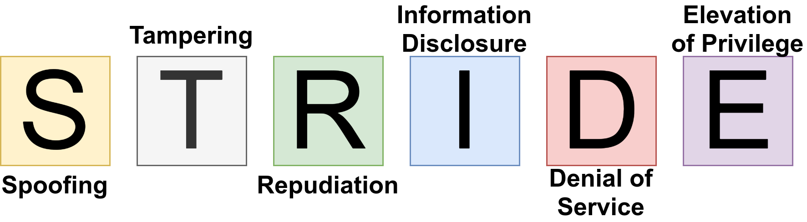

<figure>
    
    <figcaption>Image by Martin Thoma</figcaption>
</figure>

STRIDE is an acronym for:

* **Spoofing**: Impersonating someone else; e.g. [email spoofing](../email-spoofing/). A common example is the [grandparent scam](https://en.wikipedia.org/wiki/List_of_confidence_tricks#Persuasion_tricks). Spoofing breaks Authenticity.
* **Tampering**: Modifying data or code; e.g. manipulating the data sent by the browser. A non-digital tampering attack is when you look at your children's yearly school report and they changed the grades. Tampering breaks Integrity.
* **Repudiation**: Claim you didn’t send an email / perform a transaction/edit that Wikipedia page. Repudiation breaks non-repudiability.
* **Information Disclosure**: A privacy breach or a data leak. Information Disclosure breaks Confidentiality.
* **Denial of Service**: e.g. uploading big files to a service; causing heavy computation; pinging the server to overload the network; [ZIP bombs](../zip-bombs/); [A billion laughs](../billion-laughs-dos/). Denial of Service breaks availability.
* **Elevation of privilege**: e.g. [SQL Injection](../sql-injections/). Elevation of privilege breaks authorization.
