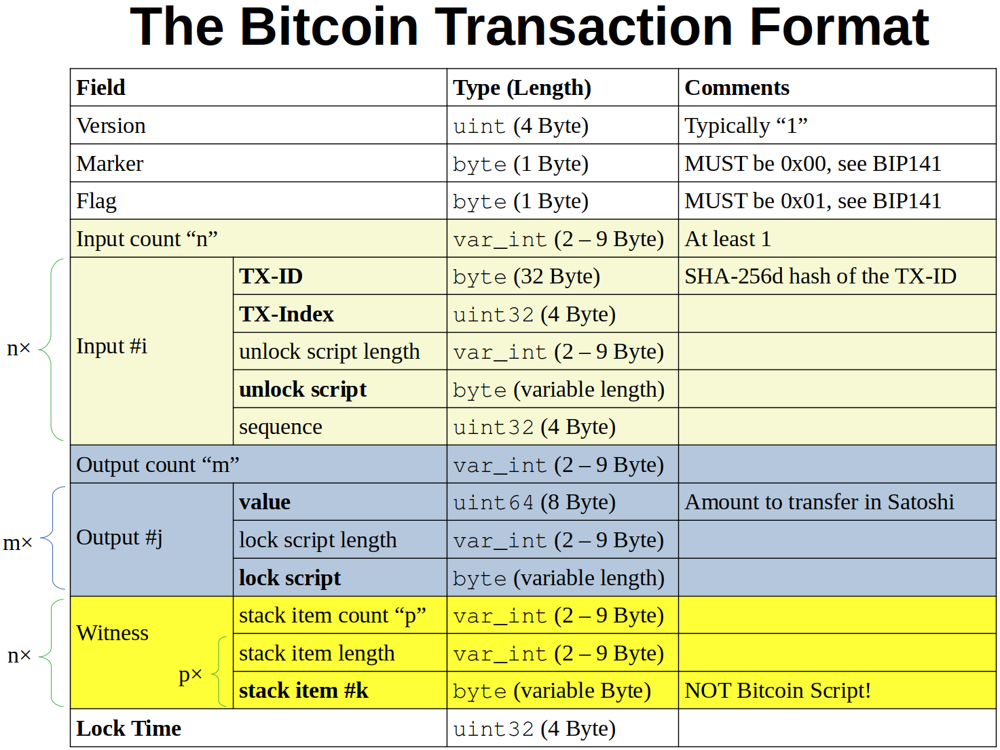

The world is changing and developers are not perfect. The first iteration of any software always has some flaws or shortcomings that need to be adjusted after a while. For those two reasons, it is important to have a mechanism for change management. In the case of APIs of central services, you typically have an API version and a deprecation schedule.

But what do you do in a distributed system? How do you keep the system flexible and secure?

Bitcoin has an elegant solution to this problem: Bitcoin Script! After reading this article, you will understand it. Let’s go!

## Anatomy of a Bitcoin Transaction

New bitcoins are mined with every block that gets added to the blockchain until about the year 2140. Who has access to which bitcoin is determined by tracking unspent transaction output (UTXO):

[**The UTXO model** *A technical cornerstone of Bitcoin*](../utxo-model/)

Going to the [Bitcoin block explorer](https://www.blockchain.com/explorer) and picking [the latest block](https://www.blockchain.com/btc/block/00000000000000000004a250beeb23fa5fb47d75491c90b037bfad847d733dc7), we see 2,738 transactions in that block. Taking [one transaction](https://www.blockchain.com/btc/tx/30713d08afa548d3465e380d6e1837354b29a1b6707e2a913b27776cf305fda4) and [showing the raw hex dump](https://blockchain.info/tx/30713d08afa548d3465e380d6e1837354b29a1b6707e2a913b27776cf305fda4?format=hex):

```
010000000001010000000000000000000000000000000000000000000000000000000000000000ffffffff5403df550a1b4d696e656420627920416e74506f6f6c373138fd004702c13ba070fabe6d6d6d9986fd3aedb9f8b00fab3c74c2e1d399fd0e6bc1d964aa57a08f78ac2d648002000000000000001eb50000c1377c00ffffffff04653c3a2a000000001976a91411dbe48cc6b617f9c6adaf4d9ed5f625b1c7cb5988ac0000000000000000266a24aa21a9ede0721e21cc17367eb4fcccf94c7e6ebc54757a693515f809307d4d6a31e0c8500000000000000000266a24b9e11b6d6eab9aaf2ccdc3cb05fb15989c512b84c8ef5f498559cd4d66e6104de8f9cdb100000000000000002b6a2952534b424c4f434b3a93320d7a461a95b953bd18e40aa031b5470d6258ccd82011999a5b290031529c0120000000000000000000000000000000000000000000000000000000000000000000000000
```

The structure of this format is as follows:

<figure>
    <a href="../images/2021/04/the-bitcoin-script-language-2.png"></a>
    <figcaption>Image by Martin Thoma</figcaption>
</figure>

The two fields that are interesting for this article are the “unlock script” and the “lock script.” When a new transaction is added, it needs to provide an unlock script that matches the referenced UTXO (TX-ID and TX-Index). The output lock script is what you expect others in the future to do to use that output. In a very direct sense, you define the key.

Those two script fields contain Bitcoin Script. It starts with a one-byte operation code (`OP_CODE`). This is just a number that is associated with an operation.

## Decoding With Bitcoin Core

Let’s take [this transaction](https://blockchain.info/tx/7de75c9a33a687de04c9621ec98d60acf6a830fda6b12b027df227d1c72d2808?format=json) for the following example. First, I decode the hex transaction to:

```
{
    "version_number": 1,
    "marker": null,
    "flag": null,
    "tx_ins": [
        {
            "tx_id": "00f645c7443e367330410e526b152fc799c71dafd4971d8ed6ee37babbd581bb",
            "tx_index": 10,
            "script": "483045022100b7393ff959120e3ccb5284e3cf2eaa200235643a1549a4e6faaa911619089e2b02207b677827c7beeb53503e016a8dd29164d07cb79f0f1e058df9b8dfa3568d0290014104c4b7a7f7bb2c899f4aeab75b41567c040ae79506d43ee72f650c95b6319e47402f0ba88d1c5a294d075885442679dc24882ea37c31e0dbc82cfd51ed185d7e94",
            "sequence": 4294967295
        }
    ],
    "tx_outs": [
        {
            "satoshi": 16939,
            "script": "a914c29b367fe...bd1b29ef47a687"
        },
        "... more outs..."
    ],
    "witness": {
        "stack_items": [
            []
        ]
    },
    "locktime": 0
}
```

The interesting part is the binary unlocking script, given in hex notation as `script` of the first (and only) input.

You can use the following script (on Ubuntu 20.04) to decode the binary bitcoin script to ASM (assembly language):

```
# Download and extract bitcoin-core
$ wget https://bitcoin.org/bin/bitcoin-core-0.20.0/bitcoin-0.20.0-x86_64-linux-gnu.tar.gz
$ tar -xvf bitcoin-0.20.0-x86_64-linux-gnu.tar.gz
$ cd bitcoin-0.20.0/bin/

# Run the daemon, but do not download blocks
$ ./bitcoind -daemon -connect=0.0.0.0

# Finally! Decode a Bitcoin Script hex-encoded program
$ ./bitcoin-cli decodescript "483045022100b7393ff959120e3ccb5284e3cf2eaa200235643a1549a4e6faaa911619089e2b02207b677827c7beeb53503e016a8dd29164d07cb79f0f1e058df9b8dfa3568d0290014104c4b7a7f7bb2c899f4aeab75b41567c040ae79506d43ee72f650c95b6319e47402f0ba88d1c5a294d075885442679dc24882ea37c31e0dbc82cfd51ed185d7e94"
{
  "asm": "3045022100b7393ff959120e3ccb5284e3cf2eaa200235643a1549a4e6faaa911619089e2b02207b677827c7beeb53503e016a8dd29164d07cb79f0f1e058df9b8dfa3568d029001 04c4b7a7f7bb2c899f4aeab75b41567c040ae79506d43ee72f650c95b6319e47402f0ba88d1c5a294d075885442679dc24882ea37c31e0dbc82cfd51ed185d7e94",
  "type": "nonstandard",
  "p2sh": "3QEAyVJgyTXivsKQopPiGngaPwFWmzdHLL",
  "segwit": {
    "asm": "0 64c118d91f54d62936c29915c5cb61d39dc3353b005aca55528a714b607800de",
    "hex": "002064c118d91f54d62936c29915c5cb61d39dc3353b005aca55528a714b607800de",
    "reqSigs": 1,
    "type": "witness_v0_scripthash",
    "addresses": [
      "bc1qvnq33kgl2ntzjdkzny2utjmp6wwuxdfmqpdv542j3fc5kcrcqr0qxaa2gw"
    ],
    "p2sh-segwit": "3EVPaAaNmZtuP4acv63USoRkSXPez4dX4z"
  }
}
```

This is a typical unlocking script (the value of the `asm` key). The first string is the script signature. The second one is the public key.

Next, we get the locking script [from the transaction](https://blockchain.info/tx/00f645c7443e367330410e526b152fc799c71dafd4971d8ed6ee37babbd581bb?format=hex) (index 10):

1. [Get the hex transaction](https://blockchain.info/tx/00f645c7443e367330410e526b152fc799c71dafd4971d8ed6ee37babbd581bb?format=hex).
1. Put the hex transaction into [my decoding tool](https://github.com/MartinThoma/algorithms/blob/master/Bitcoin/decode_transaction.py).
1. Look up the tenth index of `tx_outs` and look for the `script`.

```
$ bitcoin-cli decodescript "76a9147ddb236e7877d5040e2a59e4be544c65934e573a88ac"
{
  "asm": "OP_DUP OP_HASH160 7ddb236e7877d5040e2a59e4be544c65934e573a OP_EQUALVERIFY OP_CHECKSIG",
  "reqSigs": 1,
  "type": "pubkeyhash",
  "addresses": [
    "1CUTyyxgbKvtCdoYmceQJCZLXCde5akiX2"
  ],
  "p2sh": "3Jp8er9Srb9LMkJqk8jPeWafjDztYGLyLn",
  "segwit": {
    "asm": "0 7ddb236e7877d5040e2a59e4be544c65934e573a",
    "hex": "00147ddb236e7877d5040e2a59e4be544c65934e573a",
    "reqSigs": 1,
    "type": "witness_v0_keyhash",
    "addresses": [
      "bc1q0hdjxmncwl2sgr32t8jtu4zvvkf5u4e64ucrwj"
    ],
    "p2sh-segwit": "37e78P9jyHEZ7dp2as7w817BUPgEEUQDD2"
  }
}
```

The value for the `asm` key is a very typical lock script.

## Unlocking a Transaction

To execute both, we first put the unlock script and then the lock script:

```
3045022100b7393ff959120e3ccb5284e3cf2eaa200235643a1549a4e6faaa911619089e2b02207b677827c7beeb53503e016a8dd29164d07cb79f0f1e058df9b8dfa3568d029001
04c4b7a7f7bb2c899f4aeab75b41567c040ae79506d43ee72f650c95b6319e47402f0ba88d1c5a294d075885442679dc24882ea37c31e0dbc82cfd51ed185d7e94
OP_DUP
OP_HASH160
7ddb236e7877d5040e2a59e4be544c65934e573a
OP_EQUALVERIFY
OP_CHECKSIG
```

This is executed like every program from top to bottom. Bitcoin Script is a stack-based programming language. This means you don’t have variables but put everything on a stack.

You definitely want to execute this. There is [an online tool](https://wschae.github.io/build/editor.html), but [it seems to have bugs](https://bitcoin.stackexchange.com/a/105254/6721). Instead, I recommend using [btcdeb](https://github.com/bitcoin-core/btcdeb). After installing it, you can run:

```
$ btcc 3045022100b7393ff959120e3ccb5284e3cf2eaa200235643a1549a4e6faaa911619089e2b02207b677827c7beeb53503e016a8dd29164d07cb79f0f1e058df9b8dfa3568d029001 04c4b7a7f7bb2c899f4aeab75b41567c040ae79506d43ee72f650c95b6319e47402f0ba88d1c5a294d075885442679dc24882ea37c31e0dbc82cfd51ed185d7e94 OP_DUP OP_HASH160 7ddb236e7877d5040e2a59e4be544c65934e573a OP_EQUALVERIFY OP_CHECKSIG

483045022100b7393ff959120e3ccb5284e3cf2eaa200235643a1549a4e6faaa911619089e2b02207b677827c7beeb53503e016a8dd29164d07cb79f0f1e058df9b8dfa3568d0290014104c4b7a7f7bb2c899f4aeab75b41567c040ae79506d43ee72f650c95b6319e47402f0ba88d1c5a294d075885442679dc24882ea37c31e0dbc82cfd51ed185d7e9476a9147ddb236e7877d5040e2a59e4be544c65934e573a88ac

$ btcdeb 483045022100b7393ff959120e3ccb5284e3cf2eaa200235643a1549a4e6faaa911619089e2b02207b677827c7beeb53503e016a8dd29164d07cb79f0f1e058df9b8dfa3568d0290014104c4b7a7f7bb2c899f4aeab75b41567c040ae79506d43ee72f650c95b6319e47402f0ba88d1c5a294d075885442679dc24882ea37c31e0dbc82cfd51ed185d7e9476a9147ddb236e7877d5040e2a59e4be544c65934e573a88ac

btcdeb 0.4.21 -- type `btcdeb -h` for start up options
LOG: sign segwit taproot
notice: btcdeb has gotten quieter; use --verbose if necessary (this message is temporary)
7 op script loaded. type `help` for usage information

script               |  stack
---------------------+--------
3045022100b7393ff... |
04c4b7a7f7bb2c899... |
OP_DUP               |
OP_HASH160           |
7ddb236e7877d5040... |
OP_EQUALVERIFY       |
OP_CHECKSIG          |
btcdeb> step
```

The line `3045022...` means that you put this value on the stack. The line `04c4b...` is put on top of that. Then `OP_DUP` is executed. It takes one input: `04c4b...`. This one is duplicated. So `04c4b...` is put on the stack twice. We now have:

```
script             | stack
-------------------+-------------
OP_HASH160         | 04c4b...
7ddb23...          | 04c4b...
OP_EQUALVERIFY     | 3045022...
OP_CHECKSIG        |
```

`OP_HASH160` takes one argument (`04c4b...`) and applies the hash function to it. Then you have:

```
script             | stack
-------------------+------------
7ddb23...          | 7ddb23...
OP_EQUALVERIFY     | 04c4b...
OP_CHECKSIG        | 3045022...
```

Next, we put `7ddb23...` additionally on the stack. The `OP_EQUALVERIFY` takes the two `7ddb23...` on the stack. As they are the same, it evaluates to `True` and just continues execution. Otherwise, it would have interrupted and returned `False`. Finally, `OP_CHECKSIG` takes the two remaining values, the public key and the signature, and checks if the signature of the transaction is valid for that public key. If it is, then the transaction is unlocked!

## Hidden Bitcoin Messages

As you can put a little bit of data within Bitcoin Script, you can put messages on the blockchain. You just need to make sure that the script still evaluates to `True`. An interesting one is the [first Bitcoin transaction](https://www.blockchain.com/btc/tx/4a5e1e4baab89f3a32518a88c31bc87f618f76673e2cc77ab2127b7afdeda33b). It contains the input script:

```
04ffff001d0104455468652054696d65732030332f4a616e2f32303039204368616e63656c6c6f72206f6e206272696e6b206f66207365636f6e64206261696c6f757420666f722062616e6b73
```

Now we decode it and convert the hex-encoded part to text:

```
$ ./bitcoin-cli decodescript "04ffff001d0104455468652054696d65732030332f4a616e2f32303039204368616e63656c6c6f72206f6e206272696e6b206f66207365636f6e64206261696c6f757420666f722062616e6b73"
{
  "asm": "486604799 4 5468652054696d65732030332f4a616e2f32303039204368616e63656c6c6f72206f6e206272696e6b206f66207365636f6e64206261696c6f757420666f722062616e6b73",
  "type": "nonstandard",
  "p2sh": "3FimpcNzLCfeJB3zxDAExME4w6BLYryx4z",
  "segwit": {
    "asm": "0 c02688beb2fb8f93780d095ec5ce1a0213fafe72422744f618ab9286e3026020",
    "hex": "0020c02688beb2fb8f93780d095ec5ce1a0213fafe72422744f618ab9286e3026020",
    "reqSigs": 1,
    "type": "witness_v0_scripthash",
    "addresses": [
      "bc1qcqng304jlw8ex7qdp90vtns6qgfl4lnjggn5fasc4wfgdcczvqsqzq3rpk"
    ],
    "p2sh-segwit": "3Nh7AqMGnHaY2x5Lts4BhV3hrU8ANceMmT"
  }
}

$ python
>>> from binascii import unhexlify
>>> unhexlify("5468652054696d65732030332f4a616e2f32303039204368616e63656c6c6f72206f6e206272696e6b206f66207365636f6e64206261696c6f757420666f722062616e6b73")
b'The Times 03/Jan/2009 Chancellor on brink of second bailout for banks'
```

By the way, there are other ways to hide messages (e.g. [look at these public keys](https://www.blockchain.com/btc/tx/fc722ce39094500690a4d4676fe475520d6a0af590336b73202010ca260bbd20): “WeRe fine, 8chaN poSt Fake”). If you look at [this transaction’s script](https://www.blockchain.com/btc/tx/057954bb28527ff9c7701c6fd2b7f770163718ded09745da56cc95e7606afe99), you’ll find in the output with index 2: “Do not be overcome by evil, but overcome evil with good — Romans 12:21”

## Summary

Bitcoin Script is a stack-based programming language for locking and unlocking transactions. It is a clever approach to change management, as it allows for the modification of a core security feature: the “approval process” for transactions. The fact that it is a very simple stack-based language prevents the script itself from introducing security issues.

## Resources

A big thank-you to my friend Rene Pickhardt for helping me understand this topic.

* Rene Pickhardt: “[Dissecting a P2PKH Bitcoin Transaction down to the last Byte](https://www.youtube.com/watch?v=1n4g3eYX1UI)” on YouTube, 2018.
* [Script on bitcoin.it](https://en.bitcoin.it/wiki/Script): Various OP codes are explained.

<!-- series: blockchain -->
