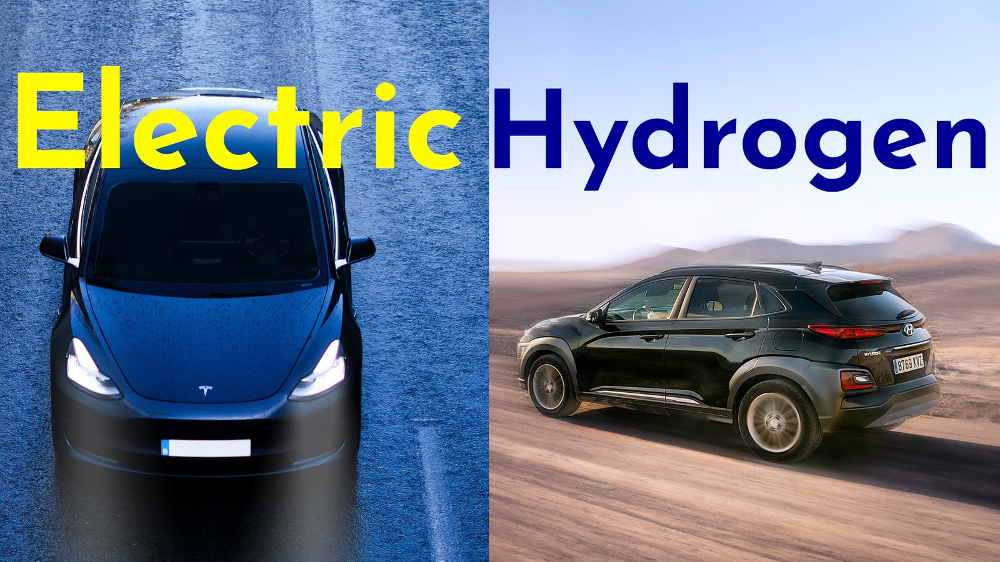
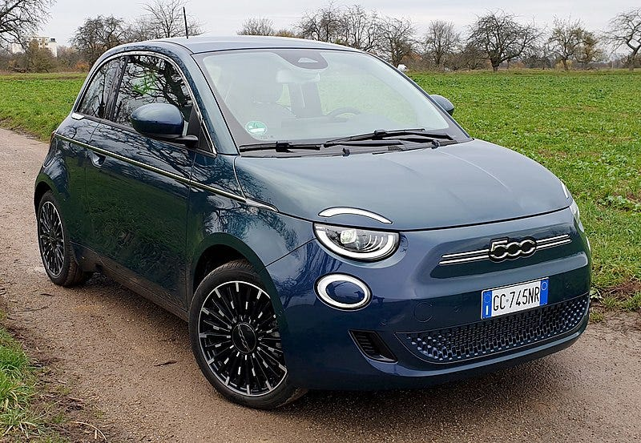
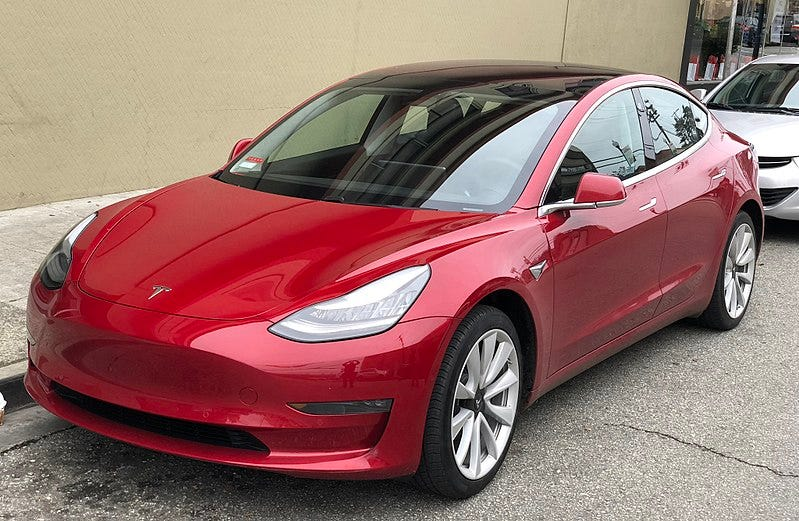
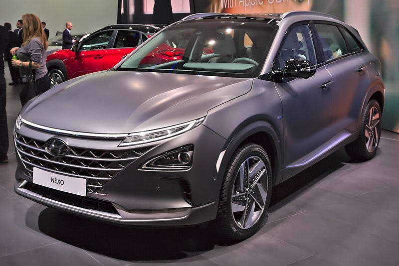

<figure>
    
    <figcaption>Image by Dylan Calluy (<a href="https://unsplash.com/photos/D1w-heh9uMg">left</a>) and Axel Antas-Bergkvist (<a href="https://unsplash.com/photos/_PDndqdsA3o">right</a>), created by Martin Thoma</figcaption>
</figure>

The car market is changing. While we were improving cars powered by Gasoline and Diesel for a long time, Tesla made the industry move. Electric vehicles (EV) and hydrogen cars were seen as two equally valid options for a long time, this changed in the past few years. Let me explain why I think that the hydrogen car will die.

## Infrastructure Cost: Charging Stations

The cost of building a hydrogen fueling station is estimated to be between \$1 million USD and \$2 million USD, whereas the cost of a 350 kW electric vehicle charging station is estimated to be around \$200,000 USD ([source](https://www.wardsauto.com/technology/costs-check-growth-fuel-cell-infrastructure)).

It’s important to notice that the charging stations differ. While your home power outlet can charge with about 2.3 kW ([source](https://efahrer.chip.de/ladezeitenrechner)), the Tesla Supercharger V3 supports up to 250 kW ([source](https://www.tesla.com/de_DE/support/supercharging)). Looking at the data of the official German regulating agency (Bundesnetzagentur, [source](https://www.bundesnetzagentur.de/DE/Sachgebiete/ElektrizitaetundGas/Unternehmen_Institutionen/HandelundVertrieb/Ladesaeulenkarte/Ladesaeulenkarte_node.html) from April 2021), Germany has 19,658 charging stations for electric vehicles:

<figure class="chart">
<table class="bar-chart" data-unit="charging stations" data-total="19658" data-approx>
    <caption>Electric vehicle charging stations in Germany by charging power, April 2021</caption>
    <thead><tr><th>Charging power</th><th>Number of charging stations</th></tr></thead>
    <tbody>
        <tr><td>up to 21 kW</td><td>870</td></tr>
        <tr class="highlight"><td>22 kW</td><td>4170</td></tr>
        <tr><td>23–43 kW</td><td>2100</td></tr>
        <tr class="highlight"><td>44 kW</td><td>8630</td></tr>
        <tr><td>46–50 kW</td><td>840</td></tr>
        <tr><td>51–90 kW</td><td>850</td></tr>
        <tr><td>91–100 kW</td><td>950</td></tr>
        <tr class="highlight"><td>101–150 kW</td><td>320</td></tr>
        <tr class="highlight"><td>151 kW or more</td><td>870</td></tr>
    </tbody>
</table>
<figcaption>There are 19,658 charging stations in total in Germany in April 2021. 44% of them are 44 kW stations, 21% are 22 kW stations, and 6% support at least 100 kW. Data from the Bundesnetzagentur; the numbers per class are rounded to tens.</figcaption>
</figure>

The situation for hydrogen cars is simpler. There are only 92 hydrogen stations in Germany ([source](https://h2.live/), April 2021). In February 2020, there were 177 hydrogen stations in all of Europe ([source](https://fuelcellsworks.com/news/in-2019-83-new-hydrogen-refuelling-stations-worldwide)), while there were 285,796 electric charging stations in Europe ([source](https://www.statista.com/statistics/955443/number-of-electric-vehicle-charging-stations-in-europe/)). And don’t forget that you can use a household power outlet for electric cars as well.

The situation looks similar across the world:

* Germany: 92 hydrogen stations vs 19,658 electric charging stations
* Japan: [150 hydrogen stations](https://www.businesswire.com/news/home/20210308005510/en/Global-Market-for-Hydrogen-Fueling-Stations-2021---Distribution-of-Stations-Will-Be-More-Even-by-2035-but-APAC-Will-Continue-to-Lead-the-Market-Followed-by-Europe---ResearchAndMarkets.com) vs [30,390 electric charging stations](https://www.statista.com/statistics/1129911/japan-electric-vehicle-chargers-number/)
* United States: [46 hydrogen stations vs 41,944 electric charging stations](https://afdc.energy.gov/stations/states)

The lack of hydrogen fueling stations brings me to the **flawed range argument for hydrogen** cars: While you might need to charge more often with an electric vehicle, you can move anywhere in Europe. With hydrogen, you might be stuck somewhere.

Please also don’t forget the comfort factor and the gain in efficiency by charging your car overnight at home. With electric vehicles, you might not need to go to a public charging station on most days. You just drive to work, buy some groceries, and charge the car at home.

Thinking a bit more about the very low number of hydrogen stations, you could also realize that **the quick hydrogen fueling argument is flawed**: When there are other people who want to fuel, you need to queue.

## Cost of a Car

I hope I’ve convinced you that electric cars have a clear advantage compared to hydrogen cars when it comes to infrastructure. Let’s see how the actual cars compare.

One weak point of electric cars is their range and the time to charge.

For calculating the total cost, I’ll assume that one will drive 200,000 km (124,000 miles) in the lifetime of a car. I assume that on most days people will drive less than 100 km (62 miles) and that they will always drive less than 850 km (530 miles) in a day.

I assume that charging costs 0.295 EUR / kWh electricity and 9.50 EUR/kg hydrogen.

### Low-End Car: Up to 25k EUR

<figure>
    
    <figcaption>A Fiat 500e. Image by <a href="https://commons.wikimedia.org/wiki/File:Fiat-500-vorne2.jpg">Daniel Przygoda</a></figcaption>
</figure>

The Fiat 500e Action costs 23,560 EUR. It can drive about 180 km with its 23.8 kWh battery. It can charge in 35 minutes to 80% ([source](https://www.adac.de/rund-ums-fahrzeug/autokatalog/marken-modelle/fiat/fiat-500-elektro/)). Assuming 14.9 kWh/100 km, the lifetime cost of the Fiat 500e action is 32,351 EUR.

I could not find a hydrogen car in this price class.

### Mid-Range Car: 25k — 40k EUR

<figure>
    
    <figcaption>A Tesla Model 3. Photo by <a href="https://commons.wikimedia.org/wiki/File:Tesla_Model_3_parked,_front_driver_side.jpg">Carlquinn</a>.</figcaption>
</figure>

The Renault Zoe costs 30,000 EUR. It can drive about 231 km with its 41 kWh battery. It can make use of a 50 kW charger to load enough electricity for 150 km in 30 minutes ([source](https://www.adac.de/rund-ums-fahrzeug/autokatalog/marken-modelle/renault/renault-zoe/)). The Renault Zoe was sold 9431 times in Germany in 2019. Assuming 17.7 kWh/100km, the lifetime cost of the Renault Zoe would be 40,443 EUR. Another electric alternative in this category is the [Smart EQ ForTwo](https://en.wikipedia.org/wiki/Smart_Fortwo#smart_EQ_rebrand_%282018%E2%80%93present%29).

The BMW i3 costs about 39,000 EUR new and around 17,000 EUR used ([source](https://www.autobild.de/artikel/bmw-i3-preis-gebrauchtwagen-reichweite-17023485.html)). It has a range of about 270 km with its 42 kWh battery ([source](https://www.adac.de/rund-ums-fahrzeug/autokatalog/marken-modelle/bmw/bmw-i3/)). It should charge in 40 minutes to about 80%. It was sold 9117 times in Germany in 2019.

The Tesla Model 3 costs about 35,000 EUR ([source](https://www.auto-motor-und-sport.de/elektroauto/tesla-model-3-jetzt-ab-35-000-euro/)). It has a range of 430 km ([source](https://www.adac.de/rund-ums-fahrzeug/autokatalog/marken-modelle/tesla/tesla-model-3/)). Using Tesla Superchargers, it takes roughly 5 minutes to charge for 120 km ([source](https://www.elektroauto-news.net/elektroautos/tesla-model-3-supercharger-v3-laderekord)). Assuming 20.9 kWh/100 km, the lifetime cost of a Tesla Model 3 is 47,331 EUR.

There are also other options like the Chevy Bolt EV for 26,400 EUR ([source](https://www.autozeitung.de/chevrolet-bolt-2021-preis-reichweite-199793.html)), the VW ID4 for 37,000 EUR ([source](https://www.adac.de/rund-ums-fahrzeug/autokatalog/marken-modelle/vw/vw-id-4/)).

There are no hydrogen cars in this category.

### High-End Car: Over 40k EUR

<figure>
    
    <figcaption>A Hyundai Nexo. Image by <a href="https://commons.wikimedia.org/wiki/File:Hyundai_Nexo_Genf_2018.jpg">Alexander Migl</a>.</figcaption>
</figure>

The Tesla Model X costs about 96,000 EUR. Its 100 kWh battery reaches 400–500 km ([source](https://www.adac.de/rund-ums-fahrzeug/autokatalog/marken-modelle/tesla/model-x/1generation/268176/)). Assuming 24 kWh/100 km ([source](https://www.adac.de/rund-ums-fahrzeug/tests/elektromobilitaet/stromverbrauch-elektroautos-adac-test/)), the lifetime cost of a Tesla Model X is 110,160 EUR.

Other EV options are the Kia EV6 for 45,000 EUR ([source](https://www.autobild.de/artikel/kia-ev6-2021-elektroauto-preis-technische-daten-reichweite-akku-18715731.html)), Ford Mustang Mach-E for 47,000 EUR ([source](https://www.adac.de/rund-ums-fahrzeug/autokatalog/marken-modelle/ford/ford-mustang-mach-e/)), the Hyundai Ioniq 5 for 60,000 EUR ([source](https://www.auto-motor-und-sport.de/elektroauto/hyundai-ioniq-5-2021-rimac-technik-gegen-id-4/)).

Let’s look at the hydrogen alternatives. I could only find two hydrogen cars that can be bought:

* The Toyota Mirai costs about 64,000 EUR. It has a range of 650 km ([source](https://www.adac.de/rund-ums-fahrzeug/autokatalog/marken-modelle/toyota/toyota-mirai/)). Assuming 0.8 kg/100km, the lifetime cost of the Toyota Mirai is 79,200 EUR.
* The Hyundai Nexo costs about 69,000 EUR. It has a range of 540 km ([source](https://www.adac.de/rund-ums-fahrzeug/autokatalog/marken-modelle/hyundai/hyundai-nexo/)). Assuming 0.92 kg/100km ([source](https://www.adac.de/rund-ums-fahrzeug/autokatalog/marken-modelle/hyundai/hyundai-nexo/)), the lifetime cost of the Hyundai Nexo is 86,480 EUR.

## An Outlook to the Future

In 2019, there were 535 new hydrogen cars registered in the EU. Not models, but vehicles on the street. Compare that with the 360,000 electric vehicles registered in the EU in 2019 ([source](https://www.heise.de/news/Elektroautos-in-Europa-Zahl-der-Neuzulassungen-verdoppelte-sich-2020-5047265.html)).

Single data points miss the growth rate. While EV registrations more than doubled from 2019 to 2020 with an already bigger base, the registrations of hydrogen cars halved to about 212 cars ([source](https://elektro-kraftfahrzeuge.com/e-fahrzeuge-mit-brennstoffzelle/zulassungszahlen-fuer-fahrzeuge-mit-wasserstoffantrieb-in-deutschland/)). Volkswagen (VW), one of the biggest manufacturers in the world, will not continue to work on hydrogen cars ([source](https://www.businessinsider.de/wirtschaft/mobility/vw-mercedes-co-verabschieden-sich-von-ihren-wasserstoff-traeumen-k/)).

It’s pretty clear that electric vehicles are on the rise and hydrogen cars are about to die. The technology is cool but too expensive. Only massive subsidies or innovations could change that.

I hear people raise concerns about the load that the electric grid needs to support when we all switch to electric vehicles. While this is a valid long-term concern, I’m not worried about it. Gasoline and Diesel cars will dominate the streets for a long time. While more electric vehicles are sold, the grid gets improved. When we get power outages or similar issues with charging cars, fewer people will buy electric cars. That gives us time to improve the electric grid. It’s a self-regulating process.

The other concern I hear is the waste of batteries. Here I see policymakers in the responsibility. The price of any product should include all costs if possible so that rational market participants can make good decisions. In the case of electric cars, it could mean that battery manufacturers get obliged to take back their batteries at the end of life. The battery manufacturers need to deposit/recycle them. This gives them an incentive to make them easier to recycle and takes the burden from the consumer. By the way, this is the case for household batteries already. In Germany, every supermarket has a waste bin for old household batteries.

## What does that mean for us?

In conclusion, I’m convinced that hydrogen cars are dead before they even got going. The alternatives are just too strong. I was tempted to advise against buying a hydrogen car and against subsidizing hydrogen infrastructure.

However, I’ve focused solely on private cars. The situation might look very different for taxis, buses, and trucks. Long-time energy storage for personal homes and general infrastructure might also be different. Without having looked into those topics, I could imagine that hydrogen could be a solution there. But I’m convinced hydrogen isn’t a solution for personal transportation.

While all of this might sound like big praise for the clean, efficient, and modern electric vehicles, I want to point out that there are severe issues we still have to tackle: The availability of Lithium, the process of mining it, the safety in case of a fire or an accident, the energy capacity, the power necessary for the electric energy network, the waste created by old batteries, and the price pop to my mind.

Interestingly, all of them might be solvable:

* Solid-State Batteries: Toyota works on [solid-state batteries](https://www.youtube.com/watch?v=G01xv1RyRVw) which promise to charge to 100% in just 10 minutes, higher energy density which would double the range compared to current lithium-ion batteries, no toxic materials, better behavior in case of fire. Samsung is also working on solid-state batteries and claims to have reached 800 km with a single charge ([source](https://news.samsung.com/global/samsung-presents-groundbreaking-all-solid-state-battery-technology-to-nature-energy), [article in nature](https://www.nature.com/articles/s41560-020-0575-z)). The Nio ET7 should go public in 2022 and have a range of 1000 km (621 miles, [source](https://www.adac.de/rund-ums-fahrzeug/elektromobilitaet/fahrbericht-test/nio-et7/)). John Goodenough claimed in 2016 to have found a research path to generate a [glass battery](https://en.wikipedia.org/wiki/Glass_battery).
* Lithium-Iron Batteries: Tesla migrates from Nickel to Iron. This is cheaper and allows more recharges.
* [XNRGI Lithium Metal Battery](https://spectrum.ieee.org/energy/the-smarter-grid/the-return-of-the-lithiummetal-battery): The new battery should 6-fold the energy density while reducing the fire-hazard risk ([source](https://www.auto-motor-und-sport.de/tech-zukunft/alternative-antriebe/xnrgi-lithium-metall-batterie-elektroauto-revolution/)).
* [Molten-Salt Batteries](https://en.wikipedia.org/wiki/Molten-salt_battery)
* [SALD Batteries](https://www.springerprofessional.de/batterie/werkstoffe/neue-li-ion-akkus-verdreifachen-reichweite-von-e-autos/18579756) claim to bring the range of electric cars to over 1000 km.
* [Graphene Battery](https://www.mdr.de/wissen/faszination-technik/elektroauto-reichweite-was-kann-der-neue-super-graphen-akku-100.html): The new battery should charge in 8 minutes to 80% and allow ranges of more than 1000 km (621 miles). The car manufacturer GAC wants to release the new technology in September 2021 in the Aion V.

If this sounds cool, look for Tesla’s Battery Day or Volkswagen’s (VW) Power Day!

As the last word, I need to point out that hydrogen-based solutions might have a solution for the expensive fueling stations and cars: [Power Paste](https://www.businessinsider.com/car-bike-tesla-amazon-gates-bezos-climate-change-fuel-drone-2021-2)!

<iframe width="560" height="315" src="https://www.youtube.com/embed/E7-i0dzx1Ho" title="YouTube video player" frameborder="0" allowfullscreen></iframe>
