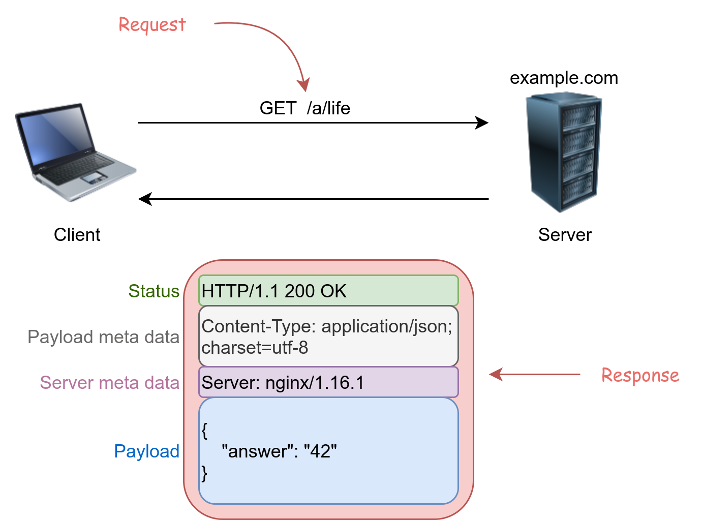
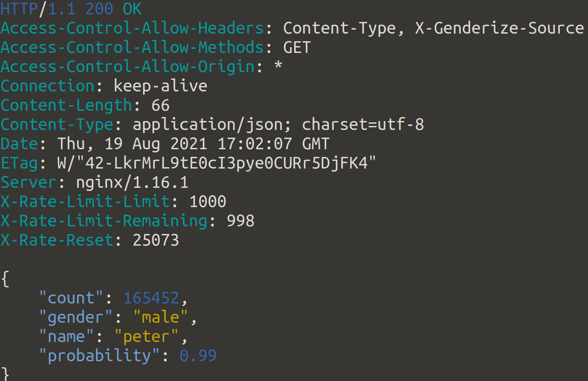
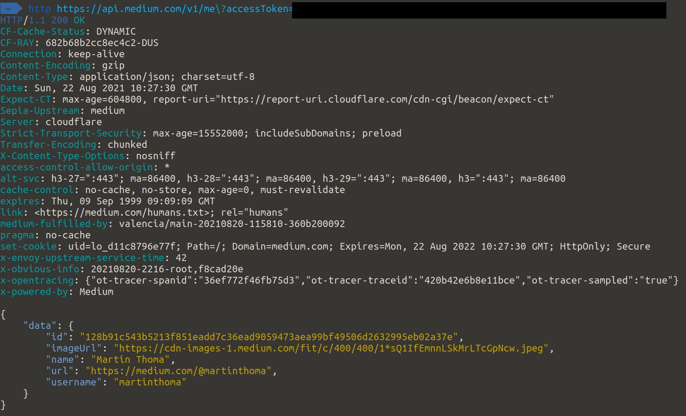
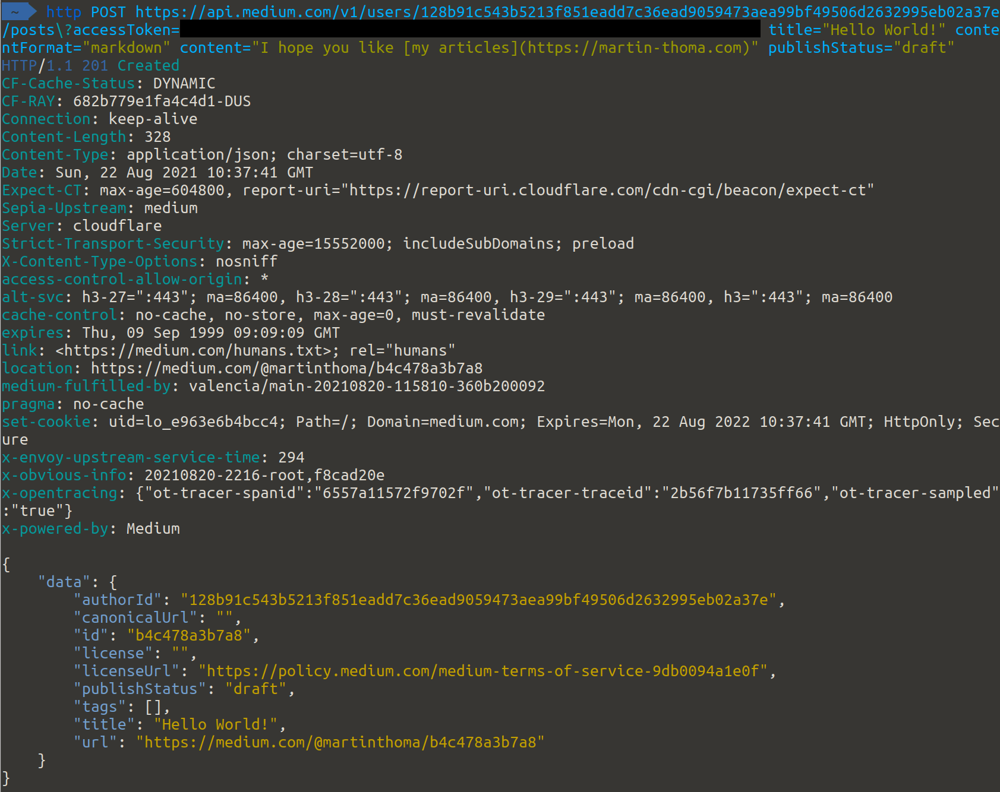
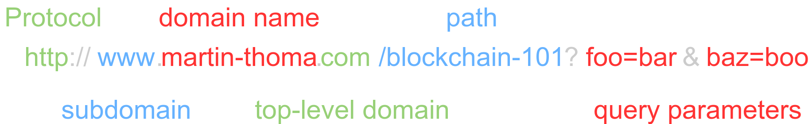
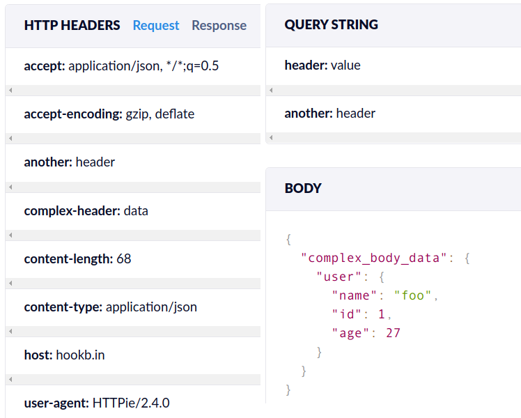

<figure>
    <a href="../images/2021/08/api-testing-with-httpie-1.png"></a>
    <figcaption>Example of a HTTP request sent with HTTPie and the received response. Screenshot taken by Martin Thoma.</figcaption>
</figure>

Testing is a crucial part of software development. It comes in different flavors such as unit testing, stress testing, acceptance testing, smoke testing. “Just giving it a shot” is probably the simplest of them all, but crucial to be convinced that things work as they should.

We often focus on the non-developers as end-users, but in some cases, developers are our end users. On the web, that often means we provide REST APIs to them. REST APIs are everywhere. Examples include [Trello](https://developer.atlassian.com/cloud/trello/rest/api-group-actions/), [MediaWiki / Wikipedia](https://www.mediawiki.org/wiki/API:Main_page), [Google Drive](https://developers.google.com/drive/api/v2/reference#Children), and [many more](https://github.com/public-apis/public-apis).

After reading this article, you will understand the core concepts related to REST APIs in the context of testing them. Additionally, you will know how to actually send requests with [HTTPie](https://httpie.io/). It’s explicitly not about REST API design.

## The Basics

### What is an API?

When a website is created for human users, it has a graphical interface. People parse websites visually, looking for common design elements such as headers, navigation, the content section, maybe some metadata.

When we build something for other developers, we call it API: Application Programming Interface. It is purely text-based and has a more formal structure. Imagine it like specified forms. The API has documentation that formally states “if you send me form X, I will respond with form Y”.

### Client / Server and Request / Response

In the API world, we have a client and a server. The client is typically a browser and the server is where the website/content is. Typically, there are lots of clients and only very few servers. A server is both, the hardware and the software. It depends on the context.

<figure>
    <a href="../images/2021/08/api-testing-with-httpie-2.png"></a>
    <figcaption>The client and the server have a request/response relationship. In this example, the client sends a GET request for the “/a/life” resource. The server responds with the status code 200 (OK) and other headers. The payload is {“answer”: “42”}. Image by Martin Thoma.</figcaption>
</figure>

The client sends a request to the server. The server sends a response back.

### HTTP Methods

Each request uses exactly one HTTP method. The five most common methods are:

* **GET**: A GET request should never change anything. You just want to read what is there.
* **POST**: Create something new.
* **PATCH**: Update an existing object.
* **PUT**: Similar to POST and PATCH combined. The client sends an identifier. If that identifier exists, update the object behind it. If not, create the object.
* **DELETE**: Remove an object.

So you can say: “The client sends a GET request.”

> Trivia: When you just enter a URL in your browser, the browser will always send a GET request. When you fill out a form on a website, it is typically a POST request.

### Headers and Payload

Requests and responses consist of arbitrarily many headers and the payload. The headers are key-value pairs, e.g.

```
Access-Control-Allow-Methods: GET
Access-Control-Allow-Origin: *
Connection: keep-alive
Content-Length: 66
Content-Type: application/json; charset=utf-8
Date: Thu, 19 Aug 2021 16:35:15 GMT
ETag: W/"42-LkrMrL9tE0cI3pye0CURr5DjFK4"
Server: nginx/1.16.1
X-Rate-Limit-Limit: 1000
X-Rate-Limit-Remaining: 999
X-Rate-Reset: 26685
```

The payload can be anything. Typically text, but it could also be a byte-stream. In the case of REST APIs, the text is typically JSON formatted:

```
{
    "count": 165452,
    "gender": "male",
    "name": "peter",
    "probability": 0.99
}
```

### HTTP Status Codes

There are 3 status codes you should know:

* 200: Success — Everything worked fine.
* 404: Not Found — you or the developers messed up
* 500: Internal Server Error — the developers messed up

They always have 3 digits and they are grouped by the first digit:

* 1XX: Information
* 2XX: Success codes
* 3XX: Redirects
* 4XX: The server thinks that the client did something wrong
* 5XX: Something went wrong on the server

Good resources to look up specific codes are:

* Mozilla Developer Network (MDN): [HTTP Response Status Codes](https://developer.mozilla.org/en-US/docs/Web/HTTP/Status)
* [httpstatuses.com](https://httpstatuses.com/)
* Wikipedia: [List of HTTP Status Codes](https://en.wikipedia.org/wiki/List_of_HTTP_status_codes)

## HTTPie: Getting Started

HTTPie is a command-line HTTP client. I would recommend installing it, but you can also run it on [the official httpie website](https://httpie.io/).

Let’s first send the HTTP request from the example. Just enter this in your console:

```
http https://api.genderize.io\?name=peter
```

You should see a response similar to this:

<figure>
    <a href="../images/2021/08/api-testing-with-httpie-3.png"></a>
    <figcaption>Screenshot by Martin Thoma</figcaption>
</figure>

When you just enter that link in your browser, you will just see the payload. The browser receives the headers, but it hides the headers from you.

## Sending POST requests / Authentication


The [API documentation](https://github.com/Medium/medium-api-docs) is pretty ugly, but the API is simple to use.

Let’s first check if we got the authentication right by sending a GET request:

```
http https://api.medium.com/v1/me\?accessToken=[integration token]
```

It should look like this:

<figure>
    <a href="../images/2021/08/api-testing-with-httpie-4.png"></a>
    <figcaption>Screenshot by Martin Thoma</figcaption>
</figure>

Save your `id`. In the following, I’ll call it `user_id` and I’ll call your integration token simply `token`.

Next we send a POST request to create a draft article:

```
http POST https://api.medium.com/v1/users/{user_id}/posts?accessToken={token} title="Hello World!" contentFormat="markdown" content="I hope you like [my articles](https://martin-thoma.com)" publishStatus="draft"
```

It should look like this:

<figure>
    <a href="../images/2021/08/api-testing-with-httpie-5.png"></a>
</figure>

Congratulations! You just sent your first POST request and dealt with token-based authentication!

## Sending Data: URL, Payload, and Headers

There are three ways to send data over HTTPS: Via URL, via the request payload, or via the headers. All mentioned HTTP methods (GET, POST, PUT, PATCH, DELETE) can use all 3 methods within the same request.

When you send a request, the URL looks like this:

<figure>
    <a href="../images/2021/08/api-testing-with-httpie-6.png"></a>
    <figcaption>URL terminology explained. Image by Martin Thoma</figcaption>
</figure>

The query string is at the end of the URL and looks like this:

`?foo=bar&key=value`

It always starts with a question mark and contains key-value pairs. The key-value pairs are delimited by an ampersand `&`. The key and the value are delimited by an equals sign `=`.

## Putting it all together

Let’s use all 3 types to send data. To see if it works, I used hookbin.com (formerly requestbin; both services are shut down by now, [postbin](https://pypi.org/project/postbin/) is a local alternative). Those services just give you a URL to which you can send requests. They record the requests and show them to you.

The request we send:

```
http POST "https://hookb.in/PxzpYb2kwqspKPrrKjzR?header=value&another=header" COMPLEX-HEADER:data ANOTHER:header complex_body_data:='{"user": {"name": "foo", "id": 1, "age": 27}}'
```

The headers are identified by `httpie` via the colon notation: `header:value`. The equals sign shows that this belongs in the body. The `:=` sign shows that raw JSON is following:

<figure>
    <a href="../images/2021/08/api-testing-with-httpie-7.png"></a>
    <figcaption>The request we just sent via httpie. Screenshot of hookbin by Martin Thoma.</figcaption>
</figure>

## Summary

You have learned a lot of terminology like what HTTP methods are, the 3 ways to send data, you have seen a very simple authentication scheme. Additionally, you have seen how to use HTTPie to send those requests. Given this knowledge, you can manually test any API.
