<figure>
    <a href="../images/2021/08/api-testing-with-insomnia-1.jpg">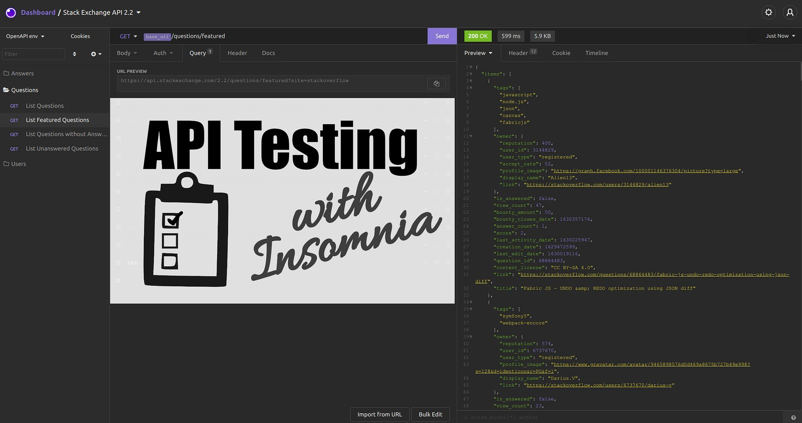</a>
    <figcaption>An overview of Insomnia. The StackExchange API was imported via this <a href="https://github.com/openapis/api-specs/tree/master/stackexchange">OpenAPI Specification</a> as an example. The screenshot was taken by Martin Thoma.</figcaption>
</figure>

Testing is a crucial part of software development. It comes in different flavors such as unit testing, stress testing, acceptance testing, smoke testing. “Just giving it a shot” is probably the simplest of them all, but crucial to be convinced that things work as they should.

After reading this article, you will know how to use Insomnia for API testing. We will go through the request collection interface of Insomnia, look at environments, and request chaining. Let’s get started!

## The Basics

If you don’t know what an endpoint, HTTP methods, or status codes are, please feel free to refresh your knowledge:

[**API Testing with HTTPie** *Testing is a crucial part of software development. It comes in different flavors such as unit testing, stress testing…*](../api-testing-with-httpie/)

## Getting started with Insomnia

You can download and install Insomnia for free ([link](https://insomnia.rest/download)). There is a paid version with additional features, but you will not need it for now.

First, create a “request collection”:

<figure>
    <a href="../images/2021/08/api-testing-with-insomnia-2.png">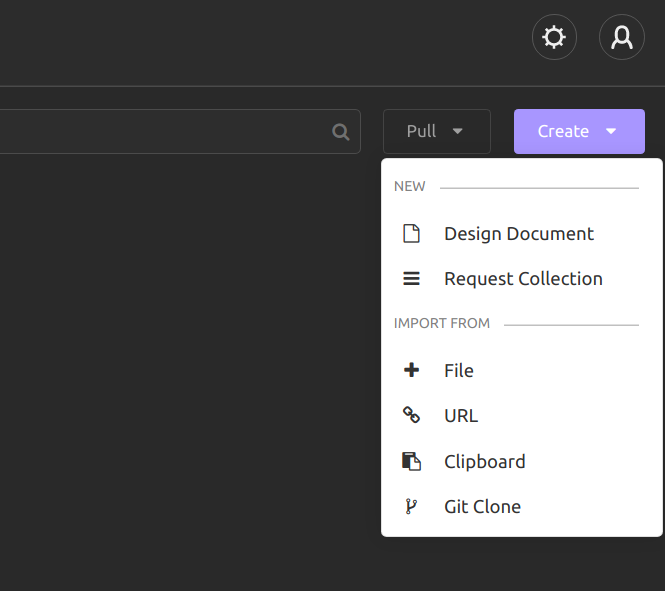</a>
    <figcaption>Create a new “Request Collection”. If you have an OpenAPI / Swagger spec YAML file, you can import it here. The screenshot is taken from Insomnia by Martin Thoma</figcaption>
</figure>

## Create a GET request

Click on “New Request” or hit Ctrl + N and enter “Get names gender” as the request name. Enter `https://api.genderize.io/` for the URL and go to the “Query” tab. Enter “name” as “New name” and “Andreas” as value. Hit the purple “Send” button:

<figure>
    <a href="../images/2021/08/api-testing-with-insomnia-3.png">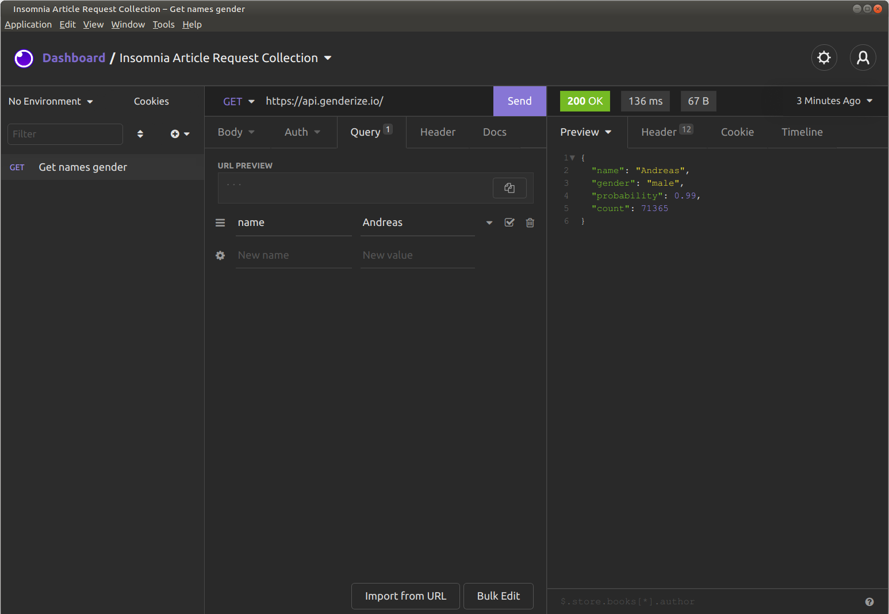</a>
    <figcaption>You can see the name of the request on the left. It shows you that it is a GET request. The query parameters are also easy to see. The response code of the server is shown in bright green. Next to it is the response time and the size of the response content. Screenshot by Martin Thoma.</figcaption>
</figure>

## The Headers Tab

Click on the “Headers” tab to see the response headers:

<figure>
    <a href="../images/2021/08/api-testing-with-insomnia-4.png">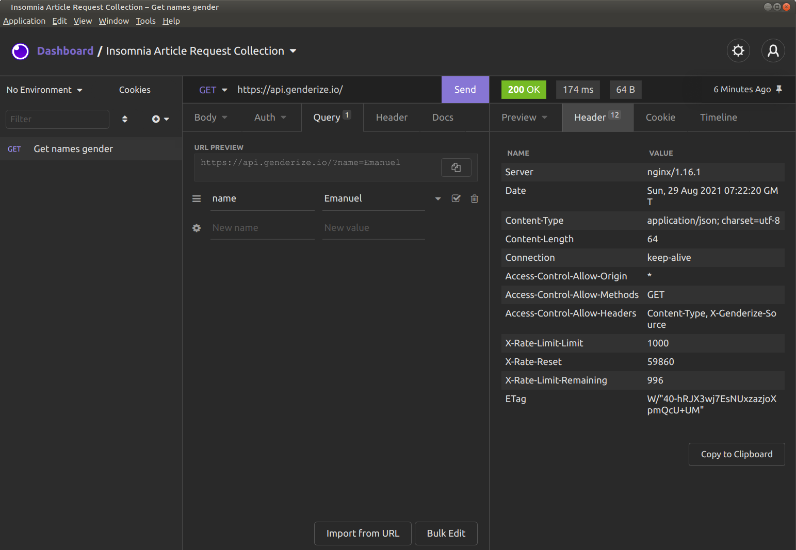</a>
    <figcaption>The response headers typically show you metadata about the server and its configuration, e.g. nginx/1.16.1, the Date, and some rate-limiting tags. The “X-” indicates that it’s something custom which might not be widespread. The headers show you meta-data about the content, e.g. the Content-Type, Content-Length. Screenshot by Martin Thoma.</figcaption>
</figure>

## The Timeline Tab

The timeline tab shows you the sequence of the request and response. I actually never use this one:

<figure>
    <a href="../images/2021/08/api-testing-with-insomnia-5.png">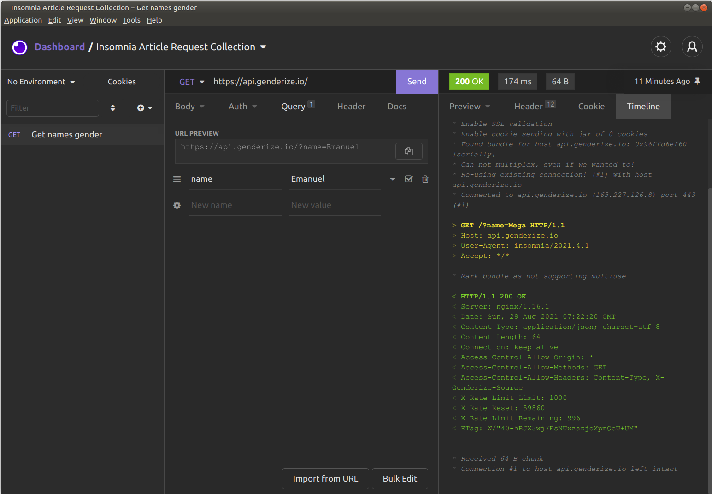</a>
    <figcaption>Screenshot was taken by Martin Thoma</figcaption>
</figure>

## The Response History Overview

Send a few more requests with different names. Then look at the bright green status code — at the very right, there is something like “A Minute Ago” / “Just Now”. If you click on it, you can see the response history:

<figure>
    <a href="../images/2021/08/api-testing-with-insomnia-6.png">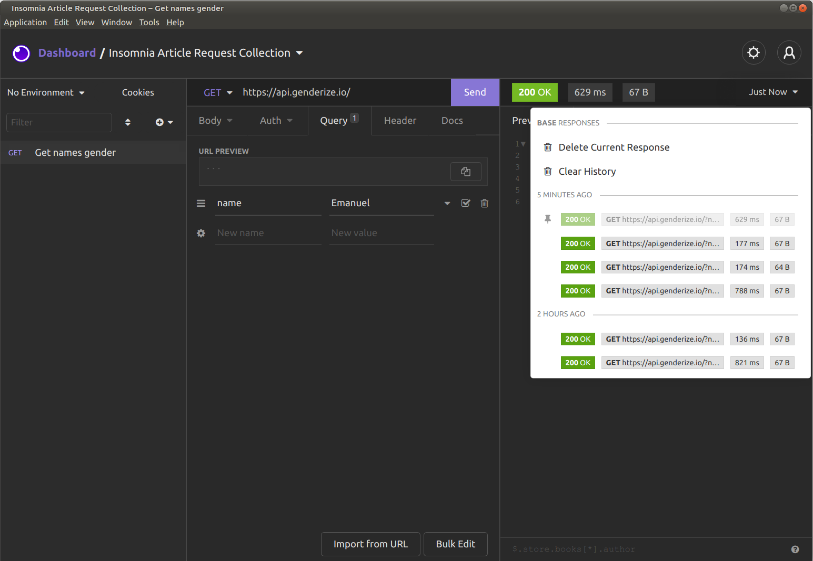</a>
    <figcaption>The response history is useful if you test the same endpoint again and again. Here you can see if the response might have become crazy slow or if the response body just increased a lot. Screenshot by Martin Thoma.</figcaption>
</figure>

If you click on any of those responses, you can look at the actual response, the headers, and the timeline.

## Using Environments

Now that you have seen some of the basics of the UI, it’s time to use a core feature: Environments. If you look at the top left, just below “Dashboard”, you can see “No Environment”. Let’s click on that and hit “Manage Environments”. Alternatively, hit Ctrl+E. Look at the “Sub Environments”, click on the “+” and click on “Environment”:

<figure>
    <a href="../images/2021/08/api-testing-with-insomnia-7.png">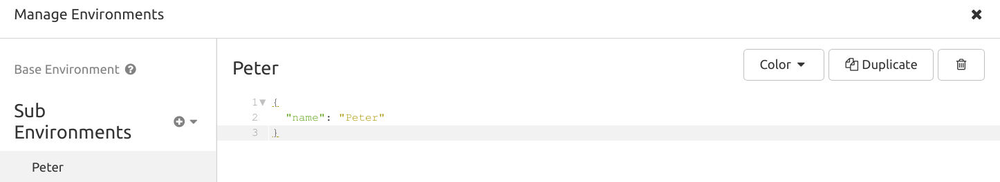</a>
    <figcaption>We called the environment “Peter” and added the variable “name” with the value “Peter” to it. You can see that the 3 lines of content are just a regular JSON dictionary. The screenshot was taken by Martin Thoma.</figcaption>
</figure>

Now duplicate the environment and create a “Karen” environment:

<figure>
    <a href="../images/2021/08/api-testing-with-insomnia-8.png">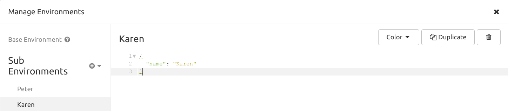</a>
    <figcaption>The screenshot was taken by Martin Thoma.</figcaption>
</figure>

Close the “Manage Environments” window. Use the “Peter” environment:

<figure>
    <a href="../images/2021/08/api-testing-with-insomnia-9.png">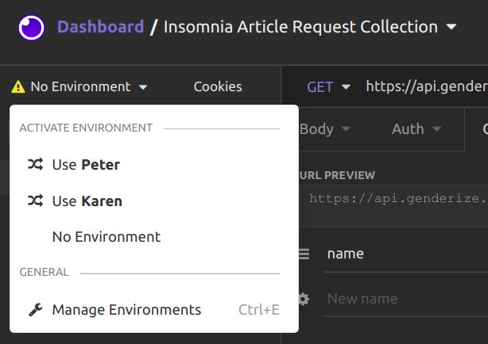</a>
    <figcaption>The screenshot was taken by Martin Thoma.</figcaption>
</figure>

Now go to the “Query” tab to the “name” key. The value probably was “Peter” — remove it. Hit Ctrl + Space. You should see a ton of options:

<figure>
    <a href="../images/2021/08/api-testing-with-insomnia-10.png">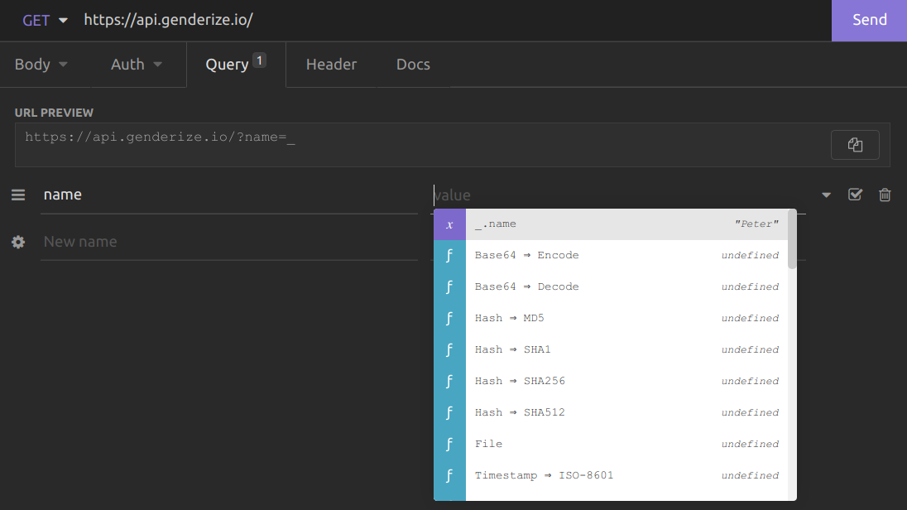</a>
    <figcaption>Auto-Complete options. The screenshot was taken by Martin Thoma.</figcaption>
</figure>

Select `_.name`. You could also have entered `_.name` directly. Now when you send the request, it uses the value of the “name” variable from your environment.

That means if you change the environment, the request you send will change.

This is incredibly useful. You might want to test different runtime environments such as dev, staging, integration, pre-production, production. You might want to test the responses for different users. Just create environments for those cases.

## Chaining Requests

Most APIs need some form of authentication. Typically, that means that you log in and receive a bearer token. This token has to be sent in all further requests.

To do that, go to “Header” and enter the key “Authorization”. As a value, you enter “Bearer “ and hit Ctrl+Space. Then enter “Response → Body attribute”:

<figure>
    <a href="../images/2021/08/api-testing-with-insomnia-11.png">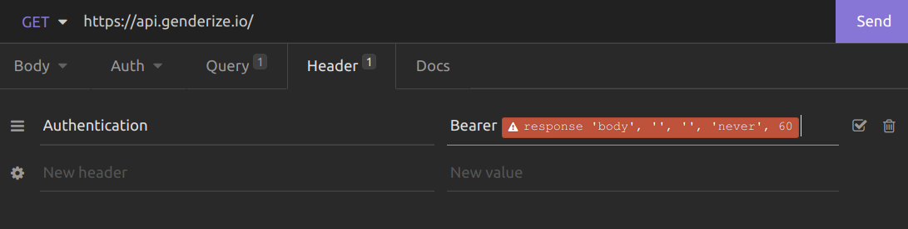</a>
    <figcaption>The response body attribute is not filled out. Screenshot by Martin Thoma</figcaption>
</figure>

When you click on the red block, you get this:

<figure>
    <a href="../images/2021/08/api-testing-with-insomnia-12.png">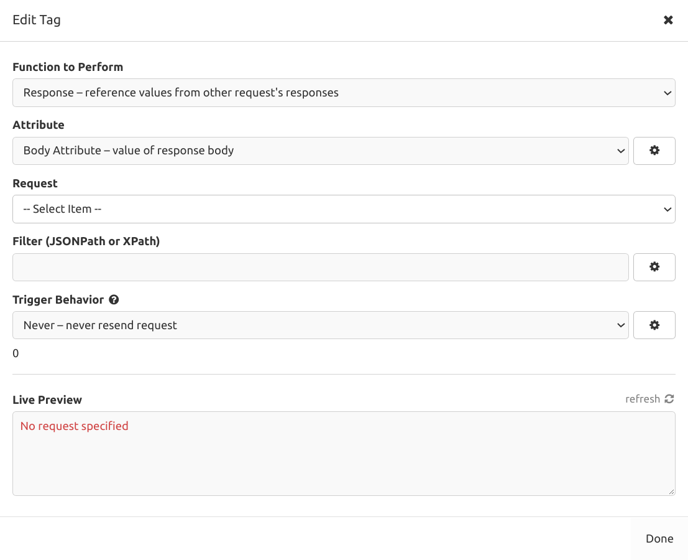</a>
    <figcaption>Screenshot by Martin Thoma</figcaption>
</figure>

We only have one “Request” so far and no API where we need authentication, but it’s good enough for demonstration. Select the request. In the “Filter” field, enter `$`. Now you should see something in the live preview:

<figure>
    <a href="../images/2021/08/api-testing-with-insomnia-13.png">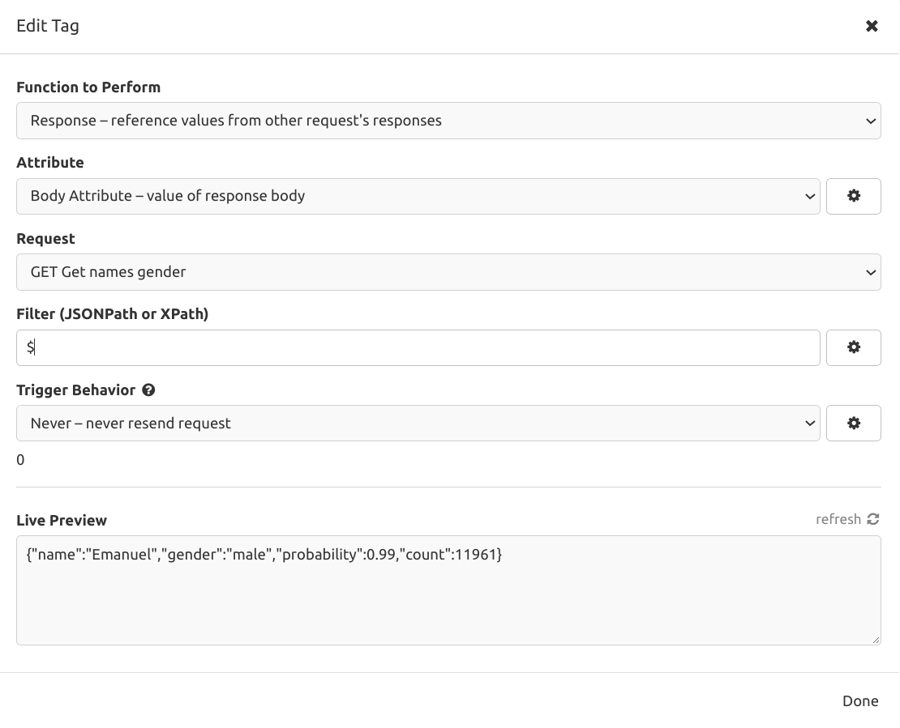</a>
</figure>

The syntax we use here is called [JSONPath](https://restfulapi.net/json-jsonpath/). If you enter `$.gender` the value this macro will get will be “male”. For access tokens, you might use something like `$.access`. It depends on the response of the server and what you want to re-use.

## Sharing Requests

Insomnia can both import and export `curl` commands. `curl` is a very powerful tool to send HTTP requests. It’s free and almost every developer will know it. A lot of tools rely on it.

<figure>
    <a href="../images/2021/08/api-testing-with-insomnia-14.png">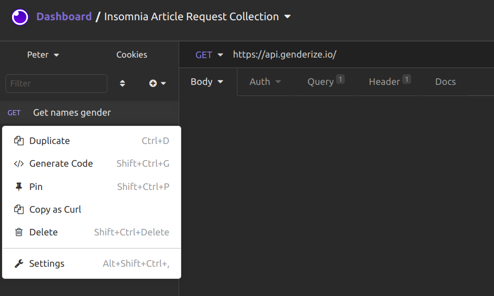</a>
    <figcaption>A right-click on the request shows the “Copy as a Curl” and “Generate code” parts to share the request</figcaption>
</figure>

Although “Copy as Curl” is a good option, your developers might prefer others. For example, I like Python code with the `requests` library. To get that, click on “Generate Code”:

<figure>
    <a href="../images/2021/08/api-testing-with-insomnia-15.png">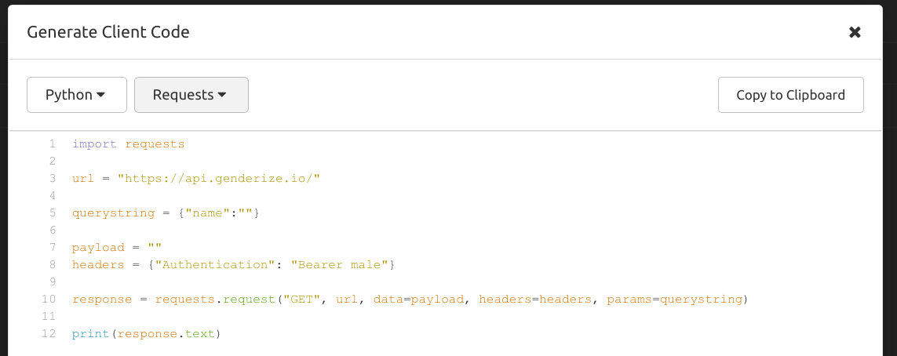</a>
    <figcaption>Generate code to send the request which was just sent by Insomnia. Ask your devs what they prefer. Under “Shell” is the option “HTTPie” which is nice as well.</figcaption>
</figure>

## Summary

You have seen how to create custom requests. Using environments and request chaining, you can get way more out of those single requests. We have looked at different meta-information such as the request timeline. Finally, you have seen how to share requests with developers.
