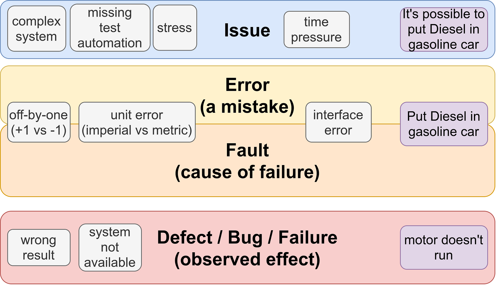

<figure>
    
    <figcaption>Issues are a pretty general term which I also like to use as a super category of the rest. An error is a mistake. If the mistake reaches the user, it is a fault. The fault is the cause of a failure. It’s called defect if it’s found during development time, bug when it’s found while testing and failure when the user finds it. Image created by Martin Thoma.</figcaption>
</figure>

Bug, issue, flaw, fault, failure, error, and defect are often used synonymously, but there are differences:

* An **error** is a mistake, e.g. a programming error or a usage error. Not every mistake leads to follow-up issues.
* A **defect** is an error found during the development phase whereas a **bug** is a defect found during testing phase. Not all programming errors are detectable. Hence not all errors cause defects/bugs.
* A **failure** is when the system does not meet its requirements. It’s an error that reached a user.
* A **fault** is the cause of a failure. It could be a programming error or it could be misuse of the system by the user.
* An **issue** can be anything — even something that was specified and is correct according to the specification. It might be something that bothers the user or something that makes development harder. It could be a design choice that leads to errors.
* A **flaw** typically refers to an issue in the architecture of the software or the design / specification of the overall system. Flaws are not directly wrong, but cause issues.

For example, if you put Diesel in a gasoline car, the car will stop working. The fact that the motor isn’t working anymore is a failure. The fault was to put Diesel in the car. Users and testers typically report failures, developers need to find the faults.

Sources: [360logica.com](https://www.360logica.com/blog/difference-between-defect-error-bug-failure-and-fault/), [ISTQB foundation level material](https://sqa.stackexchange.com/a/26838/4288), [Understanding what Fault, Error and Failure mean](https://stackoverflow.com/q/6323049/562769), [Difference between bug, defect and flaw](https://softwareengineering.stackexchange.com/q/215687/25699), [Security bugs and flaws](https://www.synopsys.com/blogs/software-security/security-flaws-vs-bugs/)

Let’s use all of those words in one scenario: Imagine a car driver who goes to a mechanic complaining that the car does not run. The user reports a failure. **The car failed to run**. The technician inspects the car and confirms it. He figures out that there is Diesel in the gasoline engine — he identified the cause: It’s the user’s **fault — the cause** of the failure is that they put Diesel in the gasoline engine! Now we try to find the reason why the fault was made. It was **human error** — the driver was not paying attention. But **it’s an issue** that you can put Diesel in a gasoline engine at all.

Let’s look at some examples of interesting or common programming errors!

## Unit Errors — Imperial vs Metric

When you deal with physical systems, units matter. It matters if you drive 100 miles or 100 km per hour. The [Mars Climate Orbiter](https://en.wikipedia.org/wiki/Mars_Climate_Orbiter) team learned that the hard way: One team used imperial units while the other one used metric units. This mismatch in communication between two software components brought the spacecraft too close to Mars, where it was destroyed in the atmosphere. It’s a loss of 327.6 million USD.

This type of error can be prevented by using unit libraries like [Python’s pint](https://pint.readthedocs.io/en/latest/) that do unit conversions for you. Once again, strong types are the rescue 😉

## Off-by-One Errors

Off-by-one errors are super common: Less than or less than or equal? Greater than or greater than or equal? Less or greater? They are logic errors that can often be found by calling the function with example input and checking the actual output against the expected output. Those off-by-one errors can also easily lead to infinite loops.

Off-by-one errors can be detected by good unit tests. Mutation testing can help to make the test suite detect those:

[**Mutation Testing with Python** *Test the tests — automatically, by applying common mistakes*](../mutation-testing/)

## Race Conditions

A race condition occurs when two or more threads / processes work on the same data. Suddenly the timing when which part of which process executes becomes important. If you’re lucky, it could be that everything works as desired. But if the timing is bad, several phenomena can occur:

* Dirty Read
* Non-repeatable reads
* Phantom Read

In the database world you can choose between different transaction isolation levels to prevent those, such as REPEATABLE READ or SERIALIZABLE ([more details](../how-concurrency-can-break-your-software/)).

Those errors are notoriously hard to find, because they depend on the timing of multiple systems. For this reason, they are also sometimes called [Heisenbugs](https://en.wikipedia.org/wiki/Heisenbug): If you inspect them, they are gone.

## Uninitialized resources

Uninitialized resources (e.g. Nullpointer Exception or `KeyError` in Python) I think are mostly covered by line coverage in unit tests and type checking tools like mypy.

## Non-functional issues

One of the most common non-functional bugs is that the code is **too slow**. You can get a grasp of this with `pytest-benchmark`, but the problem is that it depends on the hardware and what you run at the same time on the machine.

Another one I see often with browsers is that it is **too memory-intensive**. I guess that is a problem for smartphones as well.

Speaking of smartphones, **too power-intensive** is certainly another one.

## Human Error

Stating the root cause of a failure is human error is lazy in my opinion. It often means we give up on improving the system. However, I think distinguishing four types of “human error” might lead to more interesting conclusions:

* **Slips** — Failures of Attention: Maybe we need to make a warning more prominent, remove clutter from an interface, or have more people for the job.
* **Lapses** — Failures of Memory: If people forgot to do something, it might be that they have too many things to remember or that it was too long ago. Having training more often or simplifying the work could help.
* **Mistakes** — Unintentional decision making errors: If people break a rule or procedure, they might lack knowledge or understanding about the process.
* **Violation** — Intentionally doing the wrong thing: If people break a rule or procedure on purpose, they might not be aware of the consequences or their normal workflow would be significantly slower if they followed the rules all the time.

The UK Health and Safety Executive created an overview for [Understanding Human Failure](https://www.hse.gov.uk/construction/lwit/assets/downloads/human-failure.pdf).
