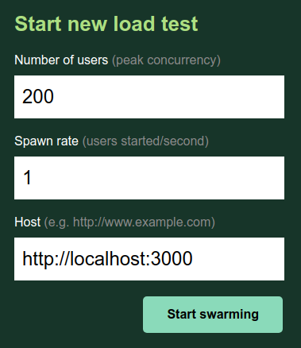
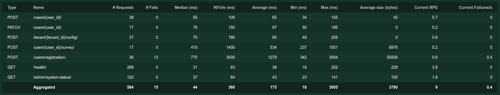
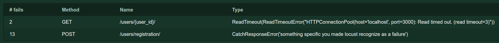
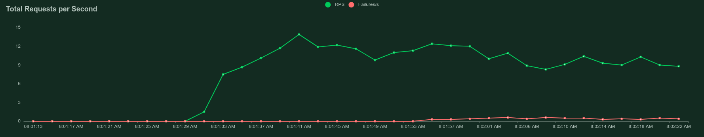
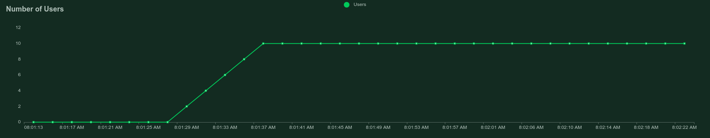
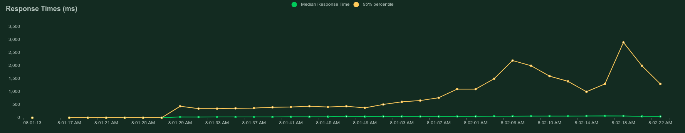
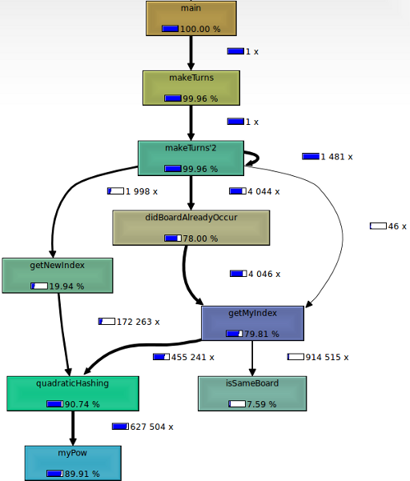

We all want software to be reliable and use minimum resources. Those are non-functional requirements and they need to be tested. In this article, we focus on web services. This means requirements like minimum energy consumption or mobile network usage are irrelevant.

After reading the article you will have a basic understanding of topics that touch performance testing and know some tools that you can use for testing web services.

## In which performance aspects are we interested?

We might be interested in three different aspects of performance. Depending on what you’re interested in, you will look at different metrics.

* **Speed**: How fast does the page load? For speed you might look at page rendering times, at response times of APIs, or throughput for bigger file transfers.
* **Stability**: Does the system behave normally? For stability you will look at error rates.
* **Scalability**: Which resources do we need to increase and by which amount if the number of our users doubles? For scalability you will look at resource utilization in comparison to different loads.

## Which Resources might be Bottlenecks?

If you want to find bottlenecks for web services, I would look at:

* **Database load**: Is the amount of requests we send to the database reasonable? Are the requests themselves fast to execute?
* **Peak memory usage**: Is there anything heavy you need to compute? How does that scale?
* **Hardware**: I’ve heard of cases where the network card was a limiting factor ([example](https://stackoverflow.com/questions/1209706/whats-the-maximum-number-of-http-connections-i-can-have-open-in-one-windows-ser#comment23076980_1209888)), although this might be less of an issue with cloud hosted machines.
* **CPU**: When CPU utilization is too high, everything will break apart.
* **Disk space**: Log files or files which are generated could kill the service on longer runs.
* **Connections**: There might be a maximum number of HTTP connections / DB connections. For Postgres, the [max\_connections is 100](https://www.postgresql.org/docs/current/runtime-config-connection.html#GUC-MAX-CONNECTIONS). nginx workers are limited to 512 concurrent connections by default ([source](https://www.nginx.com/blog/tuning-nginx/)).

## Performance Testing Types

Now that we know what potential issues are, we should talk about common [performance testing types](https://en.wikipedia.org/wiki/Software_performance_testing). The most common ones are *load testing*, *stress testing*, and *soak testing*.

### Load Testing

The purpose of load testing is to see the behavior of the tested system under an **expected** load. You don’t want to break the system here, but you want to have a load which you might get during “rush hours”. Is the application able to perform as expected under the anticipated load?

Think of a hospital or an airport where you make emergency tests, but with people who know that it will be a test. You still want to get a high, but not completely unreasonably high number of people in the test.

### Stress Testing

After load testing we know how the system behaves under anticipated load. Let’s break stuff. When we test the application under **extreme load** to see when/where/how things break, we call it *stress testing*.

Is the system stable under load? Do users see failures? Where is the upper limit of the system? Where are limits of the system? Does the system recover after failure? When it fails, is only the system’s availability affected or also its correctness?

### Soak Testing

Soak testing is trying to answer the question how the system performs over a longer time. We want to confirm that the system is reliable over a long period of time.

Things that could go wrong and be discovered under soak testing:

* DB Connection exhaustion
* Unexpected restarts
* Resource leaks, e.g. memory leaks
* Logs or other files that bloat the system

## Load Profiles

Think of a web service in the context of performance testing as a street system. People want to get from A to B. They need to go through several streets. Some have 5 lanes, others just one. Some allow them to go at 130 km/h (80 mph), others just at 50 km/h (30mph). Depending on the timing, there might be a congestion. If there is a bottleneck where you can drive fast, it might be highly unlikely that you need to wait for somebody to go through it. But the more people are in the road system, the higher the chances are that some people need to wait.

The road system is your web service. The bottleneck might be a blocking resource call such as a database transaction under a high transaction isolation level. The speed is how fast the transaction is executing.

## Testing Tools

There are tons of performance testing and profiling tools. I’ll just briefly mention a couple that I’ve either used in the past (Apache ab, Locust) or want to use (Apache JMeter, K6).

### Apache JMeter

Apache JMeter is a protocol-based load testing tool. JMeter simulates traffic and concurrent users. It looks similar to Locust, but more feature-rich.

### Apache ab

Apache ab is an HTTP server benchmarking tool. As such, it covers way less of your system than Apache JMeter — just the HTTP server. I’m pretty certain that the HTTP server isn’t the problem most of the time.

### Stress and resource limits

If you want to see how the system behaves when it hits resource limits, you can artificially reduce the resources your application has or apply [stress](https://linux.die.net/man/1/stress) to the system.

### Locust

[Locust](https://pypi.org/project/locust/) is a performance testing tool which lets you define web users that send HTTP requests. Locust automatically measures the response times and denotes failures / successes. You do this via a `locustfile.py` which you simply execute with Python. It looks like this:

```python
from locust import HttpUser, task, between


class QuickstartUser(HttpUser):
    wait_time = between(1, 2)

    def on_start(self):
        self.client.post(
            "/login",
            json={"username": "foo", "password": "bar"},
        )

    @task
    def hello_world(self):
        self.client.get("/hello")
        self.client.get("/world")

    @task(3)
    def view_item(self):
        for item_id in range(10):
            self.client.get(f"/item?id={item_id}", name="/item")
```

Executing `locust` in the folder with the `locustfile.py` starts a local web server so that you can interact with Locust via the browser.

When you start Locust, you can specify how many users you would like to spawn and how fast the users should be generated (“hatched”):

<figure>
    <a href="../images/2021/09/performance-testing-for-web-services-4.png"></a>
    <figcaption>Screenshot taken by Martin Thoma</figcaption>
</figure>

The first thing you will notice is the statistics. For every endpoint, you see the number of requests that were made against that endpoint. Locust measures how many of those requests failed, the response time, and the response size. From the response times, it shows you the minimum, median, average, 90-percentile and the maximum.

<figure>
    <a href="../images/2021/09/performance-testing-for-web-services-5.png"></a>
    <figcaption>Screenshot taken by Martin Thoma</figcaption>
</figure>

In this example, you can see that the `/users/registration` endpoint failed a couple of times. It also has a pretty high response time — both, for the maximum and the 90%ile. As the minimum response time is pretty low, this could be an indicator that this endpoint runs into a bottleneck.

Next, we should look at the failures:

<figure>
    <a href="../images/2021/09/performance-testing-for-web-services-6.png"></a>
    <figcaption>Screenshot taken by Martin Thoma</figcaption>
</figure>

Locust lets you define specific messages via `response.failure('failure message')` and shows them to you here. It also captures more general issues.

Looking at the charts can help you to identify breaking points:

<div class="gallery">
    <figure>
        <a href="../images/2021/09/performance-testing-for-web-services-7.png"></a>
    </figure>
    <figure>
        <a href="../images/2021/09/performance-testing-for-web-services-8.png"></a>
    </figure>
    <figure>
        <a href="../images/2021/09/performance-testing-for-web-services-9.png"></a>
    </figure>
</div>

It takes a few seconds as the number of users and the number of requests increase until the response times increase as well.

### K6

[K6](https://k6.io/) is a load testing tool. You can write performance tests as JavaScript files. You can [record usage with a Chrome plugin](https://chrome.google.com/webstore/detail/k6-browser-recorder/phjdhndljphphehjpgbmpocddnnmdbda) and [visualize the results in Grafana](https://grafana.com/grafana/dashboards/2587). It seems super flexible and I’m looking forward to using it 😀

## Digging into Performance Issues

When we identified performance issues in a test run, we also want to do something about it. We want to pin-point where the issue comes from so that we can fix it. Here are some tools and techniques I found useful in the past.

### Counting Queries

ORMs are amazing, but it can happen way too easily to run into the [(n+1)-issue](https://stackoverflow.com/q/97197/562769). It’s quite easy to detect if you write unit tests for those parts and also test for the number of executed SQL queries.

### Linear Microservice Cascade

If you use a service which in turn uses another service which uses another service …. well, then you get the load time of the sum of all. This is an architectural issue. It might require heavy rewrites or a lot of caching.

### Measure Memory Usage

When working on machine learning / data science topics, it sometimes happened that I needed to multiply large matrices in a production system. To ease my mind, I measured the peak memory usage with valgrind and visualized it with kcachegrind. In the Python world, [memory\_profiler](https://pypi.org/project/memory-profiler/) helped me. Those tools are called “memory profilers” and they can show all kinds of things, including call-graphs like this:

<figure>
    <a href="../images/2021/09/performance-testing-for-web-services-11.png"></a>
    <figcaption>Call-graph created by kcachegrind</figcaption>
</figure>

[Setting resource limits](https://docs.python.org/3/library/resource.html#resource.setrlimit) artificially low also helped me once to identify where memory becomes an issue.

### Front-End Performance

I’ve seen people using [Google Lighthouse](https://en.wikipedia.org/wiki/Google_Lighthouse) to find performance issues in the front-end:

[**Using Lighthouse To Improve Page Load Performance | Web** *Lighthouse is an automated tool for improving the quality of your site. You give it a URL, and it provides a list of…*](https://developers.google.com/web/updates/2018/05/lighthouse)

It’s typically run from the Chrome dev tools, but you can [integrate Lighthouse in your CI](https://github.com/GoogleChrome/lighthouse-ci) and run it automatically as well!

### Database Speedups

You might run into the situation that you need to speed up your database. Don’t worry, here are 8 hints what you could try:

[**8 Techniques To Speed up Your Database** *“If everything seems under control, you’re not going fast enough”*](../8-techniques-to-speed-up-your-db/)

## How many users do we support?

This is a question every web service needs to answer. Before you can give a number, you need to know the following:

* **Realistic Scenario**: Are the virtual users behaving similar enough to the real users?
* **Timeouts**: When is a request counted as a failure? Are 3 seconds response times still ok? Are 300 seconds response time ok? Where is the threshold?
* **Maximum failure rate**: How many failures are you willing to accept? Having it as a rate, e.g. “failures in the last 5 minutes”, enables you to run soak tests.

## Summary

You’ve learned the difference between load testing, stress testing, and soak testing. You know that not only speed, but also failures and recovery are important. You know that you can use Apache JMeter, Locust, or K6 to get started. Let’s start experimenting!
