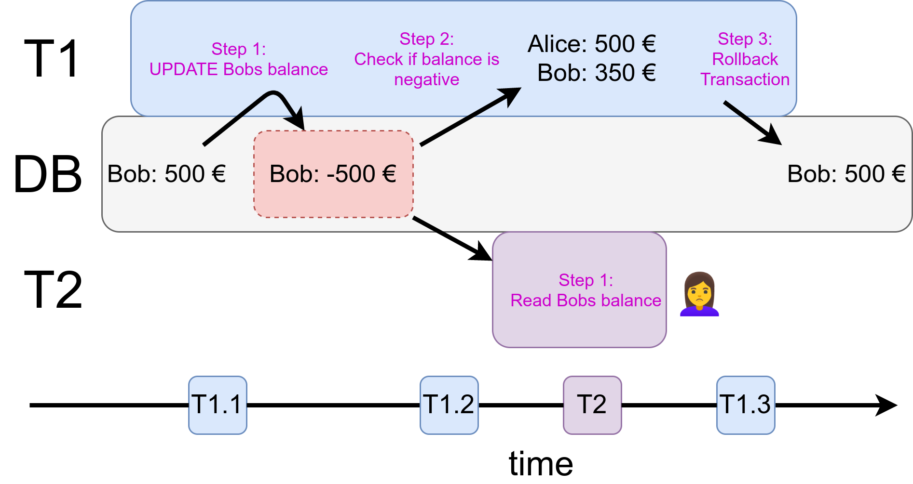
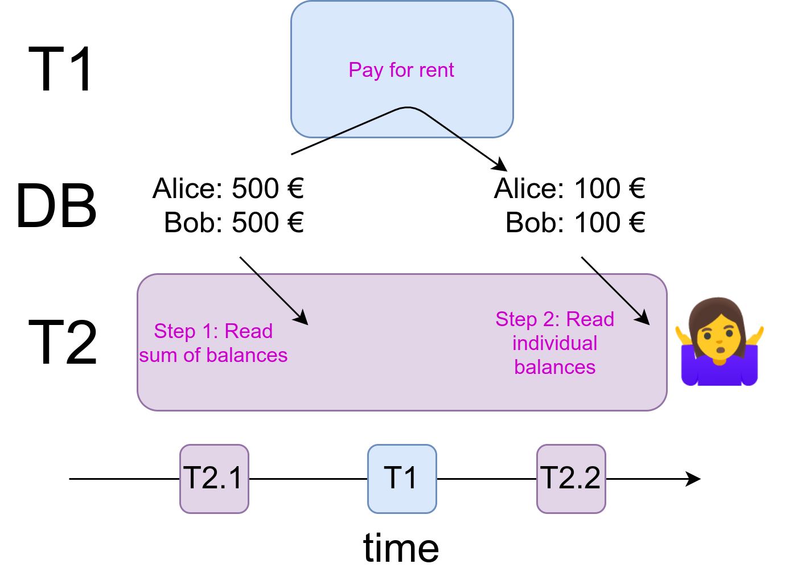

We have seen phenomenal improvements in the hardware in the last 30 years. [Moore](https://en.wikipedia.org/wiki/Moore%27s_law) observed that the number of transistors in a dense integrated circuit (IC) doubles roughly every two years, the CPU clock rate increased from 740 kHz in 1970 to 4.9 GHz in 2021, and the types of instructions CPUs can execute got more complex over time. But there are limits to increasing the clock rate and adding more complex instructions. Instead of doing that, CPU manufacturers added the possibility to execute more stuff concurrently. This comes with its own set of problems.

To me, the most interesting ones are in the context of web services. Most prominently, they are interactions with a central database and are related to *transaction isolation*. In this article, you will learn what the best-known problems of missing isolation are and which transaction isolation levels fix them. Let’s start!

## The Basics 📚

Databases organize multiple operations in ***transactions***. You can imagine a database as a sequence of transactions. If a transaction is part of the database, we say it is *committed*. If a transaction fails, a ***rollback*** is executed. The transaction is undone.

We want transactions to be ***atomic*** — either a transaction is completely part of the database or not at all. There should not be a partially committed transaction.

We also want ***transaction isolation*** — concurrent executions of transactions don’t lead to different results than serial executions. It should not matter if transactions are executed one after each other or in parallel.

The problems we will investigate in this article are called *read phenomena* and they occur when the isolation property is broken. Having stronger isolation comes at a cost. The tradeoff is speed versus guarantees that certain problems don’t occur. These guarantees are called transaction isolation levels. Controlling the issues is also called **concurrency control**. There is **optimistic** and **pessimistic** concurrency control. Optimistic concurrency control uses **snapshot** and validation, pessimistic concurrency control uses **locks**. It’s called optimistic because it first allows changes to happen and rolls back if necessary. It assumes things will be fine, whereas locks assume that something will go wrong. Depending on what happens more often, it’s cheaper to be optimistic or pessimistic.

## Do it Yourself! 🔨

If you want to execute the following statements, you need PostgreSQL running:

```bash
$ sudo su - postgres
$ psql
# CREATE TABLE balances (id varchar PRIMARY KEY, balance int);
CREATE TABLE

# INSERT INTO balances (id, balance) VALUES ('Alice', 500), ('Bob', 500);
INSERT 0 2

# SELECT * FROM balances;

id   | balance
-------+---------
Alice |     500
Bob   |     500
```

## Dirty Reads: Reading uncommitted data

> When transaction T2 sees a non-committed transaction T1, it’s called a dirty read.

Imagine this scenario: Alice and Bob are in a relationship. Alice is good at bookkeeping and keeps track of the financial situation, whereas Bob is sometimes not that financially responsible. In this case, he wants to buy a fantasy sword for 600 €. Luckily, their bank rejects transactions if the balance would drop below 0 €. But Alice checks Bob's account in between.

So we have two transactions:

* T1: Bob tries to pay for the fantasy sword, which fails and gets rolled back.
* T2: Alice checks the account.

To execute a transaction to another bank, the bank of Alice and Bob runs the following `transfer_out` function:

```sql
CREATE OR REPLACE FUNCTION
    transfer_out(source VARCHAR, amount INT) RETURNS void AS $$
DECLARE
    source_balance_after int;
BEGIN
    UPDATE balances SET balance = balance - amount WHERE id = source;
    SELECT balance FROM balances WHERE id = source INTO source_balance_after;
    IF source_balance_after < 0 THEN
        RAISE EXCEPTION 'Account % does not have enough money', source;
    END IF;
END
$$
LANGUAGE 'plpgsql' ;
```

Both initially have 500 EUR on their accounts each.

```sql
-- T1: Bob tries to get that fantasy sword
BEGIN TRANSACTION
    -- Step 1: Pay for the sword
    UPDATE balances SET balance = balance - 600 WHERE id = 'Bob';

    -- Step 2: Check if the balance got negative (it did: rollback)
    SELECT balance FROM balances WHERE id = 'Bob';
END TRANSACTION

-- T2: Alice checks the accounts
BEGIN TRANSACTION
    -- Step 1: Read the balance of Bob's account
    SELECT balance FROM balances WHERE id = 'Bob';

    -- Step 2: Read the balance of Alice's account
    SELECT balance FROM balances WHERE id = 'Alice';
END TRANSACTION
```

As we have two transactions, those two steps happen concurrently. This means it could be that T1 is first executed completely and then T2, but it could also be that they are interleaved. For example:
 T1.step1 ➔ T2.step1 ➔ T1.step2 ➔ T2.step2

<figure>
    <a href="../images/2021/10/how-concurrency-can-break-your-software-2.png"></a>
    <figcaption>Alice reads an inconsistent state of the database as transaction T1 is not finished yet. This leads her to the wrong conclusion that Bob went into debt, potentially causing high interest rates. Image created by Martin Thoma</figcaption>
</figure>

As you can see, this is problematic. Alice might now assume that they have less money than they actually have.

Dirty Reads are prevented with the **READ\_COMMITTED** transaction isolation level. As there are so many scenarios where reading uncommitted data is problematic, PostgreSQL does not even allow it:

> The SQL standard defines one additional level, READ UNCOMMITTED. In PostgreSQL READ UNCOMMITTED is treated as READ COMMITTED ([source](https://www.postgresql.org/docs/9.3/sql-set-transaction.html))

## Non-repeatable Reads 🤷

> When the same row is read twice in one transaction, but does not contain the same information due to a change outside of the transaction, it’s a non-repeatable read (aka read skew).

Alice likes to keep track of their financial situation. One part of that is to get the sum of their balances as well as the individual balances. However, this time she is unlucky. She reads the sum of balances before they both pay 400€ rent. After that, she reads the individual balances.

<figure>
    <a href="../images/2021/10/how-concurrency-can-break-your-software-3.png"></a>
    <figcaption>Alice reads the sum of balances before they both pay 400€ rent and the individual balances after that. Now she is confused because she doesn’t know that a non-repeatable read occurred. Image by Martin Thoma.</figcaption>
</figure>

To see it yourself, you need two terminal sessions opened to your PostgreSQL server:

```sql
--  Transaction 2                                 Transaction 1
# UPDATE balances SET balance = 500;
UPDATE 2

# start transaction isolation level read committed;
START TRANSACTION
# SELECT SUM(balance)
  FROM balances
  WHERE id in ('Alice', 'Bob');
 sum
------
 1000
(1 row)

                                                   SELECT transfer_out('Alice', 400);
                                                   SELECT transfer_out('Bob', 400);
                                                   SELECT * FROM balances;
                                                     id   | balance
                                                    -------+---------
                                                    Alice |     100
                                                    Bob   |     100
# SELECT *
  FROM balances
  WHERE id in ('Alice', 'Bob');
  id   | balance
-------+---------
 Alice |     100
 Bob   |     100
(2 rows)

# END;
COMMIT
```

Non-repeatable Reads are prevented with the **REPEATABLE\_READ** transaction isolation level:

```sql
# UPDATE balances SET balance = 500;
UPDATE 2

# start transaction isolation level repeatable read;
START TRANSACTION
# SELECT SUM(balance)
  FROM balances
  WHERE id in ('Alice', 'Bob');
 sum
------
 1000
(1 row)

                                                   SELECT transfer_out('Alice', 400);
                                                   SELECT transfer_out('Bob', 400);
                                                   SELECT * FROM balances;
                                                     id   | balance
                                                    -------+---------
                                                    Alice |     100
                                                    Bob   |     100
# SELECT *
  FROM balances
  WHERE id in ('Alice', 'Bob');
  id   | balance
-------+---------
 Alice |     500
 Bob   |     500
(2 rows)

# END;
COMMIT
```

## Phantom Reads 👻

> If the same query is executed twice during a transaction, but the set of rows differ, a phantom read happened. The disappeared rows are the phantoms.

Phantom Reads are prevented with the SERIALIZABLE isolation level according to the ANSI SQL-92 standard. However, the implementation of the REPEATABLE READ transaction isolation level in PostgreSQL also prevents phantom reads.

```sql
start transaction isolation level read committed;
SELECT * FROM balances;
  id   | balance
-------+---------
 Alice |     500
 Bob   |     500
(2 rows)

                                                   INSERT INTO
                                                      balances
                                                      (id, balance)
                                                   VALUES
                                                      ('Charlie', 500);

# SELECT * FROM balances;
  id     | balance
---------+---------
 Alice   |     500
 Bob     |     500
 Charlie |     500
(3 rows)

END;
```

Charlie is the phantom here 👻

## Lost Update

> When one UPDATE is lost because it is overwritten by another UPDATE of a second transaction, it’s called a lost update.

As an example, the following case. The left side and the right side are two different transactions:

```sql
start transaction isolation level read committed;
SELECT * FROM balances ORDER BY id;
  id   | balance
-------+---------
 Alice |     500
 Bob   |     500
(2 rows)

                            UPDATE balances SET balance = 100 WHERE id = 'Bob';

UPDATE balances SET balance = balance - 50 WHERE id = 'Bob';
END;
```

If you are in the REPEATABLE\_READ isolation level, the second UPDATE will trigger an exception:

> ERROR: could not serialize access due to concurrent update

## How does Postgres implement transaction isolation levels?

Postgres uses snapshot isolation for all transaction isolation levels ([source](https://www.postgresql.org/docs/14/transaction-iso.html)):

* READ\_COMMITTED sees a snapshot as of the **start of the current statement** within the transaction
* REPEATABLE\_READ sees a snapshot as of the **start of the first non-transaction-control** statement in the transaction.
* SERIALIZABLE is like REPEATABLE\_READ, but additionally monitors for conditions that could make the execution of a concurrent set of serializable transactions behave in a manner inconsistent with all possible serial (one at a time) executions of those transactions

Postgres uses a variant of Multi-Version Concurrency Control (MVCC) which is called Serializable Snapshot Isolation. The core idea is that every update does never overwrite data, but instead adds it to the DB with a transaction ID. When a SELECT is executed, potentially multiple versions can be selected which allows one transaction to have a consistent snapshot. The implementation of the [SERIALIZABLE isolation level is complex](https://www.interdb.jp/pg/pgsql05.html).

## Other Anomalies

If this is not enough for you, I recommend reading [A Critique of ANSI SQL Isolation Levels](https://www.microsoft.com/en-us/research/wp-content/uploads/2016/02/tr-95-51.pdf) by Berenson, Bernstein, Gray, Melton, O’Neil, and O’Neil. They go into detail and point out other anomalies. For example, a **dirty write** is prevented by all isolation levels (even READ\_UNCOMMITTED). It’s different from a **write skew**. Write skews are prevented in the SERIALIZABLE isolation level in Postgres.

## Summary

Here is an overview of which transaction isolation levels prevent which read phenomena:

| Isolation Level  | Dirty Read    | Non-repeatable Read | Phantom Read  |
|------------------|---------------|---------------------|---------------|
| READ_UNCOMMITTED | 💩 possible   | 💩 possible         | 💩 possible   |
| READ_COMMITTED   | ✅ prevented  | 💩 possible         | 💩 possible   |
| REPEATABLE_READ  | ✅ prevented  | ✅ prevented        | 💩 possible   |
| SERIALIZABLE     | ✅ prevented  | ✅ prevented        | ✅ prevented  |

Those isolation levels are defined in the SQL standard. However, various databases might give stronger guarantees. For example, the READ\_UNCOMMITTED transaction isolation level is equal to the READ\_COMMITTED isolation level in Postgres. Also, the REPEATABLE\_READ isolation level already prevents phantom reads in Postgres.

## References

I’ve read/viewed a lot in order to create this article. The most valuable resources were:

* [Vlad Mihalcea](https://vladmihalcea.com/): [Transactions and Concurrency Control Patterns](https://www.youtube.com/watch?v=onYjxRcToto) at Devoxx on YouTube, 2017.
* [The Internals of PostgreSQL](https://www.interdb.jp/pg/pgsql05.html)
* [Uwe Röhm](https://www.sydney.edu.au/engineering/about/our-people/academic-staff/uwe-roehm.html): [Transaction Systems](https://db.in.tum.de/teaching/ws1314/transactions/pdf/SnapshotIsolation.pdf?lang=de) in IN2267, 2014.
* PostgreSQL Docs: [Transaction Isolation](https://www.postgresql.org/docs/14/transaction-iso.html)
* Berenson, Bernstein, Gray, Melton, O’Neil, and O’Neil: [A Critique of ANSI SQL Isolation Levels](https://www.microsoft.com/en-us/research/wp-content/uploads/2016/02/tr-95-51.pdf), 1995. — Adrian Colyer made [a nice write-up](https://blog.acolyer.org/2016/02/24/a-critique-of-ansi-sql-isolation-levels/).
