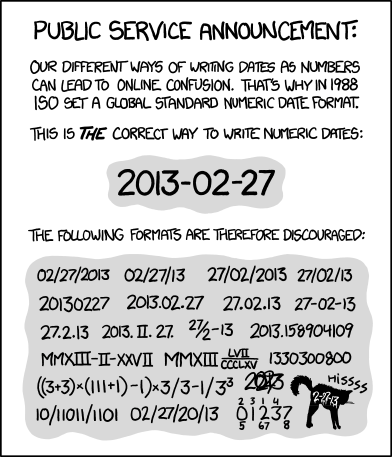

Do you really hate your Data Scientist / Data Analyst? Here is a guide on how to annoy the hell out of them 😈

## №1: Avoid repetition — Good prose needs synonyms!

Think of your code as prose. Everybody hates repetition, right? Here are some ideas on how to avoid sounding boring:

* submit, transfer, initiate, send
* user, client, customer
* id, ident, identifier, key

## №2: Avoid consistency

The world is boring when you know everything before you discover it. Surprise your data scientists! Avoid using those patterns:

* send(er) / receive(r) and source / sink and origin / destination
* save/load and serialize / deserialize
* start/stop and play/pause — and don’t forget to use synonyms like finish / succeed/fail
* in general: mixing singular and plural

Just combine sender and destination, save and deserialize.

## №3: Date formats

We all know that the best date format is `YYYY-mm-dd HH:MM:SS`:

<figure>
    
    <figcaption>Source: <a href="https://xkcd.com/1179/">XKCD 1179</a></figcaption>
</figure>

Let them know that the world is more diverse:

* 2021–06–07
* 6th of July, 2021
* 06/07/2021
* 07/06/2021

This combines well with №2 — especially for days before the 12th!

## №4: Time formats

The choice of the time zone for storing events is easy to get wrong. I mean, who cares about daylight saving time, CRON-jobs that depend on the servers' local time, and the users' daily routines which also depend on local time. Just use UTC everywhere! Let the data scientist figure out where the device was located and which date it was when the time was stored!

Oh, and for servers: Just deactivate the [Network Time Protocol](https://en.wikipedia.org/wiki/Network_Time_Protocol) server. Who needs to adjust the local time anyway?

## №5: Number formats

Learning a new language is always fun. But did you know that other languages also have other number formats? Let your data scientist know! Don’t be boring; don’t use a simple integer/float. Use a string in one of these formats:

* English format: 1,234.56
* German format: 1.234,56

## №6: Keep changing data sources — promote life-long learning!

Did you use the same analytics platform/database/data generating process for more than a couple of months? It’s time to try something new! If switching turns out not to work that well, just go back. They will for sure be happy to do a data migration 😄

## №7: Duplicate Entries — just to be sure

Log the same information twice. Just to be sure it is actually logged. But don’t give a chance to de-duplicate. Don’t use correlation IDs or something like that!

## №8: Use abbreviations — let them guess!

When you choose the name of a database table or a column within a table, use an abbreviation. Let them guess what `usr_ctr` means.

## №9: Test on production

You need to make sure that production is up and can withstand the normal load. Just run automatic tests in the production system — but don’t bother with adding special headers to mark testing activity. It’s their job to figure that out, isn’t it?

## №10: Use integers to enumerate — without adding a legend anywhere

Make something like this:

* Sex: 0/1 — besides starting a discussion for non-binary people, the data scientist can now figure out if 0 is female or male.
* Registered: 0/1/2 — you might have a lot of steps in your registration funnel. Analyzing the funnel and drawing drop-out rates is a common task. Let them figure out which step the user was in. Give them a number as a hint.

## №11: Use NULL for missing data and as a special value

Multi-variate analysis is fun. Give your data analysts the possibility to apply it for data cleaning! For example, use a `subscription_date` field that is nullable to denote if and when a user has subscribed. But when the user subscribed via an iPhone, just leave it blank.

## On a serious note

Data analysis can be super fun, but it’s often required to get rid of a ton of small annoyances like the ones I mentioned above. It’s not done with bad intentions. But maybe reading those helps to get things right. Reverse psychology, you know 😉

Another action that can help a lot for data analysis is to keep track of core events. Did you have a longer outage? When was that big client on-boarded? When was the marketing campaign run?

Besides that, you might want to get very familiar with Jupyter notebooks, Pandas, and [bamboolib](https://bamboolib.8080labs.com/). Those simplify the cleanup process quite a bit.
