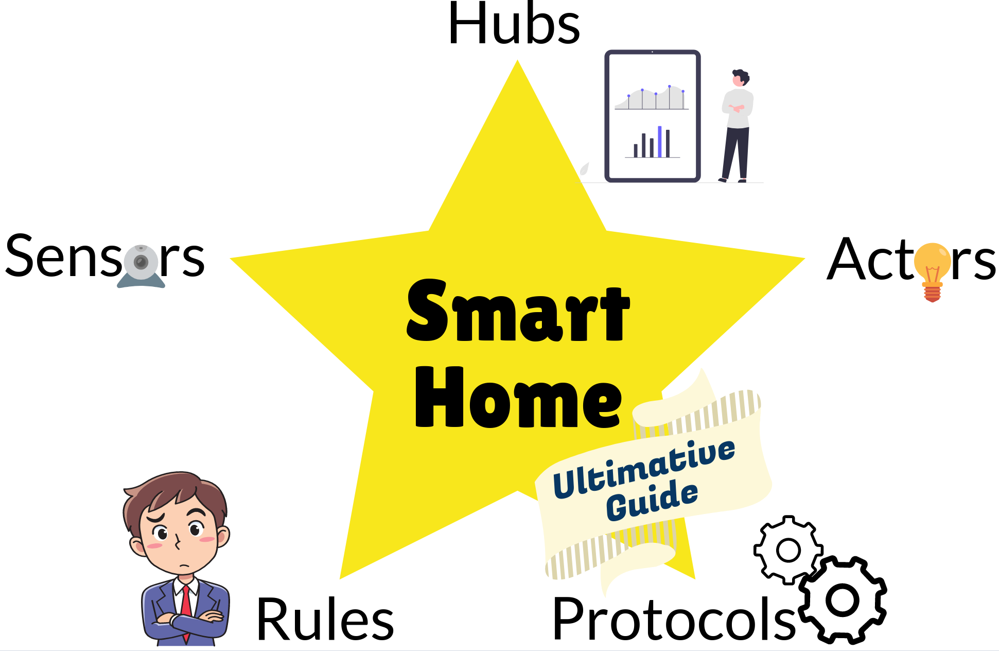
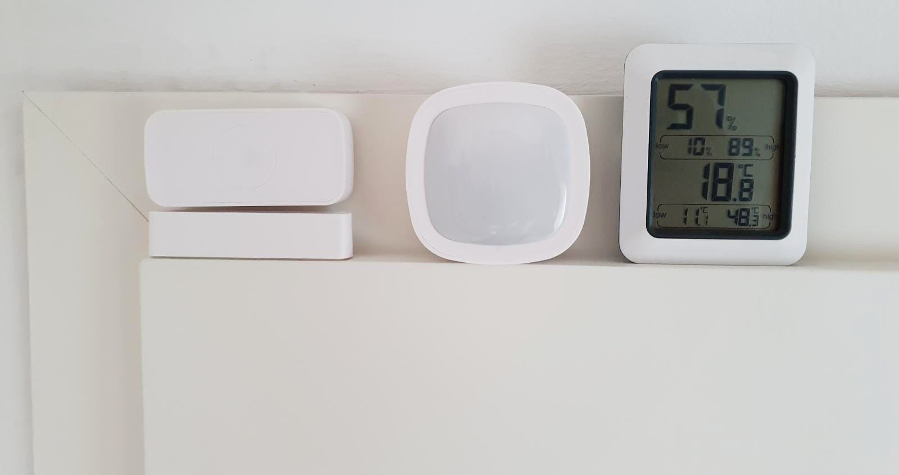
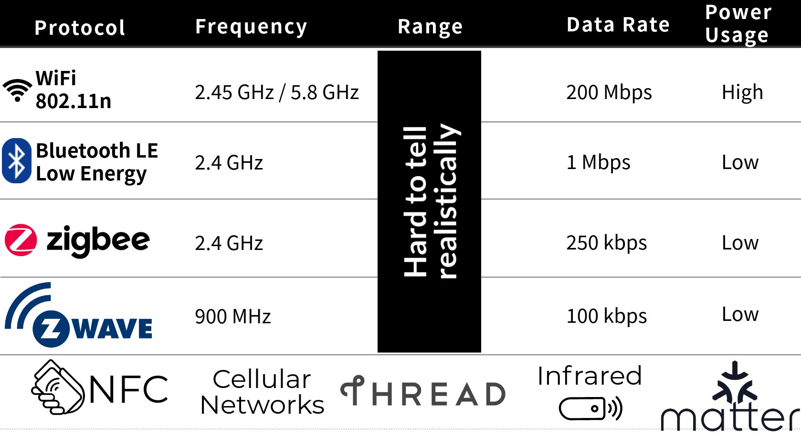
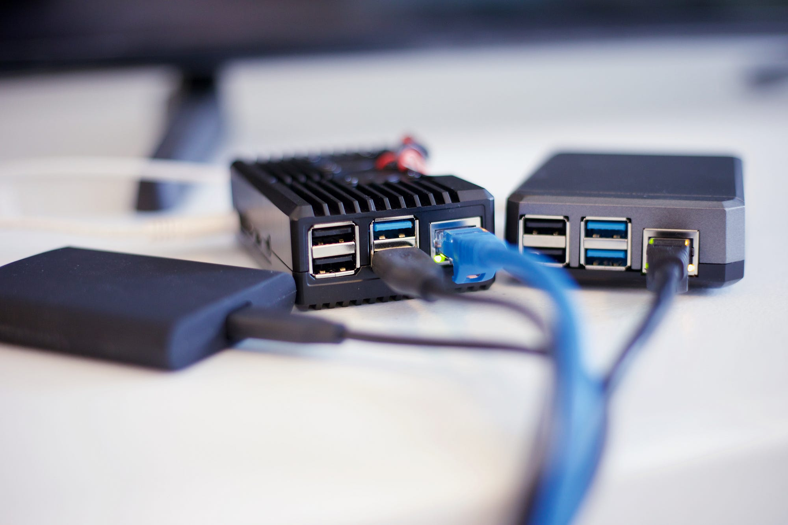
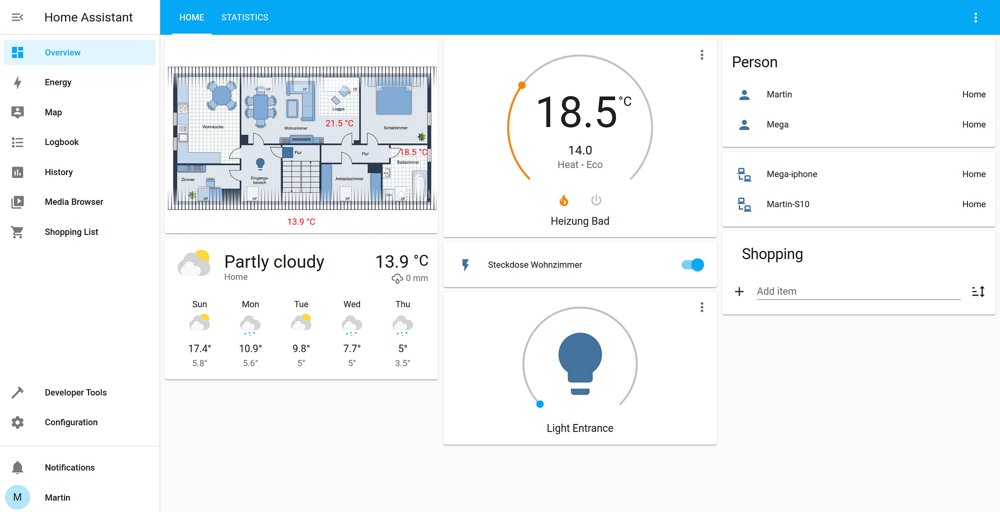
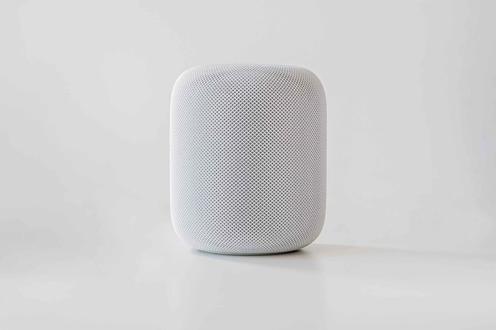
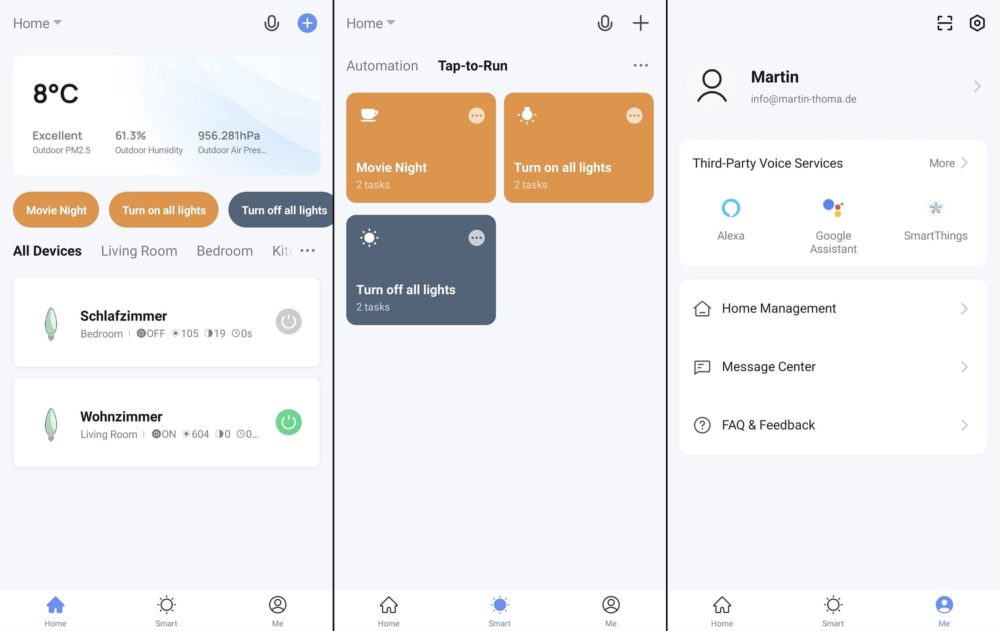
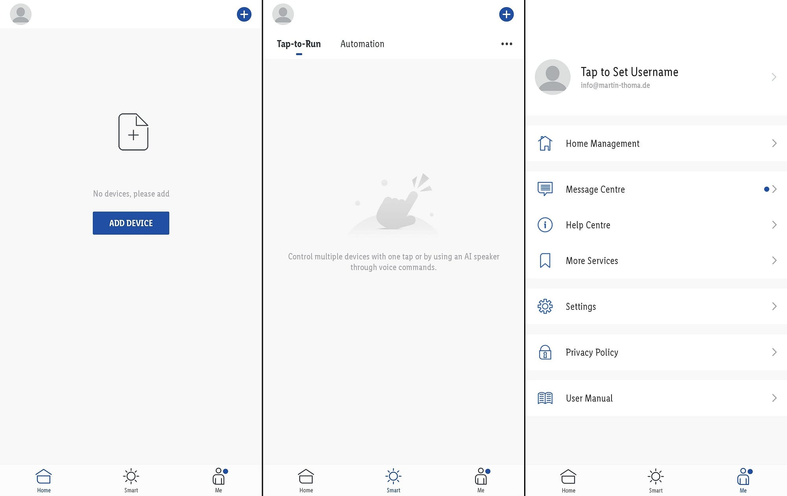

<figure>
    
    <figcaption>The five big components of Smart Homes are Sensors, Actors, Protocols, Rules, and Interfaces. Don’t worry, I’ll explain that! Image by Martin Thoma</figcaption>
</figure>

I’ve recently started looking into smart home topics and felt overwhelmed. There is a plethora of different devices, manufacturers, and systems. After reading this article you will understand what the important components are and have an overview to put everything into context. Let’s start!

## The Basic Concepts

A smart home consists of five groups of devices and software:

**Sensors** are devices or Software that gather information. Examples are temperature sensors, motion sensors, or a clock.

**Actors** are devices or software that can do something. Examples are light bulbs, smart curtains, and door openers.

**Rules** are software that takes the sensors' input and tells actors what to do. An example is to turn on the light if motion is detected and if it’s dark. If the time is between 6 am and 10 pm, the light should be bright. Otherwise, it should be less bright.

**Protocols** let the devices speak one language. Common examples are WiFi, Bluetooth, Zigbee, and Z-Wave. Those protocols are typically also connected with a signal frequency. The frequency determines physical properties that cannot be changed, for example how easily walls are passed or how high the data rate can get.

**Hubs** are the control centers of your smart home. They allow you to connect to your smart devices via the mentioned protocols and create rules around them. They make it smart. They provide the **interface** you’re using most of the time. The physical interface might be a smartphone, a desktop computer, a tablet, or a combination of those devices. What matters more than the input device is the structure of how you can create rules. Very often those hubs come with their own device on which the software runs, but some allow you to install it on any computer.

You might also see the **Internet of Things** (IoT) being mentioned. Smart home is a part of that. For example, industrial applications or mobility solutions like electric car charging stations are part of the Internet of Things, but definitely not a part of Smart Homes.

**Home Automation** is tightly coupled with Smart Home topics. Those two terms are often used interchangeably. One example of home automation that is not a part of the smart home topics is time-based lights. They go on at the same time, not considering if anybody is around. The core part of smart homes is “sense and react”: You can connect a lot of different devices and build something more interesting with them. But the borders are blurred for those two terms. Looking at [Google n-grams](https://books.google.com/ngrams/graph?content=home+automation%2Csmart+home&year_start=1980&year_end=2019&corpus=26&smoothing=3), the term “smart home” was probably coined in 1998 and kicked off around 2011 whereas home automation was probably already around in the 1980s. The term “smart home” also dominates in [Google Trends](https://trends.google.de/trends/explore?q=smart+home%2Chome+automation).

## Sensors

<figure>
    
    <figcaption>A contact sensor, a motion sensor, and a thermometer/hygrometer combination (left to right). Image by Martin Thoma.</figcaption>
</figure>

When we think about sensors, we mostly think about hardware. Devices you need to buy. But there are also software sensors that provide valuable input.

### Software Sensors

In contrast to the hardware sensors, you typically don’t own a special device for software sensors. For example, a clock is built into most computers.

* **Clock**: The time and the date are probably the most interesting software sensor. Your daily schedule depends heavily on the weekday and the time of the day.
* **Device Version**: Various devices could have the possibility to tell you if there is a version update available. This is a binary sensor: Is there an update for a specific device or not?
* **Connectivity**: Is there a connection to another device or not? For example, can something in your home connect to your smartphone?
* **Virtual Switches**: You might want to enable something manually at some point. For example, when guests are at the house. Then you can just toggle a switch on your phone to trigger something. It’s just software.
* **Presence Sensors**: If my phone is connected to the home wifi, the virtual presence sensor detects that I am at home.

### Hardware Sensors

Hardware sensors are the eyes and ears of your smart home. They are often connected with actors, e.g. you will not be able to buy a door microphone without a door speaker. There might also be multiple sensors in one device (multi-sensors), e.g. a temperature sensor and a humidity sensor.

You need to make sure that your sensors are able to connect with the hub. That means you need to look at the **protocol** being used to connect: Is it Zigbee, Z-Wave, WiFi, Bluetooth, or via Infrared (IR)? Please have a look at the “protocols” section for that.

The next interesting question is the **energy supply**. Is the device connected to the outlet or does it use a battery? Is it an AA, AAA, CR2032, or CR123A battery?

Let’s jump to sensor device classes:

**Switches** come in many shapes. A **push button** can be used for a doorbell or as a reminder to buy something. A **toggle switch** like the Kasa WiFi Light Switch can be used to turn the light on/off. A **rotary switch** is typically used for dimming the lights.

**Contact sensors** tell you if the window/door is open. There are many devices, e.g. by Linkind, Aqara, Ecolink, Silvercrest (Lidl). All of them use Zigbee. One thing to watch out for is the delay between the action (opening/closing a door) and the sensor's signal. Garage door sensors seem to be popular as well.

**Motion detection** can help to tell if somebody is in the room. Is somebody at the front door? Again, there are plenty of devices, e.g. by Ikea, Philips, HomeSeer, and Aeotec.

You typically want to do something with lights, hence measuring how bright it is comes in handy. The devices are often called **ambient light sensors** (ALS).

A **vibration sensor** can detect if somebody is knocking on the door.

The next three sensors are about feeling well at home:

**Thermometers** measure the temperature. It is simply interesting to me to see the temperature in different rooms throughout the day. Devices that support this are the FRITZ!DECT 440 and the SONOFF SNZB-02.

**Hygrometers** measure the amount of water in the air — the humidity. The SONOFF SNZB-02 is an example.

**Air quality** is important, especially in your bedroom. There are many different types of sensors, e.g. a PM2.5 particle sensor, CO₂ sensors, or a formaldehyde sensor.

There are many more, but three that I think are most interesting:

**Cameras** are interesting in a security context. You could connect those with motion sensors. If you get motion at a time/location where you don’t expect it, the camera allows you to directly have a look. I’m not a fan of cameras in my house that are connected to the internet, though.

**Accelerometers** are in your smartphone and measure if and how the device is moving. Given this information, it’s possible to tell which activity the person is doing.

**Microphones** are necessary if you want to use a voice assistant. They can also be used for other interactions, e.g. turning stuff on when you clap. Similar to cameras, I’m not a big fan of this in private spaces.

## Actors

An actor is anything that can **do** something. In contrast to a sensor that only gets information about the environment, an actor can change something. There is a crazy amount of actors, but let’s focus on the most common ones.

**Lights** are certainly the most important type of actor. There are lights that you can simply turn on/off, but very often you can also adjust the brightness. There are white lights where you can change the color temperature from cold-white to warm-white and, of course, there are RGB lights where you can change it to any color you want.

**Thermostats** are a combination of a sensor and an actor: A thermometer that measures the room temperature and an actor which adjusts it.

**Outlets** can be controlled via WiFi. You can decide when the outlet gives power. This is one of the most common ways to make non-smart devices smart. And, of course, they are typically called “smart outlets”.

**Door openers,** also called “Smart locks”, allow you to get into your home with your smartphone. They could also open your garage for you.

**Robo-cleaners** are one of the most useful devices in my opinion. You can let them run when you’re outside and always have a pretty clean floor. Some newer robotic vacuum cleaners also have a mop. The dominant manufacturer here is Roborock.

In the garden, you could automate sprinklers and have a robot for cutting the grass.

If you want to see more actors, have a look at the [Smart Home Device Types](https://developers.google.com/assistant/smarthome/guides) overview by Google.

## Rules — Tie Sensors and Actors together

<figure>
    
    <figcaption>Image by Martin Thoma</figcaption>
</figure>

Now that you have a couple of sensors and actors, you want to combine them with **rules**. Those are called **automations** or **scripts** in some software. In several apps you can read “Tap-to-run” for scripts which are executed by tapping on a button. In contrast, automations have a non-manual trigger.

Rules are built with software, but the software needs to run on hardware. Hence those two are typically more strongly connected than they need to be. Think about it similar to MacBook Air and macOS. The MacBook Air is hardware and macOS is software, but both are very strongly coupled. In contrast to PCs and laptops that run Windows / Linux. For those, you have way better mix-and-match capabilities.

In this comparison, I see the rules as a general concept of what you want to achieve. In order to implement them, you need a **smart home hub**. We will come to the hubs later, let’s first understand the concepts.

**Automations** have triggers, conditions, and actions. A **trigger** could be sunrise, a detected motion, a contact sensor telling you that a door or a window was opened, a weather forecast telling you that it is going to rain. A **condition** could be “the sun is not shining” or “somebody is at home”. They can also be combined with logical operators like `and` or `or`. An **action** could be to turn on various lights, turn on the robotic vacuum cleaner, or turn off the electricity.

**Scenes** group together various actions. An example is the light configuration when you have a movie night. They are strictly speaking not necessary, but they make things simpler. Instead of having a complex action in an automation, you can just say “trigger the relaxed evening scene”. And when you add more devices, you can just change the scene instead of adjusting many different automations.

## Protocols

<figure>
    
    <figcaption>The most relevant smart home protocols. Image by Martin Thoma</figcaption>
</figure>

What we got so far is sensors, actors, and ideas on how we want to connect those via rules. But we also need all of those devices to talk with a central hub. Information needs to flow.

Hubs help smart devices work together. They are the central point where information flows together. To do so, they need to support as many protocols as possible.

Protocols are the language two devices speak with each other. The most relevant smart home protocols are:

**WiFi (2.45 GHz or 5.8 GHz)** is what we typically use to browse the web. The devices are directly connected to your router. The fact that everybody already has a WiFi router at home makes it attractive. However, WiFi and typical private routers were designed for a few devices which have a high data load. In a smart home, you have many devices which don’t need a lot of interaction.

**Bluetooth** is a crazy standard with many different aspects. We typically use it for audio transfer and sometimes for small gadgets. **Bluetooth Low Energy (2.45 GHz),** in short BLE, was introduced with Bluetooth 4.0. With the Bluetooth 5.0 standard, the BLE mode has a way higher reach — 50 m with Bluetooth 4.0 compared to 200 m with Bluetooth 5.0 in BLE mode. I’m not sure about how well BLE works with a smart home setup. In the context of smart homes, Bluetooth is often used to set devices up.

**Z-Wave (0.9 GHz)** is a closed standard that operates on a lower frequency. This means it could use less power and have a higher range, but also a lower transmission rate. The actual figures are astonishingly hard to get; I’m uncertain how it actually plays out.

**Zigbee (2.45 GHz)** is an open standard that is similar to Z-Wave. The fact that the standard is open means that there might be less quality control, but also no additional fees and hence cheaper devices. Looking at [Google nGram](https://books.google.com/ngrams/graph?content=zigbee%2Cz-wave%2Cbluetooth+low+energy&year_start=2001&year_end=2019&corpus=26&smoothing=3&direct_url=t1%3B%2Czigbee%3B%2Cc0%3B.t1%3B%2Cz+-+wave%3B%2Cc0%3B.t1%3B%2Cbluetooth+low+energy%3B%2Cc0) and [Google Trends](https://trends.google.com/trends/explore?q=Zigbee%2Cz-wave%2C%2Fm%2F05my_f_), Zigbee seems to have won the race so far.

**Thread (2.4 GHz)** was initially developed by Google in 2014. It seems to me that the main selling point of Thread was security, although I don’t know what the issues of Z-Wave and Zigbee were/are. There are a couple of Thread devices, but it seems to me that it never has taken off. However, it is impressive how many companies are in the Thread Group: Google, Apple, IKEA, Samsung, Siemens, Osram, Silicon Labs, Qualcomm, …

**Matter (2.4 GHz)**, formerly known as CHIP, is the new kid on the block. Although [currently, no device works with matter](https://matter-smarthome.de/en/overview-products-compatible-with-matter/), eventually [all new devices might support matter](https://matter-smarthome.de/en/matter-faq-en/) in the future. Matter is a standardization effort. I see this in the same light as smartphone charging cables or cables for data exchange. USB has replaced a lot of competing other standards.

As you can see, the 2.45 GHz frequency is used by many protocols. This can lead to interference. I’ve noticed that my WiFi and Bluetooth range dropped after I bought the Zigbee stick. There are ways around interference, but I can see that Z-Wave has a big advantage there.

The lower the frequency, the less **energy** the signal needs and the higher the range is — but the lower the **data rate** is. For many smart devices, the amount of data you need to send is minimal. Only for audio and video signals does the data rate matter.

What matters is **latency**: How long do you have to wait for the first response? How long does it take until your voice assistant reacts? For Bluetooth, apparently, the latency goes up the more devices you have. For Zigbee, it is not that extreme, and Thread seems not to care about the number of devices — it has a constant latency.

The **maximum number of devices** is also limited by the protocol. I’ve heard that household routers break at around 50 devices, Z-Wave can have 232 per hub, Thread supports a whopping 11753 devices, Zigbee goes crazy with 65000 but might become unusable way earlier, Bluetooth has a theoretical maximum of 32767 devices ([source](https://youtu.be/3zaTIRiFemQ?t=1336)).

The source I’ve just linked actually is a pretty nice YouTube video:

<iframe width="560" height="315" src="https://www.youtube.com/embed/3zaTIRiFemQ" title="YouTube video player" frameborder="0" allowfullscreen></iframe>

However, even if the protocol is supported, there are problems reported. For example, the Xiaomi Hub apparently only connects to Zigbee devices by Xiaomi. Very disappointing.

Sadly, it’s pretty hard to really know if devices work together. The Connectivity Standards Alliance (formerly known as Zigbee Alliance) tries to fix this. They create **application profiles** that can then be followed. Prime members of this alliance are Amazon, Apple, Ikea, SmartThings, Tuya. Hence I would expect that products of those companies typically work well in the Zigbee ecosystem. I’ve seen many Lidl (Silvercrest) and Osram products in there and have only seen two Xiaomi Mi products.

I’m looking forward to **Matter** and hope the situation becomes better.

## Smart Home Hubs

<figure>
    
    <figcaption>Your smart home hub needs to run on a device. That could be something pre-built like a SmartThings Hub or a Philips Hue Bridge. Or it could be a mini-computer like a Raspberry Pi. Photo by <a href="https://unsplash.com/@jainath">Jainath Ponnala</a> on <a href="https://unsplash.com">Unsplash</a></figcaption>
</figure>

We have sensors that get information about the environment, actors that can change the environment, ideas for rules how we want to connect those, and protocols so that the devices can talk with a central hub. Let’s talk about options for that central hub!

The **connectivity** is key: Devices could use WiFi, Zigbee, Z-Wave, Bluetooth, Thread, or Matter. They need to be able to talk to the hub. If you don’t have a hub that has the necessary support for the mentioned protocols, you need a gateway connected to the hub.

The hub needs to expose an interface via WiFi so that you can use your smartphone or your desktop computer for **device management**: Adding devices to your smart home.

Do you want the communication to stay in your local home network with a **local hub** or if you are ok with the devices talking to the internet with a **cloud hub**? Privacy and robustness are the relevant aspects. Which companies do you trust in having your data? Do you trust any? Is your internet reliable enough so that you don’t care what happens in case of an internet outage?

A big plus for the cloud hubs is **voice assistants** like Amazon's Alexa, Apple’s Siri, and the Google one. I don’t have experience with [open-source voice assistants](https://www.yourtechdiet.com/blogs/open-source-voice-assistants/#Rhasspy). They are a very convenient interface.

Talking about **interfaces**: Typically, those hubs either provide an app or you can access them via IP. So they run a local webserver. You need to think about two types of usage: Setting things up and using them day-to-day. For daily usage, you have some kind of dashboard. Most of the time, there are tiles that you can configure.

<figure>
    
    <figcaption>How you want your smart home to communicate: All communication to the internet should be controlled by your local hub. The devices themselves should typically not communicate via WiFi, but via specialized protocols such as Z-Wave or Zigbee. They can build a mesh over those protocols. That means every device can extend the range of the network. Typically, you manage your smart home via a Management App, but some hubs also allow management via a web interface (Image by Martin Thoma)</figcaption>
</figure>

Another point that might be confusing is the terminology: Hub, Gateway, and Bridge are the same thing. Philips calls its product “Hue Bridge”, Lidl has the “Silvercrest Gateway”, and Samsung has the “SmartThings Hub”. The core part is that all of them are the contact point for a managing app.

### Local Hubs

Local hubs operate on a device in your home. This has **privacy** advantages and you have things under your control. You are independent of the operations of any company — but you are responsible for the operation yourself. You need to make sure to make backups and run upgrades. You are responsible for security considerations. You need to buy the hardware on which it runs. This can be any computer or Raspberry Pi, but also mini computers like Intel NUC. And don’t forget the connectivity, e.g. a ConBee II stick for Zigbee or a Z-Wave stick. Maybe also Bluetooth?

[**Home Assistant**](https://en.wikipedia.org/wiki/Home_Assistant) is a free and open-source project written in Python. It has [thousands of contributors](https://github.com/home-assistant/core/graphs/contributors) and [over 90k active installations](https://analytics.home-assistant.io/). The user interface could be nicer, but you can do most things. It is great for software developers and people who love to tinker. Home Assistant is software and you need to get the hardware — any computer can do it; I run it on my Raspberry Pi 2. You can also get the [Home Assistant Blue](https://www.home-assistant.io/blue/).

<figure>
    
    <figcaption>Example for the Home Assistant 2021.10.4 User Interface seen on a Laptop.</figcaption>
</figure>

[**openHAB**](https://en.wikipedia.org/wiki/OpenHAB) (short for open Home Automation Bus) is an open-source project written in Java. Similar to Home Assistant, you can install it on any device you want, e.g. a Raspberry Pi. The [code is on GitHub](https://github.com/openhab/openhab-core) and the development is backed by the [openHAB Foundation e.V](https://www.openhabfoundation.org/). Just like with Home Assistant, you need to make sure that you have the necessary hardware and gateways.

[**Hubitat**](https://hubitat.com/) is developed by [Hubitat Inc](https://www.linkedin.com/company/hubitat-inc/) in the US. It’s self-hosted and does not rely on cloud services to work. The Hubitat Elevation Hub costs \$160 USD (140 EUR) and brings Z-Wave and Zigbee support. It has an Ethernet jack (RJ45). It doesn’t have subscription fees. [According to Matt Ferrell](https://www.youtube.com/watch?v=bbbs9B0l79c), it works with Ikea, IFTTT, Philips Hue, SmartThings, Sonos, and many more. It has a lot of customization options.

<figure>
    
    <figcaption>A white Apple HomePod. Photo by <a href="https://unsplash.com/@nicolaslafargue">Nicolas Lafargue</a> on <a href="https://unsplash.com">Unsplash</a></figcaption>
</figure>

[**HomeKit**](https://en.wikipedia.org/wiki/HomeKit) is developed by Apple. It runs locally on a *home hub*. This home hub might be an Apple TV, an iPad, or a HomePod mini. At the same time, you can use cloud features, e.g. accessing the functions when you’re not at home. I’m uncertain how much information this actually gives away. Apparently, you can only have one condition in automations ([source](https://youtu.be/NNpko9jUZo8?t=510)). That severely limits the number of scenarios you can implement.

[**HomeSeer**](https://homeseer.com/) is developed by HomeSeer Technologies LLC in the US. They have various devices starting at 130 USD (120 EUR). But you have to pay for software components and maybe a subscription fee, although things run locally. It seemed a bit weird to me, so I didn’t have a closer look.

### Smart Home Management Apps

The apps in this category are probably your first touchpoint with smart homes. They give you the possibility to add your devices to your hub.

Typically, the devices you can add are rather device categories. So you might see an option to add a “Zigbee Smart Lamp” which works for multiple manufacturers.

[**Smart Life**](https://play.google.com/store/apps/details?id=com.tuya.smartlife&hl=de&gl=US) and **Tuya** were my first contact point with smart home topics. I needed a smart power outlet and the Smart Life App allowed me to control it. You can add a crazy amount of device types:

* 6 sockets
* 4 power strips
* 24 switches
* 1 doorbell
* 48 lamps and light modulators
* 75 sensors
* 27 large home appliances such as washing machines, air conditioners, refrigerators
* 10 gateways
* …

<figure>
    
    <figcaption>The Smart Life App has three big sections: (1) Home (2) Smart (3) Me. You can add devices under “Home”, add automations under “Smart”, and lookup / configure general settings under “Me”. Screenshots were taken by Martin Thoma.</figcaption>
</figure>

The [Lepro LampUX](https://play.google.com/store/apps/details?id=com.lampux.ledbrighter&hl=de&gl=US) App looks just like the Smart Life App — except that it has a tab for advertisement.

[**Lidl Home**](https://play.google.com/store/apps/details?id=com.lidlhome.smart&hl=de&gl=US) is the app to control your Silvercrest devices. They have smart lights, motion and contact sensors, and a thermostat. In the app, I see 4 devices in the “Plug and Socket” category, 18 devices in the “Lighting” category, 2 Sensors, 1 Gateway, and 8 others.

<figure>
    
    <figcaption>The Lidl Home App is structured just like Smart Life. Screenshots were taken by Martin Thoma.</figcaption>
</figure>

Similar apps are [Ikea Home Smart](https://play.google.com/store/apps/details?id=com.ikea.tradfri.lighting&hl=de&gl=US) and [Philips Hue](https://play.google.com/store/apps/details?id=com.philips.lighting.hue2&hl=de&gl=US).

### Cloud Hubs

Cloud hubs still have a local device, but most things happen in the cloud. They are typically more convenient when they work, but you have to worry about **privacy**, you have to rely on them getting the **security** right, availability of **internet**, and **service continuity**. Especially the last thing is super unclear. What happens if Google suddenly decides they don’t want to operate their smart home services? Then you might have a lot of expensive trash.

[**SmartThings**](https://en.wikipedia.org/wiki/SmartThings) is used by 62 million users and belongs to Samsung. As a device, I have seen the Aeotec Smart Home Hub for 110 EUR. The device supports Zigbee 3.0, Z-Wave, and WiFi. Their compatibility seems to be great.

**Amazon** with its iconic voice assistant Alexa also offers quite a lot in the smart home area. Their devices are called Echo (e.g. Echo Show 5). Alexa skills and routines are the way to create new voice commands. But I think you need to run things in the cloud to process those voice commands.

Google Home also has various devices, e.g. Google Nest Hub. However, I’m really uncertain if they offer anything besides the voice assistant “OK Google”. A search for “Google Home Dashboard” didn’t really show anything, hence I’m not sure how it fits into the ecosystem.

## Where can I get help?

If you have a rather open question or want to have a discussion, try Reddit: [/r/smarthome](https://www.reddit.com/r/smarthome/) and [/r/homeautomation](https://www.reddit.com/r/homeautomation/)

If you have specific questions, try StackExchange:

* Do you have a specific question about a device? Try [IoT.SE](https://iot.stackexchange.com/)
* Is your question about home automation? Try [DIY.SE](https://diy.stackexchange.com/questions/tagged/home-automation)

If you want help or discussions around a hub, try those:

* The [Home Assistant Discord](https://discord.com/channels/330944238910963714/332167321311510530)
* [OpenHAB community](https://community.openhab.org/)

## Summary

You have seen examples for sensors and actors, ideas for rules connecting those into something smart. We went into the annoying details of protocols allowing those devices to speak with each other and various options for hubs to create automations.

Smart homes promise to make our lives simpler, save money, and add living quality. In this series, I’ll explore how much there is to it. The next article will be about use cases/applications within a smart home. I also want to look into ioBroker/MQTT, IFTTT, the various voice assistants. Stay tuned!
