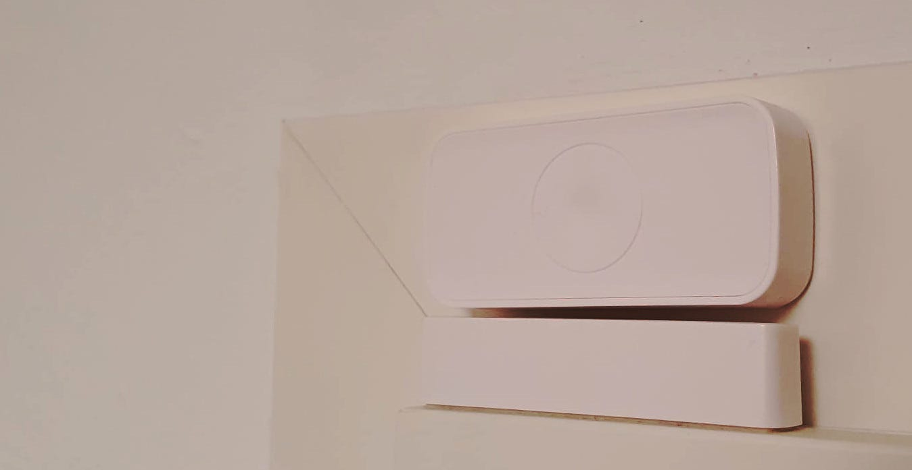

You can find “smart” devices everywhere: Light bulbs, dishwashers, toothbrushes, adult toys. [Just about everything](https://www.businessinsider.com/weirdest-smart-gadgets-internet-of-things-smart-home-2017-3#hidrate-spark-2) that has electricity. Typically, this just means that those devices are able to make a connection to a hub.

There are big promises of smart homes: More convenience, lower cost, a higher standard of living. In this episode of my smart home series, we will explore some of the awesome examples of smart homes.

If you want a refresher of the basics, please read my smart home 101 article:

[**The Ultimate Smart Home Starter Guide** *Smart Home 101: Sensors, Actors, Rules, Protocols, and Hubs*](../the-ultimate-smart-home-starter-guide/)

## Single-device applications

Some devices are already useful on their own. If they don’t need a connection, they are not necessarily smart. However, people might still connect them to a smart home.

### №1: Robotic Vacuums / Robotic Mops

Keeping the house clean takes quite a bit of time. A robotic vacuum and a robotic mop can help here. High-end models from Roborock or iRobot sense their environment and create a map so that they don’t miss spots to clean. If you connect them to a hub, you can let them run once you leave the house. But even without the connection, they are pretty useful. I have one of the earliest, dumb models and I just start it manually each morning after my girlfriend left the apartment.

### №2: Thermostats — Control temperature based on time of the day

Electronic Thermostats allow you to schedule when you want to heat the room. I have one for the radiator in my bathroom. I don’t need that room to be heated above 18 °C — but my girlfriend would love to have 28 °C. So the thermostat heats the room about 30 minutes before she wakes up.

Being able to use a vacation mode and recognizing when the window is open is nice as well.

### №3: Contact Sensors — Did I close the windows/door?

<figure>
    
    <figcaption>A contact sensor at one of my doors. Image by Martin Thoma.</figcaption>
</figure>

“Did I close the door/windows?” — this question might have haunted you already when you went on vacation. Contact sensors can help you there. You can just check them remotely. No need to worry that it will rain into your roof apartment. They work via magnets and are battery-powered. I’ve heard the AAA battery lasts for about 2 years.

### №4: Motion Sensors — Is there mail?

I’ve recently stumbled over a creative application of a motion sensor. Install it in a post bin and let it inform you if you have mail!

### №5: Smart Locks

I hate keys. I forget them, I need to get them out of my backpack/pockets, I confuse the keys. But there is one thing I almost never forget: My smartphone. For this reason, I love the idea to be able to unlock the door with my smartphone.

Another huge advantage would be to manage permissions centrally. If I lose my keys, it is going to be expensive. If I lose an electronic key used to enter my home, I can just revoke access to that key.

The third nice property is that I can grant access to guests temporarily. If I don’t hear the bell or if they need to leave briefly, they can just enter on their own. Or if they look after the plants when I’m on vacation.

However, I don’t trust smart locks enough to be secure and reliable. For this reason, I don’t have a smart lock.

### №6: Smart Lights

Who doesn’t know it: You’re almost sleeping, but you have to stand up because you forgot to turn off the ceiling light. Being able to control the light via a smartphone comes in handy in such situations. Also, being able to dim the lights and play around with the colors is fun.

## Multi-device applications

Now here it gets interesting. We combine multiple devices and get something that is pretty cool

### №7: Light color changing by the time of the day

I love yellow light with about 2700K. I think it feels really cozy. However, I also get sleepy with that. When I work, I want the light to be bright and white at about 4000K. This helps me to concentrate.

Combining a **smart light** with a **clock**, you can turn on the smart light in the morning. And in the evening, you can change the light color and dim the lights.

### №8: Alarm when it rains and the windows are open

I’ve already mentioned the contact sensors at the windows. However, going a tiny step further makes them more useful. Connect your hub with a weather forecast or a local weather station. Once it rains, check if the windows are open. If they are, create a push notification that you should probably close them.

### №9: Elderly Care

Smart home devices can detect where people are and record motion. They could allow disabled people to move around the house more easily by opening doors. A smart home could give caretakers better insights into how the behavior of the seniors changed. Smart homes could remind people automatically of common tasks and detect emergency situations.

For example, a mat next to the bed could detect when the old person fell out of the bed. Falling regularly causes severe injuries for seniors. Such a mat could send an alarm signal to a caretaker.

If we had a bar code scanner integrated into the kitchen and better information directly on the food packaging, we could automatically store which food is in the house, which food was consumed, and warn which food might go bad soon. This is less of a problem when you’re fine, but when your mental health is an issue such support systems might help. Not necessarily for today's elderly people, but when we become old.

However, privacy is a big concern here. I guess it depends a lot on what types of sensors you use and what you use them for.

## Honorable Mentions

A couple of gadgets/devices I thought about, but I actually think they are not good examples for this article. For example, motion-activated lights are awesome for the entrance of your house. However, there is no need to make that smart. It does not need to communicate with anything.

A [**magic mirror**](https://magicmirror.builders/) is pretty awesome, but this is more a nice display than a smart home device/application.

Using a presence sensor, e.g. when you log in to your local WLAN, you can automatically **turn on the lights when you come home** and it’s dark. But be honest: How often have you thought that using the light switch is really a burden? And how often do you think do those automations not work exactly as you want them to?

Speaking about lights, I thought it might be a good idea to have **smart lights** and presence detection in the **bathroom**. So once you visit the bathroom, it checks the time of the day and turns on the light in a brightness that works well for that time. The easier, cheaper, more reliable alternative is a night light. You can get 2 pieces for 4 EUR at Ikea. They have a light sensor and turn it on when it gets dark. As they only need 0.5W it doesn’t matter that they are bright all the time. That is about as much energy as smart lights need in standby mode.

Two more applications make a lot of sense to me: Smart garden sprinklers which automatically water the grass when it’s dry and a pet door opener that prevents other animals from using the pet door.
