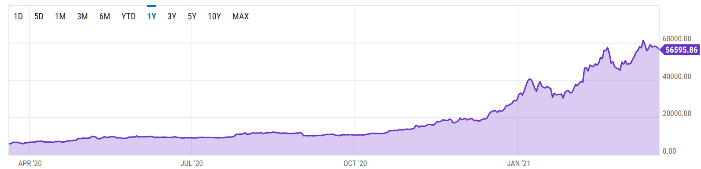
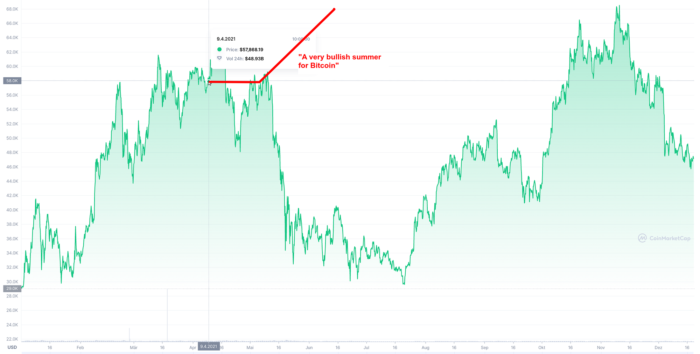

The year 2021 started with Biden becoming president and the hope of more sane US politics. The Corona Virus pandemic hit the world hard, but we had various vaccines in the beginning of 2021. Stock markets plummeted in March 2020 and were recovering. People were looking for investment opportunities.

A crazy crypto bull run was in full progress in February / March 2021. The Bitcoin price increased to 500% of the price in October 2020. A lot of crypto millionaires were created.

On the dark side, a lot of people got unrealistic hopes of getting rich by jumping on the wagon. I’ve seen a lot of crazy predictions, especially on TikTok.

After reading this article, you will hopefully stay sane and [not end up like this](https://www.tiktok.com/@teenmillionaire/video/6925963517153512709) after investing in crypto.

## Developments in 2021

In the beginning of the year 2021, Bitcoin had hit record USD prices:

<figure>
    
    <figcaption>Bitcoin prices from March 2020 to March 2021 (<a href="https://ycharts.com/indicators/bitcoin_price">source</a>)</figcaption>
</figure>

There were several key points:

* 11th of May 2020: Bitcoin halving ([explanation](https://www.investopedia.com/bitcoin-halving-4843769))
* 11th of August 2020: [MicroStrategy buys \$250M in Bitcoin](https://www.bizjournals.com/washington/news/2020/08/11/microstratregy-buys-250m-in-bitcoin.html)
* 21st of October 2020: [PayPal Launches New &#91;Bitcoin&#93; Service](https://newsroom.paypal-corp.com/2020-10-21-PayPal-Launches-New-Service-Enabling-Users-to-Buy-Hold-and-Sell-Cryptocurrency)
* 27th of November 2020: A leaked report from Citibank, titled ‘Bitcoin: 21st Century Gold’ said the price of the bitcoin could hit the \$318,000 mark by December 2021 ([source](https://economictimes.indiatimes.com/markets/stocks/news/bitcoin-the-new-gold-analysts-see-19-times-upside-by-dec-2021/articleshow/79444961.cms))
* 20th of December 2020: Jeff Currie, global head of commodities research at Goldman Sachs, revealed his outlook for bitcoin, gold, and copper on Thursday. Commenting on the recent surge in bitcoin’s price, he said on Bloomberg Markets that looking at its price chart, bitcoin looks “very similar” to copper ([source](https://siliconangle.com/2020/12/20/bitcoins-december-rally-continues-price-breaks-24000/))
* 3rd of February 2021: Ruffer Turns Bitcoin Investment Into \$750M Profit in Under 2 Months ([source](https://www.coindesk.com/ruffer-turns-bitcoin-investment-into-750m-profit-in-under-2-months))
* 8th of February 2021: [Tesla buys \$1.5 billion in Bitcoin](https://www.cnbc.com/2021/02/08/tesla-buys-1point5-billion-in-bitcoin.html)

In summary: A lot of bets on bitcoin, much news that positions bitcoin similar to gold as a store of value or as a very risky, but also an extremely profitable investment. Next to those are many social media mentions that look very superficially at the topic. As I was in a bubble around various cryptocurrencies, I was collecting over 100 crypto price predictions:

[**Crypto-Predictions** *Sheet1 Coin,Date of Statement,Expected,Expected Date,Actual,Currency,Value at Statement,Expected Increase,Actual…*](https://docs.google.com/spreadsheets/d/1qIoIk7qvYbWjq8YlrFQKa4tbSUOG7CKAIVGoltp5ON8/edit?usp=sharing)

The predictions are not always phrased like this. Sometimes people just say “this is what I do” or “it will go to the moon”. Depending on how strong statements are and which comparisons people take, I will put a number on it so that we can check them.

## Warning Sign № 1: Emoji use 🤑💎💸

I’m not sure if anybody sees those emojis and thinks: “Oh, yes, that looks like somebody who did a thorough analysis”.

## Warning Sign № 2: Wording

If you read that the coin’s name contains the words “safe” or “moon”, just run. In the best case it’s a meme project. In the worst case it’s a scam.

The language can also give a pointer whether the person writing it is educated or serious. For example, “the coin is gonna explode” and “I believe that Cardano has a huge growth potential due to Ethereum having difficulties to deliver” read very differently, right? On the one hand, the second example is correct English in a full sentence. On the other hand, it gives you the line of reasoning. You can check if the reasoning is valid and if you draw the same conclusions.

## Warning Sign № 3: Technical Analysis

There are a [lot](https://www.tiktok.com/@paultips1/video/6955632674392313094) of [videos](https://www.tiktok.com/@theperridon/video/6970067193895685382) which might look smart, but they are [just stupid](https://www.tiktok.com/@_patrickkim/video/6948145513145388294).

Bitcoin might be the best cryptocurrency to see patterns as it is the oldest. However, look how utterly wrong [BitcoinwellOfficial](https://www.tiktok.com/@bitcoinwellofficial/video/6949192021529709830) was:

<figure>
    
    <figcaption>Screenshot from <a href="https://coinmarketcap.com/de/currencies/bitcoin/">Coinmarketcap</a></figcaption>
</figure>

There are also very good examples of hindsight bias, e.g. by Alexander Kern (akx\_capital): “If you bought \$1,000 of Dogecoin in October 2020 &#91;you would have&#93; almost \$30,000 USD in February 2021” ([source](https://www.tiktok.com/@akx_capital/video/6928656825281711365)).

Of course, they typically don’t say “buy Dogecoin”, but you have to wonder why they make that comparison. At the very least you could blame them for not warning people that market capitalization is not guaranteed to go up, let alone at that speed.

## Warning Sign № 4: Distancing from their own words

> “This is just a theory, don’t listen to this. This is just a wild theory. In case it actually happens, you can look back to this video” — [cryptomasun, March 2021](https://www.tiktok.com/@cryptomasun/video/6936979088913501446).

If people tell you not to listen to them, don’t continue watching their videos. Block them. Your attention is not worth the noise. They make it for the small chance so that they can later get that video and tell everybody how good their predictions were. And the videos that show they are wrong get deleted. From the over 100 predictions I had a look at, over 40 are no longer available.

## Bitcoin Predictions

* ❌ \$318,000 USD per Bitcoin by December 2021: Citibank ([source](https://economictimes.indiatimes.com/markets/stocks/news/bitcoin-the-new-gold-analysts-see-19-times-upside-by-dec-2021/articleshow/79444961.cms))
* ❌ \$4.7M USD per Bitcoin: Michael Saylor (“Bitcoin will be a 100-Trillion Dollar Market”, [source](https://www.youtube.com/watch?v=qCA6j4rYDrw&t=290s))
* ❌ Bitcoin will drop to 0 USD in August 2021: Damien Soylash ([source](https://www.tiktok.com/@damiensoylash/video/6966220763963657477))

## Other Cryptocurrency Predictions

* ❌ 31.01.2021: [Cardano](https://coinmarketcap.com/de/currencies/cardano/) will replace Ethereum ([crypto\_ry@TikTok](https://www.tiktok.com/@crypto_ry/video/6923992333855804678))
* ❌ 03.02.2021: [Polkadot](https://coinmarketcap.com/de/currencies/polkadot-new/) will go up to 50 USD ([coinpedia.org](https://coinpedia.org/price-prediction/polkadot-price-prediction/#h-polkadot-price-prediction-2021))
* ✅ 07.03.2021: BNB will go &#91;from 230 USD&#93; up to 500 USD in March ([Taglich Bitcoin & Crypto](https://www.youtube.com/watch?v=8FEnV-Bi7tQ)). Actual max in March was 308 USD. But it did go to 500 USD in April. Good enough.
* ❌ 17.03.2021: [SafeMoon](https://coinmarketcap.com/de/currencies/safemoon/social/) will go up at least 100x ([justhogeit@TikTok](https://www.tiktok.com/@justhogeit/video/6940484041493712133))
* ❌ 21.03.2021: Ethereum will go up to 14k €, ❌ [VeChain](https://coinmarketcap.com/de/currencies/vechain/) will go up to 0.74€, ❌ [CAKE](https://coinmarketcap.com/de/currencies/pancakeswap/) to 92.58€, ❌ [Injective Protocol](https://coinmarketcap.com/de/currencies/injective-protocol/) to 105.70€, ❌ [PAID](https://coinmarketcap.com/de/currencies/paid-network/) to 19.93€, ❌ [Polkamarkets](https://coinmarketcap.com/de/currencies/polkamarkets/) to 28.92€, ❌ [Kylin](https://coinmarketcap.com/de/currencies/kylin/) to 12.42€, ❌ [Bondly](https://coinmarketcap.com/de/currencies/bondly/) to 3.97€, ❌ [Launchpool](https://coinmarketcap.com/de/currencies/launchpool/) to 228.6€ ([macklorden@TikTok](https://www.tiktok.com/@macklorden/video/6942308520704478469))
* ❌ 21.03.2021: Polkadot will go up at least 100x ([thegingerbanks@TikTok](https://www.tiktok.com/@thegingerbanks/video/6942129137679158533))
* ❌ 21.03.2021: [SafeMoon](https://coinmarketcap.com/de/currencies/safemoon/social/) will go up at least 100x ([egilkobberstad@TikTok](https://www.tiktok.com/@egilkobberstad/video/6942222771556470022))
* ❌ 21.03.2021: [Pundi X](https://coinmarketcap.com/de/currencies/pundi-x/) will be \$0.05 end of 2021, [StormX](https://coinmarketcap.com/de/currencies/stormx/) will be \$0.80 end of 2021, [VeChain](https://coinmarketcap.com/de/currencies/vechain/) will be \$1.10 end of 2021 ([mockstarket@TikTok](https://www.tiktok.com/@mockstarket/video/6942157523923324166))
* ✅ 29.03.2021: BNB will hit \$460 in April 2021 ([Young and Investing](https://youtu.be/8wpc0-dr7RY?t=658) on YouTube), was at \$270 when the video was published (+70% in a month)
* 🤷 30.03.2021: BNB will go from 304 USD to over 500 USD in 2024 and 2028 to over 1000 USD ([MonetenDave](https://youtu.be/q8KeYnSyq14?t=475) on YouTube). That would be +64% in 3 years and +228% in 7 years. He also mentions coinpedia which expects 1000 USD to be reached in 2024. This cannot be evaluated yet.

## Stock market predictions

Outlandish predictions are not limited to the crypto area. There are also several for the stock market. Two examples:

* ❌ 31.12.2021: Tesla is the biggest company in the world ([Casgains Academy](https://www.youtube.com/watch?v=3m0nuW3Tud0) on YouTube) — looking at [companiesmarketcap.com](https://companiesmarketcap.com/) they are at place #6 right now. Quite a rise, but by far not there yet.
* ❌ 31.12.2021: The Market is going to crash ([carhero9](https://www.tiktok.com/@carhero9/video/6947457338022382854) on TikTok, 15th of April 2021, [cryptomasun on TikTok, 7th of March 2021](https://www.tiktok.com/@cryptomasun/video/6936979088913501446))

## What is a good prediction?

1. A clear statement that can be checked is made.
1. A deadline is set.
1. The reasoning is provided.
1. Assumptions, conditions, and risks are clearly stated.

## TL;DR: Be careful when investing in Crypto

Crypto projects are in many cases like startups. You have to understand their business. You have to check if you can trust the intentions and capabilities of the founders. Yes, it is an area where you can get crazy gains. But the risk is extremely high. This is not an area where you want to simply trust a 1 minute TikTok where the author barely put more work than that one minute in creating the video.
