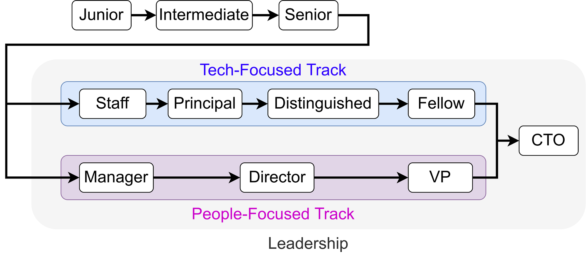

<figure>
    
    <figcaption>One example for a software engineering career ladder</figcaption>
</figure>

The job market for Software Engineers is crazy at the moment — if you happen to be skilled, you can have your dream job.

In this article, I want to shed some light on one aspect that is relevant when you consider which job to take: The Career Ladder.

When you continue reading the following, please keep in mind that this is mostly a big-tech topic. It doesn’t really apply to startups.

## Why does the career ladder matter for an employee?

The level you get rated at for your current job can influence your chances in the next job interviews. Yes, titles are different from company to company. And yes, in some it is easier than in others to get such a title.

The title can also be strongly connected to the compensation you receive and to the types of skills or behavior which are expected from you.

## Why does the career ladder matter for employers?

Think about which type of employee you want. Do you want somebody to be constantly working on improving themselves? Do you want an employee who is eager to reach goals?

A clearly formulated and accessible career ladder can help those people to understand what they want to reach. Especially for young employees, this can be encouraging as they might not have their dream salary or position yet. Few things are more frustrating than knowing that you will be locked in your current situation, having the same responsibilities until you retire.

If you have an open position, you have to be clear what you need. Having a career ladder makes it simpler to formulate what you want.

## Roles, Titles, and Levels

People get hired for a role. Typical roles in software engineering are Backend Developer, Frontend Developer, Mobile Dev, Machine Learning Engineer, Data Engineer, Data Scientist, Scrum Master, Product Manager, …

While roles describe the area in which you work, titles and levels describe how experienced you are. The titles are names like “junior” and “senior” which are used across companies. The levels are more fine-grained and only used internally. For example, the levels at Microsoft start at 59 and go up to 90. At Facebook, you have E3 to E8.

This article is about job titles in software engineering.

## The individual contributor career levels

There are three typical individual contributor career levels:

**Junior Engineers** have a really hard time making projects from start to finish. They lack important knowledge and need support.

**Engineers**, let’s call them “mid-level” for easier recognition, can start and finish small projects. I expect that a Junior Engineer can become a mid-level Engineer within 6 months if he is determined and has a good Senior leading him.

**Senior Engineers** can draft bigger projects from start to end. They have an understanding of which roles are required for a software project. They are not only experts in their specific field (e.g. backend, frontend, mobile, machine learning, data engineering, graphics, …), but they also have some knowledge of adjacent fields. For example, I expect a senior machine learning engineer to have a slight idea of data engineering. Senior engineers can take over the responsibility for a service — that means they can push for refactoring if it becomes hard to maintain. They make sure enough logging / alerting is there for things to run smoothly / be debuggable. Senior Engineers keep improving their knowledge in their field of expertise. They also spread that knowledge to other engineers in the same team.

## The tech leadership career levels

While the junior / mid-level / senior levels make sense for every company, the leadership career levels might not exist for smaller companies.

**Staff engineers** are senior engineers on steroids. Not only do they have their own specific project in mind, but they also know the projects of other teams and are able to align the tech stack and development across teams. They create a good atmosphere in their team. They are role models for others. They can take responsibility not only for a single feature or service but for an entire product.

**Principal engineers** have a company-wide perspective. They might suggest new products or change the scope of a product. They work closely with company leadership. They have a good grasp of which roles/levels are necessary to hire. They are more on the strategic side and less involved with day-to-day coding.

The next two levels might as well be in the individual contributor track. Both of them recognize the extraordinary abilities of the person.

A **distinguished engineer** is recognized by their company as being extremely competent in their professional field. I see this less as a level you get hired at, but more as a reward and a recognition of the capabilities. It has to be earned over many years leading to overall outstanding contributions.

**Fellow Engineers** take it up a notch. They are typically worldwide famous. Those are people who have Wikipedia pages and are recognized for their public contributions. Examples are:

* Jeff Dean ([Wikipedia](https://en.wikipedia.org/wiki/Jeff_Dean), [Google Fellow](https://research.google/people/jeff/)): Leads Google AI, played an important role in [MapReduce](https://en.wikipedia.org/wiki/MapReduce), was part of designing and implementing [BigTable](https://en.wikipedia.org/wiki/Bigtable) and [LevelDB](https://en.wikipedia.org/wiki/LevelDB).
* Jim Gray ([Wikipedia](https://en.wikipedia.org/wiki/Jim_Gray_%28computer_scientist%29), [Microsoft Fellow](https://www.microsoft.com/en-us/research/people/gray/)): Manager of the Bay Area Research Center, defined the transaction properties that became known as [ACID](https://en.wikipedia.org/wiki/ACID), received the Turing Award in 1998 for contributions to database and transaction processing
* Don Norman ([Wikipedia](https://en.wikipedia.org/wiki/Don_Norman), Apple Fellow): Director of The Design Lab, author of [The Design of Everyday Things](https://en.wikipedia.org/wiki/The_Design_of_Everyday_Things), Professor Emeritus of Cognitive Science at the University of California

There are not that many [corporate fellows](https://en.wikipedia.org/wiki/Category:Corporate_fellows).

## The People-Leadership Career Levels

Where the individual contributor career track focuses on technical skills and their impact on the organization, the people-leadership career track is more centered around organization.

The three levels I want to focus on are Engineering Managers (EMs), Engineering Directors, and Vice President of Engineering. James Stanier wrote an excellent article “[VP, Director, what?](https://www.theengineeringmanager.com/managing-managers/vp-director-what/)” in which he shows that essentially the number of people being managed and the time-frame over which they plan grows.

While I don’t have direct experience with this role, just think about how many people are in a good tech team. I would say something like 5 to 15 people. The 15 is just my gut feeling — I just have a hard time keeping even remotely track of what more than 15 people do. If you have more than those 15, it’s just hard to get work done. So if you have 30 people, I would expect at least 2 teams. The two team leads can talk with each other; no need for a manager.

Once more than 3 people need to align, you need a manager again. At maximum that manager can have 15 teams. Meaning when you have 15 teams at 15 people each, you need one manager for that. This manager would have 225 people below her/him.

**Engineering Managers** take care of performance reviews and set levels (sources: [Clément Mihailescu](https://www.youtube.com/watch?v=wq37pl87Weg), [Lena Reinhard](https://www.youtube.com/watch?v=Q_bJVokYLRI)). EMs still deal with the day-to-day topics like having 1-on-1s. I would expect an EM to have a team of at least 5, at most 15 people. In my opinion, the time frame over which they must plan is quarterly or maybe in half-years.

**Engineering Directors** start to manage other managers. I would expect at least 3 teams, at most 15.

A **Vice President of Engineering** is the next level in this hierarchy. I would expect at least 2 engineering directors and at most 15 below the VP.

Let’s calculate how many people could be below a VP:

> 15 directors · 15 EMs/director · 15 people/EM = 3375 people

Please be aware that it does not have to be a super strict hierarchy. It might be that there is a EM reporting directly to the VP.

Some organizations are way bigger than that. For example, Alphabet (Google) has 135,301 employees. One of their products, YouTube, already has 7500 employees. This means you definitely need some more layers in between. The solution is to add some “senior” titles, e.g. “senior director of engineering”. Each new level gives you another factor of 15.

However, I think 15 is rather a maximum. It should probably better be 7. That would mean an EM would have 7 people below them, a director would have 49, a VP would have 343 people.

Depending on how many people are below a certain position, you need to have longer time frames in mind when you plan. For example, if you drop a feature set on which several dozens of engineers work you need to have an idea what they should do in future. If you want to expand into a different direction, you might need to hire a completely new team.

## Team Lead and Tech Lead

Team Lead and Tech Lead are roles, not levels.

The responsibility of a **tech lead** is to help team members with technical aspects of their job: Explain the overall architecture, help to debug hard problems, take decisions over the overall architecture, lead technical discussions and decisions. They are in some aspects close to the role of a software architect. Tech leads assure that the code quality is good.

The responsibility of a **team lead** is to lead the team with respect to human needs: Make sure people feel well in the team, discuss their professional goals. They typically have 1-to-1s with the team members. Mentoring / coaching are parts of a team lead’s tasks.

## See also

* [progression.fyi](https://www.progression.fyi/) collects career ladders of many tech companies
* [levels.fyi](https://www.levels.fyi/) gives you insights into the different names of career levels and the salaries at big tech companies
