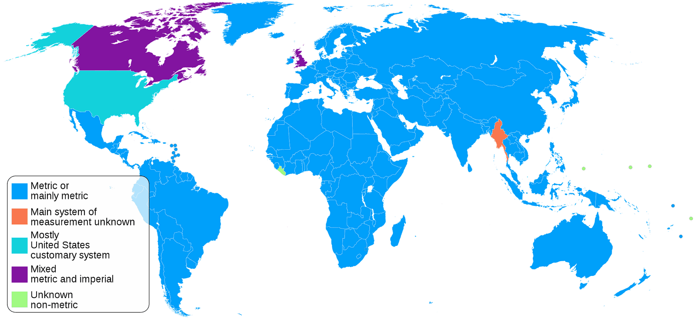
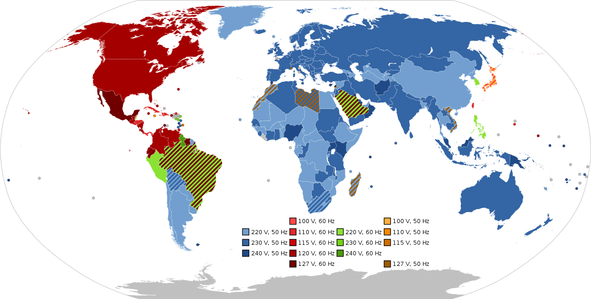
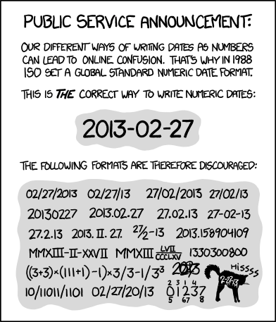

In Machine Learning, you describe a problem and you try to find a model which solves that problem well. It’s very common that the model is stuck in a locally optimal solution — meaning tiny changes make the model worse… but big changes make it better.

It’s pretty common to get into that situation in life. Once too many people and systems depend upon one established system, we will not change it. For example, where you live. Even if another city would be much nicer, you have your job, your family, and your friends in your current city. You optimize your location within that city, but moving to another city more than 100km away is a big jump.

Let’s see where we have this issue in our world 😃

## №1: The Metric System — US, England, Canada

<figure>
    
    <figcaption>Image by <a href="https://commons.wikimedia.org/wiki/User:Goran_tek-en">Goran tek-en</a> on <a href="https://en.wikipedia.org/wiki/File:Metric_and_imperial_systems_%282019%29.svg">Wikimedia Commons</a></figcaption>
</figure>

The metric system measures mass in kilograms, distance in meters, areas in square meters, and volumes in cubic meters. The US customary measurement system uses ounces (oz), pints (pt), gallons (gal), inches, yards, feet, miles, pounds, square chains, acres, cubic inches, cubic feet, cubic yards, …

This difference caused the [Mars Climate Orbiter](https://en.wikipedia.org/wiki/Mars_Climate_Orbiter) to crash in 1999. Just like that NASA lost \$327.6 million.

Besides such obvious issues, the metric units are just simpler. Everything is divisible by 10 with prefixes for powers of 1000.

## №2: Calendar System 📅

The number of days in a year is determined by the time the earth takes to go around the sun: 365 days, 5 hours, 48 minutes, and 45 seconds.

Those almost 6 hours cause a year to have 365.2422 days. This means we need roughly every 4 years a leap day.

**The status quo**: The [Gregorian Calendar](https://en.wikipedia.org/wiki/Gregorian_calendar) has chosen to split those 365 days into 12 months which have 28 to 31 days. The leap day is in February.

> **Improvement**: Another possibility would have been to have 13 months of which every single one has 28 days. That gives 364 days, so one extra day at the end of the year is needed. The leap day could be at the end of the year as well. Those two days would not be regular weekdays to keep the weekdays consistent. While we’re at it, we could rename the months to indicate the number. Something like this: (1) Unber (2) Duober (3) Tresber (4) Quatber (5) Quinber (6) Sixber (7) September (8) October (9) November (10) December (11) Endeber (12) Dodeber (13) Tredeber. They should also not sound too similar so that confusion is less likely.

**Why it would be better**: (1) Every month would have 28 days. No more counting / checking how long a month is. (2) 28 days is exactly 4 weeks. Meaning e.g. Mondays would always be on the 1st, 8th, 15th, and 22nd. (3) The leap day at the end of the year would also mean that it’s most likely a holiday anyway. (4) A typical menstrual cycle is 28 days long, meaning that women might have an easier time tracking their period.

**Why the switch is impossible**: The Gregorian Calendar is one of the few systems that we use all over the world. It is built into our computer systems. Switching would either mean that some countries would use another calendar system than others or that the whole world would need to agree on a switch. That is not going to happen. It would be too expensive.

**Red herrings**: The moon cycle is 29.5 days. So it is not consistent with the Gregorian calendar anyway.

I’ve thought about adding a section about [decimal time](https://en.wikipedia.org/wiki/Decimal_time), but I actually don’t see an advantage there.

## №3: Mains electricity — Frequency and Voltage ⚡

The electric power grid has two important properties: The voltage you receive from a typical power outlet and the grid's frequency. The actual plug is less important / easier to change.

<figure>
    
    <figcaption>Image source: <a href="https://en.wikipedia.org/wiki/File:World_Map_of_Mains_Voltages_and_Frequencies,_Detailed.svg">Wikimedia Commons</a> by SomnusDe</figcaption>
</figure>

> **Improvement**: Standardize to one voltage and frequency. I don’t know if any single one has a clear advantage.

**Why it would be better**: We could more easily create new devices. We could use devices around the world.

**Why the switch is impossible**: (1) Changing the grid's frequency would be a hefty infrastructure project (2) Every consumer would need to buy new devices.

## №4: Timezones and Daylight Saving Time

Timezones are a mess. Countries and territories decide completely on their own how their timezone should behave. If they want to have daylight saving time and when. They also sometimes change how their timezone works, e.g. to simplify trade. This is especially relevant around the [International Date Line](https://en.wikipedia.org/wiki/International_Date_Line).

> **Improvements**: (1) Only have changes by complete hours — not like Nepal which is at UTC+05:45. Having only complete hour offsets would essentially give 24 timezones (2) Have a common and clear pattern when daylight saving time kicks in (3) Have a single official public institution that can decide on changes. That institution announces the changes at least 2 years before they take effect. Not like Egypt where there was quite a bit of confusion which time is the official time.

**Why it would be better**: Less potential for error, easier to calculate the time in other cities.

## №5: Common Date Notation

<figure>
    
    <figcaption>Image source: <a href="https://xkcd.com/1179/">xkcd</a> by Randall Munroe</figcaption>
</figure>

What do you write when you want to leave a note for your partner that you’ve booked a table in a fancy restaurant on the 6th of July, 2022? Depending on where you live, you might do this:

* US: 07/06/2022
* Germany: 06.07.2022
* Australia: 2022–07–06 or 06/07/2022

> **Improvement**: Standardize to YYYY-MM-DD.

**Why it would be better**: On the one hand, this would remove one unnecessary point of confusion. On the other hand, the format YYYY-MM-DD allows you to sort very easily.

## №6: Investment Data Exchange

I’ve worked in the area of investment funds for quite a while and I can tell you that the way the data exchange works there is absolutely ridiculous. Startups write reports in PDF format which gets sent to the investors. The investor might be a fund. Employees of that fund read the PDF report and put the numbers in an Excel sheet. Then they generate some nice PDF reports where they summarize data about the portfolio companies. The data that might be interesting there is the name of the portfolio company, the location of the headquarters, the NAV (Net Asset Value), Gross IRR, fair market value, …

Then there are Funds of Funds (FoF). So funds which invest in funds. Those repeat this game: They take the reports from the funds, have employees who read them, write the data into Excel sheets, generate a PDF from it, send that PDF to their investors.

Now investors might be interested in deciding which FoF to invest in. So they take reports from FoF, have employees read them, …

Crazy.

It would be way simpler if there was a common data exchange format. This would save a lot of money and prevent errors.

## Bonus: Things that might improve

There is hope on the standardization front!

### Chargers for Notebooks 🔌

We have somehow converged around two charger types for smartphones: USB-C and Lightning — and it might be that [the EU will enforce standardization towards USB-C](https://techcrunch.com/2021/09/23/europe-will-finally-legislate-for-a-common-charger-for-mobiles/).

This standardization is great news for consumers: You can re-use the chargers you have from old phones. You can borrow a charger from a friend. When you go on vacation you don’t have to bring 10 chargers with you. There are more and cheaper options for replacement cables.

We still have this issue with notebooks.

> **Improvement**: Standardize notebook chargers to 3 categories: (1) USB-C up to 100W, (2) something up to 200 W (3) something up to 300 W. Anything above 300 W is not a notebook … maybe it’s a portable heater 😉

**Why it would be better**: Less waste, more choices, cheaper, more flexibility.

This standardization might come in a gradual way. The EU might mandate new notebooks released in the future to comply with such a standard 🤞 *Update:* It did: Since April 28, 2026, new laptops sold in the EU must support charging via USB-C, just like phones since December 28, 2024.

### Time tables for public transportation 🚍🚂

When I visit a city in Europe, I always try to figure out the name of the website of the public transportation agency of that city:

* Amsterdam: [GVB](https://en.gvb.nl/)
* Berlin: [berlin.de: Public transportation](https://www.berlin.de/en/public-transportation/1772016-2913840-tickets-fares-and-route-maps.en.html)
* Munich: [MVV](https://www.mvv-muenchen.de/en/index.html)
* Cologne: [KVB](https://auskunft.kvb-koeln.de/kvb/cgi?lang=UK)

I need to figure out what the cheapest tickets for my activities are, in which area they are valid, and how to figure out how to get from A to B.

Google Maps did a great job standardizing it. They have developed the [General Transit Feed Specification](https://en.wikipedia.org/wiki/General_Transit_Feed_Specification) (GTFS) which allows public transportation agencies to share their data in this standardized way. If they do, Google Maps can use this information to allow people to navigate.

> **Improvement**: Force cities to publish data in this format. It’s not so complex. As single citizens, just demand this from your politicians.

**Why it would be better**: Everybody knows Google Maps. It’s easy to use and it works pretty much all of the time. It’s available in many languages.
