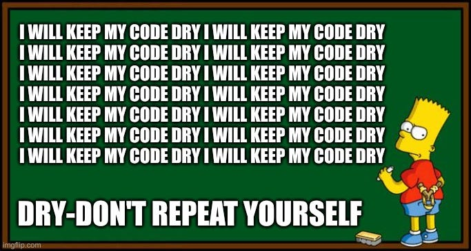
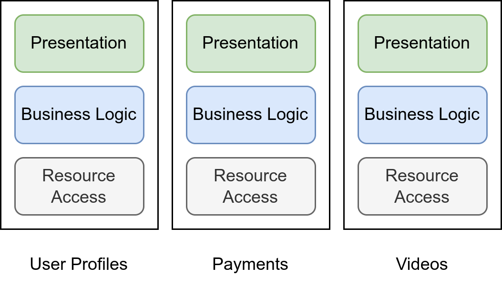

Every software developer with a little bit of experience knows that keeping things simple and stupid (KISS) makes sense. Once you have learned to use classes and functions, you don’t want to repeat yourself — keep things DRY.

The goal of all of those principles is to make software easy to maintain by reducing mental complexity.

## №1: Don’t repeat yourself (DRY)

<figure>
    
    <figcaption>Source: Generated by Martin Thoma via <a href="https://imgflip.com/i/5zpvee">https://imgflip.com/i/5zpvee</a></figcaption>
</figure>

DRY is the core of software development. We structure our code in packages and modules. We factor out functions. We try to make the code reusable so that we hopefully have an easier time maintaining it.

**Benefit**: Complexity reduction. The more code you have, the more you need to maintain. DRY typically leads to less code. This especially means that you only need to adjust one place for typical changes.

**Risk**: If you do it too much, the code typically gets more complex.

**Tooling support**: There are programs to find duplicated code. For Python, there is `pylint --disable=all --enable=similarities src`

## №2: You Ain’t Gonna Need It (YAGNI)

YAGNI is the realization that too much abstraction actually harms maintainability. Java devs, I’m looking at you!

**Benefit**: Complexity reduction. Removing abstractions makes it clearer how the code works.

**Risk**: If you apply YAGNI too much and thus make too few abstractions, you will have a hard time extending your software. And junior devs might mess with the code in a bad way.

**Tooling support**: None (maybe one could count references to classes throughout the codebase?)

## №3: Keep it Simple and Stupid (KISS)

KISS can apply to many situations. Although some solutions are smart and solve the issue at hand, the dumber solution might be better because there is less potential to introduce issues. This might be less DRY from time to time.

## №4: Principle of Least Surprise

Design your systems in such a way that the location of a feature implementation as well as the behavior and the side-effects of a component are least surprising. Keep your colleagues in the loop.

**Benefit**: Complexity reduction. You make sure that the mental model of the system fits what people assume naturally.

**Risk**: You might need to violate DRY to get this done.

**Tooling support**: None. However, there are some signs that this was violated: (1) You are explaining the same quirks of your system again and again to new colleagues (2) You need to look the same topic up again and again (3) You feel the need to document a topic that is not inherently complicated.

## №5: Separation of Concerns (SoC)

<figure>
    
    <figcaption>Three different microservices of a Video Streaming Platform are as loosely coupled as possible. Within those services, the concerns are divided by the function they serve. Image by Martin Thoma</figcaption>
</figure>

Every package, module, class, or function should only bother about one concern. If you do too many things, you do none of them well.

It is most clear to me in practice in the separation of a data storage layer, a presentation layer, and a layer that contains the business logic. Other types of concerns might be input validation, data synchronization, authentication, …

To phrase it with the Unix philosophy: [Do one thing and do it well](https://en.wikipedia.org/wiki/Unix_philosophy#Do_One_Thing_and_Do_It_Well).

**Benefit**: Complexity reduction: (1) It’s typically more clear where adjustments need to be done. (2) You should have fewer undesired side-effects you need to think about. (3) People can work in parallel without having crazy many merge conflicts.

**Risk**: If you go too crazy on SoC, you will likely violate KISS or YAGNI.

**Tooling support**: You can measure cohesion by counting how many classes/functions from other packages are used. A high number of externally imported functions can indicate violations in SoC. A high number of merge conflicts might also indicate an issue.

## №6: Fail early, fail loud

As developers, we have to deal with all kinds of errors. And especially for beginners, it’s not clear how to deal with them.

One pattern that has helped me a lot in the past is to **fail early**. Meaning very close to the location where the error can happen, the error should be recognized. Especially user input should be validated directly in the input layer. But also network interactions are a common case where you need to handle error cases.

The other pattern is to **fail loud**, meaning to throw an exception and create a log message. Don’t just return None / NULL. Exceptions are the way to go. Depending on the kind of Exception, you might also want to let the user know.

**Benefit**: Easier maintainability as it’s clearer where functionality belongs and how the system should be designed. Easier debuggability as errors happen early.

**Risk**: None.

**Tooling support**: None

## №7: Defensive Programming

Defensive programming is named after defensive driving. Defensive driving is “driving to save lives, time, and money, in spite of the conditions around you and the actions of others”. Defensive programming is the idea to be robust and correct, in spite of the conditions of the environment and the actions of others. This can mean to be robust against wrong input, e.g. when you have an IBAN field in the database to actually make sure that the content being stored there contains an IBAN. It can also mean to make assertions explicit and raise exceptions if those are violated. It can mean to make calls to APIs idempotent. It can mean to have a high test coverage to be defensive against future breaking changes.

Three core rules of defensive programming:

* All data is important until proven otherwise.
* All data is tainted until proven otherwise.
* All code is insecure until proven otherwise.

The alternative to defensive programming is “shit in, shit out”.

**Benefit**: Higher robustness

**Risk**: Higher maintenance due to more complex/lengthy code base

**Tooling support**: Test coverage to see how much your unit tests cover. If you want to go crazy, try [mutation testing](../mutation-testing/). For infrastructure, there is chaos engineering. Load testing.

## №8: SOLID

The SOLID principles give guidance around coupling and cohesion. They are originally formulated around object-oriented programming (OOP), but you can apply them to different abstraction levels than classes as well, e.g. services or functions. I will just call those “components” later on.

Two components can be coupled in several ways. For example, one service might need knowledge of how another service internally operates to do its work. The stronger component A depends on component B, the stronger A is coupled with B. Please note that this is a symmetric relationship. For coupling, we don’t care about the direction.

A high cohesion of one module means that its internal parts are strongly connected. They all deal with the same topic.

Loose coupling and high cohesion between components is what we strive for.

### Single-responsibility principle

> “There should never be more than one reason for a class to change.”

The responsibilities of software entities like services, packages, modules, classes, and functions should be clear. They should typically operate on one abstraction level and not do too many things.

The single-responsibility is one of the tools to achieve separation of concerns.

**Tooling support**: I’m not aware of automatic tools to find violations of the single responsibility principle. However, you can try to describe the functionality of the components without the words “and” / “or”. If this does not work, you might violate it.

### Open–closed principle

> “Software entities … should be open for extension, but closed for modification.”

If you change a component on which others rely, you are potentially breaking their code.

### Liskov substitution principle

> “Functions that use pointers or references to base classes must be able to use objects of derived classes without knowing it.”

**Benefit**: This is a very basic assumption you make in OOP. Just follow it.

**Risk**: None?

### Interface segregation principle

> “Many client-specific interfaces are better than one general-purpose interface.”

**Benefit**: It’s easier to extend the software and reuse interfaces if you can pick and choose. However, if the software is completely in-house, I would rather create bigger interfaces and split once it becomes necessary.

**Risk**: Violation of KISS / YAGNI.

### Dependency inversion principle

> “Depend upon abstractions, [not] concretions.”

In some cases, you want to operate on a more general class of inputs than the one specific type you’re currently dealing with. Examples that pop to my mind are WSGI (connecting web servers with web applications), JDBC (database connections), and basically any plugin system (e.g. Flake8). You want to define an interface and depend on that. This interface has then to be implemented by the components.

Assume you have an application that needs to have access to a relational database. You could now implement all queries for all kinds of relational databases. Or you define that the function receives a database connector that implements the JDBC interface. Now the connector has to be extended and not all functions that need the DB connection. That is the inversion.

**Benefit**: In the long run, this makes the software much easier to maintain as it becomes clearer where functionality lies. It also helps with KISS.

**Risk**: If you overdo it, you might violate KISS. A rule of thumb would be that at least two classes should implement an interface before you create an interface.

## №9: Locality Principle

Don’t separate things that belong together. If two parts of code are typically edited together, try to keep them as close as possible. At least in the same package, hopefully in the same directory, maybe in the same file — and if you’re lucky they can be in the same class / directly below each other within the file.

**Benefit**: Hopefully fewer merge conflicts. You don’t need to switch context when you try to find that other file. When you refactor that piece, you might remember all things that belong to it.

**Risk**: Violating loose coupling or separation of concerns.

**Tooling support**: None so far, but I’m thinking about creating one for Python. Basically, I would analyze the git commits.

## Summarizing it: The Zen of Python

I absolutely love [the Zen of Python](https://en.wikipedia.org/wiki/Zen_of_Python). While it is less concrete than several other principles, it is a piece of programming philosophy that is super important:

> Beautiful is better than ugly.
> Explicit is better than implicit.
> Simple is better than complex.
> Complex is better than complicated.

> Flat is better than nested.
> Sparse is better than dense.
> Readability counts.

> Special cases aren’t special enough to break the rules.
> Although practicality beats purity.

> Errors should never pass silently.
> Unless explicitly silenced.

> In the face of ambiguity, refuse the temptation to guess.
> There should be one– and preferably only one –obvious way to do it.
> Although that way may not be obvious at first unless you’re Dutch.

> Now is better than never.
> Although never is often better than right now.

> If the implementation is hard to explain, it’s a bad idea.
> If the implementation is easy to explain, it may be a good idea.

> Namespaces are one honking great idea — let’s do more of those!
