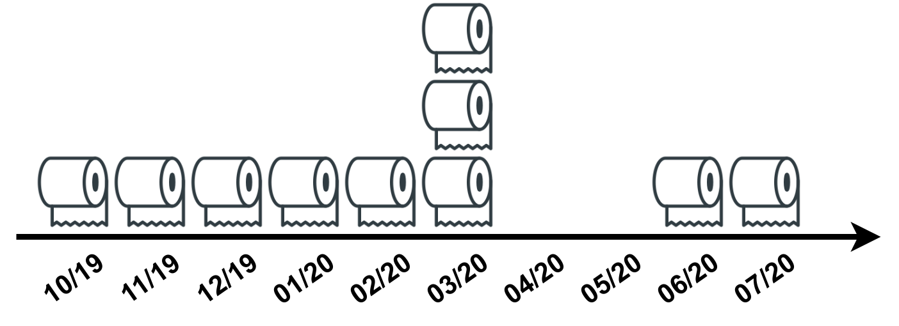
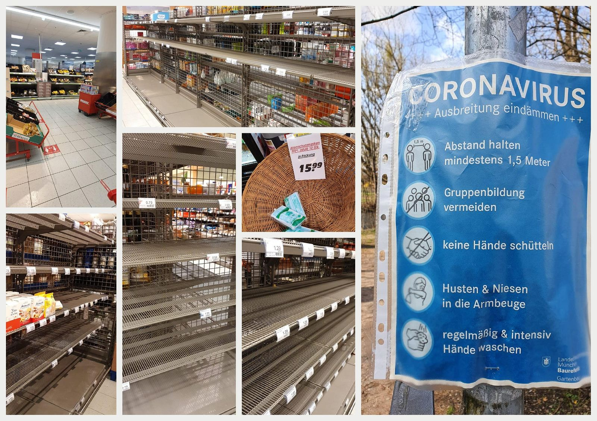
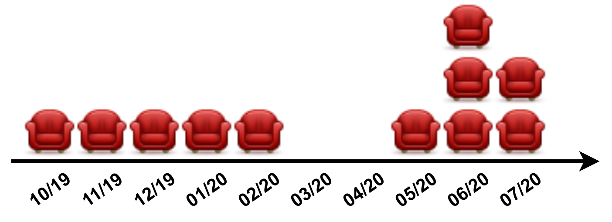

<figure>
    
    <figcaption>Nothing symbolizes the shortages of 2020/2021 better than toilet paper. At the beginning of the COVID-19 pandemic, people started buying toilet paper like crazy. Image by Martin Thoma</figcaption>
</figure>

The COVID-19 pandemic hit the world hard in 2020 and 2021. As if that wasn’t enough, we’ve experienced several products not being available. For me, that was the first time in my life. It feels weird — and in some cases frightening.

Let’s explore what happened and why.

## A Timeline of Shortages

We had several shortages in the past months. They are either related to the reduced supply due to the COVID-19 pandemic lockdowns 🦠, increased demand due to consumer shift 📈, hacking 👨💻, supply chain issues 🌎, natural disasters 🔥.

* 2020, February: [Masks](https://edition.cnn.com/2020/02/07/business/coronavirus-mask-shortage/index.html) 📈
* 2020, March: [Toilet Paper](https://www.washingtonpost.com/business/2020/03/13/toilet-paper-shortage/) 📈 — for a week locally limited also rice, noodles, flour in Germany 📈, [Condoms](https://nypost.com/2020/03/28/condom-shortage-looms-as-coronavirus-shuts-down-production/) 🦠
* 2020, July: [Aluminum cans](https://edition.cnn.com/2020/07/22/business/beer-shortage-aluminum-can/index.html) 📈 , [Food in Yemen](https://www.unicef.org/press-releases/yemen-sees-return-alarming-levels-food-insecurity-unicef-wfp-fao-ocha) 🦠🔥, [Shipping containers](https://www.dw.com/en/shipping-container-shortage-inflicts-pain-on-german-shoppers/a-58287649) 🌎
* 2020, August: [Lumber in the US](https://www.newsweek.com/why-there-lumber-shortage-us-1526548) 🦠
* 2020, December: [Computer chips](https://www.wsj.com/articles/chip-shortage-slows-global-auto-recovery-11608320026) 📈
* 2021, May: [Gas in the US](https://www.dw.com/en/us-states-declare-emergency-over-gas-shortage-fears-following-cyberattack/a-57501414) 👨💻
* 2021, June: [Food in North Korea](https://www.bbc.com/news/world-asia-57507456) 🦠🔥
* 2021, September: [Gas in the UK](https://www.dw.com/en/uk-fuel-shortage-drives-u-turn-on-short-term-visas/a-59308026) 🌎 , [Food in the UK](https://globalnews.ca/news/8223343/brexit-covid-19-aging-workforce-u-k-ended-fuel-food-shortage/) 🌎
* 2021, November: [Wine/liquor in the US](https://www.bbc.com/news/business-59399754) 🌎

## The COVID-19 pandemic caused Stop-and-Go Issues

COVID-19 forced governments around the world to enforce [**lockdowns**](https://en.wikipedia.org/wiki/COVID-19_lockdowns). An immediate effect was that people started **hoarding** toilet paper. The demand for toilet paper is usually very constant. Due to the lockdowns, people prepared for staying at home for a longer time.

<figure>
    
    <figcaption>Changes in demand for toilet paper in Germany caused by COVID-19 / the lockdown. Image by Martin Thoma</figcaption>
</figure>

As toilet paper does not go bad and as the pandemic — overall — does not change the usage of toilet paper, the demand was mainly shifted. That is not completely true as people now went to the toilet at home and not at work. Very likely you use a different kind of toilet paper at home compared to the one at work. But supermarkets don’t like empty shelves, so essentially they needed to increase the supply as well. The same story goes for rice, noodles, and flour in Germany.

<figure>
    
    <figcaption>Impressions of April/May 2020 in Munich, Germany. Noodles and sauce, rice, flour, masks, bread, toilet paper — a lot of things were just sold out. Everywhere. Images by Martin Thoma.</figcaption>
</figure>

Due to the lockdowns, a lot of people were fixing stuff in their homes. Many people started home renovations such as painting some walls. When it became clear that their jobs were likely not at risk, they started buying stuff. I would expect demand to first go down, then sharply go up again for more expensive stuff like sofas/cars. Maybe also computers, consoles, and games. I could also imagine the demand to be at a higher level for a while than before.

<figure>
    
    <figcaption>How I think demand might have changed for bigger stuff like sofas/cars. Image by Martin Thoma</figcaption>
</figure>

People spent a lot of time at home. If they continued to receive their normal salary, they would typically have more money. As they spent more time at home, they might want to improve something there.

To be clear: **This is speculation from my side**. **I don’t have the data to prove it.**

Assuming such a pattern, what is the effect on the supply?

First of all, the supply likely also was reduced due to the lockdowns. Less stuff was produced for a while. Then they continued their normal schedule, but demand went up. They probably had a hard time telling if this was just a temporary shift or an overall change that lead to higher demand for this 2-year period.

Let’s say car manufacturers came to the conclusion that they need to increase production. There is a limit to the increase of supply. People might be able to work more, but not arbitrarily much. Some increases need more machines, others need completely new factories (see the semiconductor section below). And all factories need some resources as input.

Think of this as traffic congestion.

<figure>
    
    <figcaption>Image by <a href="https://commons.wikimedia.org/wiki/User:%D9%84%D9%8A%D8%A8%D9%8A_%D8%B5%D8%AD">ليبي صح</a> from <a href="https://commons.wikimedia.org/wiki/File:Traffic_congestion_in_Al_Bayda,_Libya_..jpg">Wikipedia Commons</a></figcaption>
</figure>

Imagine such a traffic congestion. Maybe there was an accident. Cars had to wait for two hours because the road was completely blocked. It might be several hours after the last car in the congestion can move after the first one moved. This is because there is a tiny delay between being able to move and actually stepping on the gas.

There is the same issue with supply and demand. Smart factory owners might see that the demand will go up again, but they need supplies. Those supplies need to get produced and shipped. And there we get to the next issue.

## Global Shipping Issues

We have a globally interconnected economy. A lot of goods are produced in China. They are put in containers, moved to a port, put on huge container ships, travel thousands of miles overseas, arrive at a port, get offloaded, get on a truck, arrive at warehouses, and get moved from there to your home.

We will explore several of those steps in the following.

### Ship Container Shortage

In order to move goods quickly, the world has standardized containers. This means you can stack them on ships, you can put them directly on trucks. This makes the transport way simpler. New shipping containers cost between \$4,200 USD and \$7,000 USD ([source](https://westerncontainersales.com/shipping-container-prices/40-foot-shipping-container/)). This means you want to re-use them if possible. You also want to send full containers both ways if possible.

Large container ships can transport almost 24,000 containers (TEUs, [source](https://en.wikipedia.org/wiki/List_of_largest_container_ships)). The [busiest container ports](https://en.wikipedia.org/wiki/List_of_busiest_container_ports) were Shanghai (119k TEUs per day), Singapore (100k TEUs per day), Ningbo-Zhoushan (79k TEUs/day), Shenzhen (73k TEUs/day). If you look at those numbers you can see that on an average day, Shanghai will load/unload roughly 5 of the largest container ships. And most of the busy ports are in China.

How did we end up with too many containers at US ports?

US ports were having issues processing the incoming containers: 86 container ships were waiting outside of the port of Long Beach, Los Angeles in December 2021([source](https://www.wsj.com/articles/southern-californias-container-ship-backlog-moves-farther-out-to-sea-11639132381)). The picture looks similar at other big US ports ([Houston](https://www.npr.org/2021/11/05/1048678575/waiting-on-that-holiday-gift-from-your-online-cart-it-might-be-stuck-at-a-seapor), [Savannah](https://www.nytimes.com/2021/10/11/business/supply-chain-crisis-savannah-port.html)). There are several reasons for this issue:

1. During the COVID-19 pandemic, the **demand increased** — for all kinds of goods. This led to a high influx of containers to the US. For example, in March 2021 the total amount of containers handled by the port of LA more than doubled ([source](https://www.portoflosangeles.org/business/statistics/container-statistics/historical-teu-statistics-2021))
1. **Workers at the ports being sick** might lead to the ports not being able to operate at their best. I haven’t found any good resources for this, but ports have warehouses too. And **warehouse workers getting sick** causes issues ([source](https://www.businessinsider.com/labor-shortage-warehouse-jobs-workers-put-off-hours-conditions-2021-10))
1. A **shortage of truck chassis** ([source](https://theloadstar.com/port-of-la-threatens-penalties-for-empty-boxes-left-at-clogged-up-terminals/), [source](https://www.wsj.com/articles/a-simple-piece-of-steel-and-wheels-is-holding-up-the-global-supply-chain-11635452843)). Meaning even if there were truck drivers, they could not go.
1. A **shortage of truck drivers** ([source](https://www.latimes.com/politics/story/2021-12-07/facing-record-labor-shortages-trucking-firms-battle-fiercely-for-drivers))

All of this leads to containers being stuck on the ships in front of the port or at the port.

### Labour Shortage

I mentioned truck drivers, warehouse workers, and employees at ports already. This is a general pattern which is called “[The Great Resignation](https://en.wikipedia.org/wiki/Great_Resignation)”:

> Employees voluntarily resign from their jobs en masse, beginning in early 2021, primarily in the United States

There are several causes of this and a lot of speculation how important those are on the overall picture: Some people faced severe **health issues** and were not able to work in their normal job. Others had time during the pandemic to think about how they want to **live their lives**. Being in a stressful situation might have the same effect — essentially recognizing that the job is too bad for the pay. Some had the chance to **work from home** and want to keep that (I also belong to that group; I hate commuting).

## The Ever Given Suez Canal obstruction

In March 2021, the Suez Canal was blocked for six days after the grounding of Ever Given. The Suez Canal connects Europe with Asia. This prevented an estimated \$9.6 billion USD worth of trade ([source](https://www.bbc.com/news/business-56533250)).

## Brexit

Britain, or rather England, decided to exit the European Union. This means that many people who worked in the UK suddenly needed to get visas. For many, this meant they just left the UK. Hence the UK faces a serious shortage of truck drivers ([source](https://www.nytimes.com/2021/11/28/business/uk-trucking-shortage-poland.html)). Logistics UK estimates that the UK lacks around 120,000 truck drivers ([source](https://www.reuters.com/business/finance/britain-sees-green-shoots-recovery-trucker-crisis-2021-12-06/)).

I can also imagine that front-loading happened at the same time: Companies and people being uncertain of the effect of Brexit buying stuff they expect to need soon. So the demand might have been higher just before Brexit.

## Semiconductors: Computer Chips

The demand for chips exploded during the COVID-19 pandemic. The sales of semiconductors [increased by 24% from October 2020 to October 2021](https://www.semiconductors.org/global-semiconductor-sales-increase-24-year-to-year-in-october-annual-sales-projected-to-increase-26-in-2021-exceed-600-billion-in-2022/) ([additional source](https://www.statista.com/statistics/266973/global-semiconductor-sales-since-1988/)).

One reason for sure is the global COVID-19 pandemic: More people need to **work from home** so more people need work laptops / PCs. The shipments of PCs grew for 6 quarters ([source](https://www.counterpointresearch.com/global-pc-shipments-q3-2021/), [source](https://www.statista.com/statistics/264467/global-pc-shipments-since-1st-quarter-2009/), [source](https://www.businesswire.com/news/home/20210111005300/en/PC-Sales-Remain-on-Fire-as-Fourth-Quarter-Shipments-Grow-26.1-Over-the-Previous-Year-According-to-IDC)).

All of those people wanted to use **online services**. The number of Microsoft Teams users increased from 20 million in 2019 to 145 million in Q2 2021 ([source](https://www.businessofapps.com/data/microsoft-teams-statistics/)). Zoom increased the daily meeting participants from 10 million in 2019 to 350 million in December 2020 ([source](https://www.businessofapps.com/data/zoom-statistics/)). Slack increased the number of paying customers from 88,000 in 2019 to 156,000 in 2021 ([source](https://www.businessofapps.com/data/slack-statistics/)). This is not a shift of usage from one service to another one, but a massive increase. This increase means that those services need more servers to handle to load. They need more machines. One way to see this is by looking at the revenue of the biggest cloud provider (AWS): It was at 9.0 billion USD in Q3 2019 and increased to 16.1 billion USD in Q3 2021. That is +79% over two years!

It’s hard to scale up supply — factories take up to 4 years to build and cost up to 10 billion USD.

## Lumber and Paper

One of the weird messages in Germany was that paper for books was running low ([source](https://www.thetimes.co.uk/article/paper-shortage-raises-fears-of-empty-shelves-for-german-publishers-vh2g6jz0k)). This is related to the lumber shortages.

[Mountain pine beetles](https://en.wikipedia.org/wiki/Mountain_pine_beetle) ([source](https://www.theatlantic.com/science/archive/2021/04/climate-origins-massive-lumber-shortage/618727/)) and wildfires ([source](https://globalresilience.northeastern.edu/british-columbias-wildfire-impact-on-lumber-supply-to-the-u-s/)) have reduced the lumber supply of Canada. At the same time, a lot of people in the US started building houses. This leads to the US importing lumber from Europe ([source](https://www.bloomberg.com/news/articles/2021-05-12/u-s-lumber-importers-are-driving-buying-mania-for-european-wood)).

## Summary

The shortages we noticed in 2021 were caused by several different factors. A key ingredient for sure is the COVID-19 pandemic, but also Brexit, the Suez Canal obstruction, and natural disasters played a role.

However, in many cases, it’s not the supply going down but demand going up. Let’s cross fingers that our lives return to normal in 2022 so that you can get that PS5 you wanted so badly 😄
