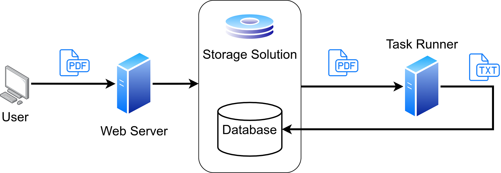

Software needs hardware to run on. For a long time, this meant that you have to buy hardware, ensure that the network connection keeps working, worry about power outages and device errors, and make sure the temperature is fine. You need to buy new machines when you get more customers, you need to deal with load balancing. You need to **maintain** your machines.

You deal with the issue of **under-provisioning** (not having enough machines) and **over-provisioning** (having more machines than you need).

Those are already the core promises of serverless architectures:

> **Serverless architectures** remove the need of taking care of server management. The pricing models are focused on actual usage, they **scale automatically** and are **provisioned automatically**.

I will mention the cloud provider AWS (Amazon) and the programming language Python most of the time as I’m most familiar with this environment. The two other cloud providers which probably provide comparable services are Microsoft Azure and Google Cloud Platform (GCP). If you’re developing JavaScript, Java, or Go you can likely do pretty much the same.

## Degrees of Abstracting away from the Machine

Serverless is just the latest iteration of abstracting the actual bare metal machine away:

* **Self-hosted Bare Metal Machine**: You buy the hardware, you plug it in, you make sure that the physical internet connection works. You need to worry about physical security.
* **Provided Bare Metal Machine**: You are no longer responsible for physical security, electricity, and internet connection. Somebody has your machines in their server rooms/containers. But you still need to do everything from the OS upwards. Those are typically called “dedicated servers” — they are dedicated to just one client. [Hetzner](https://www.hetzner.com/dedicated-rootserver/matrix-ax) provides this.
* **Virtual Machines**: Instead of having everything installed directly on the machine, you isolate the runtime environment from the host system by using a virtual machine. The virtual machine can be stopped, copied to other systems, started on those again. An advantage of using a virtual machine is that you can easily get rid of everything in it. Another advantage is that you can have multiple different operating systems on one machine, running at the same time. The big disadvantage of VMs is that they come with a pretty high memory overhead. A core part of a VM is the hypervisor, e.g. VMware or VirtualBox. [Digital Ocean Droplets](https://www.digitalocean.com/products/droplets/) and [AWS EC2](https://aws.amazon.com/ec2/) are examples.
* **Containers**: Instead of isolating complete systems with VMs, you can also isolate applications with containers. Virtual machines typically keep running and keep their state. In contrast, containers often are ephemeral: They can be killed without storing their state at any point. An example is Docker. You can *orchestrate* multiple containers on *one host* via Docker-compose and on *multiple hosts* via Kubernetes. Where VMs isolate the user space and the kernel space, containers only isolate the userspace. You cannot run a Windows container on a Linux machine and vice versa, but you can run a Windows VM on a Linux machine. You can run containers via AWS ECS, but you will still need AWS EC2 ([more details on the differences](https://stackoverflow.com/q/40575584/562769))

## Abstracting Away from the Infrastructure — XaaS

The NIST describes three different cloud service models: IaaS, PaaS, and SaaS. They can be summarized as XaaS:

* **Infrastructure as a Service (IaaS)**: Once you have virtual machines/networks/storage, you can have a big server farm and rent those virtual machines. AWS, Google Cloud Platform (GCP), Azure, and Digital Ocean are some examples in this category. The advantage of IaaS compared to bare metal machines is that provisioning a virtual machine is way faster than provisioning a physical machine. The provider typically also has a higher resource utilization which should imply that the price is lower.
* **Platform as a Service (PaaS)**: This provides the server, the OS, security settings, the runtime environment, storage, network. You only specify which kind of runtime application you need (e.g. NodeJS or Python). Heroku from Salesforce and Elastic Beanstalk from AWS are examples. There are also container platforms, e.g. Amazon ECS / EKS and Google Kubernetes Engine. Those also have auto-scaling features, e.g. with AWS Fargate.
* **Function as a Service (FaaS)**: AWS Lambda is an example.

Less relevant for you as a developer is the **Software as a Service (SaaS)** model. Instead of just providing infrastructure, you get ready-to-use applications from the cloud. Examples are Github, Dropbox, Slack, and Office 365. The advantage of SaaS compared to real applications is that you don’t need to install and configure it on different machines: The maintenance cost is reduced. Typically you pay per user/month.

## File Storage / Object Storage

One of the simplest aspects of serverless architectures is storage. AWS S3 is the solution from AWS. You can store arbitrary content (byte streams) under a key. AWS organizes those keys in so-called “Buckets”. The maximum size a single object can have is 5 terabytes. The maximum size a single PUT operation can have is 5 GB. You pay for storage and for traffic.

The promise is that you don’t need to worry any longer about not having enough disks. You don’t need to worry (that much) about backups.

## Key-Value Stores

Key-Value stores are pretty common for caches and configuration. Typical solutions are Redis and Memcached. The serverless alternative would be AWS DynamoDB.

## Serverless Databases

A core component that is notoriously hard to scale is the database. Amazon Aurora Serverless provides that.

Please note that you need to [choose how big of a machine you want](https://aws.amazon.com/rds/postgresql/pricing/) for services like AWS RDS. In contrast, the pricing for AWS Aurora Serverless is focused on usage ([storage and I/O](https://aws.amazon.com/rds/aurora/pricing/)).

## Functions as a Service (FaaS)

The idea is that you package a function which you can trigger via other means. For example, think about a website which offers its users to extract text from PDF files. The users upload the file, the website does its magic, and once it is finished the users receive the extracted text e.g. via email.

A traditional architecture might look like this:

<figure>
    
    <figcaption>Example how a text extraction service with a traditional architecture might look like. Image by Martin Thoma.</figcaption>
</figure>

The user has a PDF from which he wants to extract text. So he sends it to the webserver. The server just stores it. The task runner could be Celery running on a beefy machine. There could be a process which regularly checks for DB entries which don’t have extracted text and trigger a task to fix it.

Once this service gets more popular, a single machine will not be enough for the task runner. You will need to add more. So you create a load balancer and have a cluster of task runners. This can scale well, but you need to take care of buying the machines, installing, and updating the software of the task runners.

In a serverless architecture, you could use **AWS Lambda** or **Google Cloud Functions** from GCP or **Azure Functions**.

You bundle the software a task runner needs into a completely contained package. AWS Lambda provides you with a minimal environment, e.g. Python 3.9 (see [AWS Lambda runtimes](https://docs.aws.amazon.com/lambda/latest/dg/lambda-runtimes.html)). You upload the package as a ZIP file and tell AWS two things:

1. **Triggers**: Which events start the execution of the function? This could be a new file uploaded to AWS S3. It could be a CRON job. It could be many other things.
1. **Entry Point**: Which file and which function in that file should be called when the trigger happens?

AWS Lambda then has some restrictions, e.g. a maximum runtime, maximum memory. The function might also get called multiple times, so idempotency is crucial. It is guaranteed to be called at least once. Oh, and there might be a delay between the actual event and the start of your function.

They are a very nice fit for applications where latency does not matter that much and where you want to start from the beginning all the time. Data processing jobs (ETL, Extract-Transform-Load) are good examples for those:

* **Extract**: Extract text from a PDF file
* **Transform**: Change the format/codec of an uploaded video before it goes live
* **Machine Learning (Training)**: Training a new model once new input is there.
* **Asynchronous Tasks**: Instead of running long-running/asynchronous tasks in Celery, they could run in AWS Lambda.

They are a bad fit when you want to have low latency or when you can benefit a lot from caching:

* **Machine Learning (Inference)**: Running inference over a batch of 30 inputs is typically as fast as running inference on one input. What takes a lot of time is loading the machine learning library and the model.

## Summary

Serverless Architectures reduce operational activities in your organization as a cloud provider takes care of those. [Amazon AWS offers a lot](https://aws.amazon.com/serverless/) in this direction, but [Google Cloud Platform](https://cloud.google.com/serverless) (GCP) and [Microsoft Azure as well](https://azure.microsoft.com/en-us/solutions/serverless/).
