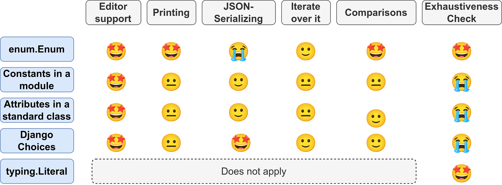

An Enum is a collection of static values, typically strings or integers. They are used pretty often — or at least they should be. At [Cashlink](https://cashlink.de/), we typically use them to track steps for longer processes.

Enums are a way to group constants. Constants are useful to prevent typos as your editor can warn you when a value is not part of an enum, but it cannot warn you that a string or an integer is invalid. Grouping constants in Enums gives you a couple of advantages.

Before we dive into it, let’s look at some applications for enums.

## Examples of Enums

* **Statuses**: You’re writing a backend and you want to return a status code, this should be an enum. Instead of writing `return 404` you write `return status.HTTP_404_NOT_FOUND`. In general, variables that contain a finite set of statuses should probably have an Enum as value. Look for “state” or “status”.
* **Choices**: It might be salutations a user can choose from or roles of users. Countries of origin, timezones, …. Look for “choice” or sometimes just lists within your code.
* **Types**: You could have different types of users, subscriptions, products, …
* **Steps**: If you track the user funnel you might have a constant for each step. Depending on that you could have different behavior. The set of all steps could be an Enum.
* **Flags**: The Unix permission system which represents Read / Write / Execute as binary flags in a 3-bit sequence is another example of what you would want to do with an Enum.

## What you want to do with enums

### Get editor support

You can always just use a constant. But when you use an editor, you typically want to get auto-completion by your editor.

### Nice representation when printing

There should be a good way to convert it to a string. For example, when you print the HTTP status code I think NOT\_FOUND is way better than 404.

### Iterate over all values

An enum is a collection of static values. In some cases, you want to loop over all of them.

### Exhaustiveness Checks

In a lot of codebases you can see this pattern:

```
if value == 'a':
    ...
elif value == 'b':
    ...
elif value == 'c':
    ...
else:
    # Safeguard if a case was forgotten
    raise NotImplementedError(f"The value {value} should not exist")
```

I’ve also seen `ValueError` for exactly the same thing.

Depending on where those values come from, you could compare `value` against an enum. Then mypy could do an exhaustiveness check, meaning it will understand that there is the possibility to run into the exception. Hence mypy can warn you that you actually forgot a case!

### Semantically meaningful comparisons

Comparing values is easy, but comparing semantics is hard. We want to compare things of the same kind, not values. For example, we want to compare if a payment we received is equal to the amount we expected. It has to be in the same unit. It makes a huge difference if we expect 1000 Euro or 1000 Indonesian Rupiah. It also makes a huge difference for some people if you speak of biological sex or gender identity. This means that two variables might contain exactly the same value, but not be comparable. At the very least we would expect a comparison to evaluate to `False`.

### Serialization and Deserialization

We need to convert data so often to JSON and back from JSON. [Pydantic](https://pydantic-docs.helpmanual.io/) is pretty amazing and does a great job coercing to the right values most of the time, but let’s check for the given options how well they do.

## № 1: The built-in Enum module

The [enum](https://docs.python.org/3/library/enum.html) module was introduced with Python 3.4 via [PEP 435](https://www.python.org/dev/peps/pep-0435/). It is the first thing that should pop to your mind when you want to create an Enum:

```python
from enum import Enum


class HttpStatus(Enum):
    NOT_FOUND = 404
    SUCCESS = 200
    INTERNAL_SERVER_ERROR = 500
```

```pycon
# Printing
>>> print(HttpStatus.SUCCESS)
HttpStatus.SUCCESS

# Comparisons
>>> HttpStatus.NOT_FOUND == 404
False

>>> HttpStatus.NOT_FOUND.value == 404
True

# Iteration
>>> for value in HttpStatus:
...     print(value)
HttpStatus.NOT_FOUND
HttpStatus.SUCCESS
HttpStatus.INTERNAL_SERVER_ERROR
```

Integer Flags can be done with [IntFlag](https://docs.python.org/3/library/enum.html#intflag).

If you want to check for exhaustiveness, you can get this:

```python
from typing import NoReturn


def assert_never(value: NoReturn) -> NoReturn:
    assert False, f"Unhandled value: {value} ({type(value).__name__})"


def print_status(status: HttpStatus) -> None:
    if status is HttpStatus.SUCCESS:
        print("SUCCESS")
    elif status is HttpStatus.NOT_FOUND:
        print("NOT_FOUND")
    else:
        assert_never(status)
```

Which gives you this error message:

```bash
$ mypy main.py
main.py:35: error: Argument 1 to "assert_never" has incompatible type "Literal[HttpStatus.INTERNAL_SERVER_ERROR]"; expected "NoReturn"
```

You can make Enums JSON-serializable, but you have to give it a little bit of thought:

[**Convert a Python Enum to JSON** *A trivial way to make a Python Enum which is based on string tokens JSON-serializable is to inherit both str and Enum…*py.watch](https://py.watch/convert-a-python-enum-to-json-5eb5e94ecc9)

## № 2: Plain class attributes

You can simply create a class and use its attributes:

```python
class HttpStatus:
    NOT_FOUND = 404
    SUCCESS = 200
    INTERNAL_SERVER_ERROR = 500
```

```pycon
# Printing
>>> print(HttpStatus.SUCCESS)
200

# Comparisons
>>> HttpStatus.NOT_FOUND == 404
True
```

While something like this is still common in many codebases, the downsides are clear:

1. Value comparisons with other enums lead to unexpected results.
1. It’s way harder to iterate over the values.
1. The string representations are just the values that can be hard to read.

## № 3: Constants in a module

You can put the values directly in a module, e.g. `http_status_codes.py`:

```
NOT_FOUND = 404
SUCCESS = 200
INTERNAL_SERVER_ERROR = 500
```

This is probably the most lightweight option. You still have all of the disadvantages.

One real-life example where this is done is the Django REST framework with the HTTP status codes ([source](https://github.com/encode/django-rest-framework/blob/master/rest_framework/status.py)).

## № 4: Django models.Choices

Django has also several ways to create enums, e.g. [TextChoices](https://docs.djangoproject.com/en/4.0/ref/models/fields/#enumeration-types):

```python
from django.db import models


class HttpStatus(models.TextChoices):
    NOT_FOUND = 404
    SUCCESS = 200
    INTERNAL_SERVER_ERROR = 500
```
```pycon
# Iteration
>>> for value in HttpStatus:
...     print(value)
404
200
500

# Comparisons
>>> HttpStatus.NOT_FOUND.value == "404"
True
>>> HttpStatus.NOT_FOUND == "404"
True
>>> HttpStatus.NOT_FOUND.value <= "404"
True

# Custom functions
>>> HttpStatus.choices
[('404', 'Not Found'), ('200', 'Success'), ('500', 'Internal Server Error')]
>>> HttpStatus.names
['NOT_FOUND', 'SUCCESS', 'INTERNAL_SERVER_ERROR']
>>> HttpStatus.labels
['Not Found', 'Success', 'Internal Server Error']
>>> HttpStatus.values
['404', '200', '500']
```

There is also `models.Choices` and `models.IntegerChoices`.

Django TextChoices Enums add a couple of functions that might come in handy. I’d recommend using them if you use Django. They can be connected to the Django ORM which is pretty nice.

The Django Choices are also directly JSON-serializable.

## № 5: typing.Literal

The [Literal type](https://docs.python.org/3/library/typing.html#typing.Literal) was introduced in [PEP 586](https://www.python.org/dev/peps/pep-0586/) as a way to indicate that a variable must have a set of certain values. For example, instead of just stating that a parameter is an integer, you can list the allowed values:

```
from typing import Literal

StatusCode = Literal[404, 200, 500]

def set_status(self, http_status_code: StatusCode):
    self.status = http_status_code
```

## Now … which one should I take?

First, make sure the type of Enum fulfills your needs:

<figure>
    <a href="../images/2022/01/5-ways-to-get-enums-in-python-2.png"></a>
    <figcaption>Image by Martin Thoma</figcaption>
</figure>

There are also some other choices:

* Do you need to support Python 3.3 or earlier? Then you cannot choose `enum.Enum`.
* Do you only want to give mypy better capabilities of checking issues? Use `typing.Literal`!
* Do you use Django? Then Django Choices are your way to go!
