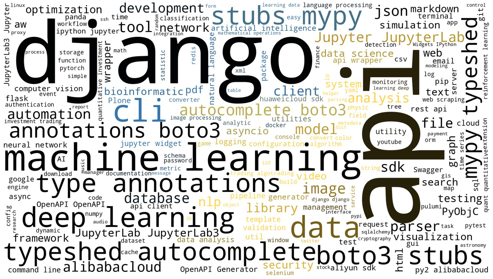
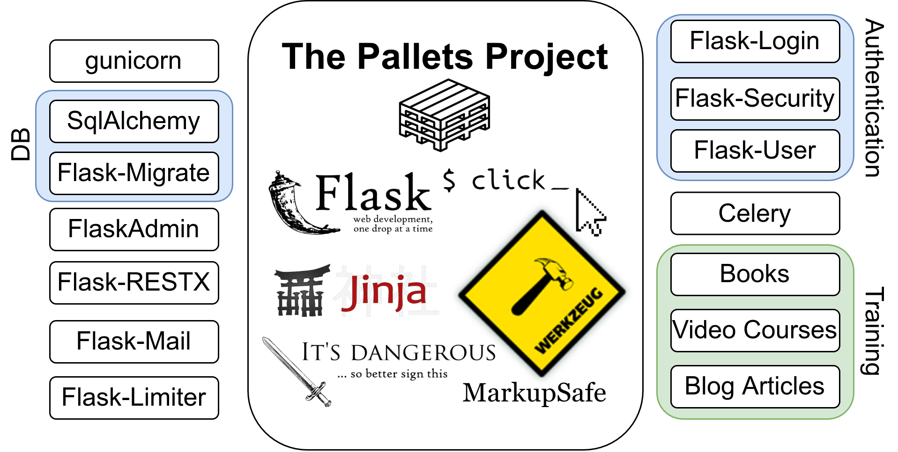
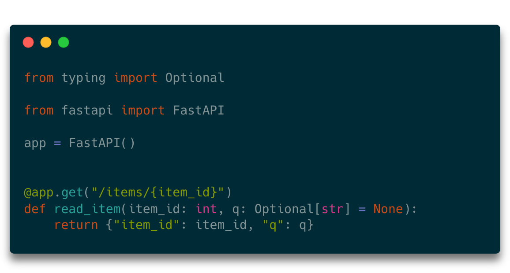
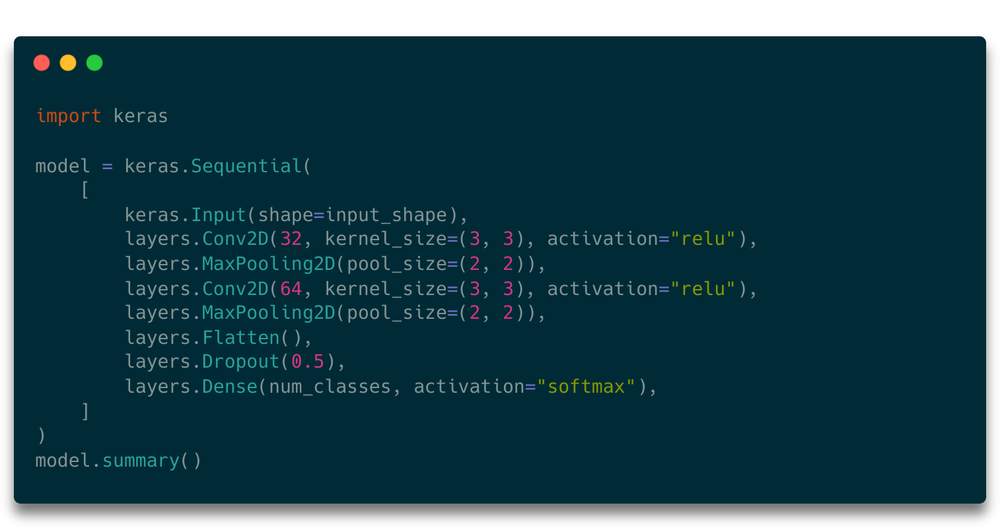
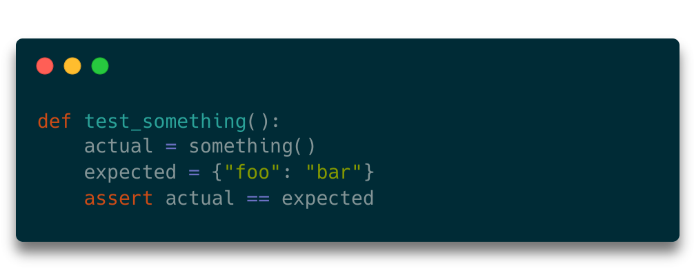

<figure>
    
    <figcaption>An overview of the keywords of Python packages. Created with <a href="https://pypi.org/project/wordcloud/">wordcloud</a> by Martin Thoma.</figcaption>
</figure>

PyPI, the python package index, is the default package repository for Python. It’s completely open and free to use for anybody. Anybody can contribute packages. PyPI is also the default package index for Python: When you run `pip install flake8` the package manager will typically look [on PyPI](https://pypi.org/) for flake8.

What kind of packages are on PyPI? Continue to find out 😄

## Context of this Analysis

It’s the third time that I run such an analysis. The first was in January 2015 ([source](../analyzing-pypi-metadata/)) and the second one was in January 2020 ([source](../pypi-2020/)).

## Methodology: Data Cleaning

I’ve essentially downloaded the complete data. Well, only the meta-data and the latest package versions. The **metadata is about 3.4 GB** of data and the latest versions of **all packages are around 200 GB** of data.

As everybody can upload packages on PyPI, there are a lot of unusable packages.

At the time of this data dump, there were 53,408 packages that classified themselves as Alpha-stage or even earlier. Several hundred packages had “Example Author” or similar in the author field. More than 800 package names contained the string “example”. Almost 2000 packages indicated that the readers were trying an example from a “Head First” book.

A lot of packages never reach a point where they are useful to anybody. Even more are abandoned. I consider a package which isn’t updated for more than a year abandoned. There were over 129k packages which didn’t receive any edit in 2021 or 2022. This includes the PyPDF2 package which is still pretty wide-spread.

All of those packages were removed and ignored in the follow-up analysis. This left **78,950 packages** ([complete list](https://github.com/MartinThoma/algorithms/blob/master/PyPI/2022-01/pypi-packages.csv)). For those packages I could imagine that people actually use them.

## Ecosystems

<figure>
    
    <figcaption>A lot of people build web services with the Flask framework. But it’s not only that. A lot of people build extensions, tools, and training material around Flask as well. This is how you get ecosystems. Image by Martin Thoma.</figcaption>
</figure>

There are several ecosystems within Python. It’s typically driven by one application or framework for which many people write extensions/plugins. In fact, there are so many ecosystems that I cannot enumerate them all. Hence I will only present the biggest ones. To be in those, the ecosystem has to have at least 100 packages that belong to it.

Please remember that a huge number of packages typically means that the ecosystem is a bit older, but it can also mean that many important features are missing. I didn’t analyze how mature those packages are or if they are maintained at all.

### Web Frameworks

<figure>
    
    <figcaption>FastAPI is a rising star in the world of Python web frameworks. Screenshot created via <a href="https://carbon.now.sh/">carbon.now.sh</a></figcaption>
</figure>

WSGI made it easy to create a web framework in Python. The biggest one for sure is **Django** (2,757 packages) with the batteries-included philosophy. Microframeworks try to provide the bare minimum. This category contains **Flask** (548 packages), **FastAPI** (182 packages), Tornado (50 packages), and **Bottle** (31 packages).

**Plone** (398 packages which contain either “collective” or “plone”) is a CMS just like **Wagtail** (92 packages) or **Django-CMS** (10 packages).

[**Dash**](https://plotly.com/dash/) (34 packages) is a framework for building data apps by plotly. I guess it’s similar to [**streamlit**](https://streamlit.io/) (57 packages).

### Machine Learning and Data Analysis

<figure>
    
    <figcaption>Creating neural networks with Keras is trivial. Keras uses Tensorflow under the hood. Screenshot created via <a href="https://carbon.now.sh/">carbon.now.sh</a></figcaption>
</figure>

In the machine learning space, we have ecosystems around the deep learning libraries [**Torch**](https://pytorch.org/) (735 packages), **Keras** (135 packages), and [**Tensorflow**](https://www.tensorflow.org/) (327 packages).

For data analysis, there is [**Jupyter**](https://jupyter.org/) (850 packages) and [**Pandas**](https://pandas.pydata.org/) (383 packages).

For robotic process automation (RPA), there is [**robotframework**](https://robotframework.org/) (108 packages).

As general libraries, there is **scikit** (202 packages, including sklearn), **numpy** (248 packages), and **scipy** (68 packages).

### Companies

When a company provides popular services, developers will write supplementary packages to simplify their lives.

For cloud computing, the dominant players are **AWS** (1,213 AWS/boto packages), **Google Cloud Platform** (59 packages), and **Microsoft Azure** (448 packages).

Other packages are around **Alibaba** (474 packages), **Discord** (414 packages), **Slack** (100 packages), and **Sentry** (62 packages).

### Testing

<figure>
    
    <figcaption>pytest makes testing super easy. You just use the assert statement, but you get nice output that tells you what’s going on. Don’t miss my series on <a href="../unit-testing-basics/">testing with Python</a> 😁</figcaption>
</figure>

The testing world pretty much consolidated around **pytest** (386 packages) for writing unit tests, **mypy** (484 packages) for type checking, and the static linter **Flake8** (125 packages).

### Tooling

* over 100 packages contain ‘pip’
* 231 packages contain ‘redis’
* 282 packages contain ‘docker’

### Tools around data formats

Reading and writing data is a common and cumbersome task. There are several packages that simplify working with SQL (1,116 packages), JSON (1,064 packages), PDF (580 packages), and Markdown (381 packages).

### Other

* [Odoo](https://en.wikipedia.org/wiki/Odoo): According to Wikipedia, Odoo is a suite of business management software tools including, for example, CRM, e-commerce, billing, accounting, manufacturing, warehouse, project management, and inventory management. 3,283 packages contain ‘odoo’.
* AsyncIO: Working in an asynchronous way has a couple of benefits that many people don’t want to miss. However, switching from a synchronous implementation to an asynchronous one is not always that easy. 8313 packages or their descriptions contain “aio” or “asyncio”.
* [MicroPython](https://micropython.org/): Did you know that CPython is only the most common implementation of the Python standard? MicroPython is another one that is tailored towards microcontrollers. There are 47 packages for this Python runtime.

## Package Authors

Who creates packages on PyPI?

Sadly, the “author” meta field was not filled out for 3,995 packages. In several cases, it’s also filled with nonsense that indicates that the package should probably not be taken seriously (521x Example Author). Others, like hfpython (473 packages) — Head First — might come from examples from learning material.

There are a couple of organizations that created a lot of packages: Various **Odoo** Community Associations (combined 4,446 packages), **Amazon** Web Services (438 packages), **Microsoft** Corporation (272 packages), and Alibaba Cloud SDK (368 packages).

There are also foundations like **OpenStack** (260 packages) and The **Apache Software Foundation** (152 packages). Even single contributors like Vlad Emelianov (307 packages, mostly type stubs for boto3) make notable amounts of packages.

## Licenses

One of the pain points of single developers working in their free time on projects is to choose the proper license. It’s not fun. It feels like work. But without having a clear license, it might be impossible for others to use your software.

Many developers did not bother to give any license information (24,299 packages), some refer to a file (2,732). The most common choices are **MIT** (24,234), **APACHE LICENSE 2.0** (7,889), **AGPL-3** (4,193), **BSD** (2,474), **GPLv3** (2,751), **BSD-3-CLAUSE** (1,799). All other licenses are used by fewer than 1000 packages or in too many different spellings.

## Big Packages

75% of the packages on PyPI are below 56 KB in size.
95% of the packages on PyPI are below 2,328 KB in size.
99% of the packages on PyPI are less than 27 MB.

You can see that a minority of packages consume most of the space. And the ones above 500 MB are:

* `mxnet-cu102==1.7.0.post0`: 895 MB ([pypi](https://pypi.org/project/mxnet-cu102/))
* `torch==1.4.0`: 753 MB ([pypi](https://pypi.org/project/torch/#files))
* `daal-static==2021.2.3`: 623 MB ([pypi](https://pypi.org/project/daal-static/#files))

The default limit is at 100 MB, but you can [ask for more](https://github.com/pypa/pypi-support/labels/limit%20request).

## Ridiculous Stuff

The [longest package name](https://pypi.org/project/program-to-get-any-string-as-user-input-and-output-code-for-the-string-reverse-the-string-and-code-using-alphabet-position/) has 122 characters. The same package has the longest release\_url (152 characters), the longest package URL (148 characters).

The [longest version string](https://pypi.org/project/softwarefabrica.django.utils/) has 70 characters, the [longest summary](https://pypi.org/project/okapi/) is 4570 characters long.

Finally, something that looks serious: The [khmer package](https://pypi.org/project/khmer/) lists 70 authors in 1105 characters.

## Security

Open package repositories such as PyPI (but also Composer in PHP) have a problem with malicious packages and typo squatting.

For PyPI, there are several examples such as jeIlyfish vs jellyfish and [python3-dateutil vs dateutil](https://snyk.io/blog/malicious-packages-found-to-be-typo-squatting-in-pypi/).

It’s hard to estimate how severe that issue is.

I’ve tried to find malware via clamscan, but I only got 45 false-positives (e.g. [bgmi](https://pypi.org/project/bgmi/), [cp-mn-bd-01-mimicat](https://pypi.org/project/cp-mn-bd-01-mimicat/)). I’ve checked those tar.gz files via [virustotal](https://www.virustotal.com/gui/home/upload).

There are several attack vectors:

* **Typosquatting**: Your developers want to use `jellyfish`, but do write `jelyfish` (just one “l”). While there are no ways to completely prevent it, one can add a link to the GitHub repository and the PyPI package in the README (e.g. [as a badge like here](https://pypi.org/project/flake8-simplify/)). GitHub and its stars/forks allow you to reason at least a little bit easier which one is the correct one.
* **Dependency confusion**: You have an internal package `bmw-ci`. It’s not expected to be on pypi.org, but to be loaded from your internal package repository. However, an angry former employee knows that and uploads his version of that package on pypi. As pip searches first on pypi.org and then in your private repository, the attacker’s package is installed.
* **Trojan horse**: You’re installing a package which has some nice functionality, but the author is an attacker.
* **Supply chain attack**: You’re making use of the package `awesome-foobar` and the author is a good guy. However, it’s just a free-time project for that author. The author does not have the time or knowledge to take security seriously. An attacker figures out his password and uploads a new version of the package that contains malware.

And many things that malicious software can do:

* **Data stealing malware**: Grab ssh keys, get your crypto wallet keys, get your bank account passwords, log your passwords, send your private photos, …
* **Ransomware**: Encrypting your data and demanding a ransom
* **Backdoors**: Allowing the attacker to access your computer

A serious issue with PyPI is that you cannot report packages easily ([#3896](https://github.com/pypa/warehouse/issues/3896)). *Update:* Since 2024, PyPI has a “Report project as malware” button.

## File Names

There are a couple of file names you would expect to appear in most packages: `__init__.py`, `PKG-INFO`, `setup.py`, `setup.cfg`. Let’s see what else we’ve got:

### README

It’s most of the time a `README.md`. More than 3x the amount of `README.rst`.

### License

Most people prefer `LICENSE` over `LICENSE.txt`

### Should this be in here?

People ship files that should not be in the package. The most obvious one is `.gitignore`, but also rendered documentation.

## What have we seen?

The Python ecosystem is thriving with several thousands of actively developed packages. It’s a mix of single contributors, open organizations, and corporations who contribute.

PyPI contains a lot of packages for **data science** and **web development**, but also **security tools**.
