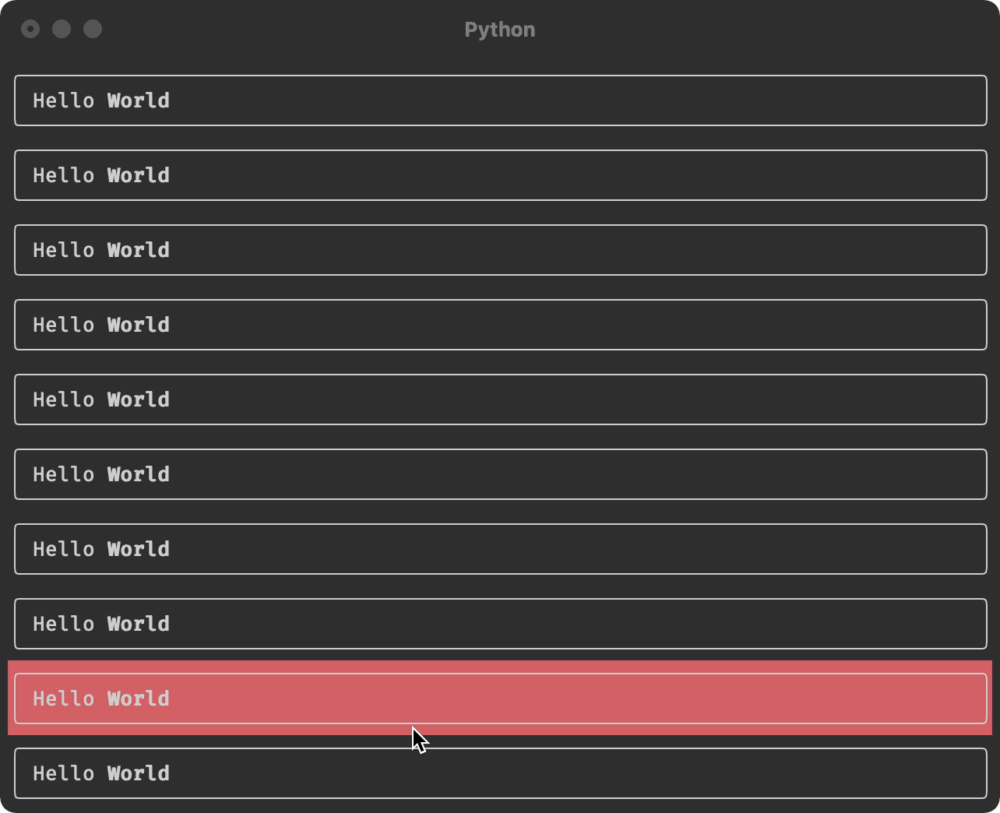
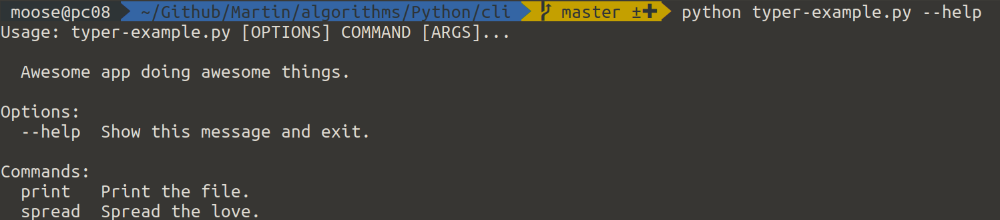
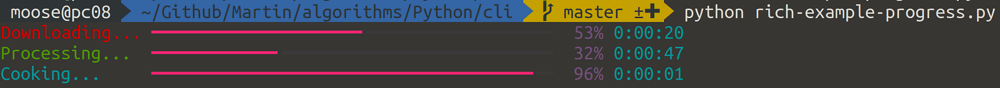
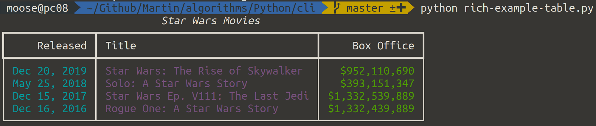
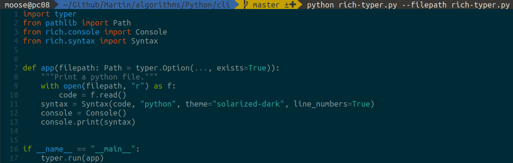
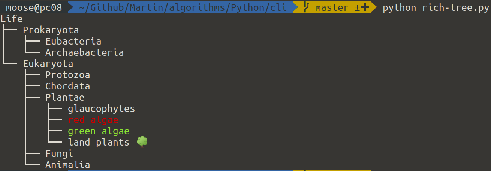
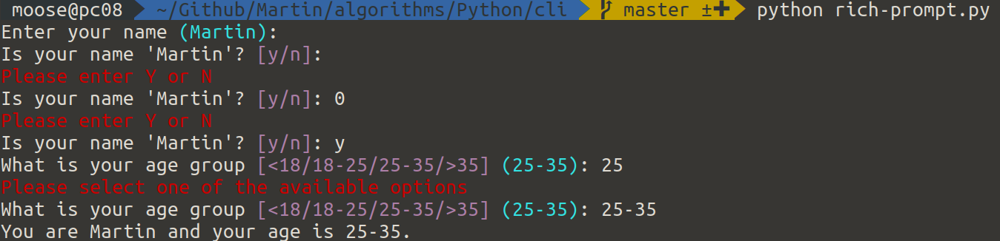
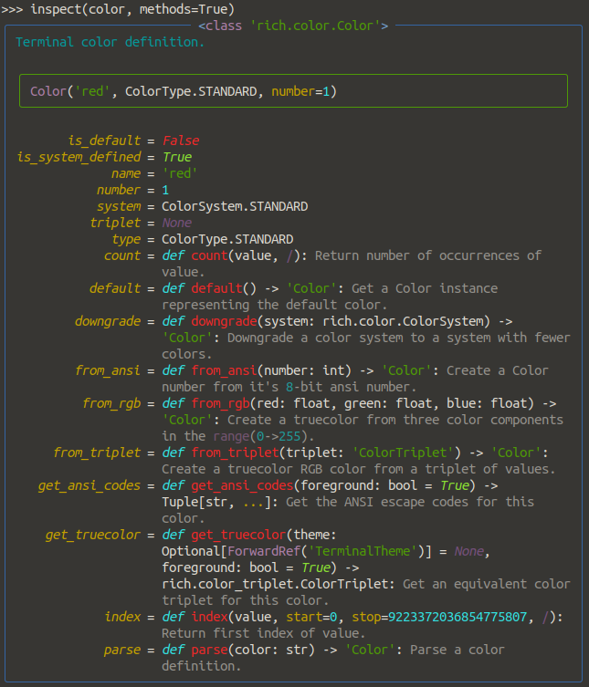
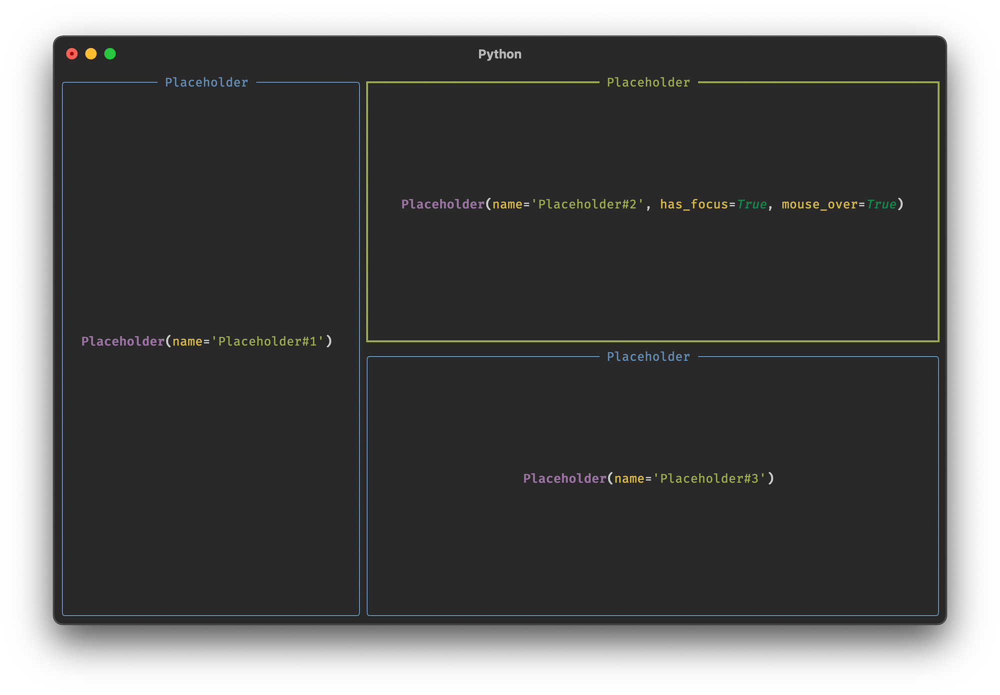
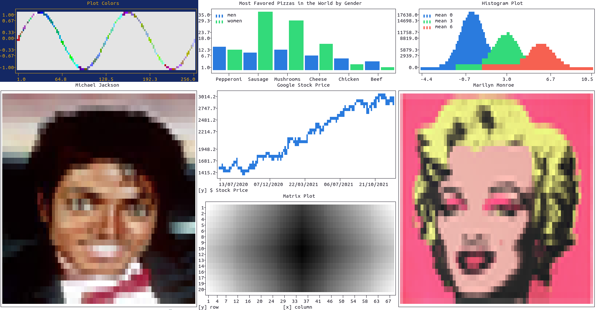

<figure>
    <a href="../images/2022/02/designing-beautiful-command-line-applications-with-python-1.gif"></a>
    <figcaption>Textual allows you to create such amazing terminal applications with interactive elements that react on the mouse cursor position. Absolutely mindboggling that this is possible. Image from the <a href="https://github.com/Textualize/textual#creating-widgets">README of textual</a>.</figcaption>
</figure>

A lot of people still write their command-line applications with Argparse or even Optparse plus `input()`. Creating outputs is often done directly with `print` and formatting strings — which gets really hairy when you want to print tables or have some color/emphasis.

There are five libraries that allow you to do WAY better. I can promise the last two will surprise you — let’s get started!

## №1 and 2: Use click or Typer for CLIs

<figure>
    <a href="../images/2022/02/designing-beautiful-command-line-applications-with-python-2.png"></a>
</figure>

[click](https://pypi.org/project/click/) is a library in the Flask ecosystem for creating non-interactive command-line interfaces. It parses command-line arguments/options but uses decorators in a very clever way to do so. Especially the options for creating subcommands are top-notch.

```python
import click


@click.group()
def app():
    """Awesome app doing awesome things."""


@app.command()
@click.option("--count", default=1, help="How much love you want")
@click.argument("name")
def spread(name, count):
    """Spread the love."""
    for i in range(count):
        print(f"{name} loves you ❤️")


@app.command(name="print")
@click.argument("filepath", metavar="FILE", type=click.Path(exists=True))
@click.option("--show-meta", default=False, is_flag=True)
def print_(filepath, show_meta):
    """Print the file."""
    if show_meta:
        print(f"File path: {filepath}")
        print("-" * 80)
    with open(filepath, "r") as f:
        print(f.read())


if __name__ == "__main__":
    app()
```

which looks like this:

```
$ python click-example.py --help
Usage: click-example.py [OPTIONS] COMMAND [ARGS]...

Awesome app doing awesome things.

Options:
  --help  Show this message and exit.

Commands:
  print   Print the file.
  spread  Spread the love.

$ python click-example.py print --help
Usage: click-example.py print [OPTIONS] FILE

Print the file.

Options:
  --show-meta
  --help       Show this message and exit.
```

[Typer](https://pypi.org/project/typer/) is a library in the FastAPI ecosystem and very similar to click. In fact, it uses click under the hood. Typer makes great use of type annotations to allow you to create beautiful command-line interfaces with very little effort.


## №3: Use rich for output formatting

[Rich](https://pypi.org/project/rich/) is a Python library for rich text and beautiful formatting in the terminal. Its documentation is excellent, so I’ll use pretty much just examples from there.

### Progress Bars

<figure>
    <a href="../images/2022/02/designing-beautiful-command-line-applications-with-python-3.png"></a>
</figure>

```python
import time

from rich.progress import Progress

with Progress() as progress:
    task1 = progress.add_task("[red]Downloading...", total=1000)
    task2 = progress.add_task("[green]Processing...", total=1000)
    task3 = progress.add_task("[cyan]Cooking...", total=1000)

    while not progress.finished:
        progress.update(task1, advance=0.5)
        progress.update(task2, advance=0.3)
        progress.update(task3, advance=0.9)
        time.sleep(0.02)
```

There is also the basic example:

```python
from rich.progress import track

for step in track(range(100), description="Processing..."):
    do_work(step)
```

### Tables

<figure>
    <a href="../images/2022/02/designing-beautiful-command-line-applications-with-python-4.png"></a>
</figure>

```python
from rich.console import Console
from rich.table import Table

table = Table(title="Star Wars Movies")

table.add_column("Released", justify="right", style="cyan", no_wrap=True)
table.add_column("Title", style="magenta")
table.add_column("Box Office", justify="right", style="green")

table.add_row(
    "Dec 20, 2019", "Star Wars: The Rise of Skywalker", "$952,110,690"
)
table.add_row("May 25, 2018", "Solo: A Star Wars Story", "$393,151,347")
table.add_row(
    "Dec 15, 2017", "Star Wars Ep. V111: The Last Jedi", "$1,332,539,889"
)
table.add_row("Dec 16, 2016", "Rogue One: A Star Wars Story", "$1,332,439,889")

console = Console()
console.print(table)
```

### Syntax Highlighting

Syntax highlighting in the console is AMAZING. Apparently [rich.syntax.Syntax](https://rich.readthedocs.io/en/latest/reference/syntax.html) uses pygments under the hood, so you can choose between many different [syntax highlighting themes](https://pygments.org/styles/).

```python
import typer
from pathlib import Path
from rich.console import Console
from rich.syntax import Syntax


def app(filepath: Path = typer.Option(..., exists=True)):
    """Print a python file."""
    with open(filepath, "r") as f:
        code = f.read()
    syntax = Syntax(code, "python", theme="solarized-dark", line_numbers=True)
    console = Console()
    console.print(syntax)


if __name__ == "__main__":
    typer.run(app)
```

<figure>
    <a href="../images/2022/02/designing-beautiful-command-line-applications-with-python-5.png"></a>
</figure>

### Trees

```python
from rich.tree import Tree
from rich import print

tree = Tree("Life")

prokaryota = tree.add("Prokaryota")
prokaryota.add("Eubacteria")
prokaryota.add("Archaebacteria")

eukaryota = tree.add("Eukaryota")
eukaryota.add("Protozoa")
eukaryota.add("Chordata")
plantae = eukaryota.add("Plantae")
plantae.add("glaucophytes")
plantae.add("[red]red algae")
plantae.add("[green][bold]green algae")
plantae.add("land plants 🌳")
eukaryota.add("Fungi")
eukaryota.add("Animalia")
print(tree)
```

<figure>
    <a href="../images/2022/02/designing-beautiful-command-line-applications-with-python-6.png"></a>
</figure>

### Prompts and Confirmations

<figure>
    <a href="../images/2022/02/designing-beautiful-command-line-applications-with-python-7.png"></a>
</figure>

```python
from rich.prompt import Prompt, Confirm

is_correct = False
while not is_correct:
    name = Prompt.ask("Enter your name", default="Martin")
    is_correct = Confirm.ask(f"Is your name '{name}'?")

age = Prompt.ask(
    "What is your age group",
    choices=["<18", "18-25", "25-35", ">35"],
    default="25-35",
)

print(f"You are {name} and your age is {age}.")
```

### Bonus: Rich in the REPL

If you want pretty printing directly in the Python REPL, try this:

```
>>> from rich import pretty
>>> pretty.install()
>>> ["Rich and pretty", True]
```

Rich also provides an `inspect` function which is excellent to figure out what a given object can do:

```
>>> from rich import inspect
>>> from rich.color import Color
>>> color = Color.parse("red")
>>> inspect(color, methods=True)
```

<figure>
    <a href="../images/2022/02/designing-beautiful-command-line-applications-with-python-8.png"></a>
</figure>

## №4: Use textual for TUI applications

[Textual](https://pypi.org/project/textual/) is a TUI (Text User Interface) framework for Python. It allows you to interact with mouse movements/clicks, have components that listen to keypresses, re-render parts of the screen. I’ve always thought this was only possible in GUI development. Crazy. I love it.

<figure>
    <a href="../images/2022/02/designing-beautiful-command-line-applications-with-python-9.png"></a>
    <figcaption>Textual allows you to define independent elements of the user interface — so-called widgets. The image is from the <a href="https://github.com/Textualize/textual#widgets">README of textual</a>.</figcaption>
</figure>

The following code from the README of textual generates the interactive example from the very top:

```python
from rich.panel import Panel

from textual.app import App
from textual.reactive import Reactive
from textual.widget import Widget


class Hover(Widget):
    mouse_over = Reactive(False)

    def render(self) -> Panel:
        return Panel(
            "Hello [b]World[/b]", style=("on red" if self.mouse_over else "")
        )

    def on_enter(self) -> None:
        self.mouse_over = True

    def on_leave(self) -> None:
        self.mouse_over = False


class HoverApp(App):
    """Demonstrates custom widgets"""

    async def on_mount(self) -> None:
        hovers = (Hover() for _ in range(10))
        await self.view.dock(*hovers, edge="top")


HoverApp.run(log="textual.log")
```

## №5: Graphs in the Terminal

<figure>
    <a href="../images/2022/02/designing-beautiful-command-line-applications-with-python-10.png"></a>
    <figcaption>Image by <a href="https://pypi.org/project/plotext/">Savino Piccolomo on PyPI</a> (Permission was granted for this post)</figcaption>
</figure>

If the capabilities of rich and textual weren’t crazy enough for you, give `plotext` a shot. `plotext` plots directly on terminal: the syntax is very similar to matplotlib, it has no dependencies (except for an optional dependency required for image plotting) and can save plots as text or as colored HTML 🤯

```python
import plotext as plt  # <--- this is plotext, not matplotlib!

y = plt.sin()  # sinusoidal signal
plt.scatter(y)
plt.title("Scatter Plot")
plt.show()
```

[**How to plot a chart in the terminal?** *I'm researching ML/Theano and recently came across this script…*](https://stackoverflow.com/questions/37288421/how-to-plot-a-chart-in-the-terminal)

## Summary

`click/typer` allows you to create a nice static interface to your application, `rich` gives you a lot of formatting options like progress bars and tables. If you want to stay on the terminal but get GUI-like features, give `textual` and `plotext` a try.

Now that you know how to create nice terminal applications with Python, you should make sure that your terminal is shiny as well:

[**How to get an amazing Terminal** *In Windows and Linux; including prompts, fonts, and colors*](../amazing-terminal/)
