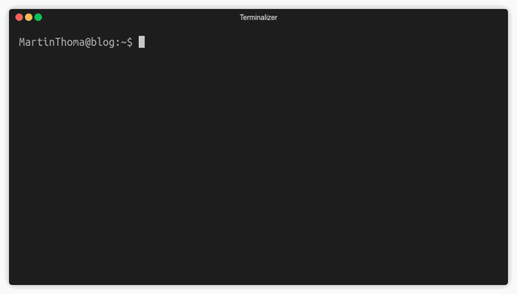
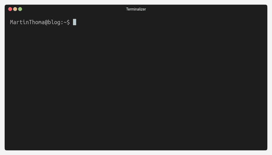
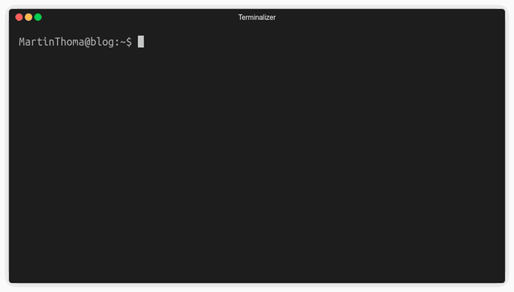
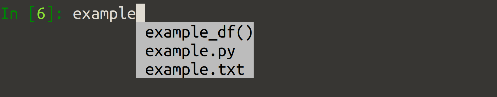
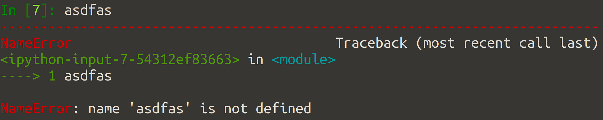
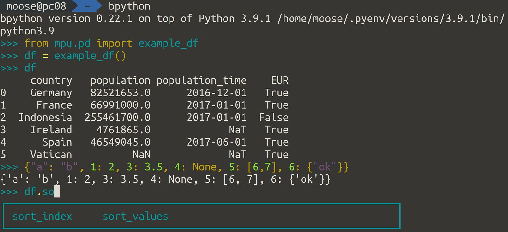
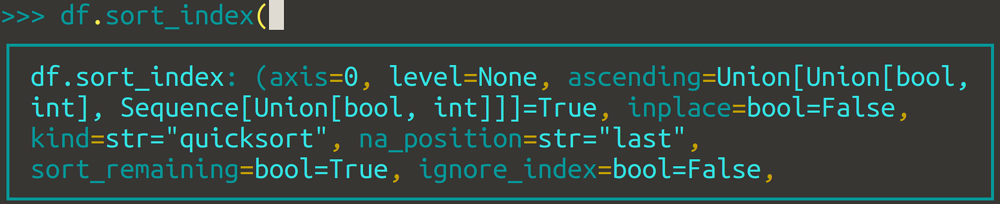
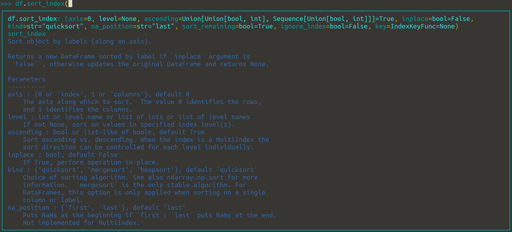
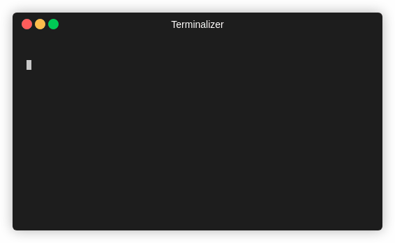
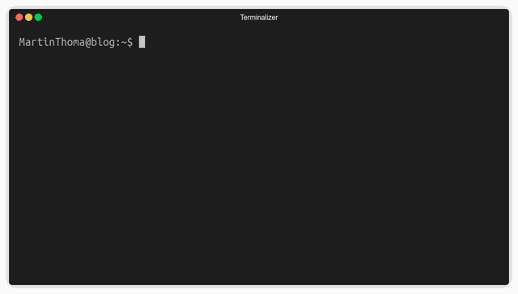

<figure>
    <a href="../images/2022/02/4-alternatives-to-the-standard-interactive-python-shell-1.gif"></a>
    <figcaption>The default interactive shell of Python has no colors, no auto-completion, no block history. There are better options. Animation created by Martin Thoma.</figcaption>
</figure>

One of the core advantages of Python compared to many other languages is that it comes with an interactive Shell.

This is especially useful for explorative tasks, e.g. [exploratory data analysis](../eda/) or debugging. The standard shell is ok, but there are four alternatives that offer missing features. Let’s start!

## 1. Standard Shell enhanced by rich

<figure>
    <a href="../images/2022/02/4-alternatives-to-the-standard-interactive-python-shell-2.gif"></a>
    <figcaption>Rich colorizes your output, but not your input. Image by Martin Thoma</figcaption>
</figure>

[Rich](https://pypi.org/project/rich/) is a Python library for rich text and beautiful formatting in the terminal. It can be installed via `pip install rich`. Instead of using a different shell, you can make your shell execute those two lines within the standard shell:

```
from rich import pretty, inspect, traceback as tb
pretty.install(); tb.install(show_locals=False)
```

Once you’ve done that, you will be rewarded with colored output 🌈

## 2. IPython

<figure>
    <a href="../images/2022/02/4-alternatives-to-the-standard-interactive-python-shell-3.gif"></a>
    <figcaption>IPython automatically colorizes your input, but not the output. It has a block-history as one can see in the end. Image by Martin Thoma</figcaption>
</figure>

[IPython](https://pypi.org/project/ipython/) is the interactive Python shell most people know from Jupyter Notebooks. It can be installed via `pip install ipython`. You start it over the console via `ipython`.

You will instantly recognize that the prompt changed from `>>>` to `In [1]`. Of course, you can customize it:

[**Custom Ipython Prompt | Waylon Walker** *I've grown tired of the standard ipython prompt as it doesn't do much to give me any useful information. The default…*](https://waylonwalker.com/custom-ipython-prompt/)

IPython gives you autocompletion triggered by `Tab` and colored errors:

<figure>
    <a href="../images/2022/02/4-alternatives-to-the-standard-interactive-python-shell-4.png"></a>
</figure>

<figure>
    <a href="../images/2022/02/4-alternatives-to-the-standard-interactive-python-shell-5.png"></a>
</figure>

IPython has a couple of advantages compared to the traditional console:

* **Colorized input and error messages**: You have a much easier time seeing when you started a string or a number.
* **Autocompletion**: It’s not super fancy, but at least you don’t have to type long strings all the time.
* **Block history**: It’s pretty common that you want to go back to past input and modify/execute it again. For single-line input that’s fine, but if you have a function definition with nested loops the standard shell just shows you each line. IPython in contrast deals with the whole block as one input, meaning you have to press the up-arrow less often. This is a big deal for me.
* **IPython commands**: You can use `clear` to get a clean window.

You can also [configure Django to use the IPython shell](https://docs.djangoproject.com/en/1.11/ref/django-admin/#shell). Of course, you can also install rich within the IPython shell to get colored output.

## 3. bpython

<figure>
    <a href="../images/2022/02/4-alternatives-to-the-standard-interactive-python-shell-6.jpg"></a>
</figure>

[bpython](https://pypi.org/project/bpython/) is an interactive shell with tons of auto-completion features. It can be installed via `pip install bpython` and you start it with `bpython`. The auto-completion is triggered while you’re typing and gives astonishingly useful hints below your cursor in a box. The really crazy part is the function definition help:

<figure>
    <a href="../images/2022/02/4-alternatives-to-the-standard-interactive-python-shell-7.png"></a>
</figure>

Even better, that help adjusts to the size of your terminal:

<figure>
    <a href="../images/2022/02/4-alternatives-to-the-standard-interactive-python-shell-8.png"></a>
</figure>

You can see it best in an action:

<figure>
    <a href="../images/2022/02/4-alternatives-to-the-standard-interactive-python-shell-9.jpg"></a>
    <figcaption>Image from the <a href="https://pypi.org/project/bpython/">README of bpython</a></figcaption>
</figure>

To summarize, bpython has one core advantage compared to the default shell and IPython: **Auto-completion / help text.** This is a killer feature for me. It also has [customization](https://docs.bpython-interpreter.org/en/latest/configuration.html#sample-config) [options](https://docs.bpython-interpreter.org/en/latest/themes.html) and you can [use bpython with Django](https://docs.djangoproject.com/en/1.11/ref/django-admin/#shell).

However, there are also downsides:

* **Speed**: It feels like there is a tiny delay when I type. It’s only a fraction of a second, but noticeable. I hate it.
* **Windows**: Due to the usage of the curses library, I expect Windows users to have issues using it. [It seems to be possible](https://docs.bpython-interpreter.org/en/latest/windows.html?highlight=windows), but bpython is not officially supported.
* **Missing Block history**: This is an [open issue since 2014](https://github.com/bpython/bpython/issues/22).

## 4. PtPython

<figure>
    <a href="../images/2022/02/4-alternatives-to-the-standard-interactive-python-shell-10.gif"></a>
    <figcaption>ptpython seems to have it all: colorized input and output, error message formatting, block history, function parameter help. Image by Martin Thoma</figcaption>
</figure>

This looks pretty similar to bpython in the kind of features that are supported, but ptpython obviously uses a different color theme. In contrast to bpython, it supports block-history.

I don’t like the color theme, but you can change it by pressing “F2”. Sadly, something seems not to work as expected. They offer [solarized dark](https://ethanschoonover.com/solarized/), but it doesn’t look like solarized dark 😢

## Summary

You can import [rich](https://pypi.org/project/rich/) in any interactive shell. For this reason, I didn’t include it in the following summary.

|                                | Standard Shell | IPython   | bpython | ptpython |
|--------------------------------|----------------|-----------|---------|----------|
| First Release                  | 1994           | 2006      | 2009    | 2014     |
| Current Version (Feb 2022)     | Python 3.10    | 8.0       | 0.22    | 3.0      |
| Lines of Code                  | –              | 36k       | 12k     | 4k       |
| GitHub Stars                   | 42k            | 15k       | 2k      | 4k       |
| GitHub Forks                   | 21.9k          | 4321      | 205     | 253      |
| Block history                  | ❌             | ✅        | ❌      | ✅       |
| Input Syntax Highlighting      | ❌             | ✅        | ✅      | ✅       |
| Autocompletion                 | ❌             | ✅ basic  | ✅ good | ✅ good  |
| Use history for autocompletion | ❌             | ❌        | ✅      | ❌       |

I like bpython best, but the missing block history ([issue 22](https://github.com/bpython/bpython/issues/22)) is a deal-breaker for me. ptpython is the next best option, but I hate the theme. Hence I use IPython pretty often.
