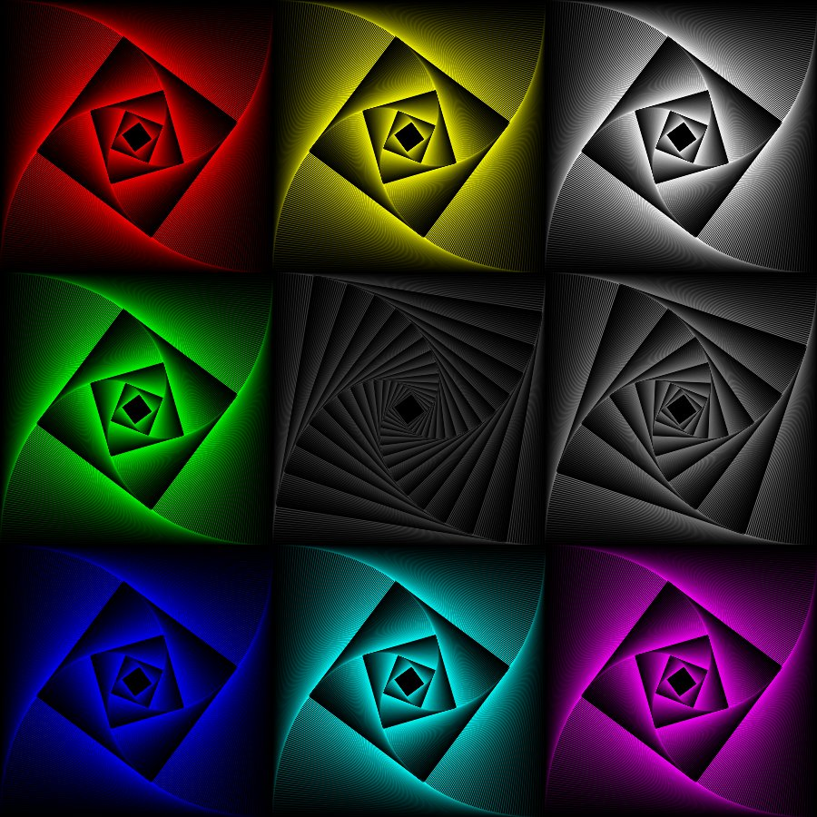
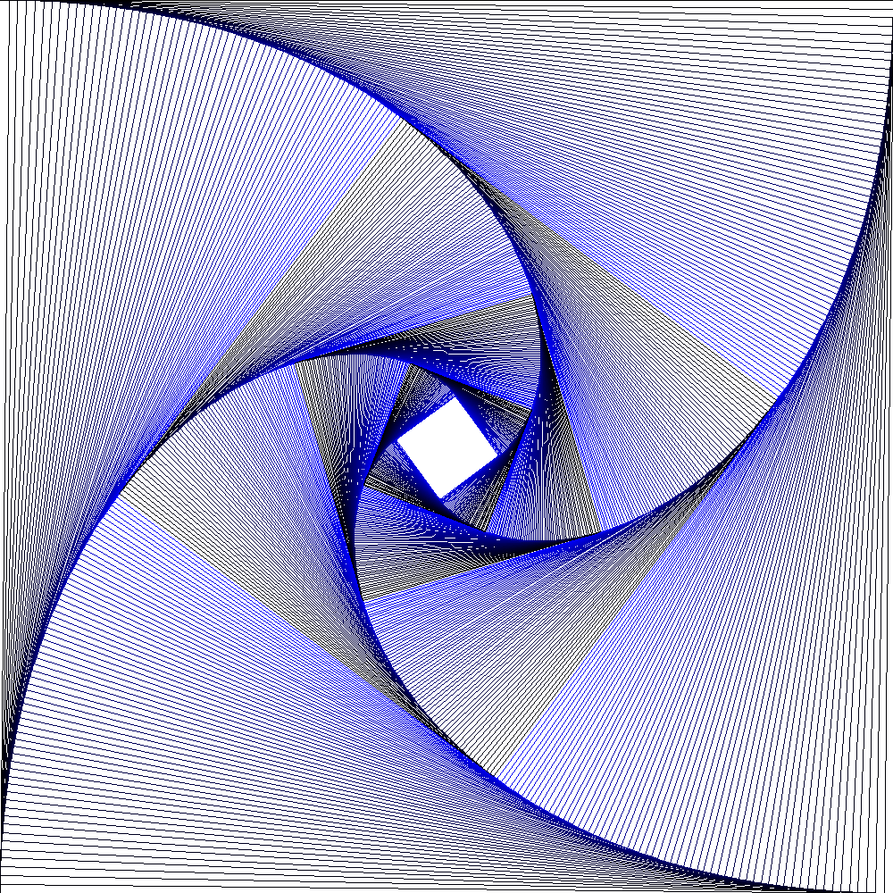
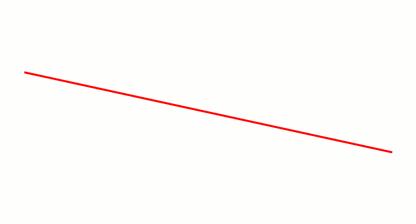
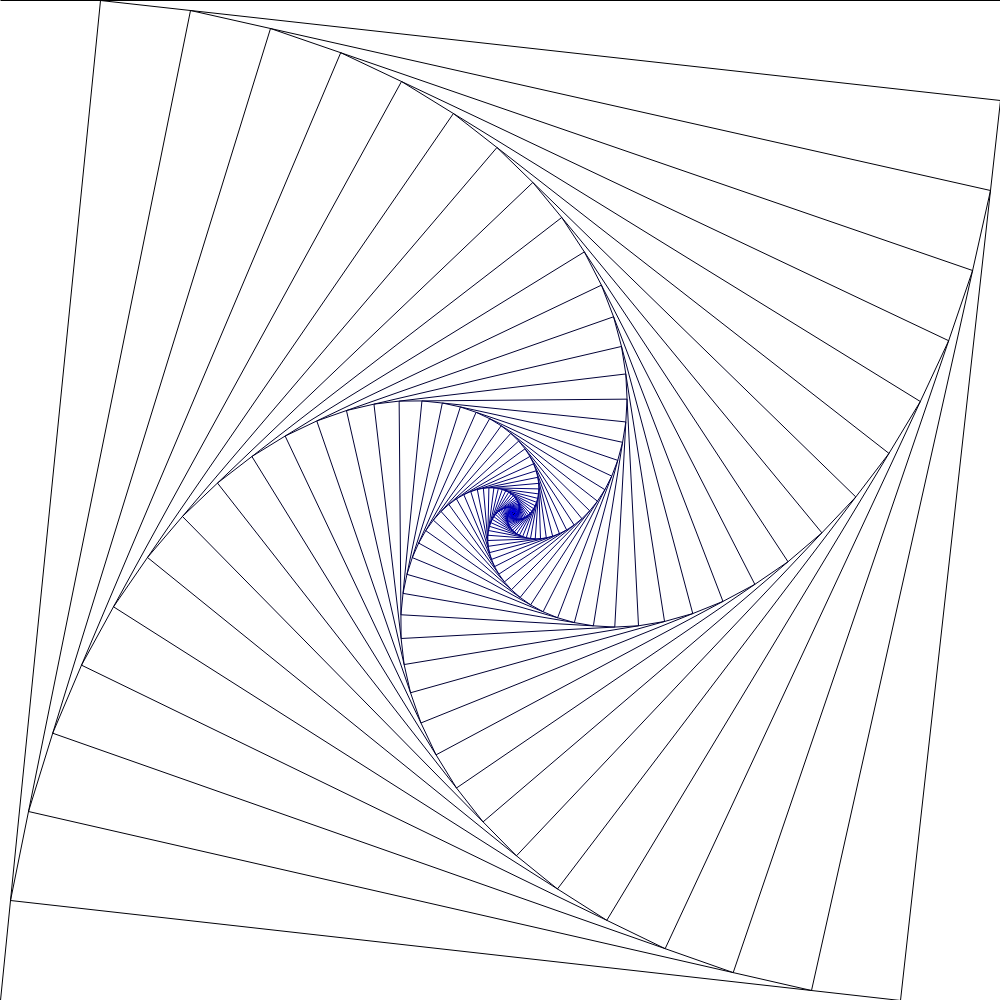
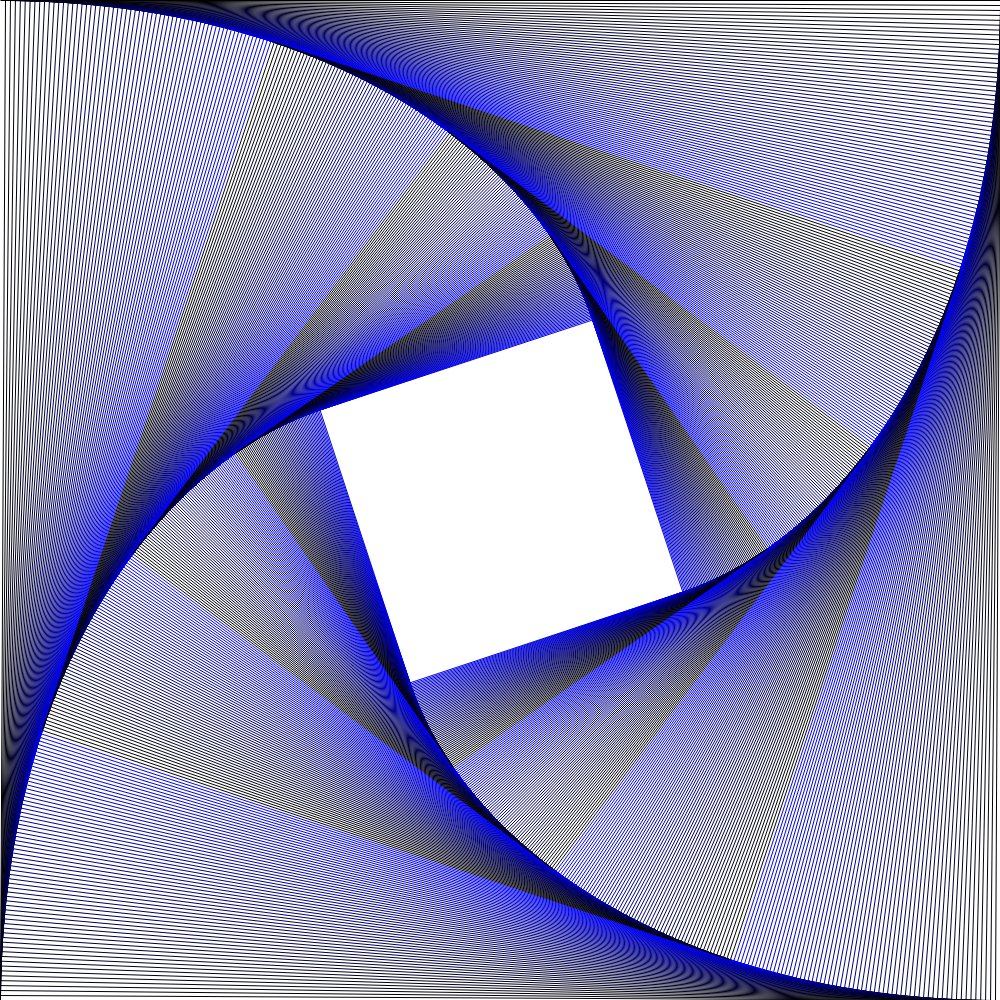
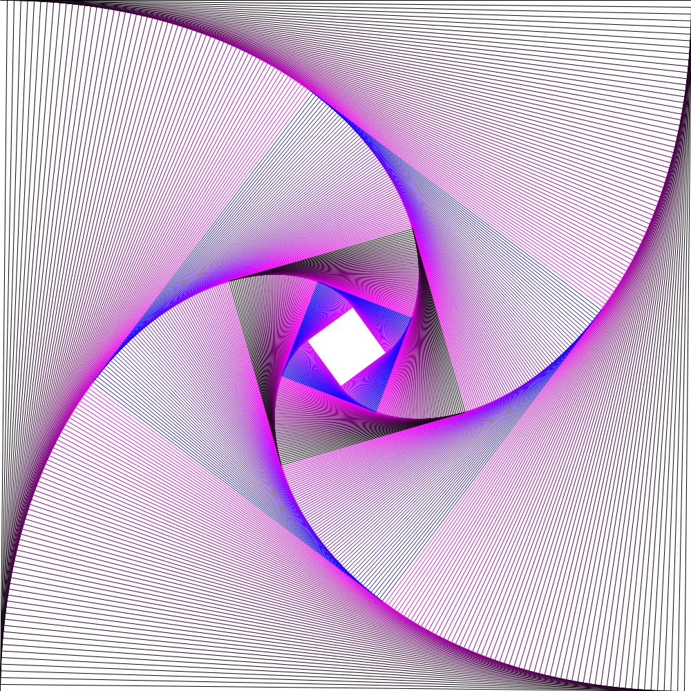
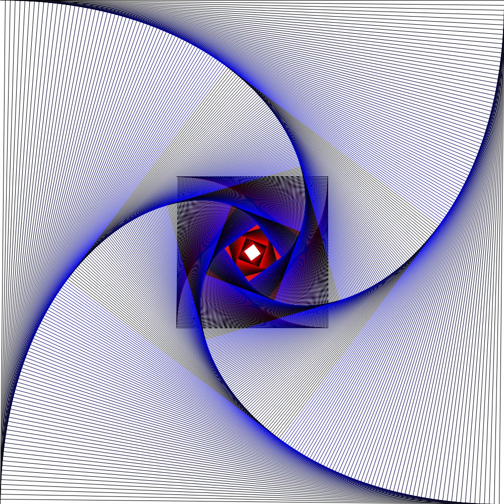
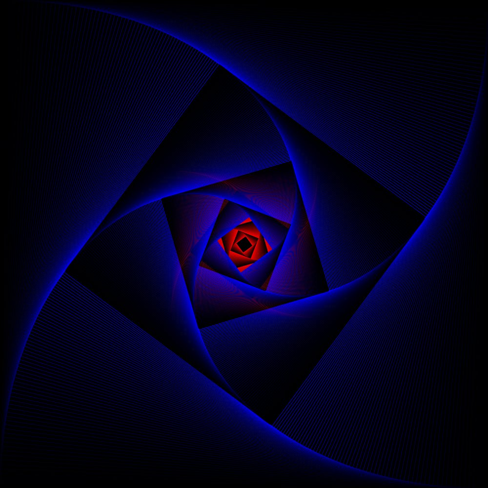

<figure>
    <a href="../images/2022/05/creating-algorithmic-art-with-python-1.jpg"></a>
    <figcaption>Recursively generated image by Martin Thoma</figcaption>
</figure>

Algorithmically defined images are beautiful. There are tons of examples, even ones that are created without a computer. The key point is that you have a clear formal definition of how the image is created. After reading this article, you will know how to create the image above. Let’s start!

## Drawing lines with Pillow

The Python Imaging Library (PIL) was the first widely used Python library that allowed you to create images. As it wasn’t updated since 2006, the fork [pillow](https://pypi.org/project/Pillow/) was created. You can install it via

```
pip install pillow
```

Drawing a line works like this:

```python
from PIL import Image, ImageDraw  # pip install pillow for PIL

# Define the canvas size
width = 1500
height = 500
im = Image.new("RGB", (width, height), (255, 255, 255))
draw = ImageDraw.Draw(im)

# Draw a single line
x1, y1 = 10, 20
x2, y2 = 1000, 50
color = (0, 0, 0)  # rgb
draw.line((x1, y1, x2, y2), fill=color)

# Save the image as a PNG
im.save("rectangles.png", "PNG")
```

You might notice that the line does not look nice. It looks as if it has “steps” in it. If you would create the above image with `draw.line`, it would look like this:

<figure>
    <a href="../images/2022/05/creating-algorithmic-art-with-python-2.png"></a>
    <figcaption>Created image with aliasing artifacts. Image by Martin Thoma</figcaption>
</figure>

The problem you see is called [aliasing](https://en.wikipedia.org/wiki/Aliasing). That essentially means that not every point of the line is exactly mapped to a pixel. There are some pixels that contain maybe 10% of the line and 90% of the pixel is not the line. The approach that fixes this issue is called anti-aliasing. The [Xiaolin Wu’s line algorithm](https://en.wikipedia.org/wiki/Xiaolin_Wu%27s_line_algorithm) fixes this.

<figure>
    <a href="../images/2022/05/creating-algorithmic-art-with-python-3.gif"></a>
    <figcaption>A visualization of the Xiaolin Wu line algorithm created by Dnttllthmmnm (Source: <a href="https://en.wikipedia.org/wiki/File:LineXiaolinWu.gif">Wikipedia Commons</a>)</figcaption>
</figure>

Luckily, the Stackoverflow user toastie already implemented it for us ([link](https://stackoverflow.com/a/5709655/562769)).

## The Image generation algorithm

The idea of the image above is simple:

1. We start with the four points of a rectangle
1. We draw a line from point 1 to point 2
1. We move point 1 a given percentage towards point 2.

Now replace 1 by “i” and 2 by “i+1”. That’s it.

You can move a point on a line by interpolating the x and y coordinates independently:

```python
from dataclasses import dataclass


@dataclass
class Point:
    x: float
    y: float


@dataclass
class Line:
    p1: Point
    p2: Point

    def position(self, p: float) -> Point:
        return Point(
            self.p1.x + (self.p2.x - self.p1.x) * p,
            self.p1.y + (self.p2.y - self.p1.y) * p,
        )
```

## Putting it all together

Do you just want to give it a try yourself? Here you are:

```python
from dataclasses import dataclass
from typing import List, Tuple

# Just store https://stackoverflow.com/a/5709655/562769
# as anti_aliased_line.py in the same directory
from anti_aliased_line import draw_line_antialiased
from PIL import Image, ImageDraw


@dataclass
class Point:
    x: float
    y: float


@dataclass
class Line:
    p1: Point
    p2: Point

    def position(self, p: float) -> Point:
        return Point(
            self.p1.x + (self.p2.x - self.p1.x) * p,
            self.p1.y + (self.p2.y - self.p1.y) * p,
        )


@dataclass
class Rectangle:
    p1: Point
    p2: Point
    p3: Point
    p4: Point

    def __getitem__(self, key: int) -> Point:
        if key == 0:
            return self.p1
        elif key == 1:
            return self.p2
        elif key == 2:
            return self.p3
        elif key == 3:
            return self.p4
        raise ValueError(f"key = {key} is invalid")

    def __setitem__(self, key: int, value: Point) -> None:
        if key == 0:
            self.p1 = value
        elif key == 1:
            self.p2 = value
        elif key == 2:
            self.p3 = value
        elif key == 3:
            self.p4 = value
        else:
            raise ValueError(f"key = {key} is invalid")


def new_point(rect: Rectangle, i: int, pct: float = 0.1) -> Point:
    if i == 0:
        return Line(rect.p1, rect.p2).position(pct)
    elif i == 1:  # top
        return Line(rect.p2, rect.p3).position(pct)
    elif i == 2:
        return Line(rect.p3, rect.p4).position(pct)
    elif i == 3:
        return Line(rect.p4, rect.p1).position(pct)
    raise ValueError(f"i = {i} is invalid")


def get_color(i: int) -> Tuple[int, int, int, int]:
    r = 0  # i % 256
    g = 0  # i * 2 % 256
    b = i % 256
    return (r, g, b, 255)


def main():
    width = 1000
    height = 1000
    im = Image.new("RGB", (width, height), (255, 255, 255))
    draw = ImageDraw.Draw(im)
    rectangle = Rectangle(
        Point(0, 0), Point(width, 0), Point(width, height), Point(0, height)
    )

    for i in range(1000):
        p1 = rectangle[i % 4]
        p2 = rectangle[(i + 1) % 4]
        draw_line_antialiased(draw, im, p1.x, p1.y, p2.x, p2.y, get_color(i))
        # draw.line((p1.x, p1.y, p2.x, p2.y), fill=get_color(i))
        rectangle[i % 4] = new_point(rectangle, i % 4, pct=0.01)

    # write to stdout
    im.save("rectangles.png", "PNG")


if __name__ == "__main__":
    main()
```

## Adjusting parameters

Let’s have some fun with the images.

<figure>
    <a href="../images/2022/05/creating-algorithmic-art-with-python-4.png"></a>
    <figcaption>Using 10% instead of 1% increases the white amount. Image by Martin Thoma.</figcaption>
</figure>

<figure>
    <a href="../images/2022/05/creating-algorithmic-art-with-python-5.jpg"></a>
    <figcaption>If you go to 0.5% it takes way longer until the coordinates reach the center. Image by Martin Thoma</figcaption>
</figure>

You can manipulate the way to get colors:

```python
def get_color(i: int) -> Tuple[int, int, int, int]:
    r = i % 256
    g = 0  # i * 2 % 256
    b = i % (256 * 2)
    return (r, g, b, 255)
```

<div class="gallery">
    <figure>
        <a href="../images/2022/05/creating-algorithmic-art-with-python-6.jpg"></a>
        <figcaption>Being more creative in the color determination. Image by Martin Thoma</figcaption>
    </figure>
    <figure>
        <a href="../images/2022/05/creating-algorithmic-art-with-python-7.jpg"></a>
        <figcaption>Adding such a recursively defined rectangle in such a rectangle. Image by Martin Thoma</figcaption>
    </figure>
    <figure>
        <a href="../images/2022/05/creating-algorithmic-art-with-python-8.jpg"></a>
        <figcaption>Using a black background instead of a white one. Image by Martin Thoma</figcaption>
    </figure>
</div>
