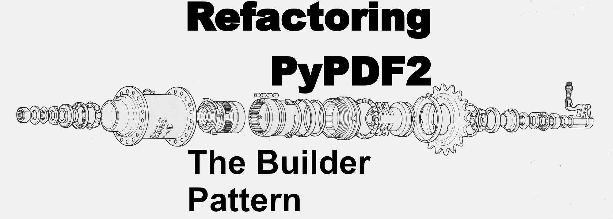
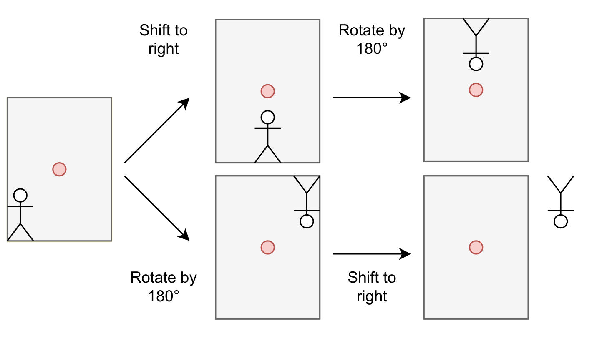

<figure>
    <a href="../images/2022/06/refactoring-pypdf2s-transformation-interface-1.png"></a>
    <figcaption>Image from <a href="https://commons.wikimedia.org/wiki/File:Internal_hub_3_speed_Shimano.jpg">Wikipedia Commons</a> (Sears Sports Center, public domain)</figcaption>
</figure>

I love writing good software. Software that is reliable and intuitively understandable by users as well as easy to maintain. It’s super hard to learn and teach what good software looks like, but I hope to plant some ideas with this article.

After reading this article, you will have learned two aspects of good software as well as a design pattern.

## What is PyPDF?

PyPDF2 is a free and open source pure-python PDF library capable of splitting, merging, cropping, and transforming the pages of PDF files. It can also add custom data, viewing options, and passwords to PDF files. PyPDF2 can retrieve text and metadata from PDFs as well.

It was actively developed from 2011 to 2016. It works for a lot of use cases and thus the Python community still uses the library a lot — although it didn’t receive any update until 2022. In April 2022, I became the maintainer of PyPDF2.

PyPDF2 is a fork of pyPdf — a way older project. The developers of PyPDF2 always wanted to keep backward compatibility. I’m not feeling that need. If I think the overall project benefits from breaking compatibility, I will do it.

## The Desire for Stable Interfaces

An interface is a boundary to a system. It allows users to interact with it. Those users might be developers themselves. Users should not have the need to know about the inner mechanics of a system.

Car mechanics can be drivers — but you should not have to be a mechanic to drive a car. The public interface is the steering wheel, the gas pedal, the brakes, and a few more things. The private interfaces are the internal CAN bus used for electronic components in the car and the standards which define which gears are used.

> The user has the expectation that interfaces stay stable — or that there is at least a clear announcement when they are changed.

This means you might need to support a sub-optimal decision you made years ago. In some cases, many years — think about Python 2 or the fact that the US still uses imperial units.

## The Need for Small Interfaces

Maintainers want small interfaces: The bigger a public interface, the more the developer needs to support. It’s more prone to errors and inconsistencies.

But also users profit from small interfaces: There is less to discover and hopefully exactly one way to do what they want. Removing duplication makes code in the wild (or by coworkers) that uses the same library more consistent.

## Interface Creep

It’s hard for any developer to say “no” to a feature request, especially when it’s easy to fulfill. We want to make people happy. Just adding a parameter here or a new convenience function/class/method there doesn’t do any harm, right?

This is how you get bloated interfaces. I’ve briefly pointed out why you want small interfaces. If software uses well-defined interfaces, you can guess function names and the names/order of parameters. You can see the pattern being used to design it.

## PDF Transformations

Think about transformations you might want to do to PDF pages. Rotation, shifting, scaling, cropping, overlay one PDF onto another PDF. There might be a lot more you can think of, but those five are the ones we focus on for the moment.

The PyPDF2 `PageObject` class has the following methods:

```python
class PageObject:
    def mergeTransformedPage(self, page2, ctm, expand=False)
    def mergeScaledPage(self ,page2, scale, expand=False)
    def mergeRotatedPage(self, page2, rotation, expand=False)
    def mergeRotatedTranslatedPage(self, page2, rotation, tx, ty, expand=False)
    def mergeRotatedTranslatedPage(self, page2, rotation, tx, ty, expand=False)
    def mergeRotatedScaledPage(self, page2, rotation, scale, expand=False)
    def mergeScaledTranslatedPage(self, page2, scale, tx, ty, expand=False)
    def mergeRotatedScaledTranslatedPage(self, page2, rotation, scale, tx, ty, expand=False)
```

Let’s check what we don’t like about those eight methods:

1. Not PEP-8 compliant: Not following the expected naming scheme is the first thing that pops into my mind. Probably the one I care least about, but the most obvious one.
1. Providing more than one way: `mergeRotatedTranslatedPage` can rotate and translate — why do we need `mergeRotatedPage`, then? `mergeRotatedScaledTranslatedPage` seems to be able to do all transformations. Do we need any others?
1. Uncertainty about the results: Assume you want to do two operations. (a) You want to rotate an image by 90° and (b) move it 10 cm to the right. Doing first (a) and then (b) is different from the other way around, assuming that the rotation center is relative to the canvas.

## Idea 1: Use a Single Method With Many Parameters

I could use `mergeRotatedScaledTranslatedPage` only and deprecate the rest.

This has a big drawback: the order of operations matters!

<figure>
    <a href="../images/2022/06/refactoring-pypdf2s-transformation-interface-2.png"></a>
    <figcaption>The order of operations matters: If you have the center of the coordinate system at the red dot and you do (1) a shift of the figure on the page to the right and (2) a rotation by 180°, you will get different results. Image by Martin Thoma.</figcaption>
</figure>

## Idea 2: Splitting Merging and Transforming

The mentioned methods have one pretty obvious shortcoming: If you want to just do one of the operations without merging with another page, you cannot do it. So it makes sense to have three methods that operate directly on the page itself and one which does merging:

```python
class PageObject:
    def merge_page(self, page2, expand=True): ...

    def scale(self, scale, expand=True): ...
    def rotate(self, rotation, expand=True): ...
    def translate(self, tx, ty, expand=True): ...
```

Now you can independently apply operations and merge, in any order you want.

## Idea 3: Creating a Transformation Builder

If you merge two documents with many pages, you might do the same operation over and over again. All of those three operations are represented by matrices. Executing them one after another is a matrix multiplication. So when you have 100 pages and you do a rotation, a scaling operation, and a translation this will do 100 x 3 matrix multiplications or 300 matrix multiplications.

When you first represent the combined operation as one matrix, you need to do two matrix multiplications. After that, you have 100 matrix multiplications. So, 102 matrix multiplications in total.

Another property of idea two is that you cannot have a fluid interface: Those operations should happen in place, as copying a page might be a rather heavy operation. So the `page.scale` operation should return `None`. That means you cannot do `page.scale(2).rotate(180)`.

To get rid of this shortcoming, we add a transformation object:

```python
class Transformation:
    def scale(self, sx, sy) -> Transformation: ...
    def rotate(self, degree) -> Transformation: ...
    def translate(self, tx, ty) -> Transformation: ...


class PageObject:
    def merge_page(self, page2, expand=True): ...
    def transform(self, transformation): ...
```

This is the Builder pattern: The `Transformation` class encapsulates the `transformation` a user wants to apply and helps them to create that matrix. The `transformation` matrix is what the PDF format and PyPDF2 actually need, but that is hidden from the PyPDF2 users. The users just use the `Transformation` builder class:

```python
transformation = Transformation().scale(2, 2).rotate(180)
```

As the `transformation` class holds very little data, we can make it immutable and always return a copy. That makes a [fluent interface](https://en.wikipedia.org/wiki/Fluent_interface) possible. Modern IDEs with auto-complete can now tell the user which operations they can do. As the `PageObject` has fewer methods, it is easier to test and the user has an easier time discovering what they need.

## Summary

You’ve seen how the builder pattern can be applied to enable a fluent interface and reduce the core objects' public methods from eight to two. At the same time, the user became more flexible and testing became easier.

You’ve noticed that maintainability and users’ needs sometimes go hand in hand. Small and well-defined interfaces just make everyone’s lives easier.
