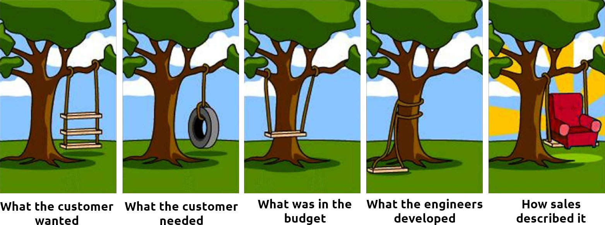

Reporting issues is a core competency a lot of people lack. That is unfortunate not only for the companies who have to deal with angry customers who loudly complain but also for those customers because it’s unlikely their problem will get solved.

When I think about issues, it’s from a developer's perspective. I’m thinking of bugs. But you can also think about businesses or public institutions and their processes.

## Nº1: It’s broken!

Just telling somebody “it’s broken” is the first step. They learn that you are unhappy, but they are very likely unable to change anything.

The same goes for “me too” comments on issues of open source projects.

## Nº2: What did you do?

Reproducibility is a key ingredient for fixing a bug. As a developer, I first try to see the bug myself. If I cannot see the bug myself, there might be another issue that the user didn’t tell me about. Hence it’s crucial to have “steps to reproduce”.

## Nº3: What did you expect?

<figure>
    
    <figcaption>Image derived from <a href="http://www.projectcartoon.com/cartoon/1111">projectcartoon</a></figcaption>
</figure>

It’s not always clear what the expected behavior is. Try to describe it with other words. Explain a little bit of the context.

## Nº4: Create a (failing) unit test

Now this one is already really good. It only applies to open source and can only be done by developers.

Essentially, you give them a way to (1) completely understand what you did and (2) automatically check if it worked.

You don’t need to put the unit test into the codebase — just make sure there is a self-contained snippet that shows what is broken. That snippet should typically raise an exception as long as the issue exists. And it should not raise an exception when the issue is gone.

## Nº5: Locating the buggy part of the code

People who can pinpoint the problematic area in the code are amazing! In some cases, that part never worked. In other cases, you’re dealing with regressions: Features that once worked, but stopped working at some point.

Once you have a snippet that shows the error clearly, you can easily spot regressions via [git bisect](https://git-scm.com/docs/git-bisect). The workflow is like this:

1. `git bisect start`
1. `git bisect good some-hash-or-tag`
1. `git bisect bad some-hash-or-tag`
1. Now git will switch the commit to something between the good one and the bad one. You execute the test script against that commit. If things look fine, you enter `git bisect good`. If the issue exists, you enter `git bisect bad`. This step is repeated until git tells you which exact commit had the problem.

## Nº6: Create a fixing pull request

It’s AMAZING when people fix the stuff on their own 👏 Even better, when they add enough context in the Pull Request (PR) so that the maintainer understands what was done and why it was done.
