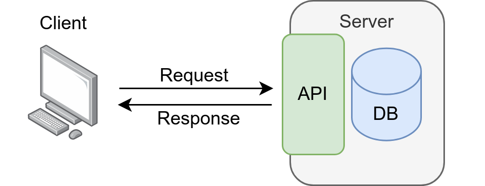
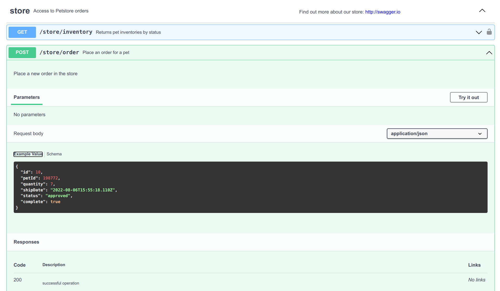
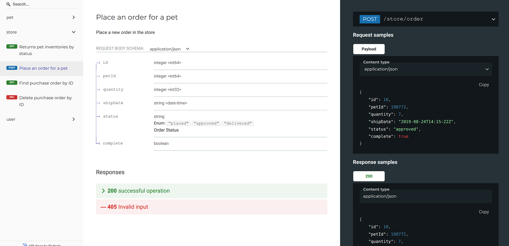

<figure>
    <a href="../images/2022/08/apis-an-in-depth-explanation-for-people-who-arent-into-tech-1.png"></a>
    <figcaption>In this article, you will learn what an API is.</figcaption>
</figure>

The speed at which we produce and exchange information has increased significantly within the past 200 years. It started with electromagnetic telegraphs in 1833, but it went wild as soon as the first email was sent in 1971.

It was a revolution. Suddenly people around the globe could exchange written information.

At the same time, we started to automate more and more tasks. ATMs started to replace bank tellers in 1972; public transportation replaced a good chunk of individual traffic, and bigger agricultural machines led to more efficiency.

The more things and services received a digital representation, the more we could automate. Connecting those services became increasingly important: You want to be able to send emails for recruiting and have those within a recruiting portal. Once you’ve made an appointment, the date should be in the recruiter's calendar.

Connecting services means that one service needs to provide information and another service needs to consume it. And the consumer has to be able to “speak the same language” as the provider. This could be a file format like `.ical` for calendar events. Or it could be another interface than a file. An interface developers can use to program their own stuff. An Application Programming Interface, or API.

## What are APIs?

Lots of people write software. Sometimes their program can do everything on their own, but in many cases, developers (also known as programmers) use other people's work as building blocks. That happens in various ways: Copying the code of others directly into your own project is called “vendoring.” If you install the project on your machine, it’s typically called “using a library/framework.” And then there are services.

Services typically don’t run on your machine. Somebody else is taking care of them. It’s a server on the internet. That server has a well-defined way of connecting to it. Similar to how you can open your browser and enter a URL. Then the browser sends a package requesting data to that server. The browser then visualizes the response to you — typically HTML, images, and JavaScript.

APIs are first and foremost interfaces. Like a remote control is an interface to a TV.

> Interfaces are at the border of two systems. They allow the two systems to interact.

An API is an application programming interface.

> An API is an interface between two programs.

You can define APIs in many different ways — the same way you can with remote controls. But just like some TVs don’t accept some remote controls, not every program accepts every API. Developers have to work on adding support for a specific API.

<figure>
    <a href="../images/2022/08/apis-an-in-depth-explanation-for-people-who-arent-into-tech-4.png"></a>
    <figcaption>On the internet, a lot of communication works by the request-response principle: The client sends a request to a server and receives a response. The contact point of the server is its API. Typically (but not necessarily!), the server has a database (DB). The client could be the code running in a browser of a user. Or it could be another service.</figcaption>
</figure>

A very common set of APIs are so-called REST-APIs. They work on top of the HTTP protocol. That uses the request-response principle, similar to people using their browser:

1. Request: The program sends a request to an endpoint (the URL). For example `https://example.com/api/books`. That request might contain more information in two forms: the header and the payload. The header could be authentication information — anything that lets the receiving server know that you are allowed to see what you request. The payload specifies exactly what you want, e.g., `series=Lord of the Rings`.
1. Response: The response can be anything. It also contains a status code, a header, and a body. The header might tell you that the body is compressed or that it was cached.

For this article, I mean “REST-APIs” when I speak about APIs. There are other APIs, but REST is the most popular API style today.

## How Do You Document REST APIs?

REST APIs are commonly documented using the OpenAPI specification. OpenAPI documentation is stored in a text file in the YAML format. It looks like this:

```yaml
/store/order:
    post:
      summary: Place an order for a pet
      responses:
        '200':
          description: successful operation
          content:
            application/json:
              schema:
                $ref: '#/components/schemas/Order'
        '400':
          description: Invalid Order
          content:
            application/json:
              example:
                status: 400
                message: "Invalid Order"
      requestBody:
        content:
          application/json:
            schema:
              $ref: '#/components/schemas/Order'
        description: order placed for purchasing the pet
        required: true
```

You can see that the domain (example.com) is not specified, but the rest of the URL `/store/order` is there. It specifies the HTTP method “post.”

> The `HTTP` method is just another part of the protocol. There is `GET` for retrieving stuff, `POST` for creating stuff, `PATCH` and `PUT` for modifying stuff, and `DELETE` to remove stuff.

The document defines that the request body has to be in JSON format and follow the `Order` schema. That one is specified later in the OpenAPI document.

Furthermore, the OpenAPI document specifies which responses you might get when sending such a request: A status of `200` for a successful order and a status of `400` for an invalid order.

> There are [lots of HTTP status codes](https://en.wikipedia.org/wiki/List_of_HTTP_status_codes). All of them have 3 digits and the important part is the first digit: 2xx is a success message, 4xx is an error with the request, 5xx is an error with the server. You will not see 1xx and 3xx so often. Details matter, but only to the developers.

## How Do You Read OpenAPI Specs?

There are two tools to make the OpenAPI specification file readable: ReDoc and Swagger.

Swagger is a well-known and widespread solution. They have started the development of the OpenAPI specs. That is the reason why we use the terms Swagger and OpenAPI sometimes synonymously, although they are conceptually very different.

> Swagger is a tool that uses OpenAPI specifications to generate documentation for REST APIs.

Swagger documentation looks like this:

<figure>
    <a href="../images/2022/08/apis-an-in-depth-explanation-for-people-who-arent-into-tech-5.png"></a>
    <figcaption>Screenshot of the famous pet store OpenAPI specification rendered to an easy-to-read HTML documentation with Swagger.</figcaption>
</figure>

ReDoc is another way to show the documentation:

<figure>
    <a href="../images/2022/08/apis-an-in-depth-explanation-for-people-who-arent-into-tech-6.png"></a>
    <figcaption>ReDoc generates a pretty neat visualization for OpenAPI specification.</figcaption>
</figure>

## What Else Do You Need for API Documentation?

Typically the hardest part about a new API is getting started: How do you authenticate? How do you complete a typical workflow? What conventions are used?

Is there rate-limiting, meaning do you have to watch out not to make too many calls? Are some calls not free or even expensive to make? Are there any side effects of calls I should know about?

## What Makes a REST API Good or Bad?

If the REST API is fully specified with OpenAPI and has an accessible Swagger/Redoc page, it already goes a long way. Even better if there is additional documentation helping you make the first steps and showing how the different endpoints are used in combination.

A bad REST API is inconsistent, not documented at all, and has different non-standard authentication mechanisms. Also, like any software, bad APIs have bugs and times when they are down.

With the last sentence, you can notice an interesting effect: As users, we start to distinguish no longer between the interface and the service. It would have been more correct to say that the service had implemented the API wrong and the service which implemented the API was down. But in many cases, people use “API” and “the service behind the API” as synonyms.

The service itself is just software and thus has functional and non-functional requirements. The functional requirements are the things you want to be able to do. If the API is an interface to your library, you might have the requirement to order a book or to see your currently rented books.

Non-functional requirements are about how you’re doing things: Is the service up/available 99.9% of the time? How quickly does it respond most of the time?

## Summary

An API is a contact point that allows services to communicate. It needs to be documented in some form for others to be able to use it. OpenAPI is one way to specify REST APIs. Using the OpenAPI specification, you can use Swagger or ReDoc to document the API.
