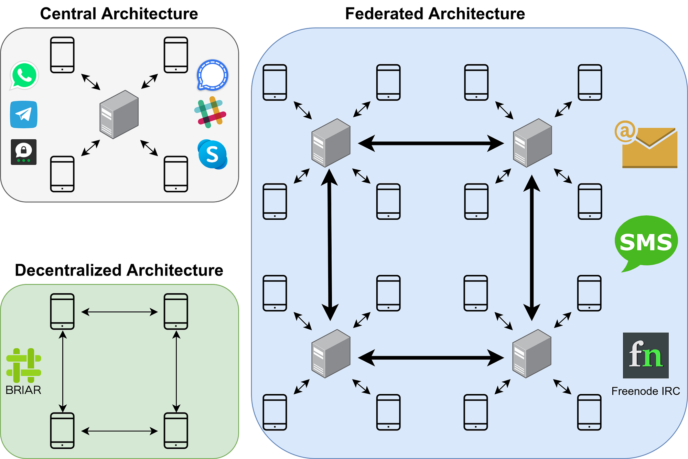

Real-time communication using text, images, sound, or video is used by pretty much everybody today. We use it on our smartphones and desktop computers. We use it privately and for work. It’s used by persecuted minorities as well as terrorists.

This article gives an overview of wide-spread secure messaging systems in 2022. It points out various differences and thus might give you an idea of what to choose for your family, friends, or company.

The focus of this article is to give you an idea how you can compare messengers: By features, privacy features, or system architecture. I will mention **WhatsApp**, **Threema**, and **Signal** as they are the messengers I know best. There are other big ones, e.g. [WeChat](https://en.wikipedia.org/wiki/WeChat) in China and [Telegram](https://en.wikipedia.org/wiki/Telegram_%28software%29) in Russia.

## Features — The functional requirements

When we compare software, we typically look at features they support. For instant messengers, those include Group Chats, sending pictures / audio recordings / videos, voice- and video calls, emoji and Unicode support.

From my perspective, the messengers seem to support all the same features. But you might have this single feature you really want — then that might be a deal-breaker for some apps for you.

## System Architecture

<figure>
    
    <figcaption>Visualizing the differences between central architectures, federated architectures, and decentralized architectures. Image by Martin Thoma</figcaption>
</figure>

Messaging systems can be grouped into three categories by their communication patterns:

**Central architectures** have a single authority managing the servers. The clients always communicate with that single server, but might use end-to-end encryption (E2EE) to keep the content of the communication private. However, metadata such as who talked with whom at which time is known by the server. Most services use this pattern as it is easiest to setup and guarantee availability. Examples are WhatsApp, Threema, Signal, Telegram, Slack, and Skype. Most IRC rooms are just on one server, thus they are centralized.

**Federated architectures** have servers which are controlled by independent organizations. The servers form a network and exchange messages. Clients connect to a single server. Examples are e-mail, SMS, and Freenode IRC.

**Decentralized architectures** for messaging are super hard. I’ve heard that Tox.chat, Ricochet.im, and Briar follow this pattern via the Tor network. However, I’m uncertain about the details and also about potential downsides such as availability and speed of message delivery.

## Discovery of Chat Partners

A problem with every communication system is how to find the person you want to communicate with. You need some identifier. How do you do the match-making?

Typical options for discovery are:

* **E-mail address** or **phone numbers**
* **Hashed** e-mail addresses or phone numbers: This way the server can know which people you know in case people join, but the server doesn’t know the plain addresses. This means they cannot be used for advertisement or other purposes.
* **Profiles** (e.g. Github, Reddit)
* **Out-of-band discovery**: Usernames or randomly generated identifiers which require that you tell your communication partner in another way how to find you.

## Privacy Features

Privacy features are of integral importance to most instant messaging — otherwise you might want to use micro-blogging services like Twitter. At the very least you should have transport encryption and end-to-end encryption.

Content reading by others:

* **Transport encryption**: Make sure that people in the network cannot read the message. If you have a central architecture, the supplier still can. If messages are exchanged via HTTPS this is given.
* **End-to-End encryption (E2EE)**: Only the sender and the receiver can read the messages, not the platform which is used. E2EE ensures content confidentiality — but only if your communication partner keeps it confidential.
* **Integrity**: Did I receive the full message? Was it changed?

Metadata:

* **Authenticity**: Ensure you are talking to the person you think you’re talking to. Did Alice really send this message or was it somebody else?
* **Meta-data Confidentiality**: Does the platform collect the activity records, meaning when / to whom / how often / at which time you send messages?

Message Forwarding:

* **Ephemeral Messages (self-deleting messages, expiring messages)**: Might help a little bit if your communication partner wants to make your conversation public.
* **Deniability**: You might want to help people to be able to say that they didn’t say something.

The Service:

* **Availability of the Service**: Is the service robust against issues? Can it handle the load?
* **Censorship resistance**: Can the service prevent me from talking to some people? Can others be blocked from talking with me?

## Open Source and Open Protocols

Open Source software makes the source code of the messaging apps publicly available. Open protocols focus on making the way of communicating publicly known.

If the messaging app and the necessary infrastructure is open source, people can check it for issues, add new features, and continue development if the original developer abandoned it. It’s not always easy, but if the software is heavily used it’s more likely that those things happen.

Examples for open messaging protocols are:

* [IRC](https://en.wikipedia.org/wiki/Internet_Relay_Chat)
* [XMPP](https://en.wikipedia.org/wiki/XMPP): [OMEMO](https://en.wikipedia.org/wiki/OMEMO). Well-known clients are [Gajim](https://gajim.org/), [Conversations](https://play.google.com/store/apps/details?id=eu.siacs.conversations&hl=de&gl=US), and [Monal](https://apps.apple.com/de/app/monal-xmpp-chat/id317711500). WhatsApp uses a variation of XMPP called funXMPP.
* [OTR (Off-the-Record Messaging)](https://en.wikipedia.org/wiki/Off-the-Record_Messaging)
* [Matrix.org](https://en.wikipedia.org/wiki/Matrix_%28protocol%29): The messenger is [Element](https://en.wikipedia.org/wiki/Element_%28software%29) (formerly Riot and Vector)

## Services

You now know a lot of different criteria that might be important to you, but which services are there and how do they compare?

There are way too many messaging apps to compare all of them in an article. I would group them into the following categories:

* **Business Team Communication**: [Slack](https://en.wikipedia.org/wiki/Slack_%28software%29), Microsoft [Teams](https://en.wikipedia.org/wiki/Microsoft_Teams)
* **Non-work messaging**: [Threema](https://en.wikipedia.org/wiki/Threema), [Signal](https://en.wikipedia.org/wiki/Signal_%28software%29), Telegram, [Facebook Messenger](https://en.wikipedia.org/wiki/Messenger_%28software%29) and [WhatsApp](https://en.wikipedia.org/wiki/WhatsApp), [Tencent QQ](https://en.wikipedia.org/wiki/Tencent_QQ), Apple iMessage, [Briar](https://en.wikipedia.org/wiki/Briar_%28software%29)
* **Video Calls**: [Zoom](https://en.wikipedia.org/wiki/Zoom_%28software%29), [Microsoft’s Skype](https://en.wikipedia.org/wiki/Skype)

## Now … how do I choose?

There are a few factors that narrow down the choices quite a lot:

* **Platform-support**: Do you or your contacts want to use it on a desktop computer? iOS? Android? Microsoft phones?
* **Features**: Do you need video calls? Do you need end-to-end encrypted group chats?
* **Attack Scenarios**: Does the app need to be censorship resistant? Do you care if others can prove that a message came from you? Does it matter to you that the service knows to whom and at which time you talked?

Please be aware that you might care about more attack scenarios than you think. A good example is this story:

[**A Dad Took Photos of His Naked Toddler for the Doctor. Google Flagged Him as a Criminal.** *Google has an automated tool to detect abusive images of children. But the system can get it wrong, and the…*](https://www.nytimes.com/2022/08/21/technology/google-surveillance-toddler-photo.html)

## See also

Will Scott gave a talk about this topic at 36C3 (2019)

<iframe width="560" height="315" src="https://www.youtube.com/embed/ezA01rs7n3s" title="YouTube video player" frameborder="0" allowfullscreen></iframe>

<!-- series: appsec -->
