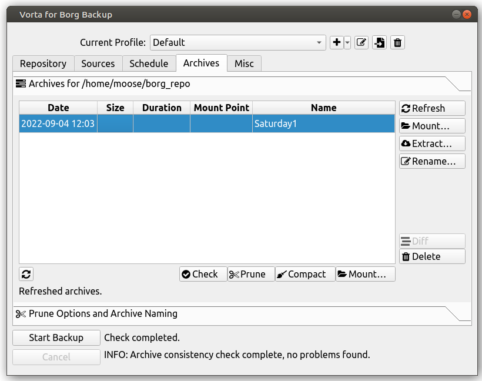
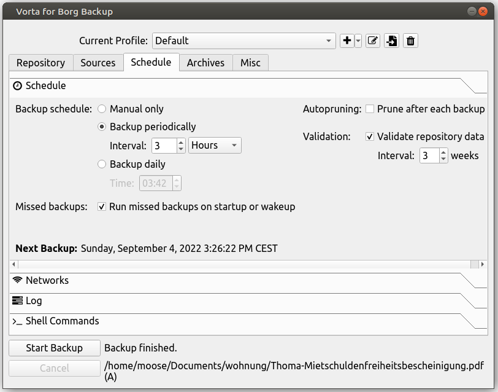
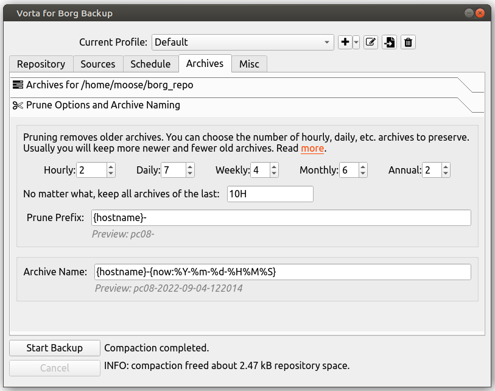

Let’s be honest: Everybody hates this topic. It’s not sexy. You just want a solution that works and that you can trust. You might not even have created backups — and I mean real backups, not randomly storing copies.

I had the weirdest kinds of backups in the past. I remember that I was super nervous about my bachelor's thesis. I’ve stored it in a private repository on GitHub and I’ve sent snapshots to my father… just to be sure I don’t lose it. You know, if the computer breaks.

In this article, you will learn about where you can store your backups and how you can create periodic backups automatically. Let’s start!

## Requirement Analysis

Before we dive into solutions, we need to analyze what we want to protect and against what we need to protect.

### Which data is important to you?

Businesses care about their databases. They might contain all kinds of things, but especially their customer data. Code is another big one. E-mails. And contracts, of course.

In your private life, you might care most about photos and documents. Maybe your whole system setup as well.

### What might cause data loss?

Against which possible causes of data loss do you want to protect with your backup strategy? I notice five big **data loss scenarios**:

**Disk failure** is for sure the most common one. It hasn’t happened to me so far, but the longer you use your device and the more read/write operations you have, the more likely it gets that the device just breaks at some point. There are companies that can recover data from broken disks, but it’s unclear to me how expensive that might get, how long it would take, and how much can be recovered.

**Accidental deletions** are another common one. You just hit the wrong button or execute the wrong command in the terminal and your data is gone.

**Malware** and especially ransomware is another reason why you want to have backups. Notice that this is different from the rest. Here somebody is actively trying to lock you out from accessing your data.

**Theft** is likely more relevant to your private life than for a business that might have better security on-site … but things might change with people working remotely.

**Natural catastrophes** are the last big reason for data loss. It could be simply your house or [data center being on fire](https://www.theregister.com/2022/03/22/ovhcloud_fire_datacenter_report/), an earthquake, a tsunami, or a flood. In the case of data centers, a catastrophe might not even destroy the data permanently, but “just” lock you out if network cables or power lines of the data center are destroyed.

## Solutions

Let’s look at what you can do to protect against those issues.

Having **more than one disk** in your computer and letting it automatically write the data to both places helps against disk failure. It’s called **RAID** — redundant array of independent disks. It does not help against accidental deletions as the files would be deleted on the other disk as well. Malware likely also affects both disks at the same time, just like theft and catastrophes.

You can have a disk in a different location at home. Just a minimal “computer” that basically only puts your disk in your local network. A network-attached storage (short: **NAS**). It might help against theft a bit better, depending on how well you hide it. Now you need to have a **backup strategy** and software that actually creates and stores your backups on the NAS. We will talk about that later. It depends on the system and how well it is protected against malware. It does not help against a natural catastrophe… except if you have the NAS really remotely and do the backup over the internet. But that is not the case most of the time for people who use NAS.

**A cloud provider** is for sure an option that can fulfill all your requirements. In this case, you want to consider different issues such as who can access the backup (privacy) and ensure that the network traffic is encrypted. Also, the pricing model just changed from a one-time investment to a subscription model.

## Backup Strategies

The “accidental deletion” and “malware” data loss scenarios are tricky because there might be a serious time delay between the **incident time** and the **detection time**.

Assume you make one backup at night. The new backup always overwrites the old backup. Now you delete the photos from your kids' 8th birthday, but you only notice that when your wife wants to create a collage for the 10th birthday. As you’ve overwritten the backup, there is no chance of recovery.

Instead of overwriting the backup, you might just create copies. But that grows really quickly. So you mix those two approaches by introducing the idea of **backup generations**. This is also known as the **generation principle** or the grandfather-father-son principle. It’s a rotation scheme for backups. The idea is the following:

You have for example 5 grandfathers, 12 fathers, and 7 sons. The 7 sons might refer to days of the week. So you have a Monday / Tuesday / Wednesday / Thursday / Friday / Saturday / Sunday backup. The 12 fathers could refer to the 1st of the month, so you have a January, February, … backup. And the Grandfathers are the 1st of January of the past 5 years.

That means if you delete the photos of your kid on 2022–12–03 and you notice on 2024–10–20, you would go back to the backup from 2022–01–01. Yes, you would lose everything that happened between 2022–01–01 and 2022–12–03. Almost a year of data. But not everything.

The described generations would also mean that you need to have 5+12+7 = **24 backups at all times**. If you have 100 GB of data that would mean you need to store 2400 GB just for the backups.

## Reducing Storage: Different types of backups

We rotate backups to reduce the required storage space, but there are other options to do that. One is to use different types of backups.

A **full backup** is conceptually the simplest. You just make a copy of what you want to back up. If you create a daily backup, you just have one copy for every day. You don’t depend on any other backups.

A **differential backup** just stores the difference (sometimes called the *delta*) since the last full backup.

**Incremental backups** are similar to differential backups, but they store the difference from the last backup. That could also be another incremental backup.

## Reducing Storage: Compression

Another trade-off you can do is storage vs. computational power. Compression algorithms try to find duplicates within your data and find a different representation.

Assume you want to store a sequence of numbers:

```
[1, 1, 1, 1, 4, 5, 5, 5, 8, 8, 8, 1, 1, 1, 1, 1, 1]
```

You might notice that this sequence has several duplicates. Instead of storing that, you could store:

```
[(4x, 1), (1x, 4), (3x, 5), (3x, 8), (6x, 1)]
```

And instead of just looking for the next digit, you could also look for the next two:

```
[(2x, 11), (1x, 4), (3x, 5), (3x, 8), (3x, 11)]
```

There are lots of clever ways how to combine ideas to make it shorter. But that shorter representation has to be computed. Applying compression takes time. Also when you want to read your original data, you need to decompress.

## Confidentiality: Encrypt your backup!

Having a copy of your important data makes it more likely that somebody else can access it. It could be during transit (when you transfer the backup to the storage) or at rest (while it is stored).

Just as you want [full disk encryption](../full-disk-encryption/) for laptop, you want to make sure your backup stays private. Make sure it is encrypted. And make really sure you don’t lose the key to decrypt it!

## Other things you might care about

It’s pretty clear that everybody cares about the **price** which is always per GB and month, but might also include additional fees for restoring or data transfer. You also know that you should care about **encryption**. Besides that, there are a few topics you might not have initially thought of:

The first thing you should check if the tool you intend to use supports the operating system you’re working with (Windows, Mac, or Linux).

There might be a **limit in single-file size**. Very likely something like 2 GB. If you have videos you might care about this a lot.

Backups are something that should just work in the background. Hence you really want **scheduled automatic backups**.

And, of course, you should know how you can use your backup for recovery. The **user experience** while recovering / restoring the backup is important. When you need it, you’re likely stressed. No time to watch many semi-professional YouTube videos that explain the tool you rely on.

## Storage

There are two very different storage solutions: A network-attached storage (NAS) which you can operate yourself or cloud storage. The NAS has high upfront cost, but except for electricity no operating cost. Cloud storage pricing models are monthly subscriptions where you pay for storage and sometimes also for the amount of data you transfer.

### NAS

The cheapest NAS I could find is “**WD** My Cloud Home” with 2 TB for 135 EUR (I have a pretty old one from WD which isn’t sold anymore).

While writing this article I found several people using **Synology** products. A key point for them is that the Synology devices are only bays for the disks. You can buy the disks independently.

### Cloud Storage

I use **Google Drive** for a lot of different things. It’s 2 EUR / 100 GB and month. It gets cheaper the more you need (see [pricing plans](https://one.google.com/about/plans)).

**Dropbox** is another popular choice. Their cheapest plan is 10 EUR / 2 TB and month. Dropbox offers a lot of different features around its storage. For example, the “rewind” feature allows you to undo any changes of the past 30 days. That might make it a proper solution for accidental file deletions or ransomware. See their [pricing plans](https://www.dropbox.com/plans) for details about those features.

A friend of mine (also a developer) uses a **Hetzner Storage Box** for his backups. It’s 3.81 EUR/1 TB per month (see [pricing plans](https://www.hetzner.com/storage/storage-box)). I also know Hetzner as a reliable and trustworthy provider.

A storage solution that is only suited for developers is **AWS S3**. The [pricing model of AWS S3](https://aws.amazon.com/de/s3/pricing/) is a bit complicated, but if I got it right you can save 100 GB for only 0.10 EUR per month in the “Glacier Deep Archive” storage class. In the standard storage class, it is about 2.30 USD per month.

## Software Solutions

Let’s dive into a few concrete solutions that you might want to use!

### Pure folder synchronization

A couple of backup solutions are essentially just synchronizing two directories (folders): The local one and a remote one.

In the Linux world, this is typically done with [rsync](https://en.wikipedia.org/wiki/Rsync) (potentially with [inotifywait](https://stackoverflow.com/a/40525217/562769) or a CRON job) and on Windows there is [PureSync](https://www.puresync.de/).

### BorgBackup (short: Borg)

[BorgBackup](https://pypi.org/project/borgbackup/) is free software that allows you to create, compress, encrypt, and manage your backups. As it’s written in Python you can make it work on pretty much any system ([installation notes](https://borgbackup.readthedocs.io/en/stable/installation.html)).

It is a command line application and here are the basic commands ([docs](https://borgbackup.readthedocs.io/en/stable/quickstart.html)):

```bash
# Create a borg repo: You need to enter
# a passphrase you have to remember
$ borg init --encryption=repokey ~/borg_repo

# Borg created a key: Print that key and store it somewhere safe
$ borg key export ~/borg_repo

# Create a backup archive
$ borg create ~/borg_repo::Saturday1 ~/Documents

# Inspect the borg repo:
$ borg list ~/borg_repo
Saturday1                            Sun, 2022-09-04 12:03:59 [07752098e880ddffcc470c9a45382c8285c6dc9500fc8a8d4e4b279e0802086e]

# Inspect a backup archive:
$ borg list ~/borg_repo::Saturday1
drwxr-xr-x moose  moose         0 Sat, 2022-08-27 18:07:24 home/moose/Documents
-rw-rw-r-- moose  moose     99420 Sat, 2021-12-18 15:23:23 home/moose/Documents/Finanzbildung-Version-2.pdf
-rw-rw-r-- moose  moose    466391 Sat, 2022-04-09 23:22:05 home/moose/Documents/out.pdf
...

# Restore a backup
$ borg extract ~/borg_repo::Saturday1
```

Borg de-duplicates files between backups. That means if you run two backups of exactly the same content, it will only store it once. As borg takes care of all your backups in one repository, you don’t have to think about the different backup types (full/differential/incremental). Borg manages it for you.

You can [automate backups via simple scripts](https://borgbackup.readthedocs.io/en/stable/quickstart.html#automating-backups). The `borg prune` command helps to implement the generation principle.

[Vorta](https://vorta.borgbase.com/) is a graphical interface to borg:

<figure>
    <a href="../images/2022/09/backups-what-matters-and-how-to-do-it-right-4.png"></a>
    <figcaption>Vorta is a graphical interface to BorgBackup. Screenshot taken by Martin Thoma on Ubuntu.</figcaption>
</figure>

This also makes scheduled backups easy:

<figure>
    <a href="../images/2022/09/backups-what-matters-and-how-to-do-it-right-5.png"></a>
</figure>

And even the pruning options are there:

<figure>
    <a href="../images/2022/09/backups-what-matters-and-how-to-do-it-right-6.png"></a>
</figure>

## Any Last Words?

The 3–2–1 rule is mentioned a lot when you’re looking for backup advice. People recommend having 3 copies in 2 different storage mediums/storage technologies and 1 off-site backup. That would cover all five data loss scenarios to some degree.

For a software developer, a Hetzner Storage Box + BorgBackup + Vorta is a great solution.

There are also many other backup solutions such as Backblaze, Duplicity, or Apple Time Machine. They might fit your needs just as well or even better than what I’ve described. You now know what to consider when you build your backup system.

<!-- series: appsec -->
