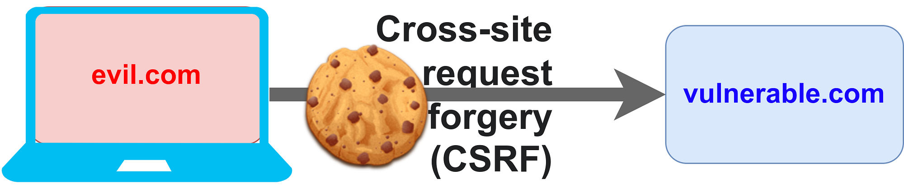

<figure>
    <a href="../images/2022/09/csrf-cross-site-request-forgery-1.png"></a>
    <figcaption>Image created by Martin Thoma</figcaption>
</figure>

A cross-site request forgery attack is one of the web classics. It has recently not been that much in the news anymore as defenses are pretty easy to apply and effective. Still, even big corporations and government organizations had issues with it in 2019 and 2022.

After reading this article, you will know how to apply those attacks and how to defend against them. Let’s get started!

## Why CSRF matters

Admittedly, CSRF attacks with a huge impact didn’t happen for a while. They are also no longer in the OWASP Top 10, but they are still around:

* 2022: Atlassian Jira had a CSRF vulnerability ([source](https://jira.atlassian.com/browse/JRASERVER-73138))
* 2019: Cert-Bund, an official German security website, was vulnerable to a CSRF attack that would have allowed attackers to see non-disclosed vulnerabilities ([source](https://www.golem.de/news/websicherheit-cert-bund-war-anfaellig-fuer-csrf-angriff-1910-144699.html))
* **2012: Millions of DSL modems hacked in Brazil, spread banking malware** ([source](https://thehackernews.com/2012/10/millions-of-dsl-modems-hacked-in-brazil.html), [source](https://nakedsecurity.sophos.com/2012/10/01/hacked-routers-brazil-vb2012/))
* 2008: Home DSL routers were vulnerable ([source](https://www.techrepublic.com/article/csrf-attacks-home-dsl-routers-are-vulnerable/))

## How are CSRF attacks executed?

Let’s say you’re coding a comments section of a blog. The REST endpoint you’re using is `POST /comments`. Of course, it is authenticated. You choose to use a cookie with a session ID.

The problem now is that an attacker could create a completely different website — let’s call it evil.com and your website vulnerable.com. On evil.com could be a form

```html
<form method="post" action="https://vulnerable.com/api/comments">

<input type="text" name="comment" />
<input type="submit" />

</form>
```

The cookies of vulnerable.com are **automatically** sent by the browser — **no matter where the request originated from**! That is the key part.

Hence the attack works as follows:

* Ensure the victim is logged-in to the vulnerable site. The attacker can rely on the fact that nobody logs out anymore.
* The attacker makes the victim visit a web page controlled by the attacker. That page makes the browser send a request — no vulnerability by the browser is needed. Browsers make requests to other websites all the time.
* The browser automatically attaches the session information of the cookie.

As long as the victim is logged-in to the vulnerable page, the attacker can send any information. The attacker cannot read information, though.

## How can I prevent CSRF attacks?

There are several ways that eliminate CSRF vulnerabilities: Anti-CSRF tokens, SameSite Cookies, and non-cookie-based authentication.

### Anti-CSRF Tokens — A fancy Nonce

The page that receives the comment could contain a “secret”. A value that is only known to the original website and user. Before the front end makes a request to comment, it requests that one-time token for that user. The backend knows that only a request which contains this token may be accepted.

Typically, this is called an “Anti-CSRF Token”. You could also call it a “Nonce” — a “**n**umber used **once**”. As a side-effect, it can also prevent duplicate page submits from posting the comment twice. Implementations differ; Anti-CSRF tokens can also be bound to sessions.

### SameSite Cookies

Cookies with the attribute `SameSite=Strict` will only be sent with requests that originate from the same site.

`Strict` provides a perfect defense, but at the cost of usability. `Lax` provides some defense. If you want to learn more, read the following article:

[**Defending against CSRF with SameSite cookies | Web Security Academy** *Some websites defend against CSRF attacks using SameSite cookies. The SameSite attribute can be used to control…*](https://portswigger.net/web-security/csrf/samesite-cookies)

### Content-Type Headers

If your API expects and enforces `Content-Type: application/json` and you don’t fiddle with CORS headers, it might also give you some protection against CSRF attacks. I’m not 100% about this though.

### Non-cookie based authentication

Only cookies are automatically sent with each request by the browser. If you store your credentials in LocalStorage instead, CSRF attacks are no longer possible. You’re avoiding the issue in that case. I love this solution as you cannot forget to do it for some endpoints — in contrast to Anti-CSRF tokens.

However, XSS might be more of a concern:

[**Cross-site Scripting (XSS) 😈** *What it is, why it matters, how they are executed, how to prevent XSS attacks — and how to create a cookie stealer!*](../xss/)

## What about Same-Origin Policy (SOP)?

The same-origin policy is a security mechanism browsers implemented to prevent cross-domain data reading.

Attackers cannot simply include an iframe of a bank and see the contents of the iframe due to cross-domain access control. They can only access it, if the protocol (HTTP / HTTPS), the domain (evil.com / vulnerable.com), and the port (almost always 443 or 80) are identical.

> As a side-note: This is connected to CORS (cross-origin resource sharing). CORS is a way to safely loosen the same-origin policy (SOP).

However, CSRF attacks are not about reading data. CSRF attacks attempt to do an action blindly. That is nothing the same origin policy cares about. Hence SOP / any CORS settings do not protect against CSRF attacks.

## Other Resources

There is an awesome YouTube video that explains CSRF really well:

<iframe width="560" height="315" src="https://www.youtube.com/embed/eWEgUcHPle0" title="YouTube video player" frameborder="0" allowfullscreen></iframe>

And of course, there is a [Computerphile video about CSRF](https://www.youtube.com/watch?v=vRBihr41JTo).

<!-- series: appsec -->
