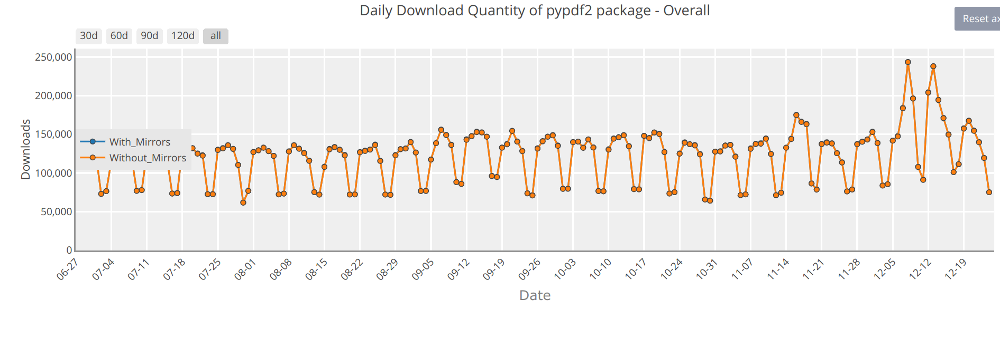

<figure>
    
    <figcaption>PyPDF2 moved back to pypdf in December 2022</figcaption>
</figure>

pypdf is a free and open-source pure-python PDF library capable of splitting, merging, cropping, and transforming the pages of PDF files. It can also add custom data, viewing options, and passwords to PDF files. pypdf can retrieve text, images, and metadata from PDFs as well.

The library has quite a history. It started with pyPdf (2005–2010), continued with PyPDF2 (2011–2016), and had PyPDF3 and PyPDF4 (2018–2022).

## What did we achieve in 2022?

We had tons of achievements in 2022 for PyPDF2 / pypdf and I’m happy that the community was so active. There were a few categories of improvements that I would like to highlight:

* The **text-extraction** capabilities of pypdf were improved by pubpub-zz. According to my [PDF text extraction benchmark](https://github.com/py-pdf/benchmarks) there is still room for improvement, especially when it comes to whitespace. The rest is pretty solid.
* The **encryption/decryption** capabilities of pypdf were improved by [exiledkingcc](https://github.com/exiledkingcc).
* **Project governance** was defined, **documentation** was created, **Continuous Integration (CI)** was set up, and a lot of **tests** were written.
* We moved from PyPDF2 to **pypdf** again. Now we have a name that is all lowercase and without a number — consistently, everywhere. This makes it easier for beginners to know what to install and what to import. It also makes it easier to identify the main project.
* A modern **library interface**: Replacing PdfFileReader with PdfReader, using `len(reader.pages)` instead of `reader.getNumPages()`, `reader.metadata` instead of `reader.getDocumentInfo()`, …

## April 2022 in Numbers

In April 2022, I took over the responsibility of being the PyPDF2 maintainer. The library was already mature: It had a large user base, several other projects that depended on it, the code was working. But the maintainer shifted his focus to other topics in his life. Don’t forget, it’s an unpaid free-time project.

Development Activity:

* **Contributors**: 68
* **Forks**: 1k

Maintenance:

* **Open PRs**: Over 100
* **Open Issues**: 321

Community Engagement:

* **Used by**: 29.1k
* **Questions on Stack Overflow**: 776
* **Watchers**: 153
* **Stars**: 4.1k

## 2022 in Numbers

Development Activity and Maintenance:

* **Contributors**: 158 (+132%)
* **Forks**: 1151 (+15%)
* **PRs**: 526 in total, only 10 left open ([link](https://github.com/py-pdf/pypdf/pulls?q=is%3Apr+created%3A2022-01-01..2023-01-01+))
* **Issues**: 205 in total, 47 left open ([link](https://github.com/py-pdf/pypdf/issues?q=is%3Aissue+created%3A2022-01-01..2023-01-01+))

Community Engagement:

* **Used by**: 38054 (+31%)
* **Questions on Stack Overflow**: 1235
* **Watchers**: 139 (-9%) — I guess there was just too much activity or people were not really interested.
* **Stars**: 5005 (+22%)
* **Downloads**: 4.2 million last month for PyPDF2 ([link](https://pypistats.org/packages/pypdf2)) and 47k for pypdf ([link](https://pypistats.org/packages/pypdf)). PyPDF3 has 301k and PyPDF4 has 48k last month.

<figure>
    
</figure>

## What do we want to achieve in 2023?

We are an open-source project without a big organization behind it. We don’t have paid developers and for that reason, we can’t make a clear roadmap with the features we will deliver.

However, we have a list of [moonshot extensions](https://github.com/py-pdf/pypdf/discussions/1181). Those are hard new features that we want to work on eventually.

We also have [14 issues with handling forms](https://github.com/py-pdf/pypdf/issues?q=is%3Aissue+is%3Aopen+label%3Aworkflow-forms). It would be really nice if we could fix some of those.
