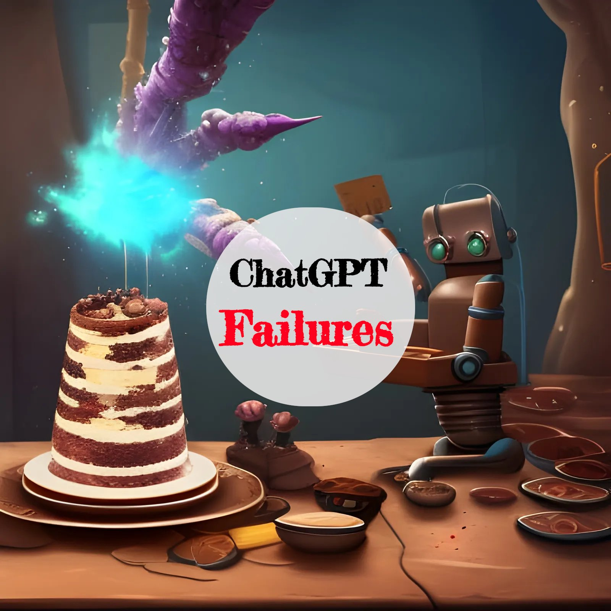
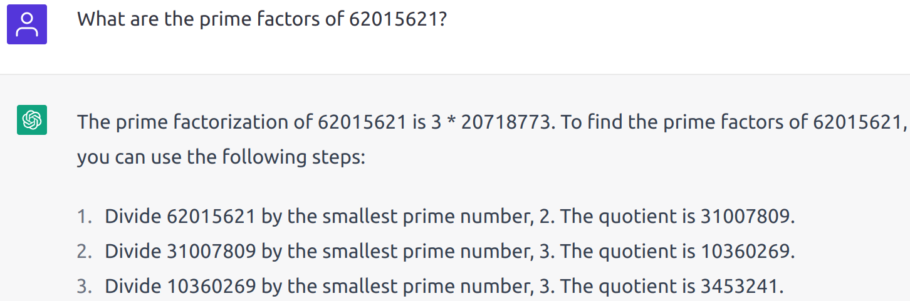
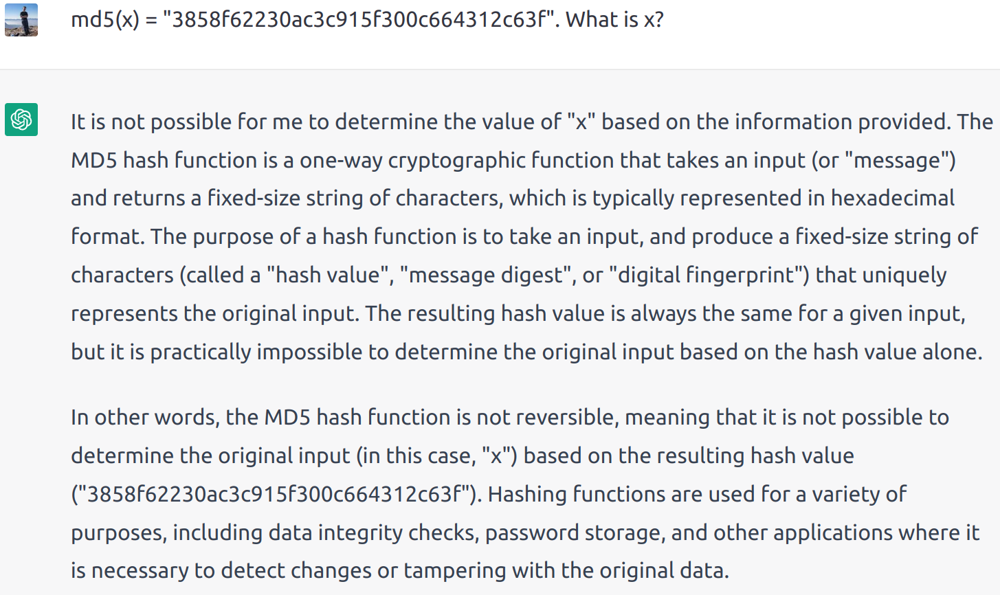

<figure class="ai-generated">
    
</figure>

I’ve just watched a clip of [Jordan Peterson talking about ChatGPT](https://www.youtube.com/watch?v=V-hB-4fnqtM). While [I’m very impressed by ChatGPT](../chatgpt-the-new-ai-tool-everybody-is-talking-about/) as well, I’m certain he is completely wrong with his assessment of the current and future capabilities of ChatGPT.

It’s hard to estimate what we will be able to do in the future, but let me show you some things that ChatGPT **cannot** do right now.

## №1: Code Generation

> Prompt: “Create a Pong game with pygame”

That’s a rather simple task for a reasonably experienced software developer. ChatGPT also generates something, but there are several issues:

1. The player does not have any way to control the paddle
1. The opponent is not doing anything
1. Collision detection of the ball with the paddle is missing
1. The screen is not refreshed — the new paddle is just printed on top of the last printed screen.

## №2: Writing Mathematical Proofs

> Prompt: “Prove P vs NP”

We have several open mathematical problems. [The 7 Millennium problems](https://en.wikipedia.org/wiki/Millennium_Prize_Problems) are the most famous ones. If any of them got solved, the person who solved it gets a US\$1 million prize. They were defined in 2000 and by 2022 only one is solved so far.

There are other open problems as well. Some others are the Collatz conjecture, the Goldbach Conjecture, and the Hodge conjecture.

But you don’t have to make it that complicated. I just prompted ChatGPT with some of the tasks I got as a first-term undergraduate in mathematics. It failed.

## №3: Computing Prime Factors

<figure>
    
</figure>

> Prompt: “What are the prime factors of 62015621?”

ChatGPT is a question-answering system. It uses data that is already out there but combines it in a very clever way. It cannot use tools, which is easily seen for computational tasks. This specific factorization task was probably never asked on the Internet. ChatGPT hasn’t seen the answer. So it cannot answer the question. Even worse, it doesn’t even understand that it is completely and utterly wrong.

This task is trivial for a software developer.

## №4: Reverse a hash function

<figure>
    
</figure>

> Prompt: md5(x) = “3858f62230ac3c915f300c664312c63f”. What is x?

Again, ChatGPT gave a very elaborate answer. It’s kind of right… but it misses some important things. You can just do trial and error, e.g. with a dictionary or a precomputed [rainbow table](https://en.wikipedia.org/wiki/Rainbow_table). That's something you learn in the 4th semester of computer science (undergraduate). [John the Ripper](https://en.wikipedia.org/wiki/John_the_Ripper) and [Hashcat](https://en.wikipedia.org/wiki/Hashcat) are tools that make those tries very quick.

Or you could simply Google for the hash.

## №5: Rhymes in German

I’ve created a pretty nice love poem in English with ChatGPT. It had details of my relationship with my wife in it. Pretty awesome.

I tried to do the same in German, but ChatGPT failed to make it rhyme. I tried it a lot of times.

This is a random failure which I don’t understand. That should even be easier than in English, as words that end with the same letters usually rhyme in German.

## №6: Current Data

<figure class="ai-generated">
    
    <figcaption>Created by Martin Thoma via <a href="https://creator.nightcafe.studio/creation/DYVjB6nuQ64KeSxhtVt2">NightCafe</a></figcaption>
</figure>

ChatGPT cannot use current data. And it cannot use tools. That means it cannot tell you how the weather will be tomorrow. It cannot tell you the current price of Microsoft stocks. It cannot give you a summary of current events.

## №7: Vagueness and missing guidance

In many cases, people don’t know how to ask questions properly. They lack the knowledge to do so. Some examples are “Why is my computer/printer not working”.

If you ask “Do I need a visa to go to the US?”, you will see that **ChatGPT struggles with vagueness**. A person would directly ask questions to get the details:

* How long do you want to stay in the US?
* What is your nationality?
* Why do you go to the US?

**ChatGPT cannot guide**: In consulting, you might even learn to point the person into a different direction than the person originally asked because it’s more in their interest than what they originally had in mind.

## Summary

**ChatGPT is amazing** but has obvious limitations. Some of the limitations are relatively clear, like **tool use** and incorporating **more recent data**. Other limitations are more substantial: How can we make it generate code?

Think of ChatGPT as a pretty amazing **search engine**. It cannot invent what doesn’t exist. It can just re-combine.
