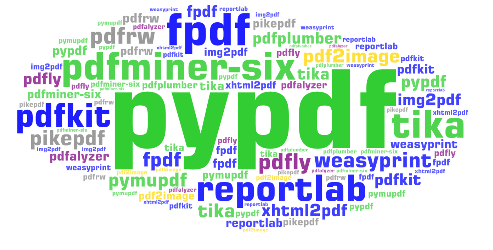

<figure>
    
    <figcaption>The Python PDF ecosystem: The sizes correlate with the download numbers (a few projects were merged), text extraction libraries are green, PDF generation libraries are blue, and applications are purple. The image was generated by Martin Thoma.</figcaption>
</figure>

The Python PDF ecosystem is a mess. There are tons of packages on PyPI, but many of them are inactive. As I had the dubious fortune of having to work with PDF documents a couple of times in my career as a Python developer, let me guide you through this jungle.

Although people have [all kinds of Python/PDF-related issues](https://stackoverflow.com/questions/tagged/python+pdf+-pypdf+-pdfminer+-pandas+-python-imaging-library+-weasyprint+-flask+-django+-reportlab+-matplotlib+-pikepdf+-tabula+-selenium-webdriver+-wkhtmltopdf+-pdfrw+-ghostscript+-vba), most are around three topics: (1) Read text from PDF documents (2) Read tables from PDF documents (3) Generate PDF documents. I’ll focus on those.

Full disclosure: I am the maintainer of pypdf and PyPDF2. I am biased when it comes to those libraries.

## The Top Libraries by PyPI Download Statistics 🏆

The PyPI download statistics from [March 2023](https://hugovk.github.io/top-pypi-packages/) (30 days, ending in 2023–03–01 09:13:26):

* 588\. [pypdf2](https://pypi.org/project/PyPDF2/), downloaded 4,642,155× — inactive, use pypdf
* 824\. [**pdfminer-six**](https://pypi.org/project/pdfminer.six/) ([SO](https://stackoverflow.com/questions/tagged/pdfminer)), downloaded 2,883,693×, used by textract
* 944\. [**reportlab**](https://pypi.org/project/reportlab/) ([SO](https://stackoverflow.com/questions/tagged/reportlab)), downloaded 2,194,928×
* 1,577\. [fpdf](https://pypi.org/project/fpdf/), downloaded 838,745× — inactive, use [fpdf2](https://pypi.org/project/fpdf2/)
* 1,647\. [**weasyprint**](https://pypi.org/project/weasyprint/) ([SO](https://stackoverflow.com/questions/tagged/weasyprint)), downloaded 764,438×
* 1,701\. [**pdfkit**](https://pypi.org/project/pdfkit/) ([SO](https://stackoverflow.com/questions/tagged/pdfkit)), downloaded 713,056×
* 1,810\. [**pdf2image**](https://pypi.org/project/pdf2image/) ([SO](https://stackoverflow.com/questions/tagged/pdf2image)), downloaded 619,182×
* 1,983\. [xhtml2pdf](https://pypi.org/project/xhtml2pdf/) ([SO](https://stackoverflow.com/questions/tagged/xhtml2pdf)), downloaded 506,259× — uses reportlab
* 2,089\. [**pymupdf**](https://pypi.org/project/PyMuPDF/) ([SO](https://stackoverflow.com/questions/tagged/pymupdf)), downloaded 450,426×
* 2,107\. [**pikepdf**](https://pypi.org/project/pikepdf/) ([SO](https://stackoverflow.com/questions/tagged/pikepdf)), downloaded 443,106×
* 2,350\. [**pdfplumber**](https://pypi.org/project/pdfplumber/) ([SO](https://stackoverflow.com/questions/tagged/pdfplumber)), downloaded 358,563× — uses pdfminer.six
* 2,430\. [**pyhanko**](https://pypi.org/project/pyHanko/) ([SO](https://stackoverflow.com/questions/tagged/pyhanko)), downloaded 333,172×
* 2,599\. Apache [**tika**](https://pypi.org/project/tika/) ([SO](https://stackoverflow.com/questions/tagged/apache-tika)), downloaded 294,887×
* 2,715\. [**pypdf**](https://pypi.org/project/pypdf/) ([SO](https://stackoverflow.com/questions/tagged/pypdf)), downloaded 269,823×
* 2,835\. [**fpdf2**](https://pypi.org/project/fpdf2/) ([SO](https://stackoverflow.com/questions/tagged/pyfpdf)), downloaded 244,516×
* 2,839\. pypdf3, downloaded 243,892× — inactive, use pypdf
* 3,260\. [**tabula-py**](https://pypi.org/project/tabula-py/) ([SO](https://stackoverflow.com/questions/tagged/tabula-py)), downloaded 176,789× — wrapper for tabula-java
* 3,334\. pdfrw, downloaded 168,797× — inactive, use pypdf
* 3,448\. pdfminer, downloaded 156,558×, inactive, use pdfminer.six
* 3,580\. [**sphinxcontrib-svg2pdfconverter**](https://pypi.org/project/sphinxcontrib-svg2pdfconverter/), downloaded 144,795×
* 3,703\. [**img2pdf**](https://pypi.org/project/img2pdf/), downloaded 134,859×
* 4,242\. [**camelot-py**](https://pypi.org/project/camelot-py/) ([SO](https://stackoverflow.com/questions/tagged/python-camelot)), downloaded 100,638×
* 4,572\. [pdfservices-sdk](https://pypi.org/project/pdfservices-sdk/) ([SO](https://stackoverflow.com/questions/tagged/adobe-pdfservices)), downloaded 86,805×

PyPI download statistics don’t represent popularity properly. People who have automatic Continuous Integration (CI) systems / build systems download their packages again and again. They easily make it appear as if the package is used all the time. That is an inherent skew towards libraries/frameworks used in web development.

Some projects have Anaconda packages and even Debian / Ubuntu packages. That reduces the number of PyPI downloads.

There are some libraries where the users should obviously migrate:

* **Use pypdf**: There is no good reason to use PyPDF2, PyPDF3, PyPDF4 anymore
* **Use pdfminer-six**: Why do people still use pdfminer?
* **Use fpdf2**: fpdf was last updated in 2018 and doesn’t support Python 3.9.

## Text Extraction from PDF Documents 📖

If you simply want to get the complete text of a PDF page, but don’t care about its exact position, my [PDF text extraction benchmark](https://github.com/py-pdf/benchmarks) shows the best choices:

* **pypdfium2** (Apache-2.0 or BSD-3-Clause license): It’s fast and the text extraction is very good. The only downside might be that it might be hard to install as it relies on PDFium (Apache 2.0 license) which is a C++ project.
* **Apache Tika** (Apache-2.0 license) is a little bit slower and a little bit worse in text extraction quality, but still excellent. It is a Java project and the server has to be started, so the first run might be slow.
* **PyMuPDF** (GNU AFFERO GPL 3.0 / Commercial), also called “fitz”, is on-par with Tika. It relies on MuPDF by Artifex Software, Inc. under AGPLv3. It’s a C project and thus might come with the same installation issues as pypdfium2 / tika. The commercial license is something you need to check.
* **pypdf** (BSD license) is a pure Python project. I became the maintainer of it in April 2022 and since then we could improve its quality a lot. Its text extraction speed is roughly 10x — 20x slower than the one of pypdfium2/tika/PyMuPDF. The text extraction quality is roughly the same, but the other three projects deal better with whitespaces. PyPDF2, PyPDF3, PyPDF4 should no longer be used. They are forks of pypdf which are far behind in development and no longer maintained. **Use pypdf**.

If you want some **extra information**, e.g. [which font was used for a specific word](https://stackoverflow.com/questions/34606382/pdfminer-extract-text-with-its-font-information) or [where exactly the character is](https://stackoverflow.com/questions/22898145/how-to-extract-text-and-text-coordinates-from-a-pdf-file/69151177#69151177) on the page, then use [pdfminer.six](https://pypi.org/project/pdfminer.six/) or [pdfplumber](https://pypi.org/project/pdfplumber/) (built on pdfminer.six). Their text extraction quality is worse than the one of the other four libraries, though.

**Extracting tables** is another special case of text extracting. camelot-py, tabula-py, and pdfplumber approach this.

A completely different topic is extracting text from images (or scanned PDF documents). That is OCR. Try tesseract for that task.

## Generating PDF Documents 🔨

I see two reasonable choices to create PDF documents:

1. **Create the raw PDF from code**: Here [reportlab](https://pypi.org/project/reportlab/) is the only option I have tried so far, but [fpdf2](https://pypi.org/project/fpdf2/) also exists.
edit: As the maintainer of pypdf and PyPDF2, I will work more closely with fpdf2 in future. They seem to have a good community and the project seems well-managed!
1. **Create an intermediate format and convert it to PDF**: There are several options, e.g. [pdfkit](https://pypi.org/project/pdfkit/) or [xhtml2pdf](https://pypi.org/project/xhtml2pdf/) (using HTML) or [pdflatex](https://tex.stackexchange.com/q/179772/5645) (using LaTeX). There are certainly way more, e.g. docx2pdf. I haven’t used those, though.
1. **Images**: You can convert SVG to PDF via [sphinxcontrib-svg2pdfconverter](https://pypi.org/project/sphinxcontrib-svg2pdfconverter/) and other images via [img2pdf](https://pypi.org/project/img2pdf/).

In all cases, you can add metadata with pypdf.

## Reading and Writing PDF Metadata 📝

Reading and writing PDF metadata with Python can be done with multiple libraries:

* pypdf, see the docs on how to [read/write PDF metadata](https://pypdf.readthedocs.io/en/latest/user/metadata.html)
* PyMuPDF ([docs](https://pymupdf.readthedocs.io/en/latest/document.html#Document.metadata))
* pikepdf ([docs](https://pikepdf.readthedocs.io/en/latest/topics/metadata.html))

## Signing a PDF Document

pyhanko is the only option here.

## Python PDF Applications 👩💻

* [**pdfly**](https://pypi.org/project/pdfly/): View metadata, create a 2-up booklet, compress a PDF, extract text, and concatenate PDFs.
* [**pdfalyzer**](https://github.com/michelcrypt4d4mus/pdfalyzer): In-depth analysis of PDF files

## There is so much more 😲

If you go outside of the Python ecosystem there is obviously much more. See the PDF awesomelist:

[**GitHub - py-pdf/awesome-pdf: A curated list of resources around PDF files** *A curated list of resources around PDF files KOReader: a document viewer primarily aimed at e-ink readers…*](https://github.com/py-pdf/awesome-pdf)
